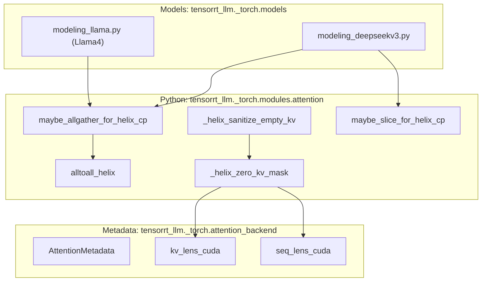
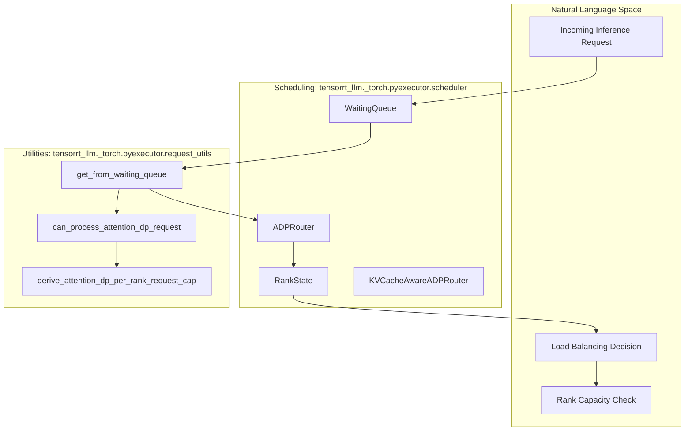

<!-- source: DeepWiki mcp.deepwiki.com · repo NVIDIA/TensorRT-LLM · page 14.4 Context Parallelism and Attention DP · fetched 2026-10-26 -->

# Context Parallelism and Attention DP

Relevant source files

The following files were used as context for generating this wiki page:

- [cpp/tensorrt_llm/common/lamportUtils.cuh](cpp/tensorrt_llm/common/lamportUtils.cuh)
- [cpp/tensorrt_llm/kernels/communicationKernels/customLowPrecisionAllReduceKernels.cu](cpp/tensorrt_llm/kernels/communicationKernels/customLowPrecisionAllReduceKernels.cu)
- [cpp/tensorrt_llm/kernels/communicationKernels/customLowPrecisionAllReduceKernels.h](cpp/tensorrt_llm/kernels/communicationKernels/customLowPrecisionAllReduceKernels.h)
- [cpp/tensorrt_llm/kernels/communicationKernels/mnnvlAllreduceKernels.cu](cpp/tensorrt_llm/kernels/communicationKernels/mnnvlAllreduceKernels.cu)
- [cpp/tensorrt_llm/kernels/communicationKernels/mnnvlAllreduceKernels.h](cpp/tensorrt_llm/kernels/communicationKernels/mnnvlAllreduceKernels.h)
- [cpp/tensorrt_llm/kernels/customAllReduceKernels.h](cpp/tensorrt_llm/kernels/customAllReduceKernels.h)
- [cpp/tensorrt_llm/thop/allreduceOp.cpp](cpp/tensorrt_llm/thop/allreduceOp.cpp)
- [cpp/tensorrt_llm/thop/thUtils.h](cpp/tensorrt_llm/thop/thUtils.h)
- [tensorrt_llm/_torch/compilation/backend.py](tensorrt_llm/_torch/compilation/backend.py)
- [tensorrt_llm/_torch/compilation/patterns/ar_residual_norm.py](tensorrt_llm/_torch/compilation/patterns/ar_residual_norm.py)
- [tensorrt_llm/_torch/compilation/piecewise_optimizer.py](tensorrt_llm/_torch/compilation/piecewise_optimizer.py)
- [tensorrt_llm/_torch/compilation/utils.py](tensorrt_llm/_torch/compilation/utils.py)
- [tensorrt_llm/_torch/distributed/__init__.py](tensorrt_llm/_torch/distributed/__init__.py)
- [tensorrt_llm/_torch/distributed/ops.py](tensorrt_llm/_torch/distributed/ops.py)
- [tensorrt_llm/_torch/pyexecutor/adp_iter_stats.py](tensorrt_llm/_torch/pyexecutor/adp_iter_stats.py)
- [tensorrt_llm/_torch/pyexecutor/kv_cache_stats.py](tensorrt_llm/_torch/pyexecutor/kv_cache_stats.py)
- [tensorrt_llm/_torch/pyexecutor/perf_metrics_manager.py](tensorrt_llm/_torch/pyexecutor/perf_metrics_manager.py)
- [tensorrt_llm/_torch/pyexecutor/request_utils.py](tensorrt_llm/_torch/pyexecutor/request_utils.py)
- [tensorrt_llm/_torch/pyexecutor/scheduler/__init__.py](tensorrt_llm/_torch/pyexecutor/scheduler/__init__.py)
- [tensorrt_llm/_torch/pyexecutor/scheduler/adp_router.py](tensorrt_llm/_torch/pyexecutor/scheduler/adp_router.py)
- [tensorrt_llm/_torch/pyexecutor/scheduler/waiting_queue.py](tensorrt_llm/_torch/pyexecutor/scheduler/waiting_queue.py)
- [tensorrt_llm/functional.py](tensorrt_llm/functional.py)
- [tensorrt_llm/scheduling_params.py](tensorrt_llm/scheduling_params.py)
- [tests/unittest/_torch/executor/test_adp_router.py](tests/unittest/_torch/executor/test_adp_router.py)
- [tests/unittest/_torch/executor/test_perf_metrics_manager.py](tests/unittest/_torch/executor/test_perf_metrics_manager.py)
- [tests/unittest/_torch/executor/test_request_utils.py](tests/unittest/_torch/executor/test_request_utils.py)
- [tests/unittest/_torch/executor/test_waiting_queue.py](tests/unittest/_torch/executor/test_waiting_queue.py)
- [tests/unittest/_torch/multi_gpu/test_allreduce.py](tests/unittest/_torch/multi_gpu/test_allreduce.py)
- [tests/unittest/_torch/multi_gpu/test_mnnvl_allreduce.py](tests/unittest/_torch/multi_gpu/test_mnnvl_allreduce.py)
- [tests/unittest/_torch/multi_gpu/test_user_buffers.py](tests/unittest/_torch/multi_gpu/test_user_buffers.py)
- [tests/unittest/_torch/multi_gpu_modeling/test_deepseek.py](tests/unittest/_torch/multi_gpu_modeling/test_deepseek.py)
- [tests/unittest/executor/test_stats_serializer.py](tests/unittest/executor/test_stats_serializer.py)
- [tests/unittest/llmapi/test_request_priority.py](tests/unittest/llmapi/test_request_priority.py)

Context Parallelism (CP) and Attention Data Parallelism (Attention DP) are distributed execution strategies designed to handle long input sequences that exceed the memory or computational capacity of a single GPU. These techniques partition sequences across multiple GPUs during the attention computation, enabling efficient processing of very long contexts by distributing the sequence length dimension.

This page covers the implementation of CP and DP approaches in TensorRT-LLM:
- **Helix Parallelism**: An optimized CP variant that uses position offsets and inactive rank markers to coordinate attention across ranks, particularly optimized for Multi-head Latent Attention (MLA) and DeepSeek architectures.
- **Attention Data Parallelism (ADP)**: A strategy where different GPUs process different parts of the batch or sequence, often combined with CP to balance workloads.
- **MNNVL AllReduce**: A specialized communication backend for Blackwell (GB200) architectures that provides high-bandwidth, low-latency collectives for sharded contexts [tensorrt_llm/_torch/distributed/ops.py:93-151]().

## Helix Parallelism

### Overview
Helix is a specialized context parallelism strategy optimized for architectures like DeepSeek-V3/V4. It utilizes position-based inactive rank markers and position offsets to manage attention across distributed ranks. Helix CP leverages specialized memory management and communication primitives to reduce the KV cache communication overhead.

Key components in the Python layer:
- **`alltoall_helix`**: A specialized all-to-all primitive used for sequence redistribution in Helix CP [tensorrt_llm/_torch/modules/attention.py:22-23]().
- **`HelixAllToAllNative`**: A native implementation of the Helix all-to-all operation [tensorrt_llm/_torch/modules/attention.py:22-22]().
- **`maybe_allgather_for_helix_cp`**: Utility to perform all-gather operations specifically for Helix context parallel sharding [tensorrt_llm/_torch/modules/attention.py:1175]().
- **`maybe_slice_for_helix_cp`**: Utility to slice tensors according to Helix CP rank ownership [tensorrt_llm/_torch/modules/attention.py:1175]().
- **`HelixCpMnnvlMemory`**: Integrates Helix context parallelism with MNNVL memory for zero-copy or low-latency transfers on NVLink-connected systems [tensorrt_llm/_torch/distributed/ops.py:10-10]().

### Helix Attention Logic
In Helix parallelism, the implementation coordinates how different ranks attend to the KV cache. A CP rank that owns no KV blocks for a token attends to zero keys, which would normally result in a NaN due to zero softmax normalization. Helix implements a "sanitize" mechanism to force these rows to a no-op contribution.

- **`_helix_zero_kv_mask`**: Generates a per-token boolean mask marking tokens with zero local KV on a specific CP rank using `kv_lens_cuda` and `seq_lens_cuda` [tensorrt_llm/_torch/modules/attention.py:125-161]().
- **`_helix_sanitize_empty_kv`**: Forces zero-local-KV rows to contribute softmax stats of `(-inf, 0)` and a zeroed partial output to ensure they act as a no-op during the global Helix combine [tensorrt_llm/_torch/modules/attention.py:163-189]().

Title: Helix CP Attention Flow (Code Entity Space)

**Sources:** [tensorrt_llm/_torch/modules/attention.py:125-189](), [tensorrt_llm/_torch/modules/attention.py:1175](), [tensorrt_llm/_torch/models/modeling_deepseekv3.py:59-60](), [tensorrt_llm/_torch/distributed/ops.py:10-10]()

## Attention Data Parallelism (ADP)

Attention DP allows for scaling the attention mechanism by parallelizing across the batch dimension, often used in conjunction with CP for very large models.

### ADP Routing and Load Balancing
ADP employs a routing mechanism to distribute requests across DP ranks. The core of this logic resides in the `ADPRouter` and its specializations [tensorrt_llm/_torch/pyexecutor/scheduler/adp_router.py:147-162]().

- **`RankState`**: Represents the state of a specific rank (active requests, tokens) shared via allgather before routing. It includes `num_active_requests` and `num_active_tokens` [tensorrt_llm/_torch/pyexecutor/scheduler/adp_router.py:91-102]().
- **`DefaultADPRouter`**: Implements load-balanced routing using a min-heap to assign requests to the least loaded ranks based on token and request counts [tensorrt_llm/_torch/pyexecutor/scheduler/adp_router.py:13-14]().
- **`KVCacheAwareADPRouter`**: Factors in prefix match length from the KV cache radix tree to improve cache hit rates across ranks [tensorrt_llm/_torch/pyexecutor/scheduler/adp_router.py:14-16]().
- **`ConversationAwareADPRouter`**: A router that prioritizes routing requests from the same conversation to the same rank to maximize KV cache reuse [tests/unittest/_torch/executor/test_adp_router.py:19-20]().
- **`RankIterStatsPayload`**: Piggybacks iteration statistics (e.g., number of context/generation requests, KV tokens) on the ADP allgather to inform routing decisions [tensorrt_llm/_torch/pyexecutor/scheduler/adp_router.py:51-62]().

### ADP Capacity and Scheduling
The scheduler enforces per-rank request limits to ensure that the token load per step does not exceed hardware capacity.

- **`derive_attention_dp_per_rank_request_cap`**: Calculates a tighter request cap by factoring in `max_total_draft_tokens` for speculative decoding, ensuring `max_num_tokens` is not exceeded per rank [tensorrt_llm/_torch/pyexecutor/request_utils.py:77-102]().
- **`can_process_attention_dp_request`**: A predicate used by the scheduler to check if a request with a specific `attention_dp_rank` can be admitted based on current rank occupancy [tensorrt_llm/_torch/pyexecutor/request_utils.py:104-130]().
- **`get_from_waiting_queue`**: Orchestrates the popping of requests from the `WaitingQueue` while respecting ADP rank assignments and strict/relaxed placement rules [tensorrt_llm/_torch/pyexecutor/request_utils.py:132-188]().

Title: ADP Request Lifecycle (Natural Language to Code)

**Sources:** [tensorrt_llm/_torch/pyexecutor/scheduler/adp_router.py:91-162](), [tensorrt_llm/_torch/pyexecutor/request_utils.py:77-188](), [tests/unittest/_torch/executor/test_adp_router.py:174-200]()

## Implementation Details

### MNNVL Communication for Context Sharding
Blackwell systems use the MNNVL (Multi-Node NVLink) backend to optimize all-reduce operations during sharded attention.

- **`get_or_scale_allreduce_mnnvl_workspace`**: Dynamically manages the MNNVL workspace size based on current sequence lengths and token counts [tensorrt_llm/_torch/distributed/ops.py:93-140]().
- **`McastGPUBuffer`**: A C++ binding for multicast GPU buffers used by MNNVL to perform efficient one-shot and two-shot all-reduces [tensorrt_llm/_torch/distributed/ops.py:144-151]().
- **`AllReduceStrategy.MNNVL`**: The strategy enum used to trigger specialized MNNVL kernels [tensorrt_llm/functional.py:117-117]().

### Model-Specific CP Integration
Several multimodal and large-scale models integrate these sharding techniques:

- **DeepSeek-V3**: Utilizes `maybe_allgather_for_helix_cp` and `maybe_slice_for_helix_cp` within the `DeepseekV3Moe` and attention blocks. In tests, `enable_attention_dp` is explicitly toggled based on `tp_size` [tests/unittest/_torch/multi_gpu_modeling/test_deepseek.py:53-80]().
- **Qwen2-VL**: Implements `_prepare_qwen_vl_vision_attn_metadata` to handle no-cache, context-only attention for vision towers, optimizing host work via `prepare_encoder_only()` [tensorrt_llm/_torch/models/modeling_qwen2vl.py:86-137]().
- **Llama4**: Integrates `maybe_execute_in_parallel` for QK normalization and RoPE application, supporting chunked attention sharding [tensorrt_llm/_torch/models/modeling_llama.py:111-157]().

### Star Attention Context Partitioning
For Star Attention CP, the context is partitioned into blocks using `partition_context_for_star_attention`. This function divides `input_token_ids` among CP ranks while accounting for `tokens_per_block` [tensorrt_llm/_torch/pyexecutor/request_utils.py:191-200]().

### ADP Configuration and Factory
The `ADPRouter.create` factory method determines the routing strategy based on the `AttentionDpConfig`. If block reuse is enabled in the `kv_cache_manager`, it defaults to `KVCacheAwareADPRouter` to optimize for prefix hits [tensorrt_llm/_torch/pyexecutor/scheduler/adp_router.py:170-192]().

**Sources:** [tensorrt_llm/_torch/pyexecutor/scheduler/adp_router.py:1-192](), [tensorrt_llm/_torch/pyexecutor/request_utils.py:77-200](), [tensorrt_llm/_torch/modules/attention.py:125-189](), [tensorrt_llm/_torch/distributed/ops.py:93-151](), [tensorrt_llm/functional.py:108-119]()

---

