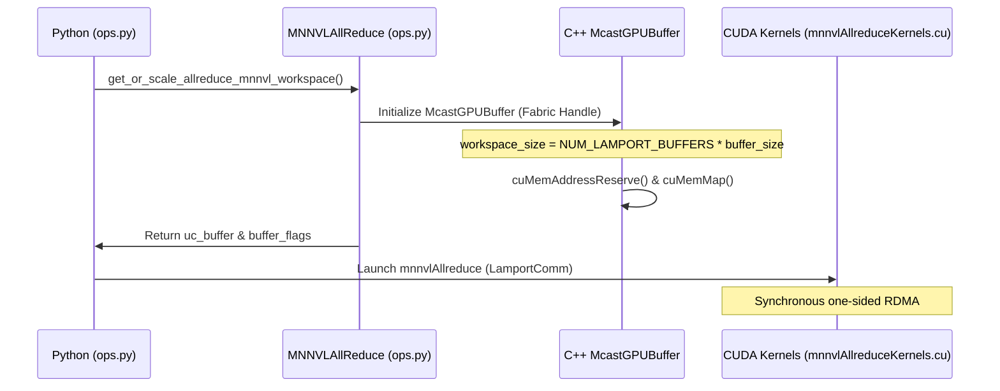

<!-- source: DeepWiki mcp.deepwiki.com · repo NVIDIA/TensorRT-LLM · page 14.5 Communication Operations and Backends · fetched 2026-10-26 -->

# Communication Operations and Backends

<details>
<summary>Relevant source files</summary>

The following files were used as context for generating this wiki page:

- [cpp/include/tensorrt_llm/runtime/ipcNvlsMemory.h](cpp/include/tensorrt_llm/runtime/ipcNvlsMemory.h)
- [cpp/tensorrt_llm/common/customAllReduceUtils.h](cpp/tensorrt_llm/common/customAllReduceUtils.h)
- [cpp/tensorrt_llm/common/lamportUtils.cuh](cpp/tensorrt_llm/common/lamportUtils.cuh)
- [cpp/tensorrt_llm/common/ncclUtils.cpp](cpp/tensorrt_llm/common/ncclUtils.cpp)
- [cpp/tensorrt_llm/common/ncclUtils.h](cpp/tensorrt_llm/common/ncclUtils.h)
- [cpp/tensorrt_llm/common/nvmlWrapper.cpp](cpp/tensorrt_llm/common/nvmlWrapper.cpp)
- [cpp/tensorrt_llm/common/nvmlWrapper.h](cpp/tensorrt_llm/common/nvmlWrapper.h)
- [cpp/tensorrt_llm/common/opUtils.cpp](cpp/tensorrt_llm/common/opUtils.cpp)
- [cpp/tensorrt_llm/common/opUtils.h](cpp/tensorrt_llm/common/opUtils.h)
- [cpp/tensorrt_llm/kernels/communicationKernels/allReduceFusionKernels.cu](cpp/tensorrt_llm/kernels/communicationKernels/allReduceFusionKernels.cu)
- [cpp/tensorrt_llm/kernels/communicationKernels/allReduceFusionKernels.h](cpp/tensorrt_llm/kernels/communicationKernels/allReduceFusionKernels.h)
- [cpp/tensorrt_llm/kernels/communicationKernels/allReduceWorkspace.cu](cpp/tensorrt_llm/kernels/communicationKernels/allReduceWorkspace.cu)
- [cpp/tensorrt_llm/kernels/communicationKernels/allReduceWorkspace.h](cpp/tensorrt_llm/kernels/communicationKernels/allReduceWorkspace.h)
- [cpp/tensorrt_llm/kernels/communicationKernels/customLowPrecisionAllReduceKernels.cu](cpp/tensorrt_llm/kernels/communicationKernels/customLowPrecisionAllReduceKernels.cu)
- [cpp/tensorrt_llm/kernels/communicationKernels/customLowPrecisionAllReduceKernels.h](cpp/tensorrt_llm/kernels/communicationKernels/customLowPrecisionAllReduceKernels.h)
- [cpp/tensorrt_llm/kernels/communicationKernels/mnnvlAllreduceKernels.cu](cpp/tensorrt_llm/kernels/communicationKernels/mnnvlAllreduceKernels.cu)
- [cpp/tensorrt_llm/kernels/communicationKernels/mnnvlAllreduceKernels.h](cpp/tensorrt_llm/kernels/communicationKernels/mnnvlAllreduceKernels.h)
- [cpp/tensorrt_llm/kernels/communicationKernels/moeAllReduceFusionKernels.cu](cpp/tensorrt_llm/kernels/communicationKernels/moeAllReduceFusionKernels.cu)
- [cpp/tensorrt_llm/kernels/customAllReduceKernels.h](cpp/tensorrt_llm/kernels/customAllReduceKernels.h)
- [cpp/tensorrt_llm/kernels/cutlass_kernels/allreduce_gemm/allreduce_gemm_impl_sm100.h](cpp/tensorrt_llm/kernels/cutlass_kernels/allreduce_gemm/allreduce_gemm_impl_sm100.h)
- [cpp/tensorrt_llm/kernels/cutlass_kernels/allreduce_gemm/allreduce_gemm_impl_sm90.h](cpp/tensorrt_llm/kernels/cutlass_kernels/allreduce_gemm/allreduce_gemm_impl_sm90.h)
- [cpp/tensorrt_llm/kernels/cutlass_kernels/allreduce_gemm/allreduce_gemm_runner.cu](cpp/tensorrt_llm/kernels/cutlass_kernels/allreduce_gemm/allreduce_gemm_runner.cu)
- [cpp/tensorrt_llm/runtime/ipcNvlsMemory.cu](cpp/tensorrt_llm/runtime/ipcNvlsMemory.cu)
- [cpp/tensorrt_llm/runtime/ncclCommunicator.cpp](cpp/tensorrt_llm/runtime/ncclCommunicator.cpp)
- [cpp/tensorrt_llm/thop/allreduceOp.cpp](cpp/tensorrt_llm/thop/allreduceOp.cpp)
- [cpp/tensorrt_llm/thop/fusedGemmAllreduceOp.cpp](cpp/tensorrt_llm/thop/fusedGemmAllreduceOp.cpp)
- [cpp/tensorrt_llm/thop/thUtils.h](cpp/tensorrt_llm/thop/thUtils.h)
- [cpp/tests/unit_tests/multi_gpu/ncclUtilsTest.cpp](cpp/tests/unit_tests/multi_gpu/ncclUtilsTest.cpp)
- [cpp/tests/unit_tests/runtime/ipcNvlsMemoryTest.cpp](cpp/tests/unit_tests/runtime/ipcNvlsMemoryTest.cpp)
- [tensorrt_llm/_torch/compilation/backend.py](tensorrt_llm/_torch/compilation/backend.py)
- [tensorrt_llm/_torch/compilation/patterns/ar_residual_norm.py](tensorrt_llm/_torch/compilation/patterns/ar_residual_norm.py)
- [tensorrt_llm/_torch/compilation/piecewise_optimizer.py](tensorrt_llm/_torch/compilation/piecewise_optimizer.py)
- [tensorrt_llm/_torch/compilation/utils.py](tensorrt_llm/_torch/compilation/utils.py)
- [tensorrt_llm/_torch/distributed/__init__.py](tensorrt_llm/_torch/distributed/__init__.py)
- [tensorrt_llm/_torch/distributed/ops.py](tensorrt_llm/_torch/distributed/ops.py)
- [tensorrt_llm/functional.py](tensorrt_llm/functional.py)
- [tests/microbenchmarks/all_reduce.py](tests/microbenchmarks/all_reduce.py)
- [tests/scripts/allreduce_perf/README.md](tests/scripts/allreduce_perf/README.md)
- [tests/scripts/allreduce_perf/allreduce_heuristic_code_gen.py](tests/scripts/allreduce_perf/allreduce_heuristic_code_gen.py)
- [tests/scripts/allreduce_perf/allreduce_perf_viz.py](tests/scripts/allreduce_perf/allreduce_perf_viz.py)
- [tests/unittest/_torch/multi_gpu/test_allreduce.py](tests/unittest/_torch/multi_gpu/test_allreduce.py)
- [tests/unittest/_torch/multi_gpu/test_mnnvl_allreduce.py](tests/unittest/_torch/multi_gpu/test_mnnvl_allreduce.py)
- [tests/unittest/_torch/multi_gpu/test_user_buffers.py](tests/unittest/_torch/multi_gpu/test_user_buffers.py)
- [tests/unittest/_torch/multi_gpu_modeling/test_deepseek.py](tests/unittest/_torch/multi_gpu_modeling/test_deepseek.py)

</details>


## Purpose and Scope

This document describes the communication infrastructure used for distributed inference in TensorRT-LLM, with a focus on collective operations like AllReduce and AllToAll. These operations enable Tensor Parallelism (TP), Expert Parallelism (EP), and Attention Data Parallelism (DP) by synchronizing data across multiple GPUs and nodes.

TensorRT-LLM supports multiple communication backends including **NCCL**, **MNNVL** (Multi-Node NVLink), **UserBuffers (UB)**, and **Symmetric Memory** optimizations to minimize latency in high-bandwidth interconnect environments.

---

## Communication Architecture and Entities

The communication system bridges high-level Python operations to highly optimized C++ and CUDA kernels.

### Python to C++ Entity Mapping

The following diagram illustrates how Python-level communication requests are dispatched to the underlying C++ runtime and kernels.

**Communication Dispatch Flow**
```mermaid
graph TD
    subgraph "Python_Space_(tensorrt_llm._torch.distributed)"
        A["CustomAllReduceHelper"] -- "allocates" --> B["allocate_allreduce_fusion_workspace"]
        C["SymmetricMemoryAllReduce"] -- "manages" --> D["SymmetricMemory"]
        MNN["MNNVLAllReduce"] -- "manages" --> MW["allreduce_mnnvl_workspaces"]
        OPS["ops.py"] -- "dispatches" --> AR_CALL["torch.ops.trtllm.allreduce"]
    end

    subgraph "C++_Runtime_(cpp/tensorrt_llm/thop)"
        AR_CALL -- "dispatched_to" --> E["allreduceOp.cpp:_allreduce()"]
        E -- "selects_strategy" --> F{"Strategy_Selection"}
        UB["userbuffersTensor.cpp"] -- "manages" --> UBM["ub_interface.h"]
        TH_COM["th_common"] -- "links" --> ALL_OP["allreduceOp.cpp"]
    end

    subgraph "Kernel_Space_(cpp/tensorrt_llm/kernels)"
        F -- "NCCL/NCCL_SYMMETRIC" --> G["ncclUtils.cpp"]
        F -- "MNNVL" --> H["mnnvlAllreduceKernels.cu"]
        F -- "CUSTOM/FUSION" --> I["allReduceFusionKernels.cu"]
        F -- "UB_(UserBuffers)" --> J["userbuffers.cu"]
    end

    D -- "interacts_with" --> L["CUDA_VMM_/_Fabric_Manager"]
    MW -- "maps_to" --> MBUF["McastGPUBuffer"]
end
```

Sources: `[cpp/tensorrt_llm/thop/allreduceOp.cpp:121-128]()`, `[tensorrt_llm/_torch/distributed/ops.py:38-51]()`, `[tensorrt_llm/_torch/distributed/ops.py:83-114]()`, `[tensorrt_llm/_torch/distributed/allreduce_helper.py:28-29]()`

---

## AllReduce Strategies

TensorRT-LLM provides several AllReduce implementations optimized for different message sizes and hardware topologies.

| Strategy | Enum Value | Description | Hardware Requirements |
| :--- | :--- | :--- | :--- |
| `NCCL` | 0 | Standard NCCL `allReduce` collective. | Any |
| `MIN_LATENCY` | 1 | Low-latency path for small messages. | NVLink |
| `UB` | 2 | UserBuffers strategy for persistent buffer communication. | NVLink / IB |
| `AUTO` | 3 | Heuristic-based automatic strategy selection. | Any |
| `ONESHOT` | 4 | Low-latency custom kernel using a single data transfer. | NVLink (Intra-node) |
| `TWOSHOT` | 5 | Custom kernel optimized for larger messages. | NVLink (Intra-node) |
| `LOWPRECISION` | 6 | Specialized kernel for low-precision data types. | Hopper+ |
| `MNNVL` | 7 | Multi-Node NVLink strategy using symmetric memory. | H100+ with NVLink Fabric |
| `NCCL_SYMMETRIC` | 8 | NCCL using symmetric memory for peer-to-peer access. | SM 90+ (Hopper) |
| `SYMM_MEM` | 9 | PyTorch symmetric memory with MULTIMEM support. | Blackwell+ |

Sources: `[tensorrt_llm/functional.py:108-119]()`, `[cpp/tensorrt_llm/thop/allreduceOp.cpp:65-66]()`, `[tensorrt_llm/_torch/distributed/ops.py:18-21]()`

### MNNVL (Multi-Node NVLink) AllReduce

MNNVL leverages the **NVLink Fabric** to perform AllReduce across nodes with latency comparable to intra-node communication. It uses a specialized synchronization algorithm for consistency across ranks.

**MNNVL Memory and Workspace Management**


**Implementation Details:**
- **Workspace Scaling:** The workspace contains `NUM_LAMPORT_BUFFERS` (set to 3). Buffers are scaled in 8 MiB granularity to avoid frequent reallocations `[tensorrt_llm/_torch/distributed/ops.py:103-137]()`.
- **Buffer Layout:** The `buffer_flags` maintain state including `cur idx`, `dirty idx`, `bytes per buffer`, and `dirty num stages` `[tensorrt_llm/_torch/distributed/ops.py:143-149]()`.
- **Symmetric Memory Access:** `McastGPUBuffer` manages memory across ranks, using either fabric handles or POSIX FD IPC based on the topology `[tensorrt_llm/_torch/distributed/ops.py:121-151]()`.
- **Blackwell Compatibility:** `MnnvlMemory` automatically detects architecture, using `CU_MEM_HANDLE_TYPE_FABRIC` for aarch64 (GB200) and `CU_MEM_HANDLE_TYPE_POSIX_FILE_DESCRIPTOR` for x86_64 `[tensorrt_llm/_mnnvl_utils.py:146-155]()`.

Sources: `[tensorrt_llm/_torch/distributed/ops.py:69-148]()`, `[cpp/tensorrt_llm/thop/allreduceOp.cpp:29-30]()`, `[tensorrt_llm/_mnnvl_utils.py:54-155]()`

---

## UserBuffers (UB) Backend

The UserBuffers backend provides a persistent memory allocation strategy that reduces the overhead of memory registration and synchronization for frequent communications.

- **Zero-Copy Optimization:** The feature flag `TLLM_NCCL_SYMMETRIC_ZERO_COPY` (default 1) allows GEMM outputs to be written directly into window buffers, eliminating an extra copy `[tensorrt_llm/_torch/distributed/ops.py:30-31]()`.
- **C++ Interface:** The `ub_interface.h` provides the low-level API for kernel interaction, integrated via `allreduceOp.cpp` `[cpp/tensorrt_llm/thop/allreduceOp.cpp:34]()`.
- **Kernel Support:** UB is supported in both standard AllReduce and MoE AllReduce fusion kernels `[cpp/tensorrt_llm/thop/allreduceOp.cpp:31-34]()`.

Sources: `[cpp/tensorrt_llm/thop/allreduceOp.cpp:33-42]()`, `[tensorrt_llm/_torch/distributed/ops.py:30-31]()`

---

## Communication Fusion

To maximize performance, TensorRT-LLM fuses communication with other operations like Residual Add and RMSNorm. This reduces kernel launch overhead and memory traffic.

### Fused AllReduce Operations

The system supports several fusion variants defined in `AllReduceFusionOp` `[tensorrt_llm/functional.py:121-132]()`:
- `RESIDUAL_RMS_NORM`: Fuses AllReduce with residual addition and RMS normalization.
- `RESIDUAL_RMS_NORM_QUANT_FP8`: Fuses AllReduce, residual add, RMSNorm, and FP8 quantization.
- `RESIDUAL_RMS_NORM_QUANT_NVFP4`: Fuses AllReduce, residual add, RMSNorm, and NVFP4 quantization for Blackwell.

**Fusion Implementation Details:**
The fusion logic is implemented in `allReduceFusionKernels.cu`. It uses specialized synchronization structures like `SyncComm` and `LamportComm` to coordinate across ranks within the kernel. The `FusedOp` class template handles the specific arithmetic for each fusion pattern, such as applying `gamma_val` for RMSNorm or `scale_factor` for FP8/FP4 quantization.

Sources: `[tensorrt_llm/functional.py:121-132]()`, `[cpp/tensorrt_llm/thop/allreduceOp.cpp:27-31]()`, `[cpp/tensorrt_llm/kernels/communicationKernels/allReduceFusionKernels.cu:26-210]()`

---

## Piecewise CUDA Graph and Inductor Backend

TensorRT-LLM integrates with PyTorch Inductor and a custom `Backend` to optimize distributed graphs.

- **Custom Passes:** The `Backend` builds custom passes like `ar_residual_norm` to register AllReduce fusions during graph compilation `[tensorrt_llm/_torch/compilation/backend.py:83-108]()`.
- **Piecewise Optimizer:** For large models, the `piecewise_optimizer` splits the graph into submodules to enable fine-grained CUDA graph capture, avoiding the overhead of capturing the entire model at once `[tensorrt_llm/_torch/compilation/piecewise_optimizer.py:170-174]()`.
- **Boundary Ops:** Operations like `attn_custom_op_inplace` or `mla_custom_op_inplace` serve as boundaries for piecewise splitting `[tensorrt_llm/_torch/compilation/piecewise_optimizer.py:23-34]()`.

Sources: `[tensorrt_llm/_torch/compilation/backend.py:43-108]()`, `[tensorrt_llm/_torch/compilation/piecewise_optimizer.py:23-124]()`

---

## Symmetric Memory AllReduce

Symmetric memory allows GPUs to access each other's memory directly via NVLink without explicit `cudaMemcpy` calls.

### NcclCommResourceManager (C++)
The `NcclCommResourceManager` is a singleton that tracks resources associated with a `ncclComm_t`. It ensures that registered cleanup functions are called in the correct order during communicator destruction.

- **getInstance():** Provides access to the global manager `[cpp/tensorrt_llm/common/ncclUtils.cpp:212-216]()`.
- **cleanupResources():** Executed to release all registered buffers before the communicator is destroyed `[cpp/tensorrt_llm/common/ncclUtils.cpp:226-240]()`.
- **Window Support:** The utility `isNcclWindowSupported()` checks if the platform and NCCL version support symmetric window buffers, specifically handling GB10 (Blackwell) platform requirements which require NCCL 2.30.4+ for symmetric window registration `[cpp/tensorrt_llm/common/ncclUtils.cpp:107-175]()`.

Sources: `[cpp/tensorrt_llm/common/ncclUtils.cpp:107-240]()`, `[cpp/tensorrt_llm/common/ncclUtils.h:77-113]()`, `[tensorrt_llm/_torch/distributed/ops.py:13-14]()`

---

## Summary of Key Files

| File Path | Role |
| :--- | :--- |
| `cpp/tensorrt_llm/thop/allreduceOp.cpp` | Main C++ entry point for AllReduce operations and strategy dispatch. |
| `cpp/tensorrt_llm/common/ncclUtils.cpp` | Implementation of `NcclCommResourceManager` and NCCL window support queries. |
| `tensorrt_llm/_torch/distributed/ops.py` | Python logic for MNNVL workspace scaling and custom AllReduce dispatch. |
| `tensorrt_llm/functional.py` | Defines communication enums (`AllReduceStrategy`, `AllReduceFusionOp`) and parameter classes. |
| `tensorrt_llm/_torch/compilation/backend.py` | Torch compilation backend and custom fusion pass registration. |
| `tensorrt_llm/_mnnvl_utils.py` | Low-level MNNVL memory management utilities (CUDA VMM, Fabric handles). |

Sources: `[cpp/tensorrt_llm/thop/allreduceOp.cpp]()`, `[cpp/tensorrt_llm/common/ncclUtils.cpp]()`, `[tensorrt_llm/_torch/distributed/ops.py]()`, `[tensorrt_llm/functional.py]()`, `[tensorrt_llm/_torch/compilation/backend.py]()`, `[tensorrt_llm/_mnnvl_utils.py]()`

---

