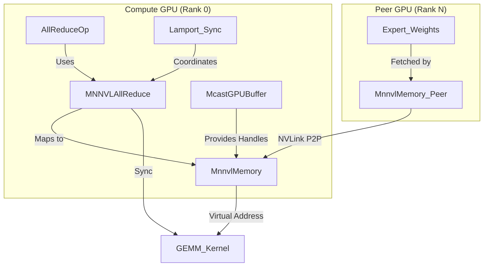
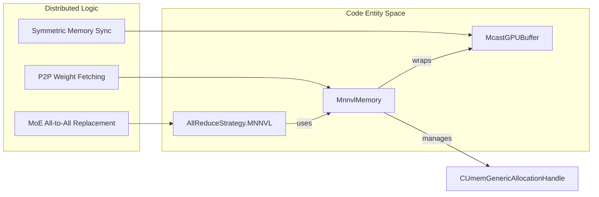

<!-- source: DeepWiki mcp.deepwiki.com · repo NVIDIA/TensorRT-LLM · page 14.6 DWDP: Distributed Weight Data Parallelism · fetched 2026-10-26 -->

# DWDP: Distributed Weight Data Parallelism

Relevant source files

The following files were used as context for generating this wiki page:

- [cpp/tensorrt_llm/common/lamportUtils.cuh](cpp/tensorrt_llm/common/lamportUtils.cuh)
- [cpp/tensorrt_llm/kernels/communicationKernels/customLowPrecisionAllReduceKernels.cu](cpp/tensorrt_llm/kernels/communicationKernels/customLowPrecisionAllReduceKernels.cu)
- [cpp/tensorrt_llm/kernels/communicationKernels/customLowPrecisionAllReduceKernels.h](cpp/tensorrt_llm/kernels/communicationKernels/customLowPrecisionAllReduceKernels.h)
- [cpp/tensorrt_llm/kernels/communicationKernels/mnnvlAllreduceKernels.cu](cpp/tensorrt_llm/kernels/communicationKernels/mnnvlAllreduceKernels.cu)
- [cpp/tensorrt_llm/kernels/communicationKernels/mnnvlAllreduceKernels.h](cpp/tensorrt_llm/kernels/communicationKernels/mnnvlAllreduceKernels.h)
- [cpp/tensorrt_llm/kernels/cudaAsyncOps.cuh](cpp/tensorrt_llm/kernels/cudaAsyncOps.cuh)
- [cpp/tensorrt_llm/kernels/customAllReduceKernels.h](cpp/tensorrt_llm/kernels/customAllReduceKernels.h)
- [cpp/tensorrt_llm/kernels/fusedMoeCommKernels.cu](cpp/tensorrt_llm/kernels/fusedMoeCommKernels.cu)
- [cpp/tensorrt_llm/kernels/fusedMoeCommKernels.h](cpp/tensorrt_llm/kernels/fusedMoeCommKernels.h)
- [cpp/tensorrt_llm/kernels/ll128Proto.cuh](cpp/tensorrt_llm/kernels/ll128Proto.cuh)
- [cpp/tensorrt_llm/kernels/moeCommKernelsCommon.h](cpp/tensorrt_llm/kernels/moeCommKernelsCommon.h)
- [cpp/tensorrt_llm/kernels/moeLoadBalance/moeLoadBalanceCommon.h](cpp/tensorrt_llm/kernels/moeLoadBalance/moeLoadBalanceCommon.h)
- [cpp/tensorrt_llm/kernels/moeLoadBalance/moeLoadBalanceKernels.cu](cpp/tensorrt_llm/kernels/moeLoadBalance/moeLoadBalanceKernels.cu)
- [cpp/tensorrt_llm/kernels/moeLoadBalance/moeLoadBalanceKernels.h](cpp/tensorrt_llm/kernels/moeLoadBalance/moeLoadBalanceKernels.h)
- [cpp/tensorrt_llm/kernels/moePrepareKernels.cu](cpp/tensorrt_llm/kernels/moePrepareKernels.cu)
- [cpp/tensorrt_llm/kernels/moePrepareKernels.h](cpp/tensorrt_llm/kernels/moePrepareKernels.h)
- [cpp/tensorrt_llm/thop/allreduceOp.cpp](cpp/tensorrt_llm/thop/allreduceOp.cpp)
- [cpp/tensorrt_llm/thop/moeCommOp.cpp](cpp/tensorrt_llm/thop/moeCommOp.cpp)
- [cpp/tensorrt_llm/thop/moeLoadBalanceOp.cpp](cpp/tensorrt_llm/thop/moeLoadBalanceOp.cpp)
- [cpp/tensorrt_llm/thop/thUtils.h](cpp/tensorrt_llm/thop/thUtils.h)
- [cpp/tests/unit_tests/kernels/fusedMoeCommKernelTest.cpp](cpp/tests/unit_tests/kernels/fusedMoeCommKernelTest.cpp)
- [tensorrt_llm/_mnnvl_utils.py](tensorrt_llm/_mnnvl_utils.py)
- [tensorrt_llm/_torch/compilation/backend.py](tensorrt_llm/_torch/compilation/backend.py)
- [tensorrt_llm/_torch/compilation/patterns/ar_residual_norm.py](tensorrt_llm/_torch/compilation/patterns/ar_residual_norm.py)
- [tensorrt_llm/_torch/compilation/piecewise_optimizer.py](tensorrt_llm/_torch/compilation/piecewise_optimizer.py)
- [tensorrt_llm/_torch/compilation/utils.py](tensorrt_llm/_torch/compilation/utils.py)
- [tensorrt_llm/_torch/distributed/__init__.py](tensorrt_llm/_torch/distributed/__init__.py)
- [tensorrt_llm/_torch/distributed/ops.py](tensorrt_llm/_torch/distributed/ops.py)
- [tensorrt_llm/functional.py](tensorrt_llm/functional.py)
- [tests/unittest/_torch/multi_gpu/test_allreduce.py](tests/unittest/_torch/multi_gpu/test_allreduce.py)
- [tests/unittest/_torch/multi_gpu/test_mnnvl_allreduce.py](tests/unittest/_torch/multi_gpu/test_mnnvl_allreduce.py)
- [tests/unittest/_torch/multi_gpu/test_user_buffers.py](tests/unittest/_torch/multi_gpu/test_user_buffers.py)
- [tests/unittest/_torch/multi_gpu_modeling/test_deepseek.py](tests/unittest/_torch/multi_gpu_modeling/test_deepseek.py)

Distributed Weight Data Parallelism (DWDP) is a high-performance parallelism strategy in TensorRT-LLM designed primarily for large-scale Mixture-of-Experts (MoE) models. DWDP eliminates the need for standard collective communication (like All-to-All) by offloading MoE expert weights across peer GPUs and utilizing peer-to-peer (P2P) NVLink transfers. This strategy is a key enabler for disaggregated serving on high-bandwidth interconnect systems like NVIDIA GB200 NVL72.

## Overview and Purpose

In traditional Expert Parallelism (EP), each GPU holds a subset of experts. When a token needs an expert located on a different GPU, the token must be moved to that GPU (All-to-All), processed, and returned. DWDP flips this paradigm: instead of moving tokens to weights, it fetches weights to tokens on-demand using the massive P2P bandwidth of NVLink.

Key benefits include:
*   **Elimination of All-to-All:** Removes the synchronization overhead and latency associated with moving activations across the network.
*   **Virtual Memory Abstraction:** Uses Virtual Memory Management (VMM) to present a unified address space for weights across the NVLink domain.
*   **Double-Buffered Pipeline:** Overlaps weight prefetching with computation to hide transfer latency.
*   **MNNVL Integration:** Utilizes Multi-Node NVLink (MNNVL) for optimized memory sharding and communication.

Sources: `[tensorrt_llm/_mnnvl_utils.py:54-90]()`, `[tensorrt_llm/_torch/distributed/ops.py:93-112]()`.

## System Architecture

The DWDP system is built on a hierarchy of memory management and scheduling components that coordinate the transfer of weights from "home" GPUs to "requesting" GPUs.

### DWDP Architecture Components

| Component | Code Entity | Responsibility |
| :--- | :--- | :--- |
| **Virtual Memory Manager** | `MnnvlMemory` | Maps physical weight fragments on peer GPUs into a contiguous virtual address space using `cuMemAddressReserve` `[tensorrt_llm/_mnnvl_utils.py:54-106]()`. |
| **MNNVL AllReduce** | `MNNVLAllReduce` | Handles multi-node NVLink all-reduce operations using Lamport sync buffers `[tensorrt_llm/_torch/distributed/ops.py:106-151]()`. |
| **Multicast Buffer** | `McastGPUBuffer` | Low-level binding for managing multicast GPU buffers across fabric handles `[tensorrt_llm/_torch/distributed/ops.py:144-151]()`. |
| **Workspace Manager** | `get_or_scale_allreduce_mnnvl_workspace` | Dynamically allocates and scales memory for MNNVL operations `[tensorrt_llm/_torch/distributed/ops.py:93-142]()`. |

### Architecture Diagram: Weight and Communication Flow
The following diagram illustrates how weights and synchronization move between GPUs using MNNVL and P2P mechanisms.

"DWDP Communication and Memory Management"

Sources: `[tensorrt_llm/_mnnvl_utils.py:54-106]()`, `[tensorrt_llm/_torch/distributed/ops.py:93-151]()`, `[cpp/tensorrt_llm/thop/allreduceOp.cpp:30-35]()`.

## Core Implementation Details

### Virtual Memory Management (VMM) via MNNVL
DWDP leverages NVIDIA's Virtual Memory Management APIs and the MNNVL (Multi-Node NVLink) utility to create a consistent view of experts.
*   **Memory Reservation:** `MnnvlMemory.new_mnnvl_memory_address` uses `cuMemAddressReserve` to reserve a large virtual address space across the cluster `[tensorrt_llm/_mnnvl_utils.py:182-183]()`.
*   **Fabric Mapping:** It differentiates between `FABRIC` handles for GB200 (aarch64) and `POSIX_FILE_DESCRIPTOR` for x86 systems `[tensorrt_llm/_mnnvl_utils.py:146-165]()`.
*   **Page Alignment:** Operations are aligned to the `fabric_page_size` (typically 512 MB) to optimize NVLink switch performance `[tensorrt_llm/_mnnvl_utils.py:59-60]()`.

### MNNVL All-Reduce Strategy
DWDP uses a specialized all-reduce strategy (`AllReduceStrategy.MNNVL`) to minimize latency on Blackwell-based systems.
*   **Lamport Synchronization:** Uses `NUM_LAMPORT_BUFFERS = 3` to manage concurrent access and synchronization across the NVLink fabric `[tensorrt_llm/_torch/distributed/ops.py:103-106]()`.
*   **Workspace Scaling:** The workspace is increased in 8 MiB granularity to avoid frequent reallocations during dynamic sequence length changes `[tensorrt_llm/_torch/distributed/ops.py:135-137]()`.
*   **Kernel Integration:** The C++ layer (`allreduceOp.cpp`) dispatches to `mnnvlAllreduceKernels` for hardware-accelerated reduction `[cpp/tensorrt_llm/thop/allreduceOp.cpp:30-32]()`.

### Double-Buffered Prefetch Pipeline
To hide the latency of fetching weights over NVLink, DWDP employs a double-buffered prefetch strategy.
*   **Overlap:** While one chunk is being processed by the GEMM kernels, the weights for the next chunk are prefetched in the background.
*   **Memory Reuse:** `MnnvlMemory` tracks address reference counts (`address_refcnt`) to safely reuse buffers without corrupting active transfers `[tensorrt_llm/_mnnvl_utils.py:82]()`.

Sources: `[tensorrt_llm/_mnnvl_utils.py:132-183]()`, `[tensorrt_llm/_torch/distributed/ops.py:93-151]()`, `[cpp/tensorrt_llm/thop/allreduceOp.cpp:102-168]()`.

## Integration with Distributed Operations

DWDP is integrated into the `tensorrt_llm._torch.distributed` module, allowing it to be used as a drop-in replacement for standard collective operations in MoE layers.

### Code Entity Mapping: Distributed Ops
This diagram bridges high-level distributed logic to specific DWDP and MNNVL code entities.

"DWDP Code Entity Mapping"

Sources: `[tensorrt_llm/_torch/distributed/ops.py:93-112]()`, `[tensorrt_llm/_mnnvl_utils.py:146-165]()`, `[tensorrt_llm/functional.py:108-119]()`.

## Disaggregated Serving on GB200 NVL72

DWDP is a foundational component for disaggregated serving on GB200 systems.
*   **NVLink Full Mesh:** On GB200 NVL72, the `MnnvlMemory` manager utilizes fabric handles to treat the entire rack as a single address space `[tensorrt_llm/_mnnvl_utils.py:157-160]()`.
*   **Fabric Handles:** The system automatically detects `aarch64` architecture to enable `CU_MEM_HANDLE_TYPE_FABRIC` for high-performance cross-node memory access `[tensorrt_llm/_mnnvl_utils.py:156-161]()`.
*   **MPI Coordination:** Uses MPI for initial setup and handle exchange, splitting communicators based on TP/PP/CP ranks to define the NVLink domain `[tensorrt_llm/_mnnvl_utils.py:134-144]()`.

## Summary of Key Classes and Functions

| Class/Function | File Path | Role |
| :--- | :--- | :--- |
| `MnnvlMemory` | `tensorrt_llm/_mnnvl_utils.py` | Core VMM and fabric memory manager for DWDP `[tensorrt_llm/_mnnvl_utils.py:54]()`. |
| `MNNVLAllReduce` | `tensorrt_llm/_torch/distributed/ops.py` | Logic for MNNVL-based all-reduce operations `[tensorrt_llm/_torch/distributed/ops.py:106]()`. |
| `McastGPUBuffer` | `tensorrt_llm/bindings/internal/runtime.py` | Binding for multicast buffer management `[tensorrt_llm/_torch/distributed/ops.py:18]()`. |
| `get_or_scale_mnnvl_workspace` | `tensorrt_llm/_torch/distributed/ops.py` | Dynamic memory management for DWDP transfers `[tensorrt_llm/_torch/distributed/ops.py:93]()`. |
| `open_mnnvl_memory` | `tensorrt_llm/_mnnvl_utils.py` | API to map peer memory into local address space `[tensorrt_llm/_mnnvl_utils.py:218]()`. |

Sources: `[tensorrt_llm/_mnnvl_utils.py:54-218]()`, `[tensorrt_llm/_torch/distributed/ops.py:93-151]()`, `[tensorrt_llm/functional.py:108-119]()`.

---

