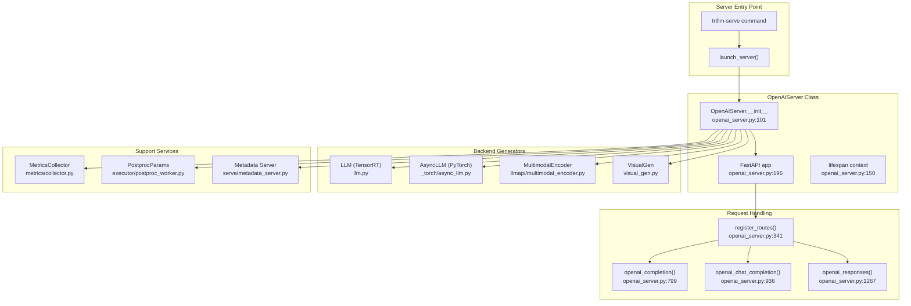
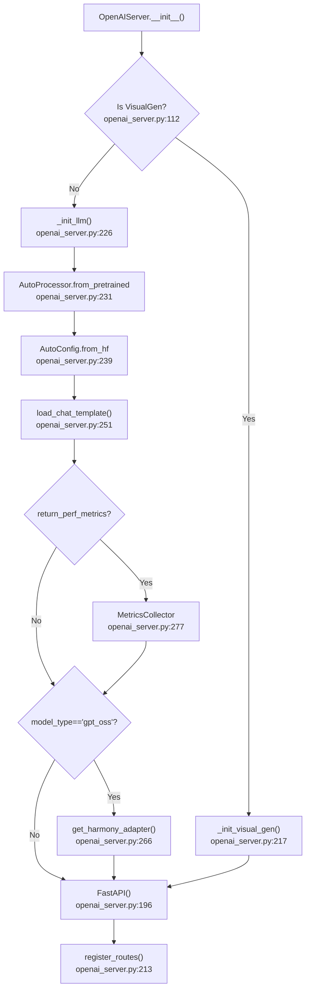
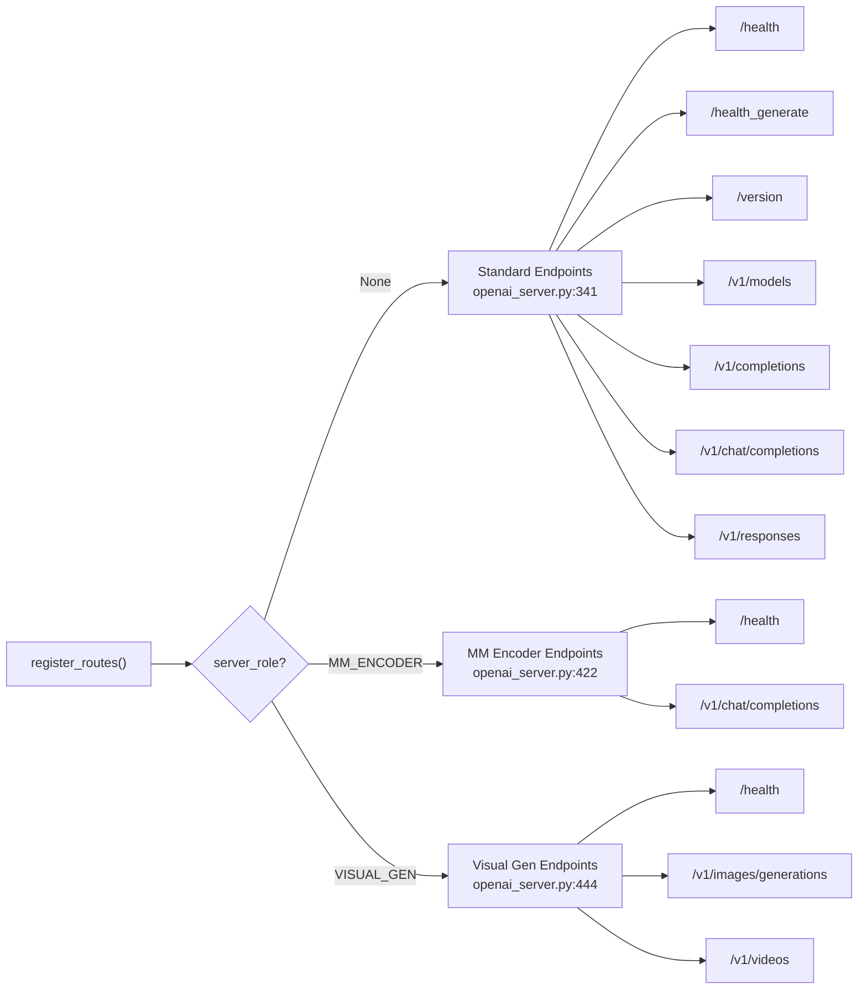
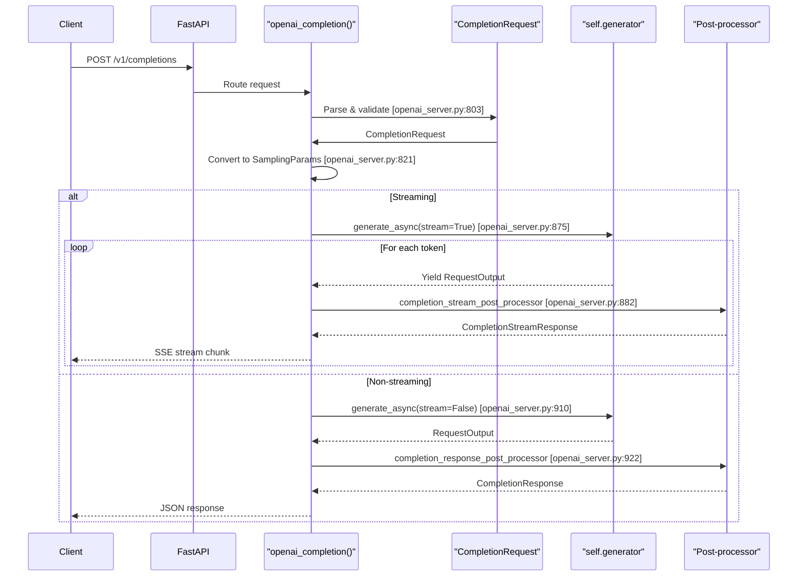

<!-- source: DeepWiki mcp.deepwiki.com · repo NVIDIA/TensorRT-LLM · page 15.1 OpenAI Compatible Server · fetched 2026-10-26 -->

# OpenAI Compatible Server

Relevant source files

The following files were used as context for generating this wiki page:

- [docs/source/commands/trtllm-serve/trtllm-serve.rst](docs/source/commands/trtllm-serve/trtllm-serve.rst)
- [docs/source/release-notes.md](docs/source/release-notes.md)
- [examples/visual_gen/serve/README.md](examples/visual_gen/serve/README.md)
- [examples/visual_gen/serve/sync_video_gen.py](examples/visual_gen/serve/sync_video_gen.py)
- [tensorrt_llm/_torch/visual_gen/models/ltx2/pipeline_ltx2.py](tensorrt_llm/_torch/visual_gen/models/ltx2/pipeline_ltx2.py)
- [tensorrt_llm/_torch/visual_gen/models/ltx2/pipeline_ltx2_two_stages.py](tensorrt_llm/_torch/visual_gen/models/ltx2/pipeline_ltx2_two_stages.py)
- [tensorrt_llm/llmapi/reasoning_parser.py](tensorrt_llm/llmapi/reasoning_parser.py)
- [tensorrt_llm/llmapi/thinking_budget.py](tensorrt_llm/llmapi/thinking_budget.py)
- [tensorrt_llm/sampling_params.py](tensorrt_llm/sampling_params.py)
- [tensorrt_llm/serve/harmony_adapter.py](tensorrt_llm/serve/harmony_adapter.py)
- [tensorrt_llm/serve/openai_protocol.py](tensorrt_llm/serve/openai_protocol.py)
- [tensorrt_llm/serve/openai_server.py](tensorrt_llm/serve/openai_server.py)
- [tensorrt_llm/serve/openai_video_routes.py](tensorrt_llm/serve/openai_video_routes.py)
- [tensorrt_llm/serve/postprocess_handlers.py](tensorrt_llm/serve/postprocess_handlers.py)
- [tensorrt_llm/serve/responses_utils.py](tensorrt_llm/serve/responses_utils.py)
- [tensorrt_llm/serve/scripts/benchmark_visual_gen.py](tensorrt_llm/serve/scripts/benchmark_visual_gen.py)
- [tensorrt_llm/serve/visual_gen_metrics.py](tensorrt_llm/serve/visual_gen_metrics.py)
- [tests/unittest/_torch/visual_gen/test_ltx2_pipeline.py](tests/unittest/_torch/visual_gen/test_ltx2_pipeline.py)
- [tests/unittest/_torch/visual_gen/test_trtllm_serve_e2e.py](tests/unittest/_torch/visual_gen/test_trtllm_serve_e2e.py)
- [tests/unittest/_torch/visual_gen/test_trtllm_serve_endpoints.py](tests/unittest/_torch/visual_gen/test_trtllm_serve_endpoints.py)
- [tests/unittest/_torch/visual_gen/test_visual_gen_utils.py](tests/unittest/_torch/visual_gen/test_visual_gen_utils.py)
- [tests/unittest/llmapi/apps/_test_openai_chat.py](tests/unittest/llmapi/apps/_test_openai_chat.py)
- [tests/unittest/llmapi/apps/_test_openai_chat_harmony.py](tests/unittest/llmapi/apps/_test_openai_chat_harmony.py)
- [tests/unittest/llmapi/apps/_test_openai_chat_harmony_perf_metrics.py](tests/unittest/llmapi/apps/_test_openai_chat_harmony_perf_metrics.py)
- [tests/unittest/llmapi/apps/_test_openai_completions.py](tests/unittest/llmapi/apps/_test_openai_completions.py)
- [tests/unittest/llmapi/apps/_test_openai_reasoning.py](tests/unittest/llmapi/apps/_test_openai_reasoning.py)
- [tests/unittest/llmapi/apps/_test_openai_responses.py](tests/unittest/llmapi/apps/_test_openai_responses.py)
- [tests/unittest/llmapi/apps/test_harmony_channel_validation.py](tests/unittest/llmapi/apps/test_harmony_channel_validation.py)
- [tests/unittest/llmapi/apps/test_harmony_parsing.py](tests/unittest/llmapi/apps/test_harmony_parsing.py)
- [tests/unittest/llmapi/test_reasoning_parser.py](tests/unittest/llmapi/test_reasoning_parser.py)
- [tests/unittest/llmapi/test_sampling_params.py](tests/unittest/llmapi/test_sampling_params.py)

## Purpose and Scope

The OpenAI Compatible Server provides an HTTP API that mirrors the OpenAI API specification, enabling clients to interact with TensorRT-LLM models using familiar OpenAI client libraries and protocols. This server acts as the primary interface for production deployments, supporting text generation, multimodal inference, and visual generation workloads.

This page covers the standalone OpenAI-compatible server implementation. For disaggregated serving (splitting context and generation phases across workers), see [Disaggregated Serving Architecture](15.2). For response processing details including tool calling and reasoning parsers, see [Response Post-Processing and Reasoning Parsers](15.5).

**Sources:** [tensorrt_llm/serve/openai_server.py:99-161](), [tensorrt_llm/serve/openai_server.py:341-399]()

---

## Server Architecture

### Core Components

The `OpenAIServer` class coordinates multiple subsystems to handle inference requests. The server is built on FastAPI and supports multiple backend executors (PyTorch, TensorRT) through a unified interface.

"OpenAI Server Architecture"

**Sources:** [tensorrt_llm/serve/openai_server.py:101-214](), [tensorrt_llm/serve/openai_server.py:28-47](), [tensorrt_llm/serve/openai_server.py:799-1391]()

---

## Server Initialization

### Constructor Parameters

The `OpenAIServer.__init__` method accepts several key parameters to configure the runtime environment:

| Parameter | Type | Purpose |
|-----------|------|---------|
| `generator` | `Union[LLM, MultimodalEncoder, VisualGen]` | Backend executor for inference [tensorrt_llm/serve/openai_server.py:103]() |
| `model` | `str` | Model name exposed in API responses [tensorrt_llm/serve/openai_server.py:104]() |
| `tool_parser` | `Optional[str]` | Parser for tool calling (e.g., "qwen3") [tensorrt_llm/serve/openai_server.py:105]() |
| `server_role` | `Optional[ServerRole]` | Role in disaggregated setup (CONTEXT/GENERATION/etc.) [tensorrt_llm/serve/openai_server.py:106]() |
| `metadata_server_cfg` | `MetadataServerConfig` | Service discovery configuration [tensorrt_llm/serve/openai_server.py:107]() |
| `disagg_cluster_config` | `Optional[DisaggClusterConfig]` | Cluster configuration for auto-scaling [tensorrt_llm/serve/openai_server.py:108]() |
| `chat_template` | `Optional[str]` | Custom chat template override [tensorrt_llm/serve/openai_server.py:110]() |

**Sources:** [tensorrt_llm/serve/openai_server.py:101-142]()

### Initialization Flow

"Initialization Logic"

**Sources:** [tensorrt_llm/serve/openai_server.py:99-285]()

### Lifespan Management

The server uses FastAPI's `lifespan` context manager to handle startup and shutdown.
- **Startup:** Registers with the `metadata_server` [tensorrt_llm/serve/openai_server.py:155](), initializes the `disagg_cluster_worker` if configured [tensorrt_llm/serve/openai_server.py:173](), and starts the `_iteration_stats_collector_task` [tensorrt_llm/serve/openai_server.py:180]().
- **Shutdown:** Deregisters from the metadata server [tensorrt_llm/serve/openai_server.py:184]() and shuts down the generator [tensorrt_llm/serve/openai_server.py:193]().

**Sources:** [tensorrt_llm/serve/openai_server.py:150-194]()

---

## API Endpoints

### Endpoint Registration

The server registers different endpoint sets based on its `server_role`:

"Endpoint Routing Map"

**Sources:** [tensorrt_llm/serve/openai_server.py:341-481]()

---

## Request Processing Flow

### Completion Request Flow

The server handles standard text completions via the `openai_completion` handler.

"Completion Pipeline"

**Sources:** [tensorrt_llm/serve/openai_server.py:799-933](), [tensorrt_llm/serve/openai_protocol.py:165-306]()

### Chat Completion Request Flow

Chat completions follow a similar flow but include additional preprocessing:
1.  **Message Parsing:** Messages are converted to prompt text using `apply_chat_template` [tensorrt_llm/serve/openai_server.py:973]().
2.  **Multimodal Processing:** Images or videos in messages are processed via `prompt_inputs` [tensorrt_llm/serve/openai_server.py:993]().
3.  **Harmony Adapter:** If the model is a `gpt_oss` type, the `HarmonyAdapter` handles specialized message formatting and channel-based reasoning [tensorrt_llm/serve/harmony_adapter.py:47-152]().

**Sources:** [tensorrt_llm/serve/openai_server.py:936-1264](), [tensorrt_llm/serve/openai_protocol.py:314-368]()

---

## Protocol and Parameters

### OpenAI Protocol Models

The `openai_protocol.py` file defines Pydantic models for request and response validation, mirroring the OpenAI API schema.

| Model | Purpose | Source |
| :--- | :--- | :--- |
| `CompletionRequest` | Text completion request schema | [tensorrt_llm/serve/openai_protocol.py:284]() |
| `ChatCompletionRequest` | Chat completion request schema | [tensorrt_llm/serve/openai_protocol.py:314]() |
| `UsageInfo` | Token usage statistics | [tensorrt_llm/serve/openai_protocol.py:146]() |
| `ErrorResponse` | Standardized error format | [tensorrt_llm/serve/openai_protocol.py:1101]() |
| `DisaggregatedParams` | Parameters for context/generation separation | [tensorrt_llm/serve/openai_protocol.py:1053]() |

### Sampling and Guided Decoding

The server translates OpenAI parameters into TensorRT-LLM `SamplingParams`.
- **Logit Bias:** Converted from dict to tensor via `_logit_bias_to_embedding_bias` [tensorrt_llm/serve/openai_protocol.py:97-144]().
- **Guided Decoding:** Supports `json`, `regex`, and `grammar` (EBNF) via `GuidedDecodingParams` [tensorrt_llm/sampling_params.py:70-85]().
- **Thinking Token Budget:** For reasoning models, the `thinking_token_budget` parameter limits reasoning tokens. This is validated via `validate_thinking_token_budget` [tensorrt_llm/sampling_params.py:45-55]() and enforced via the `add_thinking_budget_logits_processor` [tensorrt_llm/llmapi/thinking_budget.py:51-78]().

**Sources:** [tensorrt_llm/serve/openai_protocol.py:97-144](), [tensorrt_llm/sampling_params.py:70-85](), [tensorrt_llm/sampling_params.py:45-55]()

---

## Specialized Handlers

### Tool Calling and Reasoning

Post-processing handlers manage the extraction of structured data from model outputs.
- **Tool Parsing:** `ToolParserFactory` provides the interface for both one-time and streaming tool call detection [tensorrt_llm/serve/postprocess_handlers.py:44-44]().
- **Reasoning Extraction:** Reasoning content is parsed and returned as part of the assistant message via `apply_reasoning_parser` [tensorrt_llm/serve/postprocess_handlers.py:157-185]().
- **Harmony Adapter:** Manages channel transitions for GPT-OSS models via `HarmonyAdapter` [tensorrt_llm/serve/harmony_adapter.py:47-152]().

**Sources:** [tensorrt_llm/serve/postprocess_handlers.py:157-185](), [tensorrt_llm/serve/harmony_adapter.py:47-152]()

### Responses API (v1/responses)

The server implements the `v1/responses` endpoint, supporting multi-turn conversations and reasoning-heavy models.
- **Entry Point:** Handled by `openai_responses` [tensorrt_llm/serve/openai_server.py:1267]().
- **Input Processing:** Uses `responses_api_request_preprocess` to format conversation history [tensorrt_llm/serve/openai_server.py:103-103]().
- **State Management:** The `ConversationHistoryStore` manages session data for multi-turn chat [tensorrt_llm/serve/responses_utils.py:96-106]().

**Sources:** [tensorrt_llm/serve/openai_server.py:1267-1391](), [tensorrt_llm/serve/responses_utils.py:96-106]()

---

