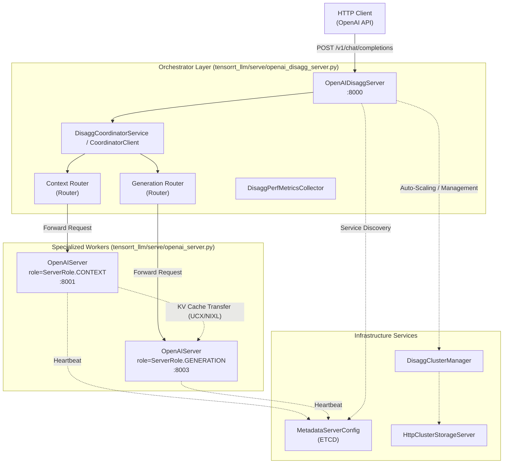

<!-- source: DeepWiki mcp.deepwiki.com · repo NVIDIA/TensorRT-LLM · page 15.2 Disaggregated Serving Architecture · fetched 2026-10-26 -->

# Disaggregated Serving Architecture

<details>
<summary>Relevant source files</summary>

The following files were used as context for generating this wiki page:

- [docs/source/blogs/Best_perf_practice_on_DeepSeek-R1_in_TensorRT-LLM.md](docs/source/blogs/Best_perf_practice_on_DeepSeek-R1_in_TensorRT-LLM.md)
- [docs/source/developer-guide/kv-transfer.md](docs/source/developer-guide/kv-transfer.md)
- [docs/source/features/disagg-serving.md](docs/source/features/disagg-serving.md)
- [examples/disaggregated/README.md](examples/disaggregated/README.md)
- [examples/disaggregated/slurm/simple_example/launch.slurm](examples/disaggregated/slurm/simple_example/launch.slurm)
- [examples/models/core/deepseek_v3/README.md](examples/models/core/deepseek_v3/README.md)
- [examples/models/core/qwen/README.md](examples/models/core/qwen/README.md)
- [tensorrt_llm/disaggregated_params.py](tensorrt_llm/disaggregated_params.py)
- [tensorrt_llm/llmapi/disagg_utils.py](tensorrt_llm/llmapi/disagg_utils.py)
- [tensorrt_llm/serve/chat_tokenization.py](tensorrt_llm/serve/chat_tokenization.py)
- [tensorrt_llm/serve/conversation_id.py](tensorrt_llm/serve/conversation_id.py)
- [tensorrt_llm/serve/openai_client.py](tensorrt_llm/serve/openai_client.py)
- [tensorrt_llm/serve/openai_disagg_server.py](tensorrt_llm/serve/openai_disagg_server.py)
- [tensorrt_llm/serve/openai_disagg_service.py](tensorrt_llm/serve/openai_disagg_service.py)
- [tensorrt_llm/serve/perf_metrics.py](tensorrt_llm/serve/perf_metrics.py)
- [tensorrt_llm/serve/router.py](tensorrt_llm/serve/router.py)
- [tensorrt_llm/serve/router_utils.py](tensorrt_llm/serve/router_utils.py)
- [tests/integration/defs/disaggregated/disagg_test_utils.py](tests/integration/defs/disaggregated/disagg_test_utils.py)
- [tests/integration/defs/disaggregated/test_ad_disagg.py](tests/integration/defs/disaggregated/test_ad_disagg.py)
- [tests/integration/defs/disaggregated/test_ad_disagg_trtllm_serve.py](tests/integration/defs/disaggregated/test_ad_disagg_trtllm_serve.py)
- [tests/integration/defs/disaggregated/test_configs/disagg_config_ctxtp2_gentp2_deepseek_v3_lite_attention_dp_overlap_cuda_graph.yaml](tests/integration/defs/disaggregated/test_configs/disagg_config_ctxtp2_gentp2_deepseek_v3_lite_attention_dp_overlap_cuda_graph.yaml)
- [tests/integration/defs/disaggregated/test_configs/disagg_config_ctxtp2_gentp2_deepseek_v3_lite_overlap_cuda_graph.yaml](tests/integration/defs/disaggregated/test_configs/disagg_config_ctxtp2_gentp2_deepseek_v3_lite_overlap_cuda_graph.yaml)
- [tests/integration/defs/disaggregated/test_configs/disagg_config_ctxtp4ep4_gentp4ep4_glm5_nvfp4_dp_tllm.yaml](tests/integration/defs/disaggregated/test_configs/disagg_config_ctxtp4ep4_gentp4ep4_glm5_nvfp4_dp_tllm.yaml)
- [tests/integration/defs/disaggregated/test_configs/disagg_config_cuda_graph_padding.yaml](tests/integration/defs/disaggregated/test_configs/disagg_config_cuda_graph_padding.yaml)
- [tests/integration/defs/disaggregated/test_disaggregated_etcd.py](tests/integration/defs/disaggregated/test_disaggregated_etcd.py)
- [tests/integration/defs/disaggregated/test_disaggregated_single_gpu.py](tests/integration/defs/disaggregated/test_disaggregated_single_gpu.py)
- [tests/integration/defs/disaggregated/test_workers.py](tests/integration/defs/disaggregated/test_workers.py)
- [tests/integration/defs/stress_test/stress_test.py](tests/integration/defs/stress_test/stress_test.py)
- [tests/integration/test_lists/qa/llm_function_stress.txt](tests/integration/test_lists/qa/llm_function_stress.txt)
- [tests/scripts/perf-sanity/disaggregated/gb200_glm-5-fp4_8k1k_con1_ctx1_dep4_gen1_tep8_eplb0_mtp3_ccb-NIXL.yaml](tests/scripts/perf-sanity/disaggregated/gb200_glm-5-fp4_8k1k_con1_ctx1_dep4_gen1_tep8_eplb0_mtp3_ccb-NIXL.yaml)
- [tests/unittest/disaggregated/test_coordinator_worker.py](tests/unittest/disaggregated/test_coordinator_worker.py)
- [tests/unittest/disaggregated/test_disagg_internal_auth.py](tests/unittest/disaggregated/test_disagg_internal_auth.py)
- [tests/unittest/disaggregated/test_disagg_openai_client.py](tests/unittest/disaggregated/test_disagg_openai_client.py)
- [tests/unittest/disaggregated/test_disagg_utils.py](tests/unittest/disaggregated/test_disagg_utils.py)
- [tests/unittest/disaggregated/test_disaggregated_params.py](tests/unittest/disaggregated/test_disaggregated_params.py)
- [tests/unittest/disaggregated/test_openai_disagg_server.py](tests/unittest/disaggregated/test_openai_disagg_server.py)
- [tests/unittest/disaggregated/test_openai_disagg_service.py](tests/unittest/disaggregated/test_openai_disagg_service.py)
- [tests/unittest/disaggregated/test_router.py](tests/unittest/disaggregated/test_router.py)

</details>


## Purpose and Scope

This document describes TensorRT-LLM's disaggregated serving architecture, which separates LLM inference into specialized **context servers** (prefill/prompt processing) and **generation servers** (decode/token generation). This architecture enables independent scaling of compute-intensive context processing and memory-intensive generation phases, allowing for independent optimization of Time-To-First-Token (TTFT) and Token-To-Token Latency (TPOT) [[docs/source/features/disagg-serving.md:17-44]]().

**Key capabilities:**
- Independent scaling and parallelism strategies for context and generation workloads [[docs/source/features/disagg-serving.md:42-44]]().
- High-performance KV cache transfer between specialized workers using **NIXL**, **UCX**, or **LIBFABRIC** backends [[examples/disaggregated/README.md:33-41]]().
- Multiple routing strategies including **Round-Robin**, **Load Balancing**, **Conversation-based**, and **KV cache-aware** routing [[tensorrt_llm/serve/router.py:27-32]]().
- Dynamic service discovery and health monitoring via Metadata Servers (e.g., ETCD) or cluster storage [[tensorrt_llm/serve/openai_disagg_server.py:106-108]]().
- Cross-server performance metrics with clock synchronization and per-request tracking via `DisaggPerfMetricsCollector` [[tensorrt_llm/serve/openai_disagg_server.py:63-102]]().
- Support for multiple scheduling styles: `context_first` (default) and `generation_first` [[tensorrt_llm/serve/openai_disagg_service.py:73-85]]().
- Flexible request management using `DisaggregatedParams` to carry state (tokens, logits, logprobs, and metadata) between phases [[tensorrt_llm/serve/openai_protocol.py:23-30]]().

**Sources:** [[docs/source/features/disagg-serving.md:17-44]](), [[tensorrt_llm/serve/router.py:27-32]](), [[tensorrt_llm/serve/openai_disagg_server.py:63-109]](), [[examples/disaggregated/README.md:33-41]](), [[tensorrt_llm/serve/openai_disagg_service.py:73-85]](), [[tensorrt_llm/serve/openai_protocol.py:23-30]]()

---

## Architecture Overview

The disaggregated serving architecture consists of three main layers: the **orchestrator** (`OpenAIDisaggServer`), **specialized workers** (context/generation servers), and **infrastructure services** (routers, coordinator, cluster storage).

### System Component Diagram
This diagram bridges the natural language system roles to the specific code entities used in the implementation.


**Sources:** [[tensorrt_llm/serve/openai_disagg_server.py:103-152]](), [[tensorrt_llm/llmapi/disagg_utils.py:85-118]](), [[tensorrt_llm/serve/openai_disagg_service.py:45-85]](), [[tensorrt_llm/serve/disagg_coordinator.py:41-43]]()

---

## Server Components

### OpenAIDisaggServer
The `OpenAIDisaggServer` class is the main entry point that coordinates requests between context and generation workers. It manages request splitting, routing, and lifecycle hooks [[tensorrt_llm/serve/openai_disagg_server.py:103-152]]().

| Component | Type | Description |
|-----------|------|-------------|
| `_coordinator` | `DisaggCoordinator` | Owns the routers and cluster state, or delegates to a remote coordinator via `CoordinatorClient` [[tensorrt_llm/serve/openai_disagg_server.py:135-145]]() |
| `_ctx_router` | `Router` | Routes context requests to available context servers [[tensorrt_llm/serve/openai_disagg_server.py:146]]() |
| `_gen_router` | `Router` | Routes generation requests to available generation servers [[tensorrt_llm/serve/openai_disagg_server.py:147]]() |
| `_service` | `OpenAIDisaggregatedService` | Orchestrates the multi-step request/response flow [[tensorrt_llm/serve/openai_disagg_server.py:149-152]]() |
| `_perf_metrics_collector` | `DisaggPerfMetricsCollector` | Tracks TTFT, TPOT, and queue latency across servers [[tensorrt_llm/serve/openai_disagg_server.py:123]]() |
| `_disagg_cluster_storage` | `ClusterStorage` | Interface for dynamic worker registration and state storage [[tensorrt_llm/serve/openai_disagg_server.py:129-131]]() |

**Sources:** [[tensorrt_llm/serve/openai_disagg_server.py:103-152]]()

### OpenAIDisaggregatedService
The `OpenAIDisaggregatedService` implements the core disaggregated logic. It supports two primary scheduling styles:
- **`_send_disagg_request_ctx_first`**: The standard flow where a context request is sent first to generate the KV cache, followed by a generation request. It handles retries and verification of context responses [[tensorrt_llm/serve/openai_disagg_service.py:116-150]]().
- **`_send_disagg_request_gen_first`**: An optimized flow where a generation server is reserved or contacted earlier in the process, allowing for parallelization of resource reservation [[tensorrt_llm/serve/openai_disagg_service.py:74-85]]().

**Sources:** [[tensorrt_llm/serve/openai_disagg_service.py:45-150]]()

---

## KV Cache Transfer

KV cache exchange is modularly decoupled from the KV cache manager and the underlying communication libraries [[docs/source/features/disagg-serving.md:48-51]]().

### Data Flow and Code Entities
This diagram maps the logical transfer of KV cache to the internal entities responsible for the transmission.

```mermaid
graph LR
    subgraph CtxWorker ["Context Worker"]
        CtxReq["LlmRequest"]
        CtxMgr["KVCacheManager"]
        CtxTrans["CacheTransceiver"]
        CtxAgent["NIXL / UCX Agent"]
    end
    
    subgraph Protocol ["Communication Backend"]
        UCX["UCX (RDMA/NVLink)"]
        NIXL["NIXL (Libfabric/UCX)"]
    end
    
    subgraph GenWorker ["Generation Worker"]
        GenAgent["NIXL / UCX Agent"]
        GenTrans["CacheTransceiver"]
        GenMgr["KVCacheManager"]
    end
    
    CtxReq --> CtxMgr
    CtxMgr --> CtxTrans
    CtxTrans --> CtxAgent
    CtxAgent --> Protocol
    Protocol --> GenAgent
    GenAgent --> GenTrans
    GenTrans --> GenMgr
```


**Sources:** [[docs/source/features/disagg-serving.md:48-57]](), [[examples/disaggregated/README.md:14-24]](), [[tensorrt_llm/serve/openai_protocol.py:23-30]]()

### Transfer Backends
TensorRT-LLM supports high-performance backends for minimal latency [[examples/disaggregated/README.md:33-41]]():

- **NIXL**: NVIDIA IXL, supporting **UCX** (default) or **LIBFABRIC** (for AWS EFA) underlying backends [[examples/disaggregated/README.md:33-41]]().
- **UCX**: Unified Communication X, typically pre-installed in NVIDIA GPU containers [[examples/disaggregated/README.md:65-68]]().
- **LIBFABRIC**: Supported via NIXL (v0.16.0+), optimized for AWS EFA instances [[examples/disaggregated/README.md:43-63]]().

**Sources:** [[examples/disaggregated/README.md:33-81]](), [[docs/source/features/disagg-serving.md:59-70]]()

---

## Router System

The `OpenAIDisaggServer` uses specialized `Router` classes to distribute requests based on worker health and load [[tensorrt_llm/serve/router.py:56-300]]().

### Router Strategies
- **RoundRobinRouter**: Distributes requests in a circular sequence [[tensorrt_llm/serve/router.py:96]]().
- **LoadBalancingRouter**: Routes based on active requests or tokens [[tensorrt_llm/serve/router.py:96]]().
- **ConversationRouter**: Provides session affinity for multi-turn conversations by routing based on session IDs or conversation IDs [[tensorrt_llm/serve/router.py:42]]().
- **KvCacheAwareRouter**: Tracks the state of KV cache blocks across workers using a `block_key_hasher` [[tensorrt_llm/serve/router.py:100-155]](). It attempts to route requests to workers that already have matching prefix blocks in their cache by polling `/kv_cache_events` [[tensorrt_llm/serve/router.py:176-178]]().
- **CoordinatorDelegatingRouter**: Used in forked worker processes to delegate routing decisions to a central coordinator [[tensorrt_llm/serve/openai_disagg_service.py:37]]().

### Request ID Management
To enable end-to-end tracking, disaggregated requests use a unique global ID [[docs/source/features/disagg-serving.md:86-91]]().
- **Global ID (Snowflake)**: A self-contained 64-bit integer unique without cross-process coordination. It includes a timestamp, `node_id`, `process_id`, and a counter [[docs/source/features/disagg-serving.md:90-98]]().
- **Node ID**: Defaults to a hash of the MAC address, overridable via `node_id` in `DisaggServerConfig` (range [0, 255]) [[tensorrt_llm/llmapi/disagg_utils.py:141-143]]().

**Sources:** [[tensorrt_llm/serve/router.py:56-300]](), [[tensorrt_llm/llmapi/disagg_utils.py:141-143]](), [[docs/source/features/disagg-serving.md:86-106]]()

---

## Configuration and Launching

### Configuration File (`extra-llm-config.yaml`)
Disaggregated serving parameters are defined in the `cache_transceiver_config` section [[examples/disaggregated/README.md:9-31]]().

```yaml
cache_transceiver_config:
  backend: NIXL              # NIXL is recommended for RDMA/NVLink
  max_tokens_in_buffer: 2048 # Buffer size for transfer
```

### Execution Lifecycle
1. **Worker Launch**: Start context and generation workers using `trtllm-serve` with appropriate configuration files. Context servers often require `disable_overlap_scheduler: True` [[examples/disaggregated/README.md:107-114]]().
2. **Orchestrator Launch**: Start the `OpenAIDisaggServer` which initializes the `DisaggCoordinator` and routers [[tensorrt_llm/serve/openai_disagg_server.py:135-147]]().
3. **Request Flow**: 
   - Orchestrator receives OpenAI API request.
   - `OpenAIDisaggregatedService` handles the logic based on `schedule_style` [[tensorrt_llm/serve/openai_disagg_service.py:73-85]]().
   - `CtxRouter` selects a context worker.
   - Context worker computes KV cache and returns `DisaggregatedParams` containing the `disagg_request_id` [[tensorrt_llm/serve/openai_protocol.py:23-30]]().
   - `GenRouter` selects a generation worker.
   - KV cache is transferred using the selected backend (UCX/NIXL) [[docs/source/features/disagg-serving.md:48-51]]().
   - Generation worker produces tokens and results are returned to the client via `RawRequestResponseHooks` which also log performance metrics [[tensorrt_llm/serve/openai_disagg_server.py:63-102]]().

**Sources:** [[examples/disaggregated/README.md:1-172]](), [[tensorrt_llm/serve/openai_disagg_server.py:63-152]](), [[tensorrt_llm/serve/openai_disagg_service.py:73-150]](), [[tensorrt_llm/serve/openai_protocol.py:23-30]](), [[docs/source/features/disagg-serving.md:48-51]]()

---

