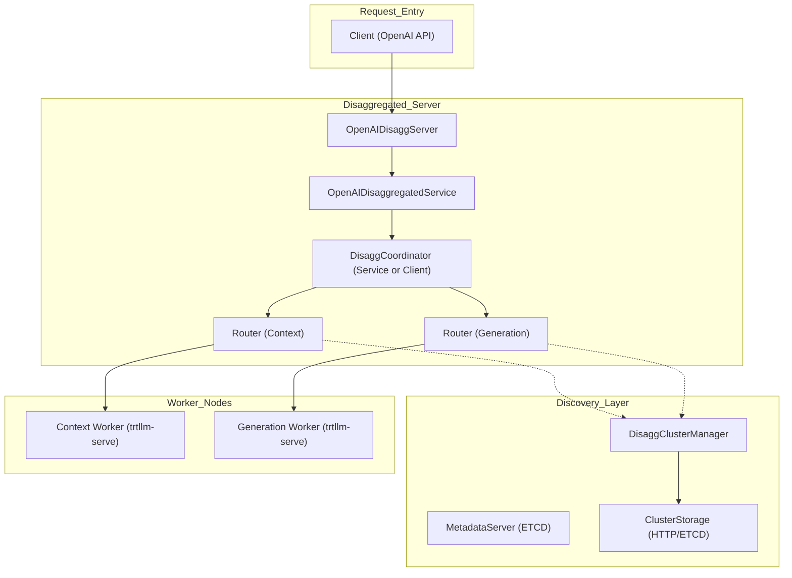
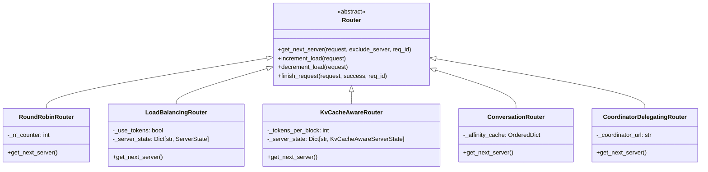

<!-- source: DeepWiki mcp.deepwiki.com · repo NVIDIA/TensorRT-LLM · page 15.3 Service Discovery and Routing · fetched 2026-10-26 -->

# Service Discovery and Routing

<details>
<summary>Relevant source files</summary>

The following files were used as context for generating this wiki page:

- [tensorrt_llm/disaggregated_params.py](tensorrt_llm/disaggregated_params.py)
- [tensorrt_llm/llmapi/disagg_utils.py](tensorrt_llm/llmapi/disagg_utils.py)
- [tensorrt_llm/serve/chat_tokenization.py](tensorrt_llm/serve/chat_tokenization.py)
- [tensorrt_llm/serve/cluster_storage.py](tensorrt_llm/serve/cluster_storage.py)
- [tensorrt_llm/serve/conversation_id.py](tensorrt_llm/serve/conversation_id.py)
- [tensorrt_llm/serve/disagg_auto_scaling.py](tensorrt_llm/serve/disagg_auto_scaling.py)
- [tensorrt_llm/serve/metadata_server.py](tensorrt_llm/serve/metadata_server.py)
- [tensorrt_llm/serve/openai_client.py](tensorrt_llm/serve/openai_client.py)
- [tensorrt_llm/serve/openai_disagg_server.py](tensorrt_llm/serve/openai_disagg_server.py)
- [tensorrt_llm/serve/openai_disagg_service.py](tensorrt_llm/serve/openai_disagg_service.py)
- [tensorrt_llm/serve/perf_metrics.py](tensorrt_llm/serve/perf_metrics.py)
- [tensorrt_llm/serve/router.py](tensorrt_llm/serve/router.py)
- [tensorrt_llm/serve/router_utils.py](tensorrt_llm/serve/router_utils.py)
- [tests/integration/defs/disaggregated/test_ad_disagg.py](tests/integration/defs/disaggregated/test_ad_disagg.py)
- [tests/integration/defs/disaggregated/test_ad_disagg_trtllm_serve.py](tests/integration/defs/disaggregated/test_ad_disagg_trtllm_serve.py)
- [tests/integration/defs/disaggregated/test_auto_scaling.py](tests/integration/defs/disaggregated/test_auto_scaling.py)
- [tests/integration/defs/disaggregated/test_disaggregated_etcd.py](tests/integration/defs/disaggregated/test_disaggregated_etcd.py)
- [tests/integration/defs/disaggregated/test_disaggregated_single_gpu.py](tests/integration/defs/disaggregated/test_disaggregated_single_gpu.py)
- [tests/integration/defs/disaggregated/test_workers.py](tests/integration/defs/disaggregated/test_workers.py)
- [tests/unittest/disaggregated/test_cluster_storage.py](tests/unittest/disaggregated/test_cluster_storage.py)
- [tests/unittest/disaggregated/test_coordinator_worker.py](tests/unittest/disaggregated/test_coordinator_worker.py)
- [tests/unittest/disaggregated/test_disagg_cluster_manager_worker.py](tests/unittest/disaggregated/test_disagg_cluster_manager_worker.py)
- [tests/unittest/disaggregated/test_disagg_internal_auth.py](tests/unittest/disaggregated/test_disagg_internal_auth.py)
- [tests/unittest/disaggregated/test_disagg_openai_client.py](tests/unittest/disaggregated/test_disagg_openai_client.py)
- [tests/unittest/disaggregated/test_disagg_utils.py](tests/unittest/disaggregated/test_disagg_utils.py)
- [tests/unittest/disaggregated/test_disaggregated_params.py](tests/unittest/disaggregated/test_disaggregated_params.py)
- [tests/unittest/disaggregated/test_openai_disagg_server.py](tests/unittest/disaggregated/test_openai_disagg_server.py)
- [tests/unittest/disaggregated/test_openai_disagg_service.py](tests/unittest/disaggregated/test_openai_disagg_service.py)
- [tests/unittest/disaggregated/test_remoteDictionary.py](tests/unittest/disaggregated/test_remoteDictionary.py)
- [tests/unittest/disaggregated/test_router.py](tests/unittest/disaggregated/test_router.py)
- [tests/unittest/llmapi/apps/_test_disagg_serving_multi_nodes.py](tests/unittest/llmapi/apps/_test_disagg_serving_multi_nodes.py)
- [tests/unittest/llmapi/apps/openai_server.py](tests/unittest/llmapi/apps/openai_server.py)
- [tests/unittest/llmapi/apps/test_disagg_serving_perf_metrics.py](tests/unittest/llmapi/apps/test_disagg_serving_perf_metrics.py)
- [tests/unittest/llmapi/apps/utils.py](tests/unittest/llmapi/apps/utils.py)

</details>


This document covers the service discovery and routing mechanisms used in TensorRT-LLM's disaggregated serving architecture. Service discovery enables dynamic registration and discovery of worker servers, while routing strategies determine how requests are distributed across available workers.

---

## Purpose and Scope

In disaggregated serving mode, TensorRT-LLM separates inference into two phases:
1. **Context phase** (prefill) - processes prompts on dedicated context workers.
2. **Generation phase** (decode) - generates tokens on dedicated generation workers.

This separation requires two key capabilities:
- **Service Discovery**: Finding available context and generation workers dynamically or via static configuration.
- **Routing**: Selecting which specific worker should handle each request based on load, availability, or cache state.

Sources: [tensorrt_llm/serve/openai_disagg_server.py:140-158](), [tensorrt_llm/llmapi/disagg_utils.py:128-168]()

---

## System Overview

The disaggregated server uses routers to select workers for each phase. Service discovery provides the list of available workers, either statically configured or dynamically discovered via a metadata provider or cluster storage.

**Service Discovery and Routing Architecture**



Sources: [tensorrt_llm/serve/openai_disagg_server.py:140-158](), [tensorrt_llm/serve/openai_disagg_service.py:44-64](), [tensorrt_llm/serve/disagg_coordinator.py:21-42]()

---

## Service Discovery Mechanisms

TensorRT-LLM supports three primary modes for identifying available workers.

### 1. Static Configuration
Workers can be defined directly in the YAML configuration. The `extract_server_configs` function processes these into structured `CtxGenServerConfig` objects.

```yaml
context_servers:
  urls: ["host1:8001", "host2:8002"]
generation_servers:
  urls: ["host3:8003"]
```
Sources: [tensorrt_llm/llmapi/disagg_utils.py:19-19](), [tensorrt_llm/llmapi/disagg_utils.py:86-91]()

### 2. Dynamic Discovery via Metadata Server (ETCD)
For dynamic environments, workers can register with an ETCD instance. The `MetadataServerConfig` defines the connection parameters, including `health_check_timeout` and `refresh_interval`.

| Class | Role |
| :--- | :--- |
| `MetadataServerConfig` | Configuration for metadata storage (e.g., ETCD). |
| `MetadataServer` | Abstract base for metadata backends (e.g., `EtcdMetadataServer`). |
| `JsonDictionary` | Wrapper that handles JSON serialization for stored values in the metadata server. |

Sources: [tensorrt_llm/llmapi/disagg_utils.py:172-179](), [tensorrt_llm/serve/metadata_server.py:29-29]()

### 3. Dynamic Discovery via Cluster Storage
The `DisaggClusterConfig` enables workers to use centralized storage for heartbeats and registration. The `DisaggClusterManager` watches these keys to notify routers of changes in the worker pool.

**Cluster Storage Implementation**
The system supports both HTTP and ETCD backends for cluster state via `create_cluster_storage`.
- **HttpClusterStorageServer**: A FastAPI-based server that implements key-value storage with TTL support for loopback-only disaggregated serving.
- **Etcd3ClusterStorage**: Uses an ETCD cluster for distributed state management across multiple nodes.

Sources: [tensorrt_llm/serve/cluster_storage.py:36-38](), [tensorrt_llm/llmapi/disagg_utils.py:119-126]()

---

## Routing Strategies

The `Router` abstract base class defines the interface for selecting servers. Concrete implementations handle specific distribution logic.

**Router Class Hierarchy**



Sources: [tensorrt_llm/serve/router.py:17-38](), [tensorrt_llm/serve/router.py:58-109](), [tensorrt_llm/serve/router.py:1255-1265]()

### RoundRobinRouter
Cycles through the available server list sequentially using an internal counter `_rr_counter`. It is the simplest strategy and remains stateless regarding server load.
Sources: [tensorrt_llm/serve/router.py:330-340]()

### LoadBalancingRouter
Tracks the active load on each server. Load can be measured by the number of active requests or the total number of active tokens (`use_tokens: true`).

- **ServerState**: Maintains `_num_active_requests` and `_num_active_tokens` for a specific server.
- **Selection**: The router selects the server with the minimum load. If multiple servers have the same minimum load, it defaults to round-robin among them.

Sources: [tensorrt_llm/serve/router.py:58-96](), [tensorrt_llm/serve/router.py:356-370]()

### KvCacheAwareRouter
Designed to maximize KV cache reuse across disaggregated nodes. It uses a `block_key_hasher` to identify block patterns in requests.

1. **Event Monitoring**: Polls `/kv_cache_events` from workers via `poll_events()` to maintain a local `_kv_cache_block_table` (a set of hashes stored on that worker).
2. **Matching**: Calculates how many tokens in the current request match the hashes stored on each worker using `_compute_block_hashes`.
3. **Selection**: Picks the worker with the highest token match count. If match counts are equal, it falls back to the least loaded worker.

Sources: [tensorrt_llm/serve/router.py:100-178](), [tensorrt_llm/serve/router.py:465-500](), [tensorrt_llm/serve/router_utils.py:33-38]()

### ConversationRouter
Implements sticky routing (affinity) based on a `conversation_id`. It uses an LRU cache (`ROUTE_AFFINITY_CACHE_SIZE`) to pin specific conversations to the same worker to maximize multi-turn KV cache hits.
Sources: [tensorrt_llm/serve/router.py:50-56](), [tensorrt_llm/serve/router.py:1255-1270]()

---

## Implementation Details

### Request Lifecycle and Load Tracking
The `OpenAIDisaggregatedService` wraps request execution with load tracking. The `RawRequestResponseHooks` facilitate metric collection and cleanup when responses are completed or fail.

**Request Data Flow**

```mermaid
sequenceDiagram
    participant S as "OpenAIDisaggregatedService"
    participant R as "Router"
    participant C as "OpenAIHttpClient"
    participant W as "Worker (Ctx/Gen)"

    S->>R: "get_next_server(UCompletionRequest)"
    R---->>S: "Selected Server URL"
    S->>C: "send_request(Server URL, Request)"
    C->>R: "increment_load(UCompletionRequest)"
    C->>W: "HTTP POST /v1/completions"
    W-->>C: "Response"
    C->>R: "finish_request(UCompletionRequest, success)"
    C-->>S: "Response"
```

Sources: [tensorrt_llm/serve/openai_disagg_server.py:63-138](), [tensorrt_llm/serve/openai_disagg_service.py:113-156](), [tensorrt_llm/serve/openai_client.py:138-192]()

### Multi-Worker Coordination
In high-concurrency deployments, the server can fork multiple `uvicorn` workers. A `DisaggCoordinatorService` acts as the single source of truth for routing and cluster state. If `num_workers > 1`, individual workers use a `CoordinatorClient` and `CoordinatorDelegatingRouter` to delegate routing decisions to the central coordinator via the `_coordinator_url`.

Sources: [tensorrt_llm/llmapi/disagg_utils.py:154-162](), [tensorrt_llm/serve/openai_disagg_server.py:140-158](), [tensorrt_llm/serve/disagg_coordinator.py:40-42]()

### Auto-Scaling and Health Checks
The `DisaggClusterManager` monitors the health of the cluster by enforcing `minimal_instances`. If the number of active context or generation workers falls below the threshold, the server cluster is considered unready.

**Key Components for Auto-Scaling:**
- `DisaggClusterConfig`: Defines `heartbeat_interval_sec` and `inactive_timeout_sec`.
- `MinimalInstances`: Defines required worker counts for `context_servers` and `generation_servers`.
- `DisaggClusterManager`: Maintains `_ctx_workers` and `_gen_workers` maps, handling worker registration and expiration via heartbeats.

Sources: [tensorrt_llm/llmapi/disagg_utils.py:113-126](), [tensorrt_llm/serve/disagg_auto_scaling.py:32-32](), [tests/integration/defs/disaggregated/test_auto_scaling.py:97-102]()

### Scheduling Styles
The `OpenAIDisaggregatedService` supports two scheduling styles via the `DisaggScheduleStyle` enum:
- `CONTEXT_FIRST`: The prefill is executed first on a context worker, and the resulting state (KV cache) is passed to a generation worker.
- `GENERATION_FIRST`: A generation worker is reserved first to ensure capacity before initiating prefill on a context worker.

Sources: [tensorrt_llm/serve/openai_disagg_service.py:68-83](), [tensorrt_llm/disaggregated_params.py:25-27]()

### Performance Metrics Integration
The `OpenAIDisaggServer` integrates `DisaggPerfMetricsCollector` to track latency and throughput across context and generation phases. The `RawRequestResponseHooks` capture `ctx_dispatch_time`, `server_first_token_time`, and combine metrics using `combine_disagg_metrics`.

Sources: [tensorrt_llm/serve/openai_disagg_server.py:63-138](), [tensorrt_llm/serve/perf_metrics.py:48-51]()

### Security and Authentication
Internal communication between the orchestrator and workers can be secured using `internal_request_auth_key`. The `OpenAIHttpClient` uses `build_internal_disagg_auth_headers` to inject authentication tokens into forwarded requests.

Sources: [tensorrt_llm/serve/openai_client.py:171-176](), [tensorrt_llm/llmapi/disagg_utils.py:41-74]()

### Configuration Example
A disaggregated configuration defining different routers for context and generation using ETCD for discovery:

```yaml
context_servers:
  router:
    type: "round_robin"
generation_servers:
  router:
    type: "kv_cache_aware"
    args:
      tokens_per_block: 32
disagg_cluster:
  cluster_uri: "etcd://localhost:2379"
  cluster_name: "prod_cluster"
  minimal_instances:
    context_servers: 2
    generation_servers: 2
```
Sources: [tensorrt_llm/llmapi/disagg_utils.py:119-126](), [tensorrt_llm/llmapi/disagg_utils.py:128-168](), [tests/integration/defs/disaggregated/test_auto_scaling.py:97-102]()

---

