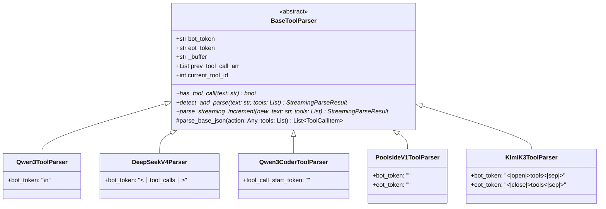
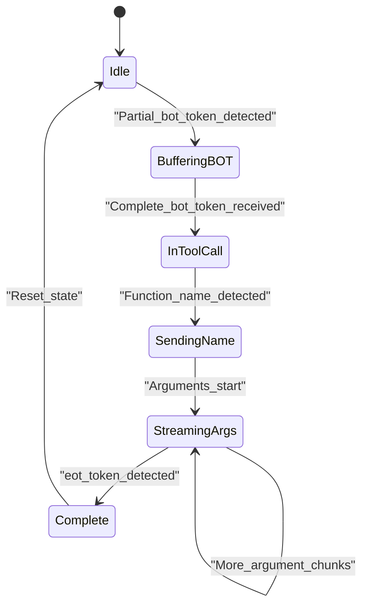

<!-- source: DeepWiki mcp.deepwiki.com · repo NVIDIA/TensorRT-LLM · page 15.4 Tool Calling and Function Calling · fetched 2026-10-26 -->

# Tool Calling and Function Calling

<details>
<summary>Relevant source files</summary>

The following files were used as context for generating this wiki page:

- [examples/serve/chat_templates/tool_chat_template_deepseekr1.jinja](examples/serve/chat_templates/tool_chat_template_deepseekr1.jinja)
- [examples/serve/chat_templates/tool_chat_template_deepseekv31.jinja](examples/serve/chat_templates/tool_chat_template_deepseekv31.jinja)
- [tensorrt_llm/serve/tool_parser/__init__.py](tensorrt_llm/serve/tool_parser/__init__.py)
- [tensorrt_llm/serve/tool_parser/base_tool_parser.py](tensorrt_llm/serve/tool_parser/base_tool_parser.py)
- [tensorrt_llm/serve/tool_parser/core_types.py](tensorrt_llm/serve/tool_parser/core_types.py)
- [tensorrt_llm/serve/tool_parser/deepseekv31_parser.py](tensorrt_llm/serve/tool_parser/deepseekv31_parser.py)
- [tensorrt_llm/serve/tool_parser/deepseekv32_parser.py](tensorrt_llm/serve/tool_parser/deepseekv32_parser.py)
- [tensorrt_llm/serve/tool_parser/deepseekv3_parser.py](tensorrt_llm/serve/tool_parser/deepseekv3_parser.py)
- [tensorrt_llm/serve/tool_parser/glm47_parser.py](tensorrt_llm/serve/tool_parser/glm47_parser.py)
- [tensorrt_llm/serve/tool_parser/glm4_parser.py](tensorrt_llm/serve/tool_parser/glm4_parser.py)
- [tensorrt_llm/serve/tool_parser/kimi_k3_tool_parser.py](tensorrt_llm/serve/tool_parser/kimi_k3_tool_parser.py)
- [tensorrt_llm/serve/tool_parser/poolside_v1_parser.py](tensorrt_llm/serve/tool_parser/poolside_v1_parser.py)
- [tensorrt_llm/serve/tool_parser/qwen3_coder_parser.py](tensorrt_llm/serve/tool_parser/qwen3_coder_parser.py)
- [tensorrt_llm/serve/tool_parser/qwen3_tool_parser.py](tensorrt_llm/serve/tool_parser/qwen3_tool_parser.py)
- [tensorrt_llm/serve/tool_parser/tool_parser_factory.py](tensorrt_llm/serve/tool_parser/tool_parser_factory.py)
- [tensorrt_llm/serve/tool_parser/utils.py](tensorrt_llm/serve/tool_parser/utils.py)
- [tensorrt_llm/tokenizer/deepseek_v32/encoding.py](tensorrt_llm/tokenizer/deepseek_v32/encoding.py)
- [tests/unittest/llmapi/apps/test_tool_parsers.py](tests/unittest/llmapi/apps/test_tool_parsers.py)

</details>


This page documents the tool calling and function calling system in TensorRT-LLM, which enables LLMs to invoke external functions and tools during inference. The system provides OpenAI-compatible APIs for tool definitions, tool call detection, and response formatting across multiple model families with different native tool calling formats.

For general chat completions functionality without tools, see [LLM Class and Generation Methods](3.1). For response post-processing and reasoning extraction, see [Response Post-Processing and Reasoning Parsers](15.5).

## Overview and Architecture

The tool calling system consists of three main components:

1.  **Protocol Layer**: OpenAI-compatible request/call structures defined in `openai_protocol.py`.
2.  **Parser Layer**: Model-specific parsers that detect and extract tool calls from generated text (e.g., `Qwen3ToolParser`, `DeepSeekV4Parser`, `PoolsideV1ToolParser`).
3.  **Integration Layer**: Components in `openai_server.py` and `postprocess_handlers.py` that wire tool parsing into the chat completions pipeline.

### System Architecture Diagram

The following diagram bridges the Natural Language space of the client request to the Code Entity space of the server implementation.

**Diagram: Tool Calling System Architecture**
```mermaid
flowchart TB
    subgraph "Client_Request"
        [Client_Application] --> ["ChatCompletionRequest"]
        ["ChatCompletionRequest"] -- "tools: List[Tool]" --> ["OpenAIServer"]
    end
    
    subgraph "OpenAI_Server_openai_server.py"
        ["OpenAIServer"] --> ["ToolParserFactory"]
        ["ToolParserFactory"] -- "create_tool_parser()" --> ["BaseToolParser"]
    end
    
    subgraph "Model_Inference_llm.py"
        ["LLM.generate_async()"] --> ["RequestOutput"]
    end
    
    subgraph "Tool_Parsers_serve_tool_parser"
        ["BaseToolParser"] --> ["Qwen3ToolParser"]
        ["BaseToolParser"] --> ["DeepSeekV4Parser"]
        ["BaseToolParser"] --> ["KimiK2ToolParser"]
        ["BaseToolParser"] --> ["Qwen3CoderToolParser"]
        ["BaseToolParser"] --> ["PoolsideV1ToolParser"]
        ["BaseToolParser"] --> ["KimiK3ToolParser"]
    end
    
    subgraph "Post_Processing_postprocess_handlers.py"
        ["RequestOutput"] --> ["apply_tool_parser()"]
        ["apply_tool_parser()"] --> ["ToolCallItem"]
        ["ToolCallItem"] --> ["ChatCompletionResponse"]
    end
```
Sources: [tensorrt_llm/serve/postprocess_handlers.py:177-220](), [tensorrt_llm/serve/tool_parser/tool_parser_factory.py:58-85]()

The system supports both streaming and non-streaming modes, with parsers maintaining state across token batches for streaming requests.

## OpenAI Protocol Support

### Request Format
Tool definitions follow the OpenAI API specification. Tools are passed in the `tools` parameter of `ChatCompletionRequest`.

| Field | Type | Description |
| :--- | :--- | :--- |
| `tools` | `List[ChatCompletionToolsParam]` | List of available tools (functions). |
| `tool_choice` | `Union[str, ToolChoice]` | Controls tool invocation behavior (`auto`, `none`, or specific tool). |

Sources: [tensorrt_llm/serve/openai_protocol.py:22-41](), [tensorrt_llm/serve/postprocess_handlers.py:71-114]()

### Response Format
Tool calls are returned in the response message's `tool_calls` field. The `finish_reason` is set to `"tool_calls"` when generation ends due to tool invocation.

Sources: [tensorrt_llm/serve/openai_protocol.py:22-41](), [tensorrt_llm/serve/postprocess_handlers.py:177-220]()

## Tool Parser Architecture

### Base Parser Interface
All tool parsers inherit from `BaseToolParser` which defines the core parsing logic and state management for streaming.

**Diagram: Tool Parser Class Hierarchy**

Sources: [tensorrt_llm/serve/tool_parser/base_tool_parser.py:16-43](), [tensorrt_llm/serve/tool_parser/tool_parser_factory.py:58-74](), [tensorrt_llm/serve/tool_parser/qwen3_coder_parser.py:19-55](), [tensorrt_llm/serve/tool_parser/poolside_v1_parser.py:107-124](), [tensorrt_llm/serve/tool_parser/kimi_k3_tool_parser.py:49-61]()

### Streaming State Management
For streaming responses, parsers maintain persistent state across token batches in `BaseToolParser`. This is critical because a single tool call might be split across multiple network packets. The parser uses an internal `_buffer` to accumulate text until complete structural tags are identified.

**Diagram: Streaming Parser State Machine**

Sources: [tests/unittest/llmapi/apps/test_tool_parsers.py:128-140](), [tensorrt_llm/serve/tool_parser/qwen3_coder_parser.py:64-144](), [tensorrt_llm/serve/tool_parser/base_tool_parser.py:22-38]()

## Model-Specific Parser Formats

The `ToolParserFactory` maps model types to their respective parser implementations using the `parsers` registry.

| Model Family | Tool Parser Class | Format Style |
| :--- | :--- | :--- |
| Qwen3 | `Qwen3ToolParser` | XML tags + JSON (supports bare-JSON fallback) |
| Qwen3 Coder | `Qwen3CoderToolParser` | `<tool_call>` blocks with `<function>` and `<parameter>` |
| DeepSeek V4 | `DeepSeekV4Parser` | Special tokens + XML/JSON |
| Kimi K2 | `KimiK2ToolParser` | Special tokens + ID |
| Kimi K3 | `KimiK3ToolParser` | XTML tag stream (`<|open|>`, `<|close|>`, `<|sep|>`) |
| GLM4 / 4.7 | `Glm47ToolParser` | `<tool_call>` with `<arg_key>` and `<arg_value>` |
| MiniMax M2 | `MiniMaxM2ToolParser` | Custom M2 Format |
| Poolside Laguna | `PoolsideV1ToolParser` | `<tool_call>` with `<arg_key>` and `<arg_value>` |

Sources: [tensorrt_llm/serve/tool_parser/tool_parser_factory.py:21-42](), [tensorrt_llm/serve/tool_parser/tool_parser_factory.py:58-74](), [tensorrt_llm/serve/tool_parser/qwen3_coder_parser.py:19-30](), [tensorrt_llm/serve/tool_parser/poolside_v1_parser.py:110-119](), [tensorrt_llm/serve/tool_parser/qwen3_tool_parser.py:27-32](), [tensorrt_llm/serve/tool_parser/kimi_k3_tool_parser.py:3-28]()

### Automatic Resolution
The `resolve_auto_tool_parser` function automatically selects a parser by reading the `model_type` from the model's `config.json`.

Sources: [tensorrt_llm/serve/tool_parser/tool_parser_factory.py:45-55]()

## Specialized Parser Implementations

### DeepSeek V3/V4 Specialized Parsing
The `DeepSeekV32Parser` supports distinct parameter formats, including XML-style parameter tags and direct JSON objects inside invoke blocks. It requires `needs_raw_special_tokens = True` to handle specific DSML delimiters like `<｜DSML｜invoke name="...">`.

Sources: [tensorrt_llm/serve/tool_parser/deepseekv32_parser.py:13-64](), [tensorrt_llm/tokenizer/deepseek_v32/encoding.py:8-33]()

### Qwen 3 Bare-JSON Fallback
Certain Qwen3 chat templates emit tool calls as bare JSON objects without the `<tool_call>` wrapper (notably when reasoning parsers strip thinking blocks). `Qwen3ToolParser` implements a state machine (`_STREAM_MODE_BARE_JSON`) to detect and recover these calls using `raw_decode` to handle leading JSON followed by trailing content.

Sources: [tensorrt_llm/serve/tool_parser/qwen3_tool_parser.py:37-53](), [tensorrt_llm/serve/tool_parser/qwen3_tool_parser.py:77-98]()

### Kimi K3 XTML Parsing
The `KimiK3ToolParser` handles an XTML tag format using special tokens like `<|open|>`, `<|close|>`, and `<|sep|>`. It supports both discrete `argument` tags (where values are typed as string, number, etc.) and raw `json` blocks. Because XTML argument bodies are tag-structured rather than pure JSON, this parser does not support structural-tag constrained decoding (`supports_structural_tag() -> False`).

Sources: [tensorrt_llm/serve/tool_parser/kimi_k3_tool_parser.py:3-28](), [tensorrt_llm/serve/tool_parser/kimi_k3_tool_parser.py:97-101](), [tensorrt_llm/serve/tool_parser/kimi_k3_tool_parser.py:121-140]()

### Poolside Laguna (V1) Parsing
The `PoolsideV1ToolParser` handles a specific structural tag format where arguments are explicitly wrapped in keys and values.

```text
<tool_call>function-name
<arg_key>argument-key</arg_key>
<arg_value>value-of-argument-key</arg_value>
</tool_call>
```
The parser uses `infer_type_from_json_schema` to correctly cast string values into their intended types (e.g., boolean, number) as defined in the tool schema.

Sources: [tensorrt_llm/serve/tool_parser/poolside_v1_parser.py:110-119](), [tensorrt_llm/serve/tool_parser/utils.py:60-135]()

## Reasoning Content Extraction

Many modern models generate reasoning content alongside tool calls. The `ReasoningParserFactory` provides specialized parsers like `NemotronV3ReasoningParser` and `DeepSeekV4ReasoningParser` to separate reasoning from content. For models like Kimi K3, the tool section typically terminates the message, meaning any text following the tools block is treated as structural framing rather than content.

Sources: [tensorrt_llm/llmapi/reasoning_parser.py:94-132](), [tensorrt_llm/serve/tool_parser/kimi_k3_tool_parser.py:62-70]()

## Integration with Post-Processing

Tool parsing is integrated into the post-processing pipeline via `apply_tool_parser`. The `ChatPostprocArgs` class carries the `tool_parser_dict`, which stores a parser instance per output index to ensure thread safety and state isolation for concurrent generations.

Sources: [tensorrt_llm/serve/postprocess_handlers.py:71-92](), [tensorrt_llm/serve/postprocess_handlers.py:157-175]()

## Testing and Validation

The tool calling system is validated through several test suites:
1.  **Parser Unit Tests**: `tests/unittest/llmapi/apps/test_tool_parsers.py` verifies model-specific formats and incremental streaming logic using fixtures like `sample_tools`.
2.  **Reasoning Tests**: `tests/unittest/llmapi/test_reasoning_parser.py` validates extraction of `<think>` blocks across streaming and non-streaming scenarios.

Sources: [tests/unittest/llmapi/apps/test_tool_parsers.py:55-97](), [tests/unittest/llmapi/apps/test_tool_parsers.py:128-191](), [tests/unittest/llmapi/test_reasoning_parser.py:30-44]()

---

