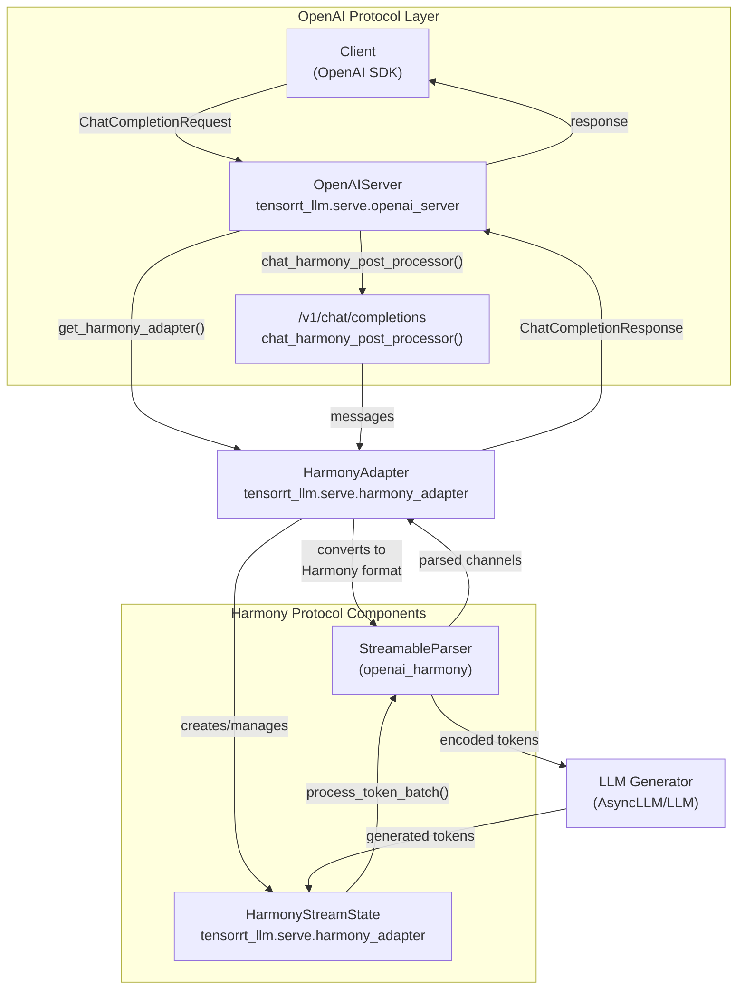
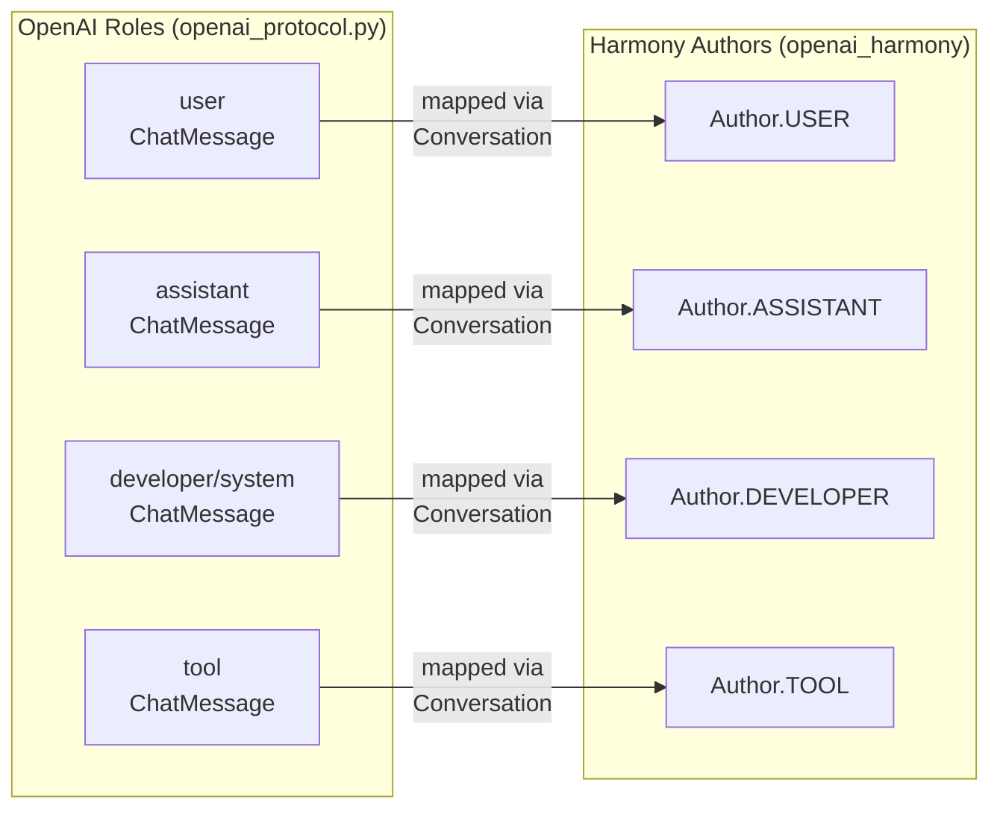
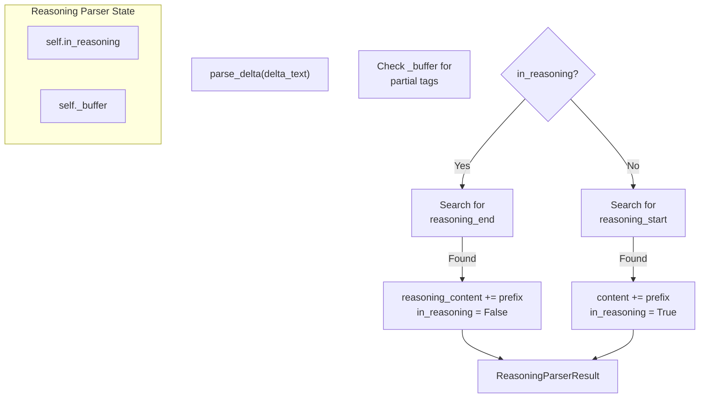
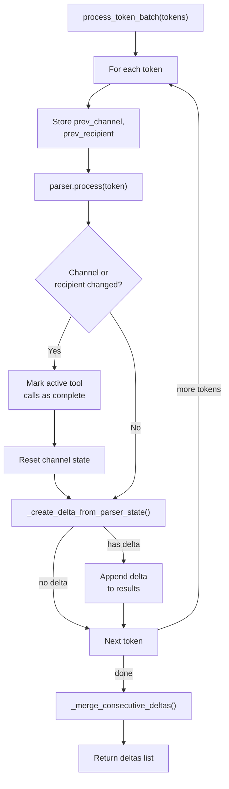

<!-- source: DeepWiki mcp.deepwiki.com · repo NVIDIA/TensorRT-LLM · page 15.6 Harmony Adapter for GPT-OSS Models · fetched 2026-10-26 -->

# Harmony Adapter for GPT-OSS Models

Relevant source files

The following files were used as context for generating this wiki page:

- [tensorrt_llm/_torch/models/modeling_gpt_oss.py](tensorrt_llm/_torch/models/modeling_gpt_oss.py)
- [tensorrt_llm/llmapi/reasoning_parser.py](tensorrt_llm/llmapi/reasoning_parser.py)
- [tensorrt_llm/llmapi/thinking_budget.py](tensorrt_llm/llmapi/thinking_budget.py)
- [tensorrt_llm/sampling_params.py](tensorrt_llm/sampling_params.py)
- [tensorrt_llm/serve/harmony_adapter.py](tensorrt_llm/serve/harmony_adapter.py)
- [tensorrt_llm/serve/openai_protocol.py](tensorrt_llm/serve/openai_protocol.py)
- [tensorrt_llm/serve/openai_server.py](tensorrt_llm/serve/openai_server.py)
- [tensorrt_llm/serve/postprocess_handlers.py](tensorrt_llm/serve/postprocess_handlers.py)
- [tensorrt_llm/serve/responses_utils.py](tensorrt_llm/serve/responses_utils.py)
- [tests/unittest/_torch/modeling/test_modeling_gpt_oss.py](tests/unittest/_torch/modeling/test_modeling_gpt_oss.py)
- [tests/unittest/llmapi/apps/_test_openai_chat.py](tests/unittest/llmapi/apps/_test_openai_chat.py)
- [tests/unittest/llmapi/apps/_test_openai_chat_harmony.py](tests/unittest/llmapi/apps/_test_openai_chat_harmony.py)
- [tests/unittest/llmapi/apps/_test_openai_chat_harmony_perf_metrics.py](tests/unittest/llmapi/apps/_test_openai_chat_harmony_perf_metrics.py)
- [tests/unittest/llmapi/apps/_test_openai_completions.py](tests/unittest/llmapi/apps/_test_openai_completions.py)
- [tests/unittest/llmapi/apps/_test_openai_reasoning.py](tests/unittest/llmapi/apps/_test_openai_reasoning.py)
- [tests/unittest/llmapi/apps/_test_openai_responses.py](tests/unittest/llmapi/apps/_test_openai_responses.py)
- [tests/unittest/llmapi/apps/test_harmony_channel_validation.py](tests/unittest/llmapi/apps/test_harmony_channel_validation.py)
- [tests/unittest/llmapi/apps/test_harmony_parsing.py](tests/unittest/llmapi/apps/test_harmony_parsing.py)
- [tests/unittest/llmapi/test_reasoning_parser.py](tests/unittest/llmapi/test_reasoning_parser.py)
- [tests/unittest/llmapi/test_sampling_params.py](tests/unittest/llmapi/test_sampling_params.py)

## Purpose and Scope

The Harmony Adapter provides a translation layer between the OpenAI-compatible chat completion API and the Harmony protocol used by GPT-OSS models. GPT-OSS models utilize a channel-based message format with specialized reasoning tokens, requiring conversion to and from standard OpenAI protocol messages. This adapter enables GPT-OSS models to be served through the standard `/v1/chat/completions` endpoint while preserving the model's unique reasoning and tool-calling capabilities.

For general OpenAI server functionality, see [tensorrt_llm/serve/openai_protocol.py:147-162](). For tool parsing in other models, see [tensorrt_llm/serve/tool_parser/tool_parser_factory.py:22-45]().

**Sources:** [tensorrt_llm/serve/harmony_adapter.py:1-15](), [tensorrt_llm/serve/postprocess_handlers.py:23-46]()

## Architecture Overview

The following diagram illustrates how the `HarmonyAdapter` and its associated `HarmonyStreamState` integrate into the TensorRT-LLM serving stack.

**Title: Harmony Adapter Integration Architecture**

**Sources:** [tensorrt_llm/serve/harmony_adapter.py:54-61](), [tensorrt_llm/serve/harmony_adapter.py:102-111](), [tensorrt_llm/serve/postprocess_handlers.py:23-46](), [tensorrt_llm/serve/openai_server.py:111-112]()

## Harmony Protocol Concepts

### Channel-Based Message Structure

Harmony protocol organizes messages into distinct channels that control content flow and reasoning visibility. These are handled within the `HarmonyStreamState` to track transitions.

| Channel | Purpose | Example Usage |
|---------|---------|---------------|
| `analysis` | Internal reasoning (thinking) | Model's step-by-step thought process |
| `commentary` | Tool calls and intermediate results | Function invocations and outputs |
| `final` | User-visible response | The actual answer to present |

The model generates content in these channels using special tokens, and transitions are managed by the `StreamableParser` within `HarmonyStreamState` [tensorrt_llm/serve/harmony_adapter.py:61]().

**Sources:** [tensorrt_llm/serve/harmony_adapter.py:89-91](), [tensorrt_llm/serve/harmony_adapter.py:116-127]()

### Role and Author Mapping

The mapping between OpenAI roles and Harmony authors is critical for maintaining conversation context in GPT-OSS models. The conversion logic handles standard roles like `user` and `assistant`, as well as mapping `system` messages to Harmony's `developer` role with a specific "Instructions:" prefix [tensorrt_llm/serve/responses_utils.py:131-136]().

**Title: Role Mapping Between Protocols**

**Sources:** [tensorrt_llm/serve/harmony_adapter.py:11-15](), [tensorrt_llm/serve/openai_protocol.py:21-41](), [tensorrt_llm/serve/responses_utils.py:128-148]()

## Reasoning Parser System

Beyond GPT-OSS specific Harmony handling, the codebase includes a generic `ReasoningParserFactory` to handle reasoning extraction for models like DeepSeek-R1 and Qwen3.

### Reasoning Parser Factory

The `ReasoningParserFactory` manages the creation of specialized parsers that identify reasoning content (e.g., within `` |
| `qwen3` | Qwen3 | `<thought>` / `</thought>` |
| `minimax_m2` | MiniMax-M2 | `<thought>` / `</thought>` |
| `laguna` | Laguna | `<thought>` / `</thought>` |

**Sources:** [tensorrt_llm/llmapi/reasoning_parser.py:68-91](), [tensorrt_llm/llmapi/reasoning_parser.py:162-165]()

### Streaming Logic and Delta Parsing

The `BaseReasoningParser` defines the interface for both full text and incremental delta parsing. The `DeepSeekR1Parser` implementation (referenced in tests) handles edge cases where delimiters are split across streaming chunks by maintaining an internal buffer [tensorrt_llm/llmapi/reasoning_parser.py:149-180]().

**Title: Reasoning Delta Parsing Data Flow**

**Sources:** [tensorrt_llm/llmapi/reasoning_parser.py:94-132](), [tensorrt_llm/llmapi/reasoning_parser.py:172-180](), [tests/unittest/llmapi/test_reasoning_parser.py:101-112]()

## HarmonyStreamState Management

The `HarmonyStreamState` class maintains the parsing state for a single request across multiple token batches. This is essential because the engine provides incremental token batches, while Harmony parsing requires continuous state for channel transitions and tool calls.

### State Lifecycle and Attributes

Each streaming request gets its own `HarmonyStreamState` instance that persists across token batches. The state tracks:
- **Parser state**: `StreamableParser` instance for the `Role.ASSISTANT` [tensorrt_llm/serve/harmony_adapter.py:61]().
- **Tool calls**: A dictionary mapping `tool_call_id` to tool information (name, arguments, index) [tensorrt_llm/serve/harmony_adapter.py:83-84]().
- **Channel tracking**: `current_channel_state` and `generated_channels` list to validate output sequences [tensorrt_llm/serve/harmony_adapter.py:89-91]().
- **Sent arguments**: `sent_tool_arguments` to track delta lengths for incremental tool call streaming [tensorrt_llm/serve/harmony_adapter.py:95]().

**Sources:** [tensorrt_llm/serve/harmony_adapter.py:54-98]()

### Token Batch Processing Flow

The `process_token_batch()` method processes each token sequentially, detecting channel transitions and generating appropriate OpenAI-compatible deltas. It includes a `_merge_consecutive_deltas` step to reduce SSE overhead by combining consecutive tool call arguments or content deltas [tensorrt_llm/serve/harmony_adapter.py:155-162]().

**Title: Token Batch Processing Flow in HarmonyStreamState**

**Sources:** [tensorrt_llm/serve/harmony_adapter.py:102-162]()

## GPT-OSS Model Architecture

The GPT-OSS model implementation in TensorRT-LLM includes specialized modules for handling attention sinks and Mixture-of-Experts (MoE) with slot-based load balancing.

### Attention with Sinks
The `AttentionBlock` for GPT-OSS uses `PositionEmbeddingType.yarn` and NeoX-style RoPE [tensorrt_llm/_torch/models/modeling_gpt_oss.py:53-70](). A key feature is the support for `attention_sinks`, which are passed to the `TRTLLM` attention backend [tensorrt_llm/_torch/models/modeling_gpt_oss.py:118-129]().

### MLP and MoE
The `MLPBlock` utilizes a `RenormalizeMoeRoutingMethod` and supports a configurable number of slots for load balancing via `moe_load_balancer` [tensorrt_llm/_torch/models/modeling_gpt_oss.py:152-175](). It can be instantiated with different backends such as `CUTLASS` or `TRITON` [tensorrt_llm/_torch/models/modeling_gpt_oss.py:186-193]().

**Sources:** [tensorrt_llm/_torch/models/modeling_gpt_oss.py:42-136](), [tensorrt_llm/_torch/models/modeling_gpt_oss.py:138-200]()

## Response Handling

### Reasoning Effort and Budget

The Harmony protocol supports varying reasoning efforts (High, Medium, Low). These are mapped from the request to the `ReasoningEffort` enum within `responses_utils.py` [tensorrt_llm/serve/responses_utils.py:79-83](). Additionally, `add_thinking_budget_logits_processor` can be used to control the model's reasoning length [tensorrt_llm/llmapi/thinking_budget.py:22-45]().

**Sources:** [tensorrt_llm/serve/responses_utils.py:79-83](), [tensorrt_llm/llmapi/thinking_budget.py:22-45]()

### Channel Validation

The `_check_channel_valid` utility ensures that the generated channel sequence is logical. It prevents the model from returning to an `analysis` (reasoning) state once it has transitioned to the `final` response. If both `analysis` and `final` channels have been generated, the total number of unique channel transitions must not exceed 2 [tensorrt_llm/serve/harmony_adapter.py:34-45]().

**Sources:** [tensorrt_llm/serve/harmony_adapter.py:34-45]()

---

