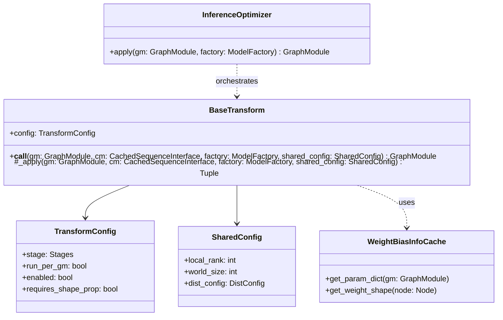

<!-- source: DeepWiki mcp.deepwiki.com · repo NVIDIA/TensorRT-LLM · page 16 AutoDeploy System · fetched 2026-10-26 -->

# AutoDeploy System

<details>
<summary>Relevant source files</summary>

The following files were used as context for generating this wiki page:

- [examples/auto_deploy/.vscode/launch.json](examples/auto_deploy/.vscode/launch.json)
- [examples/auto_deploy/.vscode/settings.json](examples/auto_deploy/.vscode/settings.json)
- [examples/auto_deploy/README.md](examples/auto_deploy/README.md)
- [examples/auto_deploy/build_and_run_ad.py](examples/auto_deploy/build_and_run_ad.py)
- [tensorrt_llm/_torch/auto_deploy/config/default.yaml](tensorrt_llm/_torch/auto_deploy/config/default.yaml)
- [tensorrt_llm/_torch/auto_deploy/custom_ops/attention/trtllm_attention.py](tensorrt_llm/_torch/auto_deploy/custom_ops/attention/trtllm_attention.py)
- [tensorrt_llm/_torch/auto_deploy/custom_ops/attention_interface.py](tensorrt_llm/_torch/auto_deploy/custom_ops/attention_interface.py)
- [tensorrt_llm/_torch/auto_deploy/custom_ops/fused_moe/torch_moe.py](tensorrt_llm/_torch/auto_deploy/custom_ops/fused_moe/torch_moe.py)
- [tensorrt_llm/_torch/auto_deploy/custom_ops/fused_moe/triton_moe.py](tensorrt_llm/_torch/auto_deploy/custom_ops/fused_moe/triton_moe.py)
- [tensorrt_llm/_torch/auto_deploy/custom_ops/fused_moe/trtllm_moe.py](tensorrt_llm/_torch/auto_deploy/custom_ops/fused_moe/trtllm_moe.py)
- [tensorrt_llm/_torch/auto_deploy/llm_args.py](tensorrt_llm/_torch/auto_deploy/llm_args.py)
- [tensorrt_llm/_torch/auto_deploy/models/factory.py](tensorrt_llm/_torch/auto_deploy/models/factory.py)
- [tensorrt_llm/_torch/auto_deploy/models/hf.py](tensorrt_llm/_torch/auto_deploy/models/hf.py)
- [tensorrt_llm/_torch/auto_deploy/models/quant_config_reader.py](tensorrt_llm/_torch/auto_deploy/models/quant_config_reader.py)
- [tensorrt_llm/_torch/auto_deploy/shim/ad_executor.py](tensorrt_llm/_torch/auto_deploy/shim/ad_executor.py)
- [tensorrt_llm/_torch/auto_deploy/shim/demollm.py](tensorrt_llm/_torch/auto_deploy/shim/demollm.py)
- [tensorrt_llm/_torch/auto_deploy/shim/interface.py](tensorrt_llm/_torch/auto_deploy/shim/interface.py)
- [tensorrt_llm/_torch/auto_deploy/transform/interface.py](tensorrt_llm/_torch/auto_deploy/transform/interface.py)
- [tensorrt_llm/_torch/auto_deploy/transform/library/collectives.py](tensorrt_llm/_torch/auto_deploy/transform/library/collectives.py)
- [tensorrt_llm/_torch/auto_deploy/transform/library/fused_moe.py](tensorrt_llm/_torch/auto_deploy/transform/library/fused_moe.py)
- [tensorrt_llm/_torch/auto_deploy/transform/library/fusion.py](tensorrt_llm/_torch/auto_deploy/transform/library/fusion.py)
- [tensorrt_llm/_torch/auto_deploy/transform/library/kvcache.py](tensorrt_llm/_torch/auto_deploy/transform/library/kvcache.py)
- [tensorrt_llm/_torch/auto_deploy/transform/library/load_weights.py](tensorrt_llm/_torch/auto_deploy/transform/library/load_weights.py)
- [tensorrt_llm/_torch/auto_deploy/transform/library/multi_stream_moe.py](tensorrt_llm/_torch/auto_deploy/transform/library/multi_stream_moe.py)
- [tensorrt_llm/_torch/auto_deploy/transform/library/quantization.py](tensorrt_llm/_torch/auto_deploy/transform/library/quantization.py)
- [tensorrt_llm/_torch/auto_deploy/transform/library/quantize_moe.py](tensorrt_llm/_torch/auto_deploy/transform/library/quantize_moe.py)
- [tensorrt_llm/_torch/auto_deploy/transform/library/rms_norm.py](tensorrt_llm/_torch/auto_deploy/transform/library/rms_norm.py)
- [tensorrt_llm/_torch/auto_deploy/transform/library/sharding.py](tensorrt_llm/_torch/auto_deploy/transform/library/sharding.py)
- [tensorrt_llm/_torch/auto_deploy/transform/library/sharding_ir.py](tensorrt_llm/_torch/auto_deploy/transform/library/sharding_ir.py)
- [tensorrt_llm/_torch/auto_deploy/transform/library/ssm_cache.py](tensorrt_llm/_torch/auto_deploy/transform/library/ssm_cache.py)
- [tensorrt_llm/_torch/auto_deploy/transform/optimizer.py](tensorrt_llm/_torch/auto_deploy/transform/optimizer.py)
- [tensorrt_llm/_torch/auto_deploy/utils/cuda_graph.py](tensorrt_llm/_torch/auto_deploy/utils/cuda_graph.py)
- [tensorrt_llm/_torch/auto_deploy/utils/node_utils.py](tensorrt_llm/_torch/auto_deploy/utils/node_utils.py)
- [tensorrt_llm/_torch/auto_deploy/utils/quantization_utils.py](tensorrt_llm/_torch/auto_deploy/utils/quantization_utils.py)
- [tests/unittest/auto_deploy/multigpu/compile/test_bypass_captured_graphs.py](tests/unittest/auto_deploy/multigpu/compile/test_bypass_captured_graphs.py)
- [tests/unittest/auto_deploy/singlegpu/custom_ops/moe/test_triton_moe.py](tests/unittest/auto_deploy/singlegpu/custom_ops/moe/test_triton_moe.py)
- [tests/unittest/auto_deploy/singlegpu/custom_ops/moe/test_trtllm_moe.py](tests/unittest/auto_deploy/singlegpu/custom_ops/moe/test_trtllm_moe.py)
- [tests/unittest/auto_deploy/singlegpu/transformations/library/test_moe_fusion.py](tests/unittest/auto_deploy/singlegpu/transformations/library/test_moe_fusion.py)
- [tests/unittest/auto_deploy/singlegpu/transformations/library/test_trtllm_gen_diag.py](tests/unittest/auto_deploy/singlegpu/transformations/library/test_trtllm_gen_diag.py)

</details>


## Purpose and Scope

AutoDeploy is a graph-transformation-based inference optimization system for PyTorch models within TensorRT-LLM. It takes a HuggingFace-compatible model, exports it to a `torch.fx.GraphModule`, and applies a configurable sequence of transformations including pattern standardization, quantization, tensor/expert parallelism sharding, weight loading, kernel fusion, and compilation. [tensorrt_llm/_torch/auto_deploy/config/default.yaml:16-18]()

AutoDeploy operates as an alternative backend to the standard PyTorch inference path. It exposes its own `LLM` class (distinct from the standard `LLM` class described in [LLM Class and Generation Methods](#3.1)). The sharding it performs is automated at the graph IR level, abstracting away manual distributed setup. [tensorrt_llm/_torch/auto_deploy/transform/library/sharding.py:15-39]()

All source code lives under `tensorrt_llm/_torch/auto_deploy/`.

---

## Entry Points

AutoDeploy exposes primary user-facing classes and specialized shim layers:

| Class / Utility | Purpose |
|---|---|
| `LLM` (AutoDeploy) | Main entry point in `llm.py`; orchestrates the `InferenceOptimizer` and `PyExecutor` runtime. [tensorrt_llm/_torch/auto_deploy/llm_args.py:72-73]() |
| `InferenceOptimizer` | The central orchestrator that manages the transformation pipeline and `TransformRegistry`. [tensorrt_llm/_torch/auto_deploy/transform/optimizer.py:61-61]() |
| `ADEngine` | The shim layer that bridges the transformed model to the `PyExecutor` runtime. [tensorrt_llm/_torch/auto_deploy/shim/ad_executor.py:134-134]() |
| `CachedSequenceInterface` | Manages sequence and cache configuration, acting as the single source of truth for `SequenceInfo`. [tensorrt_llm/_torch/auto_deploy/shim/interface.py:97-103]() |

The `backend` field on `LlmArgs` is internally set to `"_autodeploy"` to trigger the transformation pipeline. [tensorrt_llm/_torch/auto_deploy/llm_args.py:77-81]()

### Usage Example
```python
from tensorrt_llm._torch.auto_deploy import LLM as AutoDeployLLM

# Construct the LLM high-level interface object with autodeploy as backend
llm = AutoDeployLLM(
    model="meta-llama/Llama-3.1-8B",
    world_size=2,
    attn_backend="flashinfer",
    compile_backend="torch-compile"
)
```
Sources: [tensorrt_llm/_torch/auto_deploy/llm_args.py:72-81](), [tensorrt_llm/_torch/auto_deploy/shim/ad_executor.py:34-35](), [tensorrt_llm/_torch/auto_deploy/shim/interface.py:97-116]()

---

## Configuration and Registry

AutoDeploy behavior is driven by YAML configurations and a model registry that maps model names to specific optimization flags.

### Model Registry
The system uses a `ModelFactoryRegistry` to handle different model architectures and provide quantization configurations. [tensorrt_llm/_torch/auto_deploy/llm_args.py:31-31](), [tensorrt_llm/_torch/auto_deploy/models/quant_config_reader.py:53-53]()

For details on supported models, see [AutoDeploy Model Registry](#16.5).

### Transformation Configuration
The `default.yaml` defines the global sequence of transforms and their default parameters. [tensorrt_llm/_torch/auto_deploy/config/default.yaml:18-230]() Key configurable aspects include:
* **Quantization**: Enabling FP8, NVFP4, or INT4 transforms. [tensorrt_llm/_torch/auto_deploy/config/default.yaml:80-97]()
* **Fusion**: Backend selection (e.g., `trtllm`, `triton`) for fused operations. [tensorrt_llm/_torch/auto_deploy/config/default.yaml:175-206]()

Sources: [tensorrt_llm/_torch/auto_deploy/config/default.yaml:18-230](), [tensorrt_llm/_torch/auto_deploy/llm_args.py:61-64]()

---

## Transformation Pipeline Architecture

The AutoDeploy system uses a stage-based pipeline to transform a PyTorch model into an optimized inference engine.

For details, see [Transformation Pipeline Architecture](#16.1).

### `Stages` Enum (Ordered)
The `Stages` enum in `transform/interface.py` defines the strict execution order of all transforms. [tensorrt_llm/_torch/auto_deploy/transform/interface.py:109-125]()

**AutoDeploy Stage Flow**

Sources: [tensorrt_llm/_torch/auto_deploy/transform/interface.py:109-125]()

### Transform Framework Class Map
Transforms implement the `BaseTransform` interface and are managed by the `InferenceOptimizer`. [tensorrt_llm/_torch/auto_deploy/transform/interface.py:155-195]()


Sources: [tensorrt_llm/_torch/auto_deploy/transform/interface.py:133-189](), [tensorrt_llm/_torch/auto_deploy/utils/node_utils.py:195-206](), [tensorrt_llm/_torch/auto_deploy/transform/optimizer.py:61-70]()

---

## Sharding Transformations

The sharding system automatically partitions model weights and operations across multiple GPUs. It uses a hint-driven IR sharding system, with a heuristic-based fallback for unported models. [tensorrt_llm/_torch/auto_deploy/transform/library/sharding.py:15-23]()

For details, see [Sharding Transformations](#16.2).

### Sharding Dimensions

| `ShardingDim` | Description | Dimension |
|---|---|---|
| `TP` | Tensor Parallelism — splits linear layer weights. [tensorrt_llm/_torch/auto_deploy/transform/library/sharding.py:25-36]() | Row/Column |
| `EP` | Expert Parallelism — distributes MoE experts. [tensorrt_llm/_torch/auto_deploy/config/default.yaml:141-141]() | Expert Batch |
| `BMM` | Batch Matrix Multiply — slices batch dimension. [tensorrt_llm/_torch/auto_deploy/config/default.yaml:141-141]() | Batch |

Sources: [tensorrt_llm/_torch/auto_deploy/transform/library/sharding.py:25-39](), [tensorrt_llm/_torch/auto_deploy/config/default.yaml:138-150]()

---

## Pattern Matching and Fusion Transforms

AutoDeploy identifies high-level patterns (MoE, Attention, RMSNorm, Mamba SSM) and replaces them with optimized kernels.

For details, see [Pattern Matching and Fusion Transforms](#16.3).

### Mixture of Experts (MoE) Fusion
Mixture of Experts patterns are detected and replaced with optimized backend implementations. [tensorrt_llm/_torch/auto_deploy/transform/library/fused_moe.py:180-200]()

| Feature | Implementation |
|---|---|
| **All-to-All** | Used for cross-rank expert communication via `MoeAlltoAll`. [tensorrt_llm/_torch/auto_deploy/custom_ops/fused_moe/trtllm_moe.py:119-132]() |
| **Quantization** | Supports FP8, NVFP4, and FineGrained FP8 MoE kernels. [tensorrt_llm/_torch/auto_deploy/config/default.yaml:80-97]() |
| **Multi-Stream** | Optimized execution for MoE using multiple CUDA streams. [tensorrt_llm/_torch/auto_deploy/transform/library/multi_stream_moe.py:15-18]() |

### Attention and KV Cache
The `InsertCachedAttention` transform automatically adds KV cache management into fused MHA/MLA ops. It uses `KVPagedResourceHandler` to drive KV grouping, ensuring layers with identical requirements share cache pools. [tensorrt_llm/_torch/auto_deploy/transform/library/kvcache.py:17-40]()

Sources: [tensorrt_llm/_torch/auto_deploy/transform/library/fused_moe.py:180-204](), [tensorrt_llm/_torch/auto_deploy/custom_ops/fused_moe/trtllm_moe.py:119-132](), [tensorrt_llm/_torch/auto_deploy/transform/library/kvcache.py:17-40](), [tensorrt_llm/_torch/auto_deploy/config/default.yaml:42-74]()

---

## Compilation and CUDA Graph Support

The final stage compiles the optimized graph. AutoDeploy supports various backends including `torch-compile` and a specialized "piecewise" CUDA graph strategy for handling dynamic shapes. [tensorrt_llm/_torch/auto_deploy/shim/ad_executor.py:132-153]()

For details, see [Compilation and CUDA Graph Support](#16.4).

### Compilation Components

| Component | Role |
|---|---|
| `CompileModel` | The transform that invokes the selected compilation backend. [tensorrt_llm/_torch/auto_deploy/config/default.yaml:227-228]() |
| `BypassCapturedGraphs` | Utility to force captured-graph wrappers to short-circuit to eager mode when shapes match but per-rank scalar args are stale. [tensorrt_llm/_torch/auto_deploy/shim/ad_executor.py:143-150]() |
| `maybe_pad_for_cuda_graph` | Decorator in `ADEngine` that orchestrates batch padding for CUDA graph compatibility. [tensorrt_llm/_torch/auto_deploy/shim/ad_executor.py:132-166]() |

Sources: [tensorrt_llm/_torch/auto_deploy/config/default.yaml:225-230](), [tensorrt_llm/_torch/auto_deploy/shim/ad_executor.py:132-170]()

---

