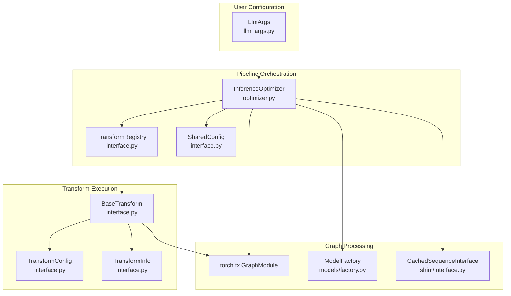
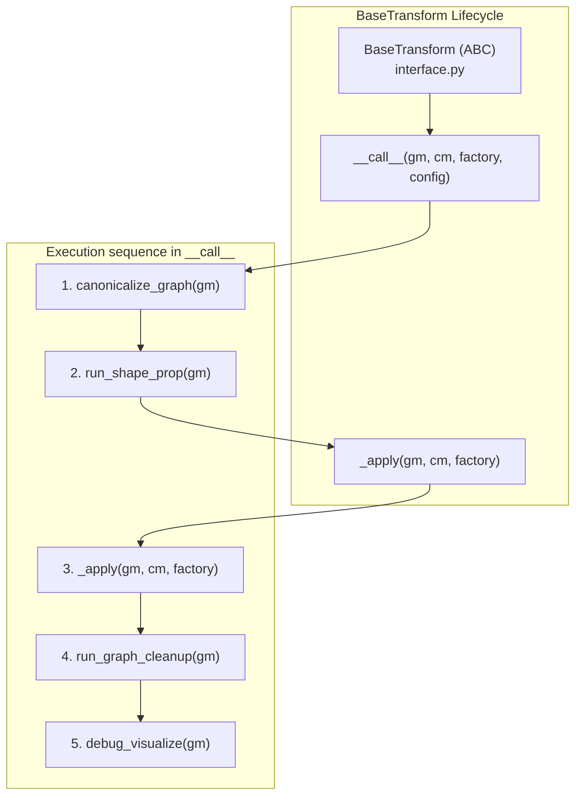
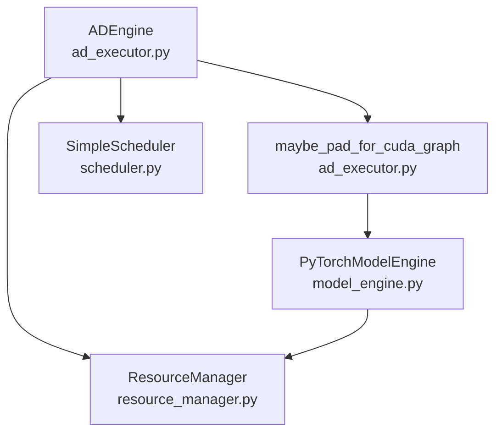

<!-- source: DeepWiki mcp.deepwiki.com · repo NVIDIA/TensorRT-LLM · page 16.1 Transformation Pipeline Architecture · fetched 2026-10-26 -->

# Transformation Pipeline Architecture

Relevant source files

The following files were used as context for generating this wiki page:

- [examples/auto_deploy/.vscode/launch.json](examples/auto_deploy/.vscode/launch.json)
- [examples/auto_deploy/.vscode/settings.json](examples/auto_deploy/.vscode/settings.json)
- [examples/auto_deploy/README.md](examples/auto_deploy/README.md)
- [examples/auto_deploy/build_and_run_ad.py](examples/auto_deploy/build_and_run_ad.py)
- [tensorrt_llm/_torch/auto_deploy/config/default.yaml](tensorrt_llm/_torch/auto_deploy/config/default.yaml)
- [tensorrt_llm/_torch/auto_deploy/custom_ops/attention/trtllm_attention.py](tensorrt_llm/_torch/auto_deploy/custom_ops/attention/trtllm_attention.py)
- [tensorrt_llm/_torch/auto_deploy/custom_ops/attention_interface.py](tensorrt_llm/_torch/auto_deploy/custom_ops/attention_interface.py)
- [tensorrt_llm/_torch/auto_deploy/custom_ops/fused_moe/torch_moe.py](tensorrt_llm/_torch/auto_deploy/custom_ops/fused_moe/torch_moe.py)
- [tensorrt_llm/_torch/auto_deploy/custom_ops/fused_moe/triton_moe.py](tensorrt_llm/_torch/auto_deploy/custom_ops/fused_moe/triton_moe.py)
- [tensorrt_llm/_torch/auto_deploy/custom_ops/fused_moe/trtllm_moe.py](tensorrt_llm/_torch/auto_deploy/custom_ops/fused_moe/trtllm_moe.py)
- [tensorrt_llm/_torch/auto_deploy/llm_args.py](tensorrt_llm/_torch/auto_deploy/llm_args.py)
- [tensorrt_llm/_torch/auto_deploy/models/factory.py](tensorrt_llm/_torch/auto_deploy/models/factory.py)
- [tensorrt_llm/_torch/auto_deploy/models/hf.py](tensorrt_llm/_torch/auto_deploy/models/hf.py)
- [tensorrt_llm/_torch/auto_deploy/models/quant_config_reader.py](tensorrt_llm/_torch/auto_deploy/models/quant_config_reader.py)
- [tensorrt_llm/_torch/auto_deploy/shim/ad_executor.py](tensorrt_llm/_torch/auto_deploy/shim/ad_executor.py)
- [tensorrt_llm/_torch/auto_deploy/shim/demollm.py](tensorrt_llm/_torch/auto_deploy/shim/demollm.py)
- [tensorrt_llm/_torch/auto_deploy/shim/interface.py](tensorrt_llm/_torch/auto_deploy/shim/interface.py)
- [tensorrt_llm/_torch/auto_deploy/transform/interface.py](tensorrt_llm/_torch/auto_deploy/transform/interface.py)
- [tensorrt_llm/_torch/auto_deploy/transform/library/collectives.py](tensorrt_llm/_torch/auto_deploy/transform/library/collectives.py)
- [tensorrt_llm/_torch/auto_deploy/transform/library/fused_moe.py](tensorrt_llm/_torch/auto_deploy/transform/library/fused_moe.py)
- [tensorrt_llm/_torch/auto_deploy/transform/library/fusion.py](tensorrt_llm/_torch/auto_deploy/transform/library/fusion.py)
- [tensorrt_llm/_torch/auto_deploy/transform/library/kvcache.py](tensorrt_llm/_torch/auto_deploy/transform/library/kvcache.py)
- [tensorrt_llm/_torch/auto_deploy/transform/library/load_weights.py](tensorrt_llm/_torch/auto_deploy/transform/library/load_weights.py)
- [tensorrt_llm/_torch/auto_deploy/transform/library/multi_stream_moe.py](tensorrt_llm/_torch/auto_deploy/transform/library/multi_stream_moe.py)
- [tensorrt_llm/_torch/auto_deploy/transform/library/quantization.py](tensorrt_llm/_torch/auto_deploy/transform/library/quantization.py)
- [tensorrt_llm/_torch/auto_deploy/transform/library/quantize_moe.py](tensorrt_llm/_torch/auto_deploy/transform/library/quantize_moe.py)
- [tensorrt_llm/_torch/auto_deploy/transform/library/rms_norm.py](tensorrt_llm/_torch/auto_deploy/transform/library/rms_norm.py)
- [tensorrt_llm/_torch/auto_deploy/transform/library/sharding.py](tensorrt_llm/_torch/auto_deploy/transform/library/sharding.py)
- [tensorrt_llm/_torch/auto_deploy/transform/library/sharding_ir.py](tensorrt_llm/_torch/auto_deploy/transform/library/sharding_ir.py)
- [tensorrt_llm/_torch/auto_deploy/transform/library/ssm_cache.py](tensorrt_llm/_torch/auto_deploy/transform/library/ssm_cache.py)
- [tensorrt_llm/_torch/auto_deploy/transform/optimizer.py](tensorrt_llm/_torch/auto_deploy/transform/optimizer.py)
- [tensorrt_llm/_torch/auto_deploy/utils/cuda_graph.py](tensorrt_llm/_torch/auto_deploy/utils/cuda_graph.py)
- [tensorrt_llm/_torch/auto_deploy/utils/node_utils.py](tensorrt_llm/_torch/auto_deploy/utils/node_utils.py)
- [tensorrt_llm/_torch/auto_deploy/utils/quantization_utils.py](tensorrt_llm/_torch/auto_deploy/utils/quantization_utils.py)
- [tests/unittest/auto_deploy/multigpu/compile/test_bypass_captured_graphs.py](tests/unittest/auto_deploy/multigpu/compile/test_bypass_captured_graphs.py)
- [tests/unittest/auto_deploy/singlegpu/custom_ops/moe/test_triton_moe.py](tests/unittest/auto_deploy/singlegpu/custom_ops/moe/test_triton_moe.py)
- [tests/unittest/auto_deploy/singlegpu/custom_ops/moe/test_trtllm_moe.py](tests/unittest/auto_deploy/singlegpu/custom_ops/moe/test_trtllm_moe.py)
- [tests/unittest/auto_deploy/singlegpu/transformations/library/test_moe_fusion.py](tests/unittest/auto_deploy/singlegpu/transformations/library/test_moe_fusion.py)
- [tests/unittest/auto_deploy/singlegpu/transformations/library/test_trtllm_gen_diag.py](tests/unittest/auto_deploy/singlegpu/transformations/library/test_trtllm_gen_diag.py)

## Purpose and Scope

This document describes the transformation pipeline architecture in TensorRT-LLM AutoDeploy, which orchestrates graph-level optimizations for LLM inference. The pipeline applies a sequence of transformations to PyTorch FX graphs, converting models from their initial exported state through pattern matching, sharding, fusion, and compilation stages.

The pipeline is designed to be modular and stage-based, allowing for standardizing graph representations before applying hardware-specific optimizations or distributed execution strategies.

**Sources:** [tensorrt_llm/_torch/auto_deploy/transform/interface.py:15-18](), [tensorrt_llm/_torch/auto_deploy/llm_args.py:72-81]()

## Pipeline Architecture Overview

The transformation system bridges the gap between high-level model definitions and optimized runtime execution through a series of structured components. The `InferenceOptimizer` acts as the central orchestrator, while the `TransformRegistry` provides a lookup mechanism for specific transformation implementations.

Title: Pipeline Component Relationships

**Sources:** [tensorrt_llm/_torch/auto_deploy/transform/interface.py:257-289](), [tensorrt_llm/_torch/auto_deploy/transform/optimizer.py:100-144](), [tensorrt_llm/_torch/auto_deploy/llm_args.py:72-89]()

## Pipeline Stages

Execution is organized into logical stages defined by the `Stages` enum. This ordering ensures that prerequisite transformations (like pattern matching) occur before dependent ones (like fusion). The stages are processed sequentially to ensure graph consistency.

Title: Transform Pipeline Stages

```mermaid
graph LR
    FACTORY["FACTORY<br/>build_model"]
    EXPORT["EXPORT<br/>export_to_gm"]
    POST_EXPORT["POST_EXPORT<br/>cleanup_noop_slice"]
    PATTERN["PATTERN_MATCHER<br/>match_moe_pattern<br/>quantize_fp8_linear"]
    SHARDING["SHARDING<br/>detect_sharding<br/>sharding_transform_executor"]
    WEIGHT_LOAD["WEIGHT_LOAD<br/>load_weights<br/>move_inputs_to_device"]
    POST_LOAD["POST_LOAD_FUSION<br/>fuse_moe<br/>fuse_fp8_linear"]
    CACHE_INIT["CACHE_INIT<br/>insert_cached_attention"]
    COMPILE["COMPILE<br/>compile_model"]
    
    FACTORY --> EXPORT
    EXPORT --> POST_EXPORT
    POST_EXPORT --> PATTERN
    PATTERN --> SHARDING
    SHARDING --> WEIGHT_LOAD
    WEIGHT_LOAD --> POST_LOAD
    POST_LOAD --> CACHE_INIT
    CACHE_INIT --> COMPILE
```

**Sources:** [tensorrt_llm/_torch/auto_deploy/transform/interface.py:109-125](), [tensorrt_llm/_torch/auto_deploy/config/default.yaml:18-215]()

### Stage Descriptions

| Stage | Purpose | Example Transforms |
|-------|---------|-------------------|
| `FACTORY` | Build model on meta device | `build_model` |
| `EXPORT` | Export to FX GraphModule | `export_to_gm` |
| `POST_EXPORT` | Low-level graph cleanup | `cleanup_noop_slice`, `cleanup_noop_add` |
| `PATTERN_MATCHER` | Standardize graph patterns and apply quantization | `match_moe_pattern`, `match_rmsnorm_pattern`, `quantize_fp8_linear_from_config` |
| `SHARDING` | Apply tensor/expert parallelism | `detect_sharding`, `sharding_transform_executor` |
| `WEIGHT_LOAD` | Load checkpoint weights and move to device | `load_weights`, `move_inputs_to_device` |
| `POST_LOAD_FUSION` | Fuse operations with loaded weights | `fuse_moe`, `fuse_fp8_linear`, `fuse_nvfp4_swiglu` |
| `CACHE_INIT` | Initialization of cached attention + (KV) cache initialization | `insert_cached_attention`, `initialize_cache` |
| `COMPILE` | Graph compilation stage using low-level compilers like `torch.compile` | `compile_model` |

**Sources:** [tensorrt_llm/_torch/auto_deploy/transform/interface.py:109-125](), [tensorrt_llm/_torch/auto_deploy/config/default.yaml:22-215]()

## Transform Interface and Lifecycle

Every transformation inherits from `BaseTransform` and implements the `_apply` logic. The lifecycle is managed by the base class to ensure consistent graph cleanup and shape propagation via `run_shape_prop`.

Title: Transform Lifecycle Flow

### Key Methods and Properties

**BaseTransform Core API:**
- `get_config_class()`: Returns the `TransformConfig` subclass used for validation. [tensorrt_llm/_torch/auto_deploy/transform/interface.py:307-310]()
- `__call__`: Orchestrates the lifecycle including `canonicalize_graph` and `run_shape_prop`. [tensorrt_llm/_torch/auto_deploy/transform/interface.py:317-450]()
- `_apply`: The abstract method where the actual graph manipulation (using `torch.fx`) occurs. [tensorrt_llm/_torch/auto_deploy/transform/interface.py:452-460]()

**TransformConfig Fields:**
- `stage`: Determines where in the pipeline the transform runs. [tensorrt_llm/_torch/auto_deploy/transform/interface.py:155-157]()
- `run_per_gm`: If True, the transform runs on every submodule in the `GraphModule` hierarchy. [tensorrt_llm/_torch/auto_deploy/transform/interface.py:160-163]()
- `enabled`: Whether to enable this transform. [tensorrt_llm/_torch/auto_deploy/transform/interface.py:164-167]()
- `requires_shape_prop`: Ensures `run_shape_prop` is called before `_apply`. [tensorrt_llm/_torch/auto_deploy/transform/interface.py:186-189]()
- `expect_mem_change`: Triggers `MemStats` collection to track CUDA memory impact. [tensorrt_llm/_torch/auto_deploy/transform/interface.py:196-199]()

**Sources:** [tensorrt_llm/_torch/auto_deploy/transform/interface.py:146-199](), [tensorrt_llm/_torch/auto_deploy/transform/interface.py:291-502]()

## Configuration System

The pipeline is highly configurable via `LlmArgs`. Short-cuts are provided for common configurations like `attn_backend` and `compile_backend`, which map to specific transformation settings via the `_TRANSFORMS_SHORTCUT_LOOKUP`.

**Sources:** [tensorrt_llm/_torch/auto_deploy/llm_args.py:61-71](), [tensorrt_llm/_torch/auto_deploy/llm_args.py:72-89]()

## Implementation Examples

### Attention and KV Cache
The `_InsertCachedOperator` base class provides the infrastructure for replacing standard attention nodes with cached variants. It utilizes `AttentionDescriptor` to handle metadata preparation on both host and device via `InputBuffer`. 

The transform runs in two passes so that KV grouping is driven by a single source of truth: `KVPagedResourceHandler.__eq__`. Pass 1 identifies groups based on equivalence (e.g., same head dimension but different sliding windows land in different groups). Pass 2 publishes per-group window sizes to the `CachedSequenceInterface` via `set_kv_groups` and inserts the cached attention ops with group-specific metadata.

**Sources:** [tensorrt_llm/_torch/auto_deploy/transform/library/kvcache.py:17-40](), [tensorrt_llm/_torch/auto_deploy/transform/library/kvcache.py:92-101](), [tensorrt_llm/_torch/auto_deploy/custom_ops/attention_interface.py:87-165]()

### Sharding Transformations
The sharding pipeline involves identifying parallelizable subgraphs and inserting collective operations. The `detect_sharding` transform detects TP/EP/BMM sharding opportunities. It identifies linear nodes corresponding to tensor parallel tuples and manages weight sharding info to ensure weights are sharded correctly during the `load_weights` stage.

**Sources:** [tensorrt_llm/_torch/auto_deploy/transform/library/sharding.py:25-39](), [tensorrt_llm/_torch/auto_deploy/transform/library/sharding.py:138-151]()

### Fused MoE Transformations
AutoDeploy supports MoE optimization by replacing standard MoE patterns with fused backend-specific implementations. The `_insert_fused_moe_ops` function handles both standard MoE (per-expert weights) and Llama4-style stacked MoE patterns. It replaces `torch_moe` nodes with `trtllm_moe_fused` or `triton_moe_fused`.

**Sources:** [tensorrt_llm/_torch/auto_deploy/transform/library/fused_moe.py:180-210](), [tensorrt_llm/_torch/auto_deploy/custom_ops/fused_moe/trtllm_moe.py:116-132]()

## ADEngine and Execution

The `ADEngine` is the runtime component that manages the execution of the transformed model. It handles batching, resource management, and padding for CUDA graph execution.

Title: ADEngine Execution Logic

Key runtime features:
- **CUDA Graph Padding**: The `maybe_pad_for_cuda_graph` decorator ensures that batches are padded to the nearest captured batch size using a `_generate_dummy_request` to reserve KV cache blocks. [tensorrt_llm/_torch/auto_deploy/shim/ad_executor.py:132-170]()
- **Resource Management**: It orchestrates `KVCacheManager` and `SeqSlotManager` to handle physical memory allocation for the caches inserted during the pipeline. [tensorrt_llm/_torch/auto_deploy/shim/ad_executor.py:105-110]()
- **Speculative Decoding**: Supports Eagle3 and MTP through specialized samplers like `SpecSampler`. [tensorrt_llm/_torch/auto_deploy/shim/ad_executor.py:51-51]()
- **Hybrid Token Budget**: The MoE all-to-all per-rank token budget is determined by `_hybrid_runtime_max_tokens_per_rank`, which uses `local_num_tokens` during CUDA graph capture/warm-up to avoid host-sync regressions and falls back to `max_num_tokens` for compute-bound prefill paths. [tensorrt_llm/_torch/auto_deploy/custom_ops/fused_moe/trtllm_moe.py:33-74]()

**Sources:** [tensorrt_llm/_torch/auto_deploy/shim/ad_executor.py:132-170](), [tensorrt_llm/_torch/auto_deploy/shim/ad_executor.py:32-50](), [tensorrt_llm/_torch/auto_deploy/shim/ad_executor.py:105-110](), [tensorrt_llm/_torch/auto_deploy/custom_ops/fused_moe/trtllm_moe.py:33-74]()

## Code Entity Reference

| Class/Function | File Path | Description |
| :--- | :--- | :--- |
| `BaseTransform` | [tensorrt_llm/_torch/auto_deploy/transform/interface.py:291-502]() | Abstract base class for all graph transformations. |
| `TransformRegistry` | [tensorrt_llm/_torch/auto_deploy/transform/interface.py:257-289]() | Singleton registry for looking up transforms by name. |
| `SharedConfig` | [tensorrt_llm/_torch/auto_deploy/transform/interface.py:133-144]() | Data class for state shared across the pipeline (rank, world_size). |
| `InferenceOptimizer` | [tensorrt_llm/_torch/auto_deploy/transform/optimizer.py:100-144]() | Orchestrator that runs the pipeline of transforms. |
| `CachedSequenceInterface` | [tensorrt_llm/_torch/auto_deploy/shim/interface.py:97-163]() | Single source of truth for sequence and cache configuration during transforms. |
| `ADEngine` | [tensorrt_llm/_torch/auto_deploy/shim/ad_executor.py:134-250]() | AutoDeploy execution engine implementing the `PyExecutor` interface. |
| `InputBuffer` | [tensorrt_llm/_torch/auto_deploy/custom_ops/attention_interface.py:87-165]() | Manages memory buffers for efficient host-to-device metadata transfers. |
| `Stages` | [tensorrt_llm/_torch/auto_deploy/transform/interface.py:109-125]() | Enumerated stages of the transformation pipeline. |
| `_hybrid_runtime_max_tokens_per_rank` | [tensorrt_llm/_torch/auto_deploy/custom_ops/fused_moe/trtllm_moe.py:33-74]() | Logic to select token budget for MoE collectives based on execution mode. |

**Sources:** [tensorrt_llm/_torch/auto_deploy/transform/interface.py:1-502](), [tensorrt_llm/_torch/auto_deploy/transform/optimizer.py:100-144](), [tensorrt_llm/_torch/auto_deploy/shim/ad_executor.py:132-170](), [tensorrt_llm/_torch/auto_deploy/custom_ops/attention_interface.py:87-165](), [tensorrt_llm/_torch/auto_deploy/shim/interface.py:97-163](), [tensorrt_llm/_torch/auto_deploy/custom_ops/fused_moe/trtllm_moe.py:33-74]()

---

