<!-- source: DeepWiki mcp.deepwiki.com · repo NVIDIA/TensorRT-LLM · page 16.2 Sharding Transformations · fetched 2026-10-26 -->

# Sharding Transformations

Relevant source files

The following files were used as context for generating this wiki page:

- [examples/auto_deploy/model_registry/configs/qwen3.5_moe_35b.yaml](examples/auto_deploy/model_registry/configs/qwen3.5_moe_35b.yaml)
- [examples/auto_deploy/model_registry/configs/qwen3.5_moe_400b.yaml](examples/auto_deploy/model_registry/configs/qwen3.5_moe_400b.yaml)
- [tensorrt_llm/_torch/auto_deploy/config/default.yaml](tensorrt_llm/_torch/auto_deploy/config/default.yaml)
- [tensorrt_llm/_torch/auto_deploy/custom_ops/fused_moe/torch_moe.py](tensorrt_llm/_torch/auto_deploy/custom_ops/fused_moe/torch_moe.py)
- [tensorrt_llm/_torch/auto_deploy/custom_ops/fused_moe/triton_moe.py](tensorrt_llm/_torch/auto_deploy/custom_ops/fused_moe/triton_moe.py)
- [tensorrt_llm/_torch/auto_deploy/custom_ops/fused_moe/trtllm_moe.py](tensorrt_llm/_torch/auto_deploy/custom_ops/fused_moe/trtllm_moe.py)
- [tensorrt_llm/_torch/auto_deploy/custom_ops/linear/swiglu.py](tensorrt_llm/_torch/auto_deploy/custom_ops/linear/swiglu.py)
- [tensorrt_llm/_torch/auto_deploy/models/custom/modeling_qwen3_5_moe.py](tensorrt_llm/_torch/auto_deploy/models/custom/modeling_qwen3_5_moe.py)
- [tensorrt_llm/_torch/auto_deploy/models/quant_config_reader.py](tensorrt_llm/_torch/auto_deploy/models/quant_config_reader.py)
- [tensorrt_llm/_torch/auto_deploy/transform/interface.py](tensorrt_llm/_torch/auto_deploy/transform/interface.py)
- [tensorrt_llm/_torch/auto_deploy/transform/library/collectives.py](tensorrt_llm/_torch/auto_deploy/transform/library/collectives.py)
- [tensorrt_llm/_torch/auto_deploy/transform/library/fuse_swiglu.py](tensorrt_llm/_torch/auto_deploy/transform/library/fuse_swiglu.py)
- [tensorrt_llm/_torch/auto_deploy/transform/library/fused_moe.py](tensorrt_llm/_torch/auto_deploy/transform/library/fused_moe.py)
- [tensorrt_llm/_torch/auto_deploy/transform/library/fusion.py](tensorrt_llm/_torch/auto_deploy/transform/library/fusion.py)
- [tensorrt_llm/_torch/auto_deploy/transform/library/multi_stream_gemm.py](tensorrt_llm/_torch/auto_deploy/transform/library/multi_stream_gemm.py)
- [tensorrt_llm/_torch/auto_deploy/transform/library/multi_stream_moe.py](tensorrt_llm/_torch/auto_deploy/transform/library/multi_stream_moe.py)
- [tensorrt_llm/_torch/auto_deploy/transform/library/quantization.py](tensorrt_llm/_torch/auto_deploy/transform/library/quantization.py)
- [tensorrt_llm/_torch/auto_deploy/transform/library/quantize_moe.py](tensorrt_llm/_torch/auto_deploy/transform/library/quantize_moe.py)
- [tensorrt_llm/_torch/auto_deploy/transform/library/rms_norm.py](tensorrt_llm/_torch/auto_deploy/transform/library/rms_norm.py)
- [tensorrt_llm/_torch/auto_deploy/transform/library/sharding.py](tensorrt_llm/_torch/auto_deploy/transform/library/sharding.py)
- [tensorrt_llm/_torch/auto_deploy/transform/library/sharding_ir.py](tensorrt_llm/_torch/auto_deploy/transform/library/sharding_ir.py)
- [tensorrt_llm/_torch/auto_deploy/transform/library/ssm_cache.py](tensorrt_llm/_torch/auto_deploy/transform/library/ssm_cache.py)
- [tensorrt_llm/_torch/auto_deploy/utils/cuda_graph.py](tensorrt_llm/_torch/auto_deploy/utils/cuda_graph.py)
- [tensorrt_llm/_torch/auto_deploy/utils/node_utils.py](tensorrt_llm/_torch/auto_deploy/utils/node_utils.py)
- [tensorrt_llm/_torch/auto_deploy/utils/pattern_matcher.py](tensorrt_llm/_torch/auto_deploy/utils/pattern_matcher.py)
- [tensorrt_llm/_torch/auto_deploy/utils/quantization_utils.py](tensorrt_llm/_torch/auto_deploy/utils/quantization_utils.py)
- [tests/test_common/llm_data.py](tests/test_common/llm_data.py)
- [tests/unittest/auto_deploy/multigpu/compile/test_bypass_captured_graphs.py](tests/unittest/auto_deploy/multigpu/compile/test_bypass_captured_graphs.py)
- [tests/unittest/auto_deploy/multigpu/custom_ops/test_sharded_rmsnorm.py](tests/unittest/auto_deploy/multigpu/custom_ops/test_sharded_rmsnorm.py)
- [tests/unittest/auto_deploy/multigpu/transformations/library/test_bmm_sharding.py](tests/unittest/auto_deploy/multigpu/transformations/library/test_bmm_sharding.py)
- [tests/unittest/auto_deploy/multigpu/transformations/library/test_ep_sharding.py](tests/unittest/auto_deploy/multigpu/transformations/library/test_ep_sharding.py)
- [tests/unittest/auto_deploy/multigpu/transformations/library/test_tp_sharding.py](tests/unittest/auto_deploy/multigpu/transformations/library/test_tp_sharding.py)
- [tests/unittest/auto_deploy/singlegpu/custom_ops/moe/test_triton_moe.py](tests/unittest/auto_deploy/singlegpu/custom_ops/moe/test_triton_moe.py)
- [tests/unittest/auto_deploy/singlegpu/custom_ops/moe/test_trtllm_moe.py](tests/unittest/auto_deploy/singlegpu/custom_ops/moe/test_trtllm_moe.py)
- [tests/unittest/auto_deploy/singlegpu/models/test_qwen3_5_moe.py](tests/unittest/auto_deploy/singlegpu/models/test_qwen3_5_moe.py)
- [tests/unittest/auto_deploy/singlegpu/shim/test_engine.py](tests/unittest/auto_deploy/singlegpu/shim/test_engine.py)
- [tests/unittest/auto_deploy/singlegpu/transformations/library/test_finegrained_fp8_swiglu.py](tests/unittest/auto_deploy/singlegpu/transformations/library/test_finegrained_fp8_swiglu.py)
- [tests/unittest/auto_deploy/singlegpu/transformations/library/test_fuse_swiglu.py](tests/unittest/auto_deploy/singlegpu/transformations/library/test_fuse_swiglu.py)
- [tests/unittest/auto_deploy/singlegpu/transformations/library/test_moe_fusion.py](tests/unittest/auto_deploy/singlegpu/transformations/library/test_moe_fusion.py)
- [tests/unittest/auto_deploy/singlegpu/transformations/library/test_mrope_delta_cache.py](tests/unittest/auto_deploy/singlegpu/transformations/library/test_mrope_delta_cache.py)
- [tests/unittest/auto_deploy/singlegpu/transformations/library/test_nvfp4_swiglu.py](tests/unittest/auto_deploy/singlegpu/transformations/library/test_nvfp4_swiglu.py)
- [tests/unittest/auto_deploy/singlegpu/transformations/library/test_trtllm_gen_diag.py](tests/unittest/auto_deploy/singlegpu/transformations/library/test_trtllm_gen_diag.py)

## Purpose and Scope

This page documents the sharding transformation system in AutoDeploy, which automatically applies model parallelism strategies to distribute model execution across multiple GPUs. The system implements three sharding dimensions: Tensor Parallelism (TP), Expert Parallelism (EP), and Batch Matrix Multiplication (BMM) sharding, supporting both unquantized and quantized models (FP8, FP4, NVFP4, FineGrained FP8).

The sharding system is implemented as two primary transforms: `detect_sharding` (pattern detection) and `sharding_transform_executor` (transformation application). Both are registered in `TransformRegistry` and configured via `ShardingTransformConfig` [[tensorrt_llm/_torch/auto_deploy/transform/library/sharding.py:199-213](), [tensorrt_llm/_torch/auto_deploy/config/default.yaml:138-153]()].

---

## System Architecture

The sharding system operates in two phases: **detection** and **execution**. The detection phase (`detect_sharding` transform) analyzes the graph to identify shardable patterns and generates transformation plans. The execution phase (`sharding_transform_executor` transform) applies these transformations to the graph.

### Two-Phase Sharding Architecture

**Diagram: Two-Phase Sharding Architecture**

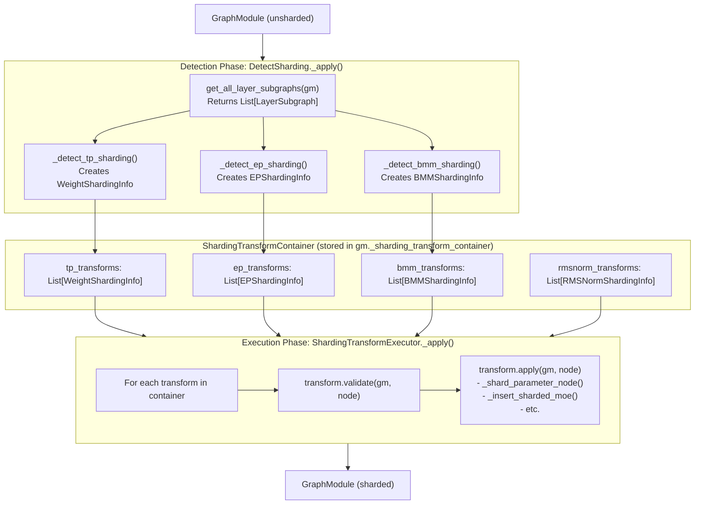

**Sources:** [[tensorrt_llm/_torch/auto_deploy/transform/library/sharding.py:910-1050](), [tensorrt_llm/_torch/auto_deploy/transform/library/sharding.py:1651-1753](), [tensorrt_llm/_torch/auto_deploy/utils/node_utils.py:816-1029]()]

---

## Sharding Dimensions

The system supports three distinct sharding dimensions, each suited for different computational patterns. The configuration specifies which dimensions to enable via the `sharding_dims` parameter [[tensorrt_llm/_torch/auto_deploy/transform/library/sharding.py:187-193](), [tensorrt_llm/_torch/auto_deploy/config/default.yaml:141]()].

### Sharding Dimension Types

| Dimension | Target Operations | Communication Pattern | Primary Use Case |
|-----------|-------------------|----------------------|------------------|
| **TP** (Tensor Parallel) | Linear layers in Attention/MLP | AllReduce after row-split layers | Standard layer parallelism |
| **EP** (Expert Parallel) | MoE expert layers | AllToAll (attention-DP) or AllReduce | MoE model parallelism |
| **BMM** (Batch Matrix Multiply) | Batched matrix multiplications | AllGather after BMM | Expert-specific BMM operations |

```mermaid
graph TB
    subgraph TP["Tensor Parallelism (TP)"]
        TPInput["Input Tensor"]
        ColSplit["Column Split<br/>SplitDimension.COLUMN=0"]
        RowSplit["Row Split<br/>SplitDimension.ROW=1"]
        AllReduce["AllReduce<br/>(after row split)"]
        AllGather["AllGather<br/>(simple shard)"]
        
        TPInput --> ColSplit
        TPInput --> RowSplit
        RowSplit --> AllReduce
        ColSplit --> AllGather
    end
    
    subgraph EP["Expert Parallelism (EP)"]
        EPInput["Input + Expert IDs"]
        EPRouter["Expert Routing"]
        LocalExperts["Local Expert Computation"]
        EPComm["AllToAll (attn-DP) or<br/>AllReduce (non attn-DP)"]
        
        EPInput --> EPRouter
        EPRouter --> LocalExperts
        LocalExperts --> EPComm
    end
    
    subgraph BMM["BMM Sharding"]
        BMMInput["Batched Input"]
        BMMShard["Shard Batch Dimension"]
        BMMCompute["Local BMM"]
        BMMGather["AllGather Results"]
        
        BMMInput --> BMMShard
        BMMShard --> BMMCompute
        BMMCompute --> BMMGather
    end
```

**Sources:** [[tensorrt_llm/_torch/auto_deploy/transform/library/sharding.py:179-196](), [tensorrt_llm/_torch/auto_deploy/config/default.yaml:138-143]()]

---

## Transform Info Classes

The system uses specialized `ShardingTransformInfo` subclasses to represent different types of transformations. Each class encapsulates the parameters needed to apply a specific sharding operation.

### Transform Info Hierarchy

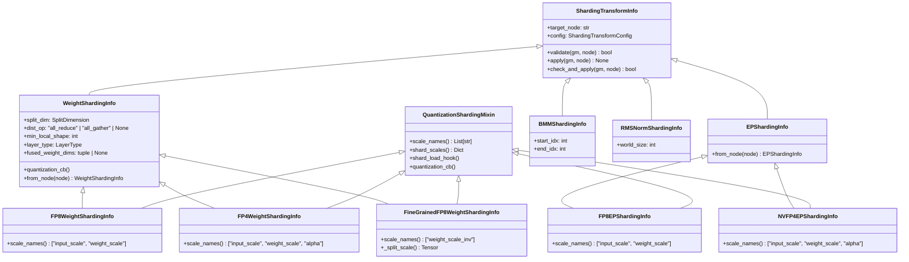

**Sources:** [[tensorrt_llm/_torch/auto_deploy/transform/library/sharding.py:272-323](), [tensorrt_llm/_torch/auto_deploy/transform/library/sharding.py:324-398](), [tensorrt_llm/_torch/auto_deploy/transform/library/sharding.py:401-463](), [tensorrt_llm/_torch/auto_deploy/transform/library/sharding.py:465-611](), [tensorrt_llm/_torch/auto_deploy/transform/library/sharding.py:613-711](), [tensorrt_llm/_torch/auto_deploy/transform/library/sharding.py:713-808](), [tensorrt_llm/_torch/auto_deploy/transform/library/sharding.py:834-903]()]

---

## Tensor Parallelism (TP) Sharding

TP sharding splits model weights across GPUs and inserts appropriate communication operations. The system identifies layer subgraphs (Attention, MLP, MLA, Delta, SSM) and applies sharding patterns based on the layer type [[tensorrt_llm/_torch/auto_deploy/utils/node_utils.py:53-62](), [tensorrt_llm/_torch/auto_deploy/transform/library/sharding.py:1083-1430]()].

### TP Pattern Detection

**Diagram: TP Pattern Detection Flow**

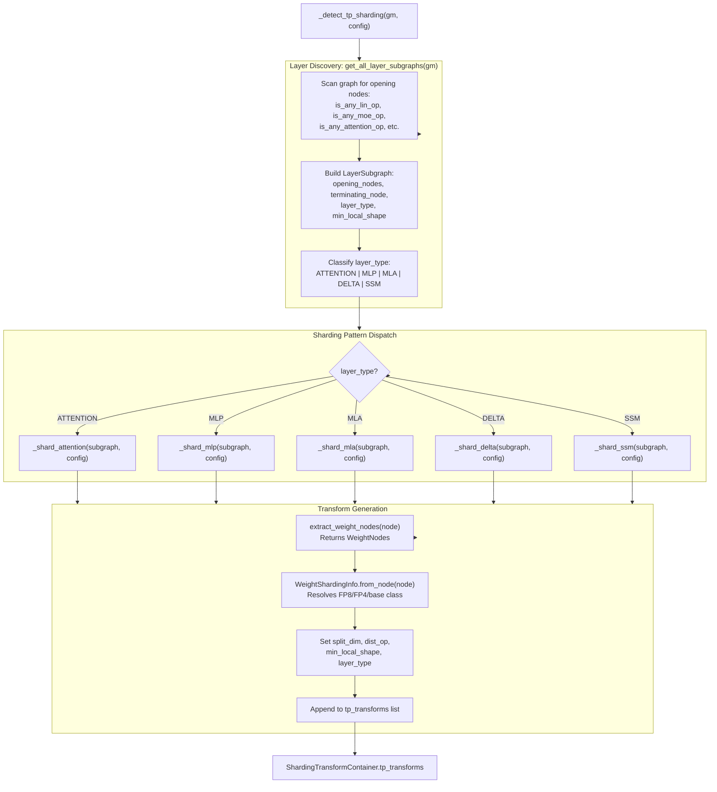

**Key Functions:**
- `_detect_tp_sharding()` [[tensorrt_llm/_torch/auto_deploy/transform/library/sharding.py:1083-1430]()]
- `_shard_attention()` [[tensorrt_llm/_torch/auto_deploy/transform/library/sharding.py:1432-1526]()]
- `_shard_mlp()` [[tensorrt_llm/_torch/auto_deploy/transform/library/sharding.py:1528-1617]()]
- `_shard_mla()` [[tensorrt_llm/_torch/auto_deploy/transform/library/sharding.py:2104-2260]()]
- `_shard_delta()` [[tensorrt_llm/_torch/auto_deploy/transform/library/sharding.py:2262-2412]()]
- `get_all_layer_subgraphs()` [[tensorrt_llm/_torch/auto_deploy/utils/node_utils.py:816-1029]()]
- `extract_weight_nodes()` [[tensorrt_llm/_torch/auto_deploy/utils/node_utils.py:277-412]()]

**Sources:** [[tensorrt_llm/_torch/auto_deploy/transform/library/sharding.py:1083-1617](), [tensorrt_llm/_torch/auto_deploy/utils/node_utils.py:816-1029](), [tensorrt_llm/_torch/auto_deploy/utils/node_utils.py:277-412]()]

### TP Sharding Execution

The execution phase applies transformations via `WeightShardingInfo.apply()`, which calls `_shard_parameter_node()` [[tensorrt_llm/_torch/auto_deploy/transform/library/sharding.py:2620-2801]()].

**Diagram: TP Sharding Execution Flow**

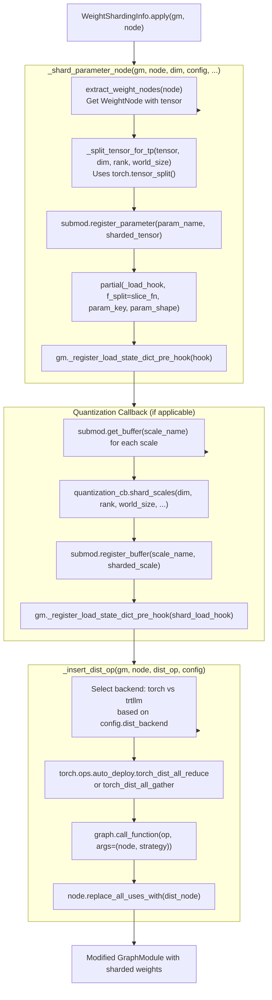

**Key Functions:**
- `_shard_parameter_node()` [[tensorrt_llm/_torch/auto_deploy/transform/library/sharding.py:2620-2801]()]
- `_split_tensor_for_tp()` [[tensorrt_llm/_torch/auto_deploy/transform/library/sharding.py:2529-2561]()]
- `_load_hook()` [[tensorrt_llm/_torch/auto_deploy/transform/library/sharding.py:2443-2464]()]
- `_insert_dist_op()` [[tensorrt_llm/_torch/auto_deploy/transform/library/sharding.py:2885-2994]()]

**Sources:** [[tensorrt_llm/_torch/auto_deploy/transform/library/sharding.py:2620-2801](), [tensorrt_llm/_torch/auto_deploy/transform/library/sharding.py:2885-2994](), [tensorrt_llm/_torch/auto_deploy/transform/library/sharding.py:2529-2561]()]

---

## Expert Parallelism (EP) Sharding

EP sharding distributes expert computation across GPUs for Mixture-of-Experts (MoE) models. It supports two communication patterns: AllToAll (with attention-DP) and AllReduce (without attention-DP) [[tensorrt_llm/_torch/auto_deploy/transform/library/sharding.py:2996-3329]()].

### EP Sharding Detection and Execution

**Diagram: EP Sharding Flow**

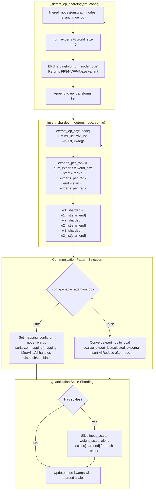

**Key Functions:**
- `_detect_ep_sharding()` [[tensorrt_llm/_torch/auto_deploy/transform/library/sharding.py:1619-1649]()]
- `_insert_sharded_moe()` [[tensorrt_llm/_torch/auto_deploy/transform/library/sharding.py:2996-3329]()]
- `_localize_expert_ids()` [[tensorrt_llm/_torch/auto_deploy/transform/library/sharding.py:3331-3387]()]
- `EPShardingInfo.from_node()` [[tensorrt_llm/_torch/auto_deploy/transform/library/sharding.py:713-722]()]

**Attention-DP Mode:** Sets `mapping_config` on the MoE node, which is deserialized in the custom op to use `MoeAlltoAll` for efficient cross-GPU expert routing with global expert IDs [[tensorrt_llm/_torch/auto_deploy/transform/library/sharding.py:3161-3184](), [tensorrt_llm/_torch/auto_deploy/custom_ops/fused_moe/trtllm_moe.py:116-133]()].

**Non-Attention-DP Mode:** Converts expert IDs to local coordinates via `_localize_expert_ids()`, zeros routing weights for remote experts, and inserts AllReduce to sum contributions across ranks [[tensorrt_llm/_torch/auto_deploy/transform/library/sharding.py:3185-3221]()].

**Sources:** [[tensorrt_llm/_torch/auto_deploy/transform/library/sharding.py:1619-1649](), [tensorrt_llm/_torch/auto_deploy/transform/library/sharding.py:2996-3329](), [tensorrt_llm/_torch/auto_deploy/transform/library/sharding.py:3331-3387](), [tensorrt_llm/_torch/auto_deploy/custom_ops/fused_moe/trtllm_moe.py:116-133]()]

---

## BMM Sharding

BMM sharding partitions batched matrix multiplications along the batch dimension. It is used for expert-specific BMM operations where the batch dimension corresponds to the number of experts [[tensorrt_llm/_torch/auto_deploy/transform/library/sharding.py:613-711]()].

### BMM Sharding Process

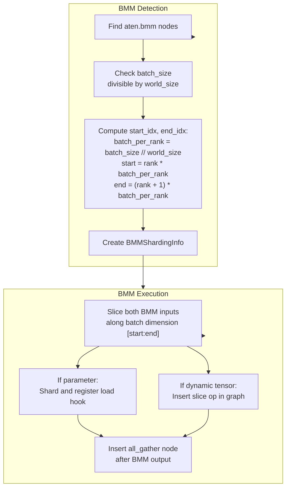

**Key Functions:**
- `_detect_bmm_sharding()`: BMM pattern detection [[tensorrt_llm/_torch/auto_deploy/transform/library/sharding.py:1974-2102]()]
- `BMMShardingInfo.apply()`: BMM sharding execution [[tensorrt_llm/_torch/auto_deploy/transform/library/sharding.py:648-711]()]

**Sources:** [[tensorrt_llm/_torch/auto_deploy/transform/library/sharding.py:613-711](), [tensorrt_llm/_torch/auto_deploy/transform/library/sharding.py:1974-2102]()]

---

## Quantization-Aware Sharding

The system automatically handles sharding for quantized models by detecting quantized operations and using specialized transform info classes that inherit from `QuantizationShardingMixin` [[tensorrt_llm/_torch/auto_deploy/transform/library/sharding.py:401-463]()].

### Quantization Sharding Workflow

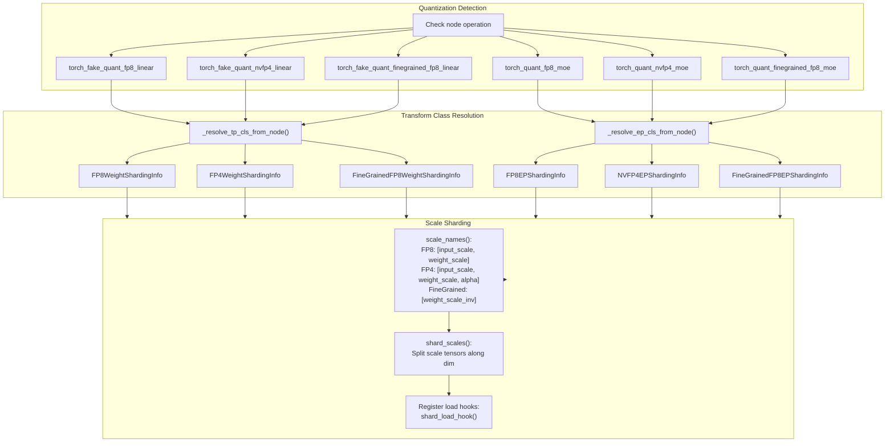

**FP8 Quantization:** Shards `input_scale` (per-tensor scalar) and `weight_scale` (per-tensor scalar) buffers [[tensorrt_llm/_torch/auto_deploy/transform/library/sharding.py:465-498]()].

**FP4 Quantization:** Shards `input_scale`, `weight_scale`, and `alpha` buffers. The `weight_scale` is converted between ModelOpt format and Cutlass format using `_shard_fp4_weight_scale()` [[tensorrt_llm/_torch/auto_deploy/transform/library/sharding.py:570-611]()].

**FineGrained FP8 Quantization:** Shards `weight_scale_inv` (per-block scales) along the same dimension as the weight [[tensorrt_llm/_torch/auto_deploy/transform/library/sharding.py:500-555]()].

**Sources:** [[tensorrt_llm/_torch/auto_deploy/transform/library/sharding.py:401-611](), [tensorrt_llm/_torch/auto_deploy/transform/library/sharding.py:750-809](), [tensorrt_llm/_torch/auto_deploy/transform/library/sharding.py:811-832]()]

---

## Configuration

Sharding is configured via two transforms in the transformation pipeline: `detect_sharding` and `sharding_transform_executor`. Configuration is specified in YAML or programmatically via `LlmArgs`.

### Configuration Parameters

The sharding system is configured via `ShardingTransformConfig` [[tensorrt_llm/_torch/auto_deploy/transform/library/sharding.py:199-213]()].

| Parameter | Type | Default | Description |
|-----------|------|---------|-------------|
| `simple_shard_only` | bool | `false` | Apply simple shard (col split + all_gather) to all linears [[tensorrt_llm/_torch/auto_deploy/transform/library/sharding.py:206]()] |
| `sharding_source` | List[ShardingSource] | `['manual', 'factory', 'heuristic']` | TP config sources in priority order [[tensorrt_llm/_torch/auto_deploy/transform/library/sharding.py:210-213]()] |
| `sharding_dims` | List[ShardingDim] | `['tp', 'ep', 'bmm']` | Enabled sharding dimensions [[tensorrt_llm/_torch/auto_deploy/transform/library/sharding.py:214-216]()] |
| `shard_all_unprocessed` | bool | `false` | Simple shard leftover linear nodes [[tensorrt_llm/_torch/auto_deploy/transform/library/sharding.py:217-221]()] |
| `enable_attention_dp` | bool | `false` | Enable attention-DP (skip TP, use EP AllToAll) [[tensorrt_llm/_torch/auto_deploy/transform/library/sharding.py:239-241]()] |
| `allreduce_strategy` | AllReduceStrategy | `NCCL` | Strategy from `AllReduceStrategy` enum [[tensorrt_llm/_torch/auto_deploy/transform/library/sharding.py:230-235]()] |
| `dist_backend` | DistBackend | `auto` | Backend: `auto`, `trtllm`, `torch` [[tensorrt_llm/_torch/auto_deploy/transform/library/sharding.py:237]()] |

**Sources:** [[tensorrt_llm/_torch/auto_deploy/transform/library/sharding.py:179-241](), [tensorrt_llm/_torch/auto_deploy/config/default.yaml:138-153]()]

---

## Execution Flow

The sharding transformation execution follows a structured pipeline that validates, applies, and verifies transformations [[tensorrt_llm/_torch/auto_deploy/transform/library/sharding.py:1651-1753]()].

### Transformation Application Pipeline

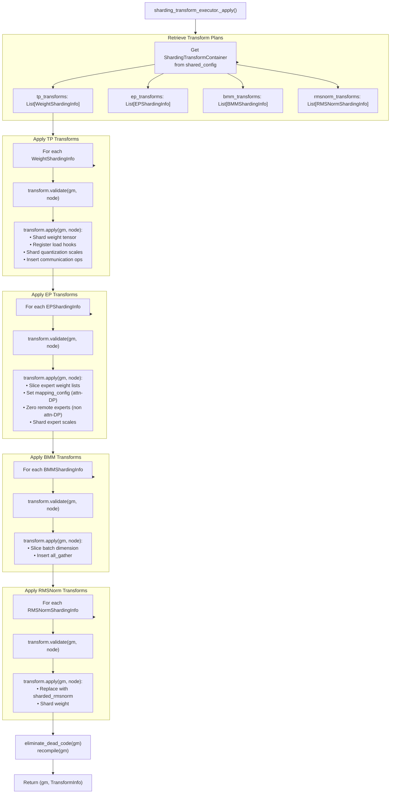

**Sources:** [[tensorrt_llm/_torch/auto_deploy/transform/library/sharding.py:1651-1753]()]

### Weight Sharding Implementation

The core weight sharding logic in `_shard_parameter_node()` [[tensorrt_llm/_torch/auto_deploy/transform/library/sharding.py:2620-2801]()]:

1. **Retrieve weight tensor** from target node [[tensorrt_llm/_torch/auto_deploy/transform/library/sharding.py:2634-2640]()]
2. **Compute local shard** using `tensor_split()` [[tensorrt_llm/_torch/auto_deploy/transform/library/sharding.py:2642-2663]()]
3. **Update parameter** with sharded tensor [[tensorrt_llm/_torch/auto_deploy/transform/library/sharding.py:2665-2669]()]
4. **Register load hook** for checkpoint loading [[tensorrt_llm/_torch/auto_deploy/transform/library/sharding.py:2671-2679]()]
5. **Handle quantization** via `quantization_cb()` [[tensorrt_llm/_torch/auto_deploy/transform/library/sharding.py:2681-2692]()]
6. **Insert communication ops** if needed [[tensorrt_llm/_torch/auto_deploy/transform/library/sharding.py:2694-2799]()]

**Sources:** [[tensorrt_llm/_torch/auto_deploy/transform/library/sharding.py:2620-2801]()]

---

## Communication Operation Insertion

Communication operations are inserted based on the sharding pattern and backend configuration. The system supports two backends: `torch` (using `torch.distributed`) and `trtllm` (using custom TRT-LLM ops) [[tensorrt_llm/_torch/auto_deploy/transform/library/sharding.py:2885-2994]()].

### Communication Backend Selection

**Diagram: Backend Selection and Operation Dispatch**

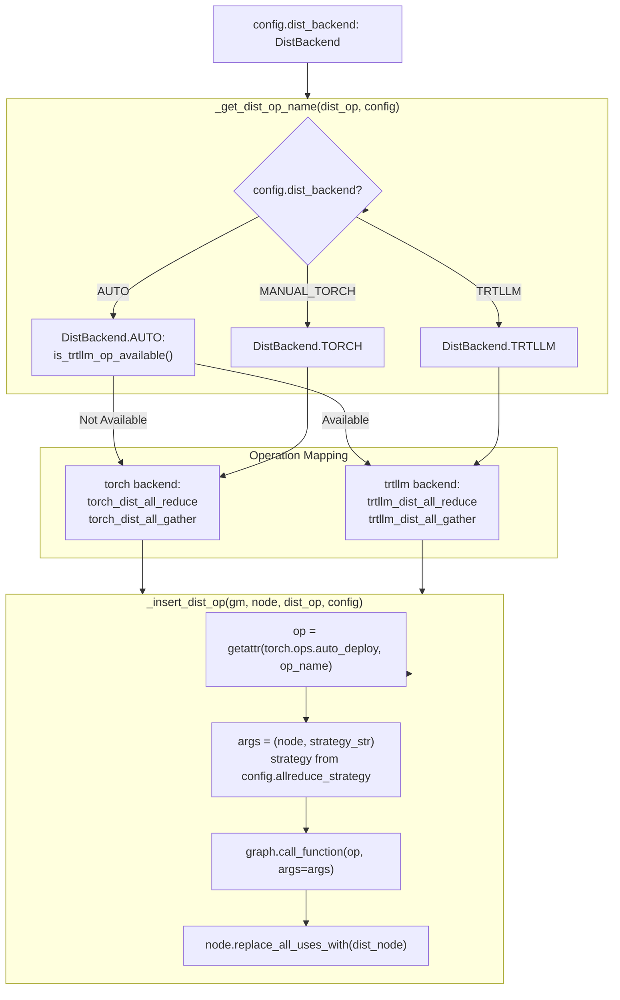

**AllReduce Strategies:**

The `allreduce_strategy` parameter controls the AllReduce implementation [[tensorrt_llm/_torch/auto_deploy/transform/library/sharding.py:230-235]()]:

| Strategy | Description |
|----------|-------------|
| `AUTO` | Automatic strategy selection |
| `NCCL` | Standard NCCL AllReduce |
| `ONESHOT` | Single-stage multi-node AllReduce |
| `TWOSHOT` | Two-stage multi-node AllReduce |
| `MIN_LATENCY` | Latency-optimized variant |
| `LOWPRECISION` | Lower precision communication |
| `UB` | User buffer AllReduce |
| `MNNVL` | Multi-node NVLink (requires symmetric memory) |
| `NCCL_SYMMETRIC` | NCCL with symmetric memory support |
| `SYMM_MEM` | Symmetric memory based communication [[examples/auto_deploy/model_registry/configs/qwen3.5_moe_400b.yaml:38]()] |

**Sources:** [[tensorrt_llm/_torch/auto_deploy/transform/library/sharding.py:2885-2994](), [examples/auto_deploy/model_registry/configs/qwen3.5_moe_400b.yaml:38]()]

---

## Layer-Specific Sharding Patterns

Different layer types require different sharding patterns. The system automatically detects layer types and applies appropriate patterns [[tensorrt_llm/_torch/auto_deploy/transform/library/sharding.py:1432-1617]()].

### Layer Type Detection and Sharding

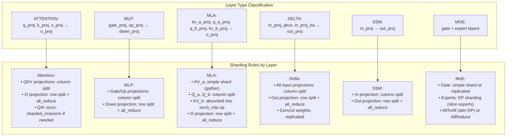

**Sources:** [[tensorrt_llm/_torch/auto_deploy/transform/library/sharding.py:1432-1617](), [tensorrt_llm/_torch/auto_deploy/transform/library/sharding.py:2104-2412]()]

---

## Special Cases and Edge Handling

### Q/K RMSNorm Sharding

When attention uses RMSNorm on Q/K projections (e.g., DeepSeekV3), the RMSNorm layer must be converted to `sharded_rmsnorm` to compute correct global statistics across shards [[tensorrt_llm/_torch/auto_deploy/transform/library/sharding.py:2414-2527]()].

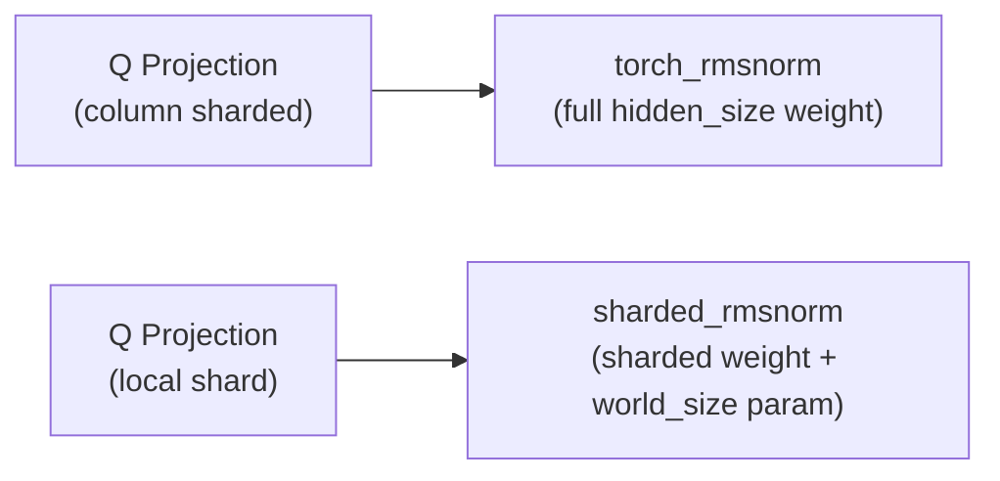

The `_shard_qk_norm()` function detects this pattern and creates `RMSNormShardingInfo` transforms [[tensorrt_llm/_torch/auto_deploy/transform/library/sharding.py:2414-2527]()].

**Sources:** [[tensorrt_llm/_torch/auto_deploy/transform/library/sharding.py:834-903](), [tensorrt_llm/_torch/auto_deploy/transform/library/sharding.py:2414-2527]()]

### Fused Weight Handling

Some models use fused weights (e.g., `gate_up_proj`). The system handles this via the `fused_weight_dims` parameter. The `_split_fused_weight()` function splits fused weights before sharding [[tensorrt_llm/_torch/auto_deploy/transform/library/sharding.py:2563-2618]()].

**Sources:** [[tensorrt_llm/_torch/auto_deploy/transform/library/sharding.py:2563-2618]()]

### Unprocessed Linear Nodes

When `shard_all_unprocessed=True`, linear nodes not part of any detected layer subgraph are sharded using simple shard (column split + all_gather). This ensures all model weights are distributed [[tensorrt_llm/_torch/auto_deploy/transform/library/sharding.py:1755-1795]()].

**Sources:** [[tensorrt_llm/_torch/auto_deploy/transform/library/sharding.py:1755-1795]()]

---

