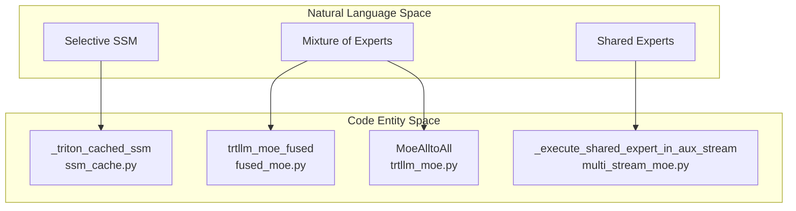
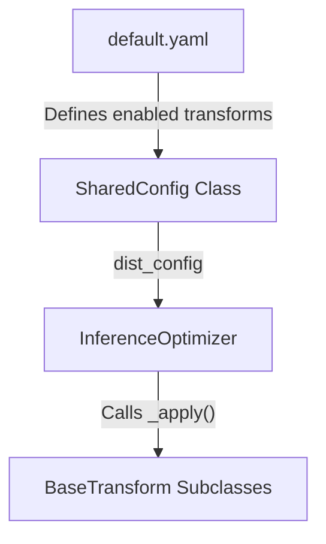

<!-- source: DeepWiki mcp.deepwiki.com · repo NVIDIA/TensorRT-LLM · page 16.3 Pattern Matching and Fusion Transforms · fetched 2026-10-26 -->

# Pattern Matching and Fusion Transforms

Relevant source files

The following files were used as context for generating this wiki page:

- [examples/auto_deploy/nano_v3.yaml](examples/auto_deploy/nano_v3.yaml)
- [examples/auto_deploy/super_v3.yaml](examples/auto_deploy/super_v3.yaml)
- [tensorrt_llm/_torch/auto_deploy/config/default.yaml](tensorrt_llm/_torch/auto_deploy/config/default.yaml)
- [tensorrt_llm/_torch/auto_deploy/custom_ops/fused_moe/torch_moe.py](tensorrt_llm/_torch/auto_deploy/custom_ops/fused_moe/torch_moe.py)
- [tensorrt_llm/_torch/auto_deploy/custom_ops/fused_moe/triton_moe.py](tensorrt_llm/_torch/auto_deploy/custom_ops/fused_moe/triton_moe.py)
- [tensorrt_llm/_torch/auto_deploy/custom_ops/fused_moe/trtllm_moe.py](tensorrt_llm/_torch/auto_deploy/custom_ops/fused_moe/trtllm_moe.py)
- [tensorrt_llm/_torch/auto_deploy/custom_ops/normalization/l2norm.py](tensorrt_llm/_torch/auto_deploy/custom_ops/normalization/l2norm.py)
- [tensorrt_llm/_torch/auto_deploy/custom_ops/normalization/triton_rms_norm.py](tensorrt_llm/_torch/auto_deploy/custom_ops/normalization/triton_rms_norm.py)
- [tensorrt_llm/_torch/auto_deploy/custom_ops/quantization/torch_quant.py](tensorrt_llm/_torch/auto_deploy/custom_ops/quantization/torch_quant.py)
- [tensorrt_llm/_torch/auto_deploy/custom_ops/rope/flashinfer_rope.py](tensorrt_llm/_torch/auto_deploy/custom_ops/rope/flashinfer_rope.py)
- [tensorrt_llm/_torch/auto_deploy/models/custom/mla_rope_utils.py](tensorrt_llm/_torch/auto_deploy/models/custom/mla_rope_utils.py)
- [tensorrt_llm/_torch/auto_deploy/models/custom/modeling_deepseek.py](tensorrt_llm/_torch/auto_deploy/models/custom/modeling_deepseek.py)
- [tensorrt_llm/_torch/auto_deploy/models/custom/modeling_eagle.py](tensorrt_llm/_torch/auto_deploy/models/custom/modeling_eagle.py)
- [tensorrt_llm/_torch/auto_deploy/models/custom/modeling_gemma3n.py](tensorrt_llm/_torch/auto_deploy/models/custom/modeling_gemma3n.py)
- [tensorrt_llm/_torch/auto_deploy/models/custom/modeling_glm4_moe_lite.py](tensorrt_llm/_torch/auto_deploy/models/custom/modeling_glm4_moe_lite.py)
- [tensorrt_llm/_torch/auto_deploy/models/custom/modeling_mistral3.py](tensorrt_llm/_torch/auto_deploy/models/custom/modeling_mistral3.py)
- [tensorrt_llm/_torch/auto_deploy/models/custom/modeling_nemotron_h.py](tensorrt_llm/_torch/auto_deploy/models/custom/modeling_nemotron_h.py)
- [tensorrt_llm/_torch/auto_deploy/models/eagle.py](tensorrt_llm/_torch/auto_deploy/models/eagle.py)
- [tensorrt_llm/_torch/auto_deploy/models/quant_config_reader.py](tensorrt_llm/_torch/auto_deploy/models/quant_config_reader.py)
- [tensorrt_llm/_torch/auto_deploy/transform/interface.py](tensorrt_llm/_torch/auto_deploy/transform/interface.py)
- [tensorrt_llm/_torch/auto_deploy/transform/library/collectives.py](tensorrt_llm/_torch/auto_deploy/transform/library/collectives.py)
- [tensorrt_llm/_torch/auto_deploy/transform/library/fuse_mamba_a_log.py](tensorrt_llm/_torch/auto_deploy/transform/library/fuse_mamba_a_log.py)
- [tensorrt_llm/_torch/auto_deploy/transform/library/fused_moe.py](tensorrt_llm/_torch/auto_deploy/transform/library/fused_moe.py)
- [tensorrt_llm/_torch/auto_deploy/transform/library/fusion.py](tensorrt_llm/_torch/auto_deploy/transform/library/fusion.py)
- [tensorrt_llm/_torch/auto_deploy/transform/library/hidden_states.py](tensorrt_llm/_torch/auto_deploy/transform/library/hidden_states.py)
- [tensorrt_llm/_torch/auto_deploy/transform/library/multi_stream_moe.py](tensorrt_llm/_torch/auto_deploy/transform/library/multi_stream_moe.py)
- [tensorrt_llm/_torch/auto_deploy/transform/library/quantization.py](tensorrt_llm/_torch/auto_deploy/transform/library/quantization.py)
- [tensorrt_llm/_torch/auto_deploy/transform/library/quantize_moe.py](tensorrt_llm/_torch/auto_deploy/transform/library/quantize_moe.py)
- [tensorrt_llm/_torch/auto_deploy/transform/library/rms_norm.py](tensorrt_llm/_torch/auto_deploy/transform/library/rms_norm.py)
- [tensorrt_llm/_torch/auto_deploy/transform/library/sharding.py](tensorrt_llm/_torch/auto_deploy/transform/library/sharding.py)
- [tensorrt_llm/_torch/auto_deploy/transform/library/sharding_ir.py](tensorrt_llm/_torch/auto_deploy/transform/library/sharding_ir.py)
- [tensorrt_llm/_torch/auto_deploy/transform/library/ssm_cache.py](tensorrt_llm/_torch/auto_deploy/transform/library/ssm_cache.py)
- [tensorrt_llm/_torch/auto_deploy/utils/_graph.py](tensorrt_llm/_torch/auto_deploy/utils/_graph.py)
- [tensorrt_llm/_torch/auto_deploy/utils/cuda_graph.py](tensorrt_llm/_torch/auto_deploy/utils/cuda_graph.py)
- [tensorrt_llm/_torch/auto_deploy/utils/node_utils.py](tensorrt_llm/_torch/auto_deploy/utils/node_utils.py)
- [tensorrt_llm/_torch/auto_deploy/utils/quantization_utils.py](tensorrt_llm/_torch/auto_deploy/utils/quantization_utils.py)
- [tensorrt_llm/quantization/utils/fp8_matrix_weight_dequant.py](tensorrt_llm/quantization/utils/fp8_matrix_weight_dequant.py)
- [tests/integration/defs/examples/test_ad_speculative_decoding.py](tests/integration/defs/examples/test_ad_speculative_decoding.py)
- [tests/unittest/auto_deploy/_utils_test/_model_test_utils.py](tests/unittest/auto_deploy/_utils_test/_model_test_utils.py)
- [tests/unittest/auto_deploy/multigpu/compile/test_bypass_captured_graphs.py](tests/unittest/auto_deploy/multigpu/compile/test_bypass_captured_graphs.py)
- [tests/unittest/auto_deploy/singlegpu/custom_ops/moe/test_triton_moe.py](tests/unittest/auto_deploy/singlegpu/custom_ops/moe/test_triton_moe.py)
- [tests/unittest/auto_deploy/singlegpu/custom_ops/moe/test_trtllm_moe.py](tests/unittest/auto_deploy/singlegpu/custom_ops/moe/test_trtllm_moe.py)
- [tests/unittest/auto_deploy/singlegpu/custom_ops/test_resource_handlers.py](tests/unittest/auto_deploy/singlegpu/custom_ops/test_resource_handlers.py)
- [tests/unittest/auto_deploy/singlegpu/models/test_eagle.py](tests/unittest/auto_deploy/singlegpu/models/test_eagle.py)
- [tests/unittest/auto_deploy/singlegpu/models/test_mla_rope_utils.py](tests/unittest/auto_deploy/singlegpu/models/test_mla_rope_utils.py)
- [tests/unittest/auto_deploy/singlegpu/shim/test_cached_sequence_interface.py](tests/unittest/auto_deploy/singlegpu/shim/test_cached_sequence_interface.py)
- [tests/unittest/auto_deploy/singlegpu/shim/test_llm_config.py](tests/unittest/auto_deploy/singlegpu/shim/test_llm_config.py)
- [tests/unittest/auto_deploy/singlegpu/smoke/test_ad_speculative_decoding.py](tests/unittest/auto_deploy/singlegpu/smoke/test_ad_speculative_decoding.py)
- [tests/unittest/auto_deploy/singlegpu/transformations/library/test_kv_cache.py](tests/unittest/auto_deploy/singlegpu/transformations/library/test_kv_cache.py)
- [tests/unittest/auto_deploy/singlegpu/transformations/library/test_moe_fusion.py](tests/unittest/auto_deploy/singlegpu/transformations/library/test_moe_fusion.py)
- [tests/unittest/auto_deploy/singlegpu/transformations/library/test_trtllm_gen_diag.py](tests/unittest/auto_deploy/singlegpu/transformations/library/test_trtllm_gen_diag.py)

## Purpose and Scope

This document covers the pattern matching and fusion transforms in AutoDeploy's graph optimization pipeline. These transforms standardize and optimize the FX graph representation after model export, converting common computational patterns into optimized custom operators and fusing multiple operations into single kernels to maximize inference performance.

Pattern matching transforms (`stage: PATTERN_MATCHER`) identify computational patterns in the exported graph and replace them with standardized custom operators. Fusion transforms (`stage: POST_LOAD_FUSION`) combine multiple operations into single fused kernels after weights are loaded to minimize memory bandwidth and kernel launch overhead. [tensorrt_llm/_torch/auto_deploy/transform/interface.py:118-121]()

## Transform Pipeline Stages

The transformation pipeline processes models through strictly ordered stages defined in the `Stages` enum. The `InferenceOptimizer` orchestrates these stages to ensure that high-level graph standardizations happen before physical optimizations like sharding and weight loading. [tensorrt_llm/_torch/auto_deploy/transform/interface.py:109-131]()

Title: AutoDeploy Transformation Pipeline Stages

```mermaid
graph LR
    Factory["ModelFactory<br/>build_model"]
    Export["export_to_gm<br/>Export to FX Graph"]
    PostExport["POST_EXPORT<br/>cleanup_noop_slice"]
    PatternMatcher["PATTERN_MATCHER<br/>match_moe_pattern<br/>match_rope_pattern"]
    Sharding["SHARDING<br/>detect_sharding"]
    WeightLoad["WEIGHT_LOAD<br/>load_weights"]
    PostLoadFusion["POST_LOAD_FUSION<br/>fuse_moe<br/>fuse_gemms"]
    Compile["COMPILE<br/>compile_model"]
    
    Factory --> Export
    Export --> PostExport
    PostExport --> PatternMatcher
    PatternMatcher --> Sharding
    Sharding --> WeightLoad
    WeightLoad --> PostLoadFusion
    PostLoadFusion --> Compile
```

**Stage Definitions**:
- **PATTERN_MATCHER**: Identifies and standardizes computational patterns such as Attention, MoE, and RoPE. [tensorrt_llm/_torch/auto_deploy/config/default.yaml:42-74]()
- **SHARDING**: Applies tensor parallelism (TP) and expert parallelism (EP) sharding hints or heuristic detection. [tensorrt_llm/_torch/auto_deploy/config/default.yaml:124-153]()
- **WEIGHT_LOAD**: Loads model weights into the graph and moves them to the target device. [tensorrt_llm/_torch/auto_deploy/config/default.yaml:163-171]()
- **POST_LOAD_FUSION**: Fuses operations into optimized kernels after weights are materialized. This handles GEMM fusion, MoE fusion, and normalization optimizations. [tensorrt_llm/_torch/auto_deploy/config/default.yaml:175-214]()

Sources: [tensorrt_llm/_torch/auto_deploy/transform/interface.py:109-131](), [tensorrt_llm/_torch/auto_deploy/config/default.yaml:1-214]()

## Mixture of Experts (MoE) Transforms

MoE optimization involves identifying MoE subgraphs and replacing them with fused kernels that support tensor parallelism (TP) and expert parallelism (EP).

### MoE Pattern Matching
The `match_moe_pattern`, `match_dense_moe_pattern`, and `match_bmm_moe_pattern` transforms identify MoE routing and expert computation blocks. [tensorrt_llm/_torch/auto_deploy/config/default.yaml:42-47](). The pipeline handles standard MoE (per-expert weight lists) and stacked tensor patterns (e.g., BMM-based MoE) via specialized hooks like `_bmm_moe_gate_up_split_hook` and `_bmm_moe_down_split_hook`. [tensorrt_llm/_torch/auto_deploy/transform/library/fused_moe.py:70-123]()

### MoE Fusion and Quantization
The `_insert_fused_moe_ops` function replaces `torch_moe` nodes with backend-specific implementations like `trtllm_moe_fused`. [tensorrt_llm/_torch/auto_deploy/transform/library/fused_moe.py:180-203]().
- **Quantization Support**: Transforms like `quantize_fp8_moe` and `quantize_nvfp4_moe` prepare MoE weights for specialized kernels. For NVFP4, this includes row/column shuffling via `get_shuffle_matrix_a_row_indices`. [tensorrt_llm/_torch/auto_deploy/transform/library/fused_moe.py:28-41](), [tensorrt_llm/_torch/auto_deploy/config/default.yaml:114-117]()
- **All-to-All Strategy**: If Expert Parallelism is enabled, `MoeAlltoAll` handles token dispatch. The `_hybrid_runtime_max_tokens_per_rank` function selects a token budget to balance host read overhead and GEMM performance. [tensorrt_llm/_torch/auto_deploy/custom_ops/fused_moe/trtllm_moe.py:33-74]()

### Multi-Stream MoE
The `multi_stream_moe` transform enables overlapping computation of shared experts and routed experts. It uses `_find_merge_node` to locate where shared and routed branches combine and inserts synchronization points using `begin_aux_stream_passthrough` and `end_aux_stream_passthrough`. [tensorrt_llm/_torch/auto_deploy/transform/library/multi_stream_moe.py:37-110]()

Sources: [tensorrt_llm/_torch/auto_deploy/transform/library/fused_moe.py:70-203](), [tensorrt_llm/_torch/auto_deploy/custom_ops/fused_moe/trtllm_moe.py:33-153](), [tensorrt_llm/_torch/auto_deploy/config/default.yaml:42-117](), [tensorrt_llm/_torch/auto_deploy/transform/library/multi_stream_moe.py:16-110]()

## Attention and KV Cache Transforms

AutoDeploy uses pattern matching to lower standard PyTorch attention into optimized cached attention operators.

### Attention Pattern Matching
The pipeline includes multiple matchers to identify attention variants:
- `match_sdpa_to_torch_attention`: Lowers `scaled_dot_product_attention` to a standardized internal attention op. [tensorrt_llm/_torch/auto_deploy/config/default.yaml:56-57]()
- `match_eager_attention`: Identifies attention patterns implemented with manual softmax and matmuls. [tensorrt_llm/_torch/auto_deploy/config/default.yaml:53-55]()
- `match_attention_layout`: Normalizes attention tensors to the expected layout (e.g., `bsnd`). [tensorrt_llm/_torch/auto_deploy/config/default.yaml:60-62]()

### KV Cache Insertion
The `InsertCachedAttention` transform replaces standardized attention nodes with cached variants. It groups attention nodes by their `KVPagedResourceHandler` equivalence class and inserts the cached attention op (e.g., `trtllm_attention`). [tensorrt_llm/_torch/auto_deploy/config/default.yaml:209-211]()

Sources: [tensorrt_llm/_torch/auto_deploy/config/default.yaml:50-62](), [tensorrt_llm/_torch/auto_deploy/config/default.yaml:209-211]()

## GEMM and Quantization Fusion

Fusion transforms target memory-bound operations by combining multiple linear layers that share the same input activation.

### GEMM Fusion
The `fuse_gemms` transform identifies multiple `linear` nodes consuming the same input and fuses them into a single larger GEMM. [tensorrt_llm/_torch/auto_deploy/config/default.yaml:178-180]()

### Quantization Fusion
Specialized fusion transforms exist for quantized linear layers, including FP8 and NVFP4.
- **Quantization Logic**: The `Quantization` base class provides the infrastructure for config-driven quantization, including `_insert_quantized_linear`. [tensorrt_llm/_torch/auto_deploy/transform/library/quantization.py:62-177]()
- **Fused Quantized Ops**: `fuse_fp8_linear` and `fuse_nvfp4_linear` combine the linear operation with its required scaling factors into a single backend-optimized call. [tensorrt_llm/_torch/auto_deploy/config/default.yaml:187-196]()

Sources: [tensorrt_llm/_torch/auto_deploy/transform/library/quantization.py:62-177](), [tensorrt_llm/_torch/auto_deploy/config/default.yaml:162-196]()

## Mamba SSM and Multi-Stream Support

AutoDeploy supports architectures like Mamba through specialized kernels and transforms.

### Selective State Update (SSM)
Mamba models use optimized Triton kernels for state updates. The `_triton_cached_ssm` operator implements selective state updates for prefill, extend, and decode phases. [tensorrt_llm/_torch/auto_deploy/transform/library/ssm_cache.py:25-35]()

### Multi-Stream Execution
The `multi_stream_moe` transform is critical for models with shared experts (e.g., DeepSeekV3). It classifies merge node inputs into `routed_output`, `shared_output`, and `pass-through` (residual) to move shared-expert computation to an auxiliary CUDA stream. [tensorrt_llm/_torch/auto_deploy/transform/library/multi_stream_moe.py:87-161]()

Title: Mamba and MoE Pattern Entity Mapping

Sources: [tensorrt_llm/_torch/auto_deploy/transform/library/fused_moe.py:180-203](), [tensorrt_llm/_torch/auto_deploy/transform/library/multi_stream_moe.py:16-161](), [tensorrt_llm/_torch/auto_deploy/transform/library/ssm_cache.py:25-35]()

## RMSNorm and Normalization Pattern Matching

The `match_rmsnorm_pattern` identifies the standard RMSNorm computation (square, mean, add epsilon, sqrt, inv, mul weight). [tensorrt_llm/_torch/auto_deploy/config/default.yaml:68-70](). 

### Normalization Fusion
The `fuse_rmsnorm` transform replaces the identified subgraph with optimized kernels. The `fuse_rmsnorm_quant_fp8` transform can also fuse normalization with subsequent quantized attention components. [tensorrt_llm/_torch/auto_deploy/config/default.yaml:205-207]()

Sources: [tensorrt_llm/_torch/auto_deploy/config/default.yaml:68-70](), [tensorrt_llm/_torch/auto_deploy/config/default.yaml:205-207]()

## Transform Configuration and Execution

Transforms are configured via YAML files and executed by the `InferenceOptimizer`.

- **Shape Propagation**: Many transforms (e.g., `match_repeat_kv`, `match_rmsnorm_pattern`) require `run_shape_prop: true` to identify patterns based on tensor dimensions. [tensorrt_llm/_torch/auto_deploy/config/default.yaml:52,70]()
- **Memory Management**: Fusion transforms often set `expect_mem_change: true` to signal that GPU memory stats will fluctuate during weight concatenation and module replacement. [tensorrt_llm/_torch/auto_deploy/config/default.yaml:167,171,200,203]()

Title: Configuration to Code Mapping

Sources: [tensorrt_llm/_torch/auto_deploy/config/default.yaml:1-214](), [tensorrt_llm/_torch/auto_deploy/transform/interface.py:133-197]()

---

