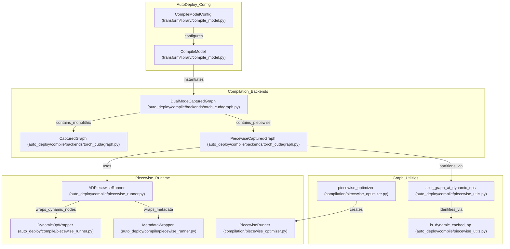
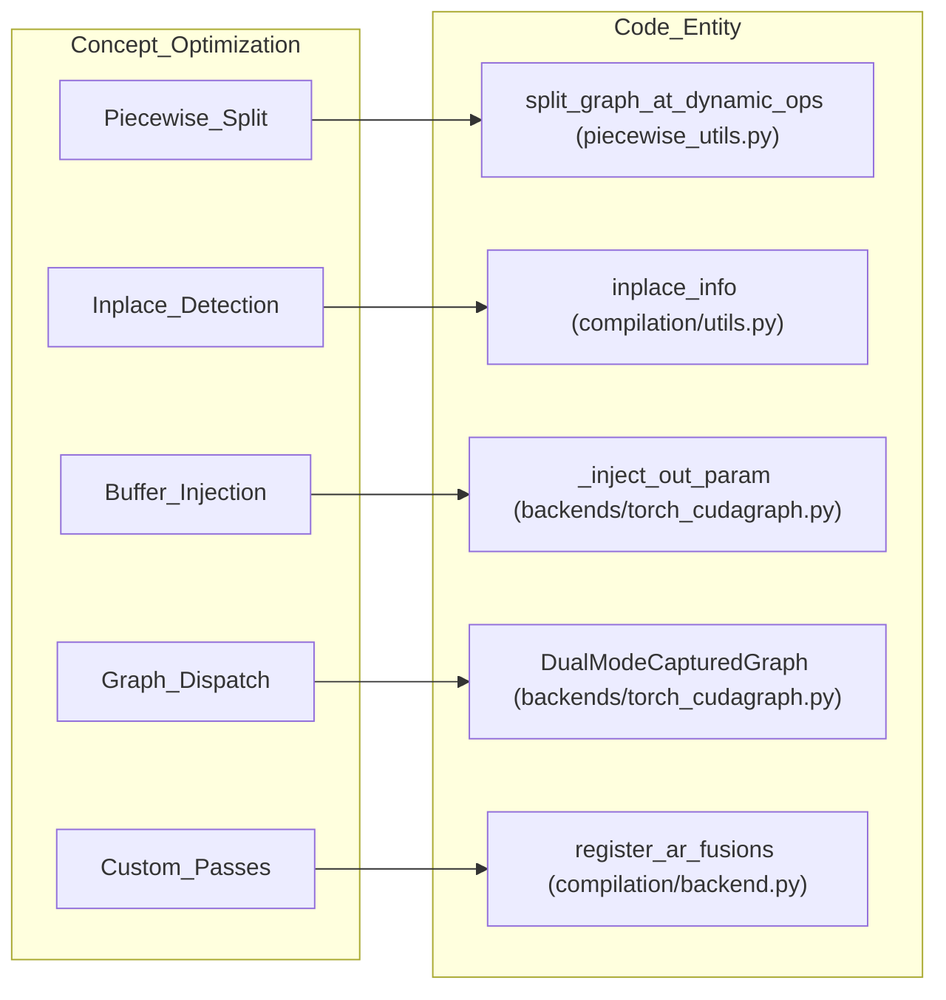

<!-- source: DeepWiki mcp.deepwiki.com · repo NVIDIA/TensorRT-LLM · page 16.4 Compilation and CUDA Graph Support · fetched 2026-10-26 -->

# 16.4 Compilation and CUDA Graph Support

Relevant source files

The following files were used as context for generating this wiki page:

- [cpp/tensorrt_llm/common/lamportUtils.cuh](cpp/tensorrt_llm/common/lamportUtils.cuh)
- [cpp/tensorrt_llm/kernels/communicationKernels/customLowPrecisionAllReduceKernels.cu](cpp/tensorrt_llm/kernels/communicationKernels/customLowPrecisionAllReduceKernels.cu)
- [cpp/tensorrt_llm/kernels/communicationKernels/customLowPrecisionAllReduceKernels.h](cpp/tensorrt_llm/kernels/communicationKernels/customLowPrecisionAllReduceKernels.h)
- [cpp/tensorrt_llm/kernels/communicationKernels/mnnvlAllreduceKernels.cu](cpp/tensorrt_llm/kernels/communicationKernels/mnnvlAllreduceKernels.cu)
- [cpp/tensorrt_llm/kernels/communicationKernels/mnnvlAllreduceKernels.h](cpp/tensorrt_llm/kernels/communicationKernels/mnnvlAllreduceKernels.h)
- [cpp/tensorrt_llm/kernels/customAllReduceKernels.h](cpp/tensorrt_llm/kernels/customAllReduceKernels.h)
- [cpp/tensorrt_llm/thop/allreduceOp.cpp](cpp/tensorrt_llm/thop/allreduceOp.cpp)
- [cpp/tensorrt_llm/thop/thUtils.h](cpp/tensorrt_llm/thop/thUtils.h)
- [examples/auto_deploy/model_registry/configs/deepseek-r1.yaml](examples/auto_deploy/model_registry/configs/deepseek-r1.yaml)
- [examples/auto_deploy/model_registry/configs/gemma3n_e2b_it.yaml](examples/auto_deploy/model_registry/configs/gemma3n_e2b_it.yaml)
- [examples/auto_deploy/model_registry/configs/gemma4_e2b.yaml](examples/auto_deploy/model_registry/configs/gemma4_e2b.yaml)
- [examples/auto_deploy/model_registry/configs/gemma4_moe.yaml](examples/auto_deploy/model_registry/configs/gemma4_moe.yaml)
- [tensorrt_llm/_torch/auto_deploy/compile/backends/torch_cudagraph.py](tensorrt_llm/_torch/auto_deploy/compile/backends/torch_cudagraph.py)
- [tensorrt_llm/_torch/auto_deploy/compile/piecewise_runner.py](tensorrt_llm/_torch/auto_deploy/compile/piecewise_runner.py)
- [tensorrt_llm/_torch/auto_deploy/compile/piecewise_utils.py](tensorrt_llm/_torch/auto_deploy/compile/piecewise_utils.py)
- [tensorrt_llm/_torch/auto_deploy/custom_ops/mla/trtllm_mla.py](tensorrt_llm/_torch/auto_deploy/custom_ops/mla/trtllm_mla.py)
- [tensorrt_llm/_torch/auto_deploy/transform/library/compile_model.py](tensorrt_llm/_torch/auto_deploy/transform/library/compile_model.py)
- [tensorrt_llm/_torch/auto_deploy/utils/multi_stream_utils.py](tensorrt_llm/_torch/auto_deploy/utils/multi_stream_utils.py)
- [tensorrt_llm/_torch/compilation/backend.py](tensorrt_llm/_torch/compilation/backend.py)
- [tensorrt_llm/_torch/compilation/patterns/ar_residual_norm.py](tensorrt_llm/_torch/compilation/patterns/ar_residual_norm.py)
- [tensorrt_llm/_torch/compilation/piecewise_optimizer.py](tensorrt_llm/_torch/compilation/piecewise_optimizer.py)
- [tensorrt_llm/_torch/compilation/utils.py](tensorrt_llm/_torch/compilation/utils.py)
- [tensorrt_llm/_torch/distributed/__init__.py](tensorrt_llm/_torch/distributed/__init__.py)
- [tensorrt_llm/_torch/distributed/ops.py](tensorrt_llm/_torch/distributed/ops.py)
- [tensorrt_llm/functional.py](tensorrt_llm/functional.py)
- [tests/unittest/_torch/multi_gpu/test_allreduce.py](tests/unittest/_torch/multi_gpu/test_allreduce.py)
- [tests/unittest/_torch/multi_gpu/test_mnnvl_allreduce.py](tests/unittest/_torch/multi_gpu/test_mnnvl_allreduce.py)
- [tests/unittest/_torch/multi_gpu/test_user_buffers.py](tests/unittest/_torch/multi_gpu/test_user_buffers.py)
- [tests/unittest/_torch/multi_gpu_modeling/test_deepseek.py](tests/unittest/_torch/multi_gpu_modeling/test_deepseek.py)
- [tests/unittest/auto_deploy/singlegpu/compile/test_captured_graph.py](tests/unittest/auto_deploy/singlegpu/compile/test_captured_graph.py)
- [tests/unittest/auto_deploy/singlegpu/compile/test_piecewise_runner.py](tests/unittest/auto_deploy/singlegpu/compile/test_piecewise_runner.py)
- [tests/unittest/auto_deploy/singlegpu/compile/test_piecewise_utils.py](tests/unittest/auto_deploy/singlegpu/compile/test_piecewise_utils.py)
- [tests/unittest/auto_deploy/singlegpu/custom_ops/mla/test_trtllm_mla_op.py](tests/unittest/auto_deploy/singlegpu/custom_ops/mla/test_trtllm_mla_op.py)
- [tests/unittest/auto_deploy/singlegpu/shim/test_create_ad_executor.py](tests/unittest/auto_deploy/singlegpu/shim/test_create_ad_executor.py)
- [tests/unittest/auto_deploy/singlegpu/smoke/test_ad_build_small_single.py](tests/unittest/auto_deploy/singlegpu/smoke/test_ad_build_small_single.py)
- [tests/unittest/auto_deploy/singlegpu/utils/test_multi_stream_utils.py](tests/unittest/auto_deploy/singlegpu/utils/test_multi_stream_utils.py)

This page documents the compilation stage of the AutoDeploy transformation pipeline and the underlying `tensorrt_llm._torch` compilation infrastructure. This stage applies low-level optimizations to the model graph using PyTorch's compilation infrastructure (`torch.compile`), piecewise CUDA graph strategies, batch size bucketing, and the `CompileModel` transform.

## Overview

The compilation stage (`Stages.COMPILE`) is the final phase of the AutoDeploy transformation pipeline. It prepares the model for high-performance inference by:

1.  **Graph Compilation**: Utilizing backends like `torch-compile`, `torch-cudagraph`, or `torch-opt` to optimize the computation graph [tensorrt_llm/_torch/auto_deploy/transform/library/compile_model.py:81-83]().
2.  **CUDA Graphs**: Capturing execution sequences to eliminate kernel launch overhead.
3.  **Piecewise Execution**: Splitting graphs to allow CUDA graph capture of static segments while running dynamic or incompatible nodes in eager mode [tensorrt_llm/_torch/auto_deploy/compile/backends/torch_cudagraph.py:18-24]().
4.  **Multi-Stream Scheduling**: Overlapping operations (like MoE experts or attention) across multiple CUDA streams while maintaining graph safety [tensorrt_llm/_torch/auto_deploy/utils/multi_stream_utils.py:15-31]().

The primary entry point for this stage is the `CompileModel` transform, configured via `CompileModelConfig` [tensorrt_llm/_torch/auto_deploy/transform/library/compile_model.py:67-105]().

**Sources**: [tensorrt_llm/_torch/auto_deploy/transform/library/compile_model.py:67-108](), [tensorrt_llm/_torch/auto_deploy/compile/backends/torch_cudagraph.py:15-24](), [examples/auto_deploy/model_registry/configs/deepseek-r1.yaml:64-66]()

## System Architecture: Code Entity Space

The following diagram illustrates how the compilation `Backend` interacts with the PyTorch compilation system and the `PiecewiseRunner` to optimize the `GraphModule`.

### Compilation and Optimization Flow
Title: "AutoDeploy Compilation and Piecewise Optimization Flow"

**Sources**: [tensorrt_llm/_torch/auto_deploy/compile/backends/torch_cudagraph.py:15-24](), [tensorrt_llm/_torch/auto_deploy/compile/backends/torch_cudagraph.py:175-191](), [tensorrt_llm/_torch/auto_deploy/compile/piecewise_utils.py:15-22](), [tensorrt_llm/_torch/auto_deploy/compile/piecewise_runner.py:32-45](), [tensorrt_llm/_torch/compilation/piecewise_optimizer.py:144-160]()

## Compilation Backends and Piecewise Support

The AutoDeploy system supports multiple backends for graph execution. Selection is driven by the `backend` parameter in `CompileModelConfig` [tensorrt_llm/_torch/auto_deploy/transform/library/compile_model.py:81-83]().

### Piecewise CUDA Graph
Managed by `ADPiecewiseRunner` (and the underlying `PiecewiseRunner`), this strategy splits the model at dynamic ops.
*   **Split Logic**: The graph is split at nodes that have dynamic shapes or are uncapturable. `split_graph_at_dynamic_ops` uses `torch.fx.passes.split_module` to partition the graph [tensorrt_llm/_torch/auto_deploy/compile/piecewise_utils.py:31-32]().
*   **Dual-Mode Dispatch**: `DualModeCapturedGraph` dispatches:
    *   **Decode-only batches**: Dispatched to a monolithic `CapturedGraph` (single graph replay) [tensorrt_llm/_torch/auto_deploy/compile/backends/torch_cudagraph.py:22]().
    *   **Prefill/mixed batches**: Dispatched to a `PiecewiseCapturedGraph` which alternates between replaying static CUDA graph segments and running dynamic ops in eager mode [tensorrt_llm/_torch/auto_deploy/compile/backends/torch_cudagraph.py:23-24]().
*   **Dynamic Op Policies**: `DynamicOpPolicy` defines how outputs are handled: `OUT_BUFFER` for stable tensor results (using `DynamicOpWrapper`), `METADATA_WRAPPER` for metadata tensor address stability, and `EAGER` for host-driven or inplace ops [tensorrt_llm/_torch/auto_deploy/compile/piecewise_utils.py:48-90]().
*   **Piecewise Optimizer**: The `piecewise_optimizer` function orchestrates the splitting of a `GraphModule` and wraps submodules with `PiecewiseRunner` to handle CUDA graph capture per-segment [tensorrt_llm/_torch/compilation/piecewise_optimizer.py:171-175]().

### Multi-Stream Execution
The compilation system supports overlapping operations using multiple CUDA streams.
*   **CudaStreamManager**: A per-device singleton that manages auxiliary streams (like `AUX_STREAM_NAME`) and events for overlapping execution [tensorrt_llm/_torch/auto_deploy/utils/multi_stream_utils.py:138-174]().
*   **Passthrough Helpers**: `begin_aux_stream_passthrough` and `end_aux_stream_passthrough` switch streams while preserving data-flow edges required for FX graph execution and CUDA graph capture [tensorrt_llm/_torch/auto_deploy/utils/multi_stream_utils.py:24-26]().
*   **Safety**: `disable_multi_stream` is used during piecewise CUDA graph capture/replay for prefill/mixed batches because host-side synchronization is incompatible with stable-address invariants [tensorrt_llm/_torch/auto_deploy/utils/multi_stream_utils.py:47-50]().

**Sources**: [tensorrt_llm/_torch/auto_deploy/compile/backends/torch_cudagraph.py:15-24](), [tensorrt_llm/_torch/auto_deploy/compile/piecewise_utils.py:48-90](), [tensorrt_llm/_torch/auto_deploy/utils/multi_stream_utils.py:138-174](), [tensorrt_llm/_torch/compilation/piecewise_optimizer.py:171-175]()

## CUDA Graph Capture and Memory Management

The `CapturedGraph` class handles the low-level `torch.cuda.CUDAGraph` lifecycle [tensorrt_llm/_torch/auto_deploy/compile/backends/torch_cudagraph.py:175-191]().

### Buffer Management
Captured graphs operate on fixed-size buffers to ensure stability during replay.
*   **Output Coalescing**: For dynamic segments, `_inject_out_param` rewrites the FX graph to accept an `out` placeholder, and `_coalesce_output` selects between the pre-allocated buffer and the operator's return value [tensorrt_llm/_torch/auto_deploy/compile/backends/torch_cudagraph.py:114-174](), [tensorrt_llm/_torch/auto_deploy/compile/backends/torch_cudagraph.py:75-79]().
*   **Inplace Optimization**: The `inplace_info` utility maps custom `trtllm` ops to their mutable arguments (e.g., `flashinfer_fused_add_rmsnorm` mutates index 1 and 2) to avoid redundant copies during graph execution [tensorrt_llm/_torch/compilation/utils.py:66-179]().
*   **Graph Pool Handling**: `PiecewiseRunner` manages `graph_pool_handle` to share memory pools across captured segments [tensorrt_llm/_torch/compilation/piecewise_optimizer.py:168-170]().

**Sources**: [tensorrt_llm/_torch/auto_deploy/compile/backends/torch_cudagraph.py:75-79](), [tensorrt_llm/_torch/auto_deploy/compile/backends/torch_cudagraph.py:114-174](), [tensorrt_llm/_torch/compilation/utils.py:66-179](), [tensorrt_llm/_torch/compilation/piecewise_optimizer.py:168-170]()

## Batch Size and Token Bucketing

AutoDeploy handles dynamic shapes by capturing graphs for specific "buckets" of input sizes defined in the model configuration.

| Feature | Configuration Key | Description |
| :--- | :--- | :--- |
| **Batch Sizes** | `cuda_graph_config.batch_sizes` | Explicit list of batch sizes for which monolithic graphs are captured [examples/auto_deploy/model_registry/configs/deepseek-r1.yaml:17](). |
| **Max Batch Size** | `cuda_graph_config.max_batch_size` | The upper bound for CUDA graph batch size bucketing [examples/auto_deploy/model_registry/configs/deepseek-r1.yaml:16](). |
| **Token Capture** | `piecewise_num_tokens` | Sorted list of token counts used to initialize `PiecewiseCapturedGraph` entries [tensorrt_llm/_torch/auto_deploy/transform/library/compile_model.py:88-95](). |
| **Capture Num Tokens** | `capture_num_tokens` | The `Backend` class maintains a sorted list of token counts to trigger graph capture at runtime [tensorrt_llm/_torch/compilation/backend.py:71-72](). |

**Sources**: [examples/auto_deploy/model_registry/configs/deepseek-r1.yaml:16-17](), [tensorrt_llm/_torch/auto_deploy/transform/library/compile_model.py:88-95](), [tensorrt_llm/_torch/compilation/backend.py:71-72]()

## Implementation: Code Mapping

The following diagram bridges high-level compilation concepts to specific classes and functions in the codebase.

### Compilation Entity Mapping
Title: "Compilation Concept to Code Entity Mapping"

**Sources**: [tensorrt_llm/_torch/auto_deploy/compile/backends/torch_cudagraph.py:114](), [tensorrt_llm/_torch/compilation/utils.py:66](), [tensorrt_llm/_torch/auto_deploy/compile/piecewise_utils.py:53-60](), [tensorrt_llm/_torch/compilation/backend.py:95]()

## Distributed Compilation and Fusions

The `Backend` class manages custom optimization passes that bridge distributed operations and graph compilation [tensorrt_llm/_torch/compilation/backend.py:43-60]().

*   **AllReduce Fusion**: `register_ar_fusions` inserts patterns to fuse `AllReduce` with `Residual` and `RMSNorm` [tensorrt_llm/_torch/compilation/backend.py:95]().
*   **Pattern Matching**: `register_ar_residual_norm` defines FX patterns to replace standard NCCL/AllReduce calls with fused TRTLLM custom ops like `AllReduceFusionOp.RESIDUAL_RMS_NORM` [tensorrt_llm/_torch/compilation/patterns/ar_residual_norm.py:57-104]().
*   **UserBuffers Integration**: If `enable_userbuffers` is true, the compiler registers specific UB fusion patterns to utilize zero-copy communication [tensorrt_llm/_torch/compilation/backend.py:91-95]().
*   **MNNVL Support**: The system supports `AllReduceStrategy.MNNVL` for Blackwell systems, utilizing `McastGPUBuffer` for one-shot and two-shot allreduce [tensorrt_llm/_torch/distributed/ops.py:93-151](), [tensorrt_llm/functional.py:116]().

**Sources**: [tensorrt_llm/_torch/compilation/backend.py:43-108](), [tensorrt_llm/_torch/compilation/patterns/ar_residual_norm.py:57-104](), [tensorrt_llm/_torch/distributed/ops.py:93-151](), [tensorrt_llm/functional.py:116]()

---

