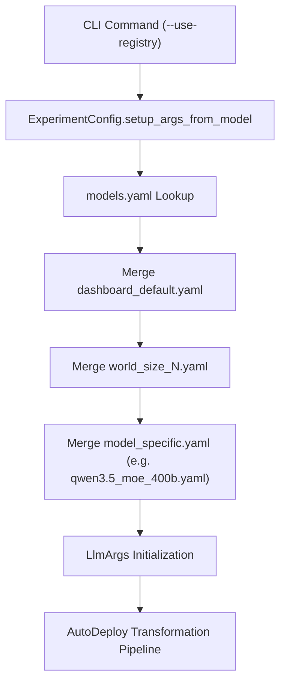
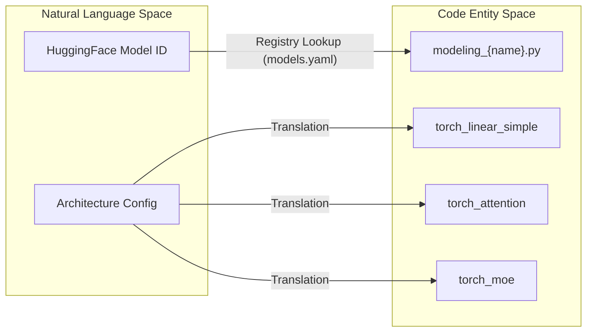
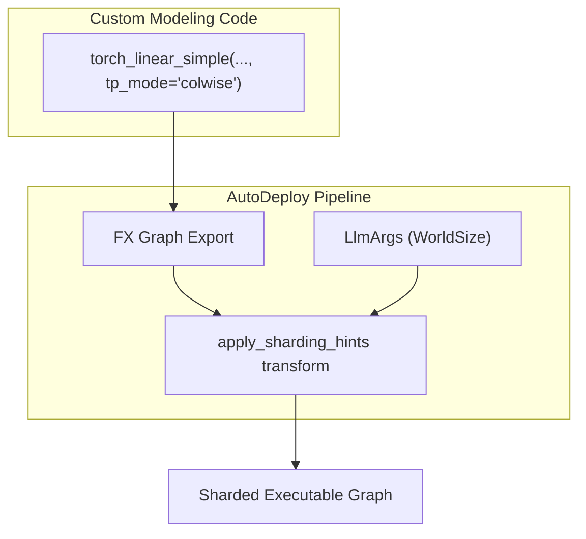

<!-- source: DeepWiki mcp.deepwiki.com · repo NVIDIA/TensorRT-LLM · page 16.5 AutoDeploy Model Registry · fetched 2026-10-26 -->

# AutoDeploy Model Registry

Relevant source files

The following files were used as context for generating this wiki page:

- [.claude/agents/ad-conf-check-update.md](.claude/agents/ad-conf-check-update.md)
- [.claude/agents/ad-debug-agent.md](.claude/agents/ad-debug-agent.md)
- [.claude/agents/ad-onboard-reviewer.md](.claude/agents/ad-onboard-reviewer.md)
- [.claude/agents/ad-run-agent.md](.claude/agents/ad-run-agent.md)
- [.claude/skills/ad-add-fusion-transformation/SKILL.md](.claude/skills/ad-add-fusion-transformation/SKILL.md)
- [.claude/skills/ad-conf-check/SKILL.md](.claude/skills/ad-conf-check/SKILL.md)
- [.claude/skills/ad-conf-check/references/config_log_patterns.md](.claude/skills/ad-conf-check/references/config_log_patterns.md)
- [.claude/skills/ad-conf-check/references/graph_verification_patterns.md](.claude/skills/ad-conf-check/references/graph_verification_patterns.md)
- [.claude/skills/ad-conf-check/scripts/parse_config.py](.claude/skills/ad-conf-check/scripts/parse_config.py)
- [.claude/skills/ad-graph-dump/SKILL.md](.claude/skills/ad-graph-dump/SKILL.md)
- [.claude/skills/ad-model-onboard/SKILL.md](.claude/skills/ad-model-onboard/SKILL.md)
- [.codex/AGENTS.md](.codex/AGENTS.md)
- [.codex/agents/ad_debug_agent.toml](.codex/agents/ad_debug_agent.toml)
- [.codex/agents/ad_onboard_reviewer.toml](.codex/agents/ad_onboard_reviewer.toml)
- [.codex/agents/ad_run_agent.toml](.codex/agents/ad_run_agent.toml)
- [.codex/agents/onboard_update_reviewer.toml](.codex/agents/onboard_update_reviewer.toml)
- [.codex/config.toml](.codex/config.toml)
- [.codex/skills/ad-model-onboard/SKILL.md](.codex/skills/ad-model-onboard/SKILL.md)
- [examples/auto_deploy/.gitignore](examples/auto_deploy/.gitignore)
- [examples/auto_deploy/cookbooks/minimax_m2.7_trtllm_cookbook.ipynb](examples/auto_deploy/cookbooks/minimax_m2.7_trtllm_cookbook.ipynb)
- [examples/auto_deploy/model_registry/configs/minimax_m2.7.yaml](examples/auto_deploy/model_registry/configs/minimax_m2.7.yaml)
- [examples/auto_deploy/model_registry/configs/qwen3.5_moe_35b.yaml](examples/auto_deploy/model_registry/configs/qwen3.5_moe_35b.yaml)
- [examples/auto_deploy/model_registry/configs/qwen3.5_moe_400b.yaml](examples/auto_deploy/model_registry/configs/qwen3.5_moe_400b.yaml)
- [examples/auto_deploy/model_registry/models.yaml](examples/auto_deploy/model_registry/models.yaml)
- [tensorrt_llm/_torch/auto_deploy/custom_ops/linear/swiglu.py](tensorrt_llm/_torch/auto_deploy/custom_ops/linear/swiglu.py)
- [tensorrt_llm/_torch/auto_deploy/models/__init__.py](tensorrt_llm/_torch/auto_deploy/models/__init__.py)
- [tensorrt_llm/_torch/auto_deploy/models/custom/__init__.py](tensorrt_llm/_torch/auto_deploy/models/custom/__init__.py)
- [tensorrt_llm/_torch/auto_deploy/models/custom/modeling_qwen3_5_moe.py](tensorrt_llm/_torch/auto_deploy/models/custom/modeling_qwen3_5_moe.py)
- [tensorrt_llm/_torch/auto_deploy/transform/library/fuse_swiglu.py](tensorrt_llm/_torch/auto_deploy/transform/library/fuse_swiglu.py)
- [tensorrt_llm/_torch/auto_deploy/transform/library/multi_stream_gemm.py](tensorrt_llm/_torch/auto_deploy/transform/library/multi_stream_gemm.py)
- [tensorrt_llm/_torch/auto_deploy/utils/pattern_matcher.py](tensorrt_llm/_torch/auto_deploy/utils/pattern_matcher.py)
- [tests/test_common/llm_data.py](tests/test_common/llm_data.py)
- [tests/unittest/auto_deploy/multigpu/custom_ops/test_sharded_rmsnorm.py](tests/unittest/auto_deploy/multigpu/custom_ops/test_sharded_rmsnorm.py)
- [tests/unittest/auto_deploy/multigpu/transformations/library/test_bmm_sharding.py](tests/unittest/auto_deploy/multigpu/transformations/library/test_bmm_sharding.py)
- [tests/unittest/auto_deploy/multigpu/transformations/library/test_ep_sharding.py](tests/unittest/auto_deploy/multigpu/transformations/library/test_ep_sharding.py)
- [tests/unittest/auto_deploy/multigpu/transformations/library/test_tp_sharding.py](tests/unittest/auto_deploy/multigpu/transformations/library/test_tp_sharding.py)
- [tests/unittest/auto_deploy/singlegpu/models/test_qwen3_5_moe.py](tests/unittest/auto_deploy/singlegpu/models/test_qwen3_5_moe.py)
- [tests/unittest/auto_deploy/singlegpu/shim/test_engine.py](tests/unittest/auto_deploy/singlegpu/shim/test_engine.py)
- [tests/unittest/auto_deploy/singlegpu/transformations/library/test_finegrained_fp8_swiglu.py](tests/unittest/auto_deploy/singlegpu/transformations/library/test_finegrained_fp8_swiglu.py)
- [tests/unittest/auto_deploy/singlegpu/transformations/library/test_fuse_swiglu.py](tests/unittest/auto_deploy/singlegpu/transformations/library/test_fuse_swiglu.py)
- [tests/unittest/auto_deploy/singlegpu/transformations/library/test_mrope_delta_cache.py](tests/unittest/auto_deploy/singlegpu/transformations/library/test_mrope_delta_cache.py)
- [tests/unittest/auto_deploy/singlegpu/transformations/library/test_nvfp4_swiglu.py](tests/unittest/auto_deploy/singlegpu/transformations/library/test_nvfp4_swiglu.py)

The AutoDeploy Model Registry is a centralized configuration system designed to manage model-specific hyperparameters, graph transformation pipelines, and sharding strategies. It provides a structured way to onboard new architectures (e.g., OpenELM, DeepSeek-V3, Qwen3.5-MoE, Nemotron-H, MiniMax-M2, Gemma4, Hunyuan) and ensure they are optimized for the TensorRT-LLM AutoDeploy system.

## Registry Architecture

The registry consists of a flat YAML manifest that points to composable configuration snippets. This design allows for fine-grained control over model variants while reusing common settings for world sizes and hardware backends.

### Configuration Manifest
The primary entry point is `models.yaml`, which maps model names (HuggingFace repository IDs) to a `config_id` and a list of supplemental YAML files [examples/auto_deploy/model_registry/models.yaml:1-3]().

| Field | Description |
| :--- | :--- |
| `name` | The HF model card or path to the checkpoint [examples/auto_deploy/model_registry/models.yaml:4](). |
| `config_id` | A unique identifier for the specific configuration variant [examples/auto_deploy/model_registry/models.yaml:5](). |
| `yaml_extra` | A list of YAML files in the `configs/` directory that are merged to form the final experiment configuration [examples/auto_deploy/model_registry/models.yaml:6](). |

### Data Flow: From Registry to Execution
The configuration resolution performs a lookup in `models.yaml` to populate the `yaml_extra` field, merging baseline defaults with hardware-specific (e.g., `world_size_1.yaml`) and model-specific overrides (e.g., `qwen3.5_moe_400b.yaml`) [examples/auto_deploy/model_registry/models.yaml:16-18]().

Title: "Model Configuration Resolution Flow"

Sources: [examples/auto_deploy/model_registry/models.yaml:1-153](), [examples/auto_deploy/model_registry/configs/qwen3.5_moe_400b.yaml:1-47]()

## Model Factory and Custom Definitions

The `ModelFactory` interface bridges the HuggingFace model space with the AutoDeploy IR. For models not fully covered by standard `transformers` logic or requiring specialized sharding/kernels, custom modeling files are provided in `tensorrt_llm/_torch/auto_deploy/models/custom/`.

### Custom Model Registry
New architectures are registered in the `_MODEL_MODULES` map to ensure they are discoverable by the `AutoModelFactory` [tensorrt_llm/_torch/auto_deploy/models/custom/__init__.py:28-66]().

| Model Family | Code Entity | Key Features |
| :--- | :--- | :--- |
| **Qwen3.5-MoE** | `Qwen3_5MoeForCausalLM` | Sharding-aware implementation for text/vision; uses `torch_moe` [tensorrt_llm/_torch/auto_deploy/models/custom/modeling_qwen3_5_moe.py:8-30](). |
| **OpenELM** | `OpenELMForCausalLM` | Implementation for Apple's OpenELM [tensorrt_llm/_torch/auto_deploy/models/custom/__init__.py:56](). |
| **DeepSeek** | `DeepSeekV3ForCausalLM` | Sharding-IR variant supporting MLA [tensorrt_llm/_torch/auto_deploy/models/custom/__init__.py:31](). |
| **Nemotron-H** | `NemotronHForCausalLM` | Hybrid architecture using Mamba2 mixers [tensorrt_llm/_torch/auto_deploy/models/custom/__init__.py:54](). |
| **Gemma4** | `Gemma4ForCausalLM` | Support for next-gen Gemma architectures [tensorrt_llm/_torch/auto_deploy/models/custom/__init__.py:49](). |
| **Hunyuan** | `HunYuanMoEForCausalLM` | Support for Hunyuan Dense and MoE variants [tensorrt_llm/_torch/auto_deploy/models/custom/__init__.py:44-45](). |
| **ExaOne** | `ExaoneForCausalLM` | Support for ExaOne architecture [tensorrt_llm/_torch/auto_deploy/models/custom/__init__.py:33](). |
| **Step-3.7** | `Step3p7ForCausalLM` | Implementation for Step-3.7 [tensorrt_llm/_torch/auto_deploy/models/custom/__init__.py:65](). |

Sources: [tensorrt_llm/_torch/auto_deploy/models/custom/__init__.py:28-66](), [tensorrt_llm/_torch/auto_deploy/models/custom/modeling_qwen3_5_moe.py:8-30]()

## Specialized Model Architectures

### Qwen3.5-MoE (Text + Vision)
The `Qwen3_5MoeForCausalLM` implementation is sharding-aware and replaces external kernel dependencies (e.g., `flash-linear-attention`, `causal_conv1d`) with AutoDeploy custom ops [tensorrt_llm/_torch/auto_deploy/models/custom/modeling_qwen3_5_moe.py:13-22](). The configuration for Qwen3.5-MoE 400B enables `multi_stream_moe` and `multi_stream_gemm` during the compile stage [examples/auto_deploy/model_registry/configs/qwen3.5_moe_400b.yaml:40-45](). It also supports 3D position IDs for multi-modal RoPE (mRoPE) [tensorrt_llm/_torch/auto_deploy/models/custom/modeling_qwen3_5_moe.py:23-27]().

### Nemotron-H (Mamba Hybrid)
Nemotron-H uses hybrid Mamba2 mixers. The sharding strategy for these models often involves replicating Mamba blocks while sharding attention and MoE components to satisfy NVFP4 alignment constraints [tensorrt_llm/_torch/auto_deploy/models/custom/__init__.py:54]().

### Custom Normalization
Models like Qwen3.5-MoE use `Qwen3_5MoeRMSNorm` which implements `(1 + w)` parameterization. A load-time pre-hook folds the `+1` offset into the weight parameter to match the `flashinfer_rms_norm` pattern [tensorrt_llm/_torch/auto_deploy/models/custom/modeling_qwen3_5_moe.py:172-180]().

## Onboarding New Models

Onboarding follows a structured process to ensure the model is represented in the AutoDeploy IR correctly.

### Phase 1: Survey and Analysis
The system checks if the architecture is already covered by an existing custom model. The `_MODEL_MODULES` registry in `tensorrt_llm/_torch/auto_deploy/models/custom/__init__.py` serves as the source of truth for supported custom architectures [tensorrt_llm/_torch/auto_deploy/models/custom/__init__.py:28-66]().

### Phase 2: Lean Modeling
A minimal prefill-only model is created. It must use **Canonical Ops** (e.g., `torch_attention`, `torch_moe`, `torch_rmsnorm`) instead of raw PyTorch or backend-specific kernels to allow the transformation pipeline to select the best backend later [.claude/skills/ad-model-onboard/SKILL.md:80-92]().

Title: "Natural Language to Code Entity Space (Onboarding)"

Sources: [examples/auto_deploy/model_registry/models.yaml:1-153](), [tensorrt_llm/_torch/auto_deploy/models/custom/modeling_qwen3_5_moe.py:8-30](), [.claude/skills/ad-model-onboard/SKILL.md:80-92]()

### Phase 3: Distributed Configuration
For distributed execution, models must include sharding hints. The `apply_sharding_hints` transform reads these hints to produce node-local sharding. For example, `qwen3.5_moe_35b.yaml` uses a `manual_config` for `tp_plan` to shard `q_proj` colwise and `o_proj` rowwise [examples/auto_deploy/model_registry/configs/qwen3.5_moe_35b.yaml:32-40]().

Title: "Sharding Hint Data Flow"

Sources: [examples/auto_deploy/model_registry/configs/qwen3.5_moe_35b.yaml:32-47](), [tensorrt_llm/_torch/auto_deploy/transform/library/sharding.py:37-45]()

## Testing and Validation

### Engine Propagation
The `ADEngine` in `tensorrt_llm/_torch/auto_deploy/shim/ad_executor.py` is tested to ensure it correctly propagates `LlmArgs` scheduling, streaming, and `AttentionDpConfig` from YAML configurations to the runtime [tests/unittest/auto_deploy/singlegpu/shim/test_engine.py:130-158]().

### Numerical Equivalence
Custom models are validated against HuggingFace reference implementations. For example, `test_qwen3_5_moe.py` validates that `Qwen3_5MoeGatedDeltaNet` and `Qwen3_5MoeSparseMoeBlock` produce numerically equivalent results to their HF counterparts [tests/unittest/auto_deploy/singlegpu/models/test_qwen3_5_moe.py:15-24]().

### Mocking HF Downloads
To ensure CI stability, `hf_id_to_local_model_dir` maps HuggingFace IDs to local paths in `LLM_MODELS_ROOT`, preventing network calls during testing [tests/test_common/llm_data.py:101-119]().

Sources: [tests/unittest/auto_deploy/singlegpu/shim/test_engine.py:130-158](), [tests/unittest/auto_deploy/singlegpu/models/test_qwen3_5_moe.py:15-46](), [tests/test_common/llm_data.py:101-119]()

---

