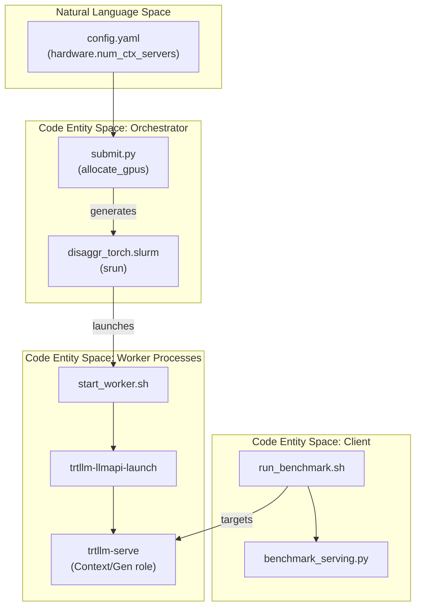
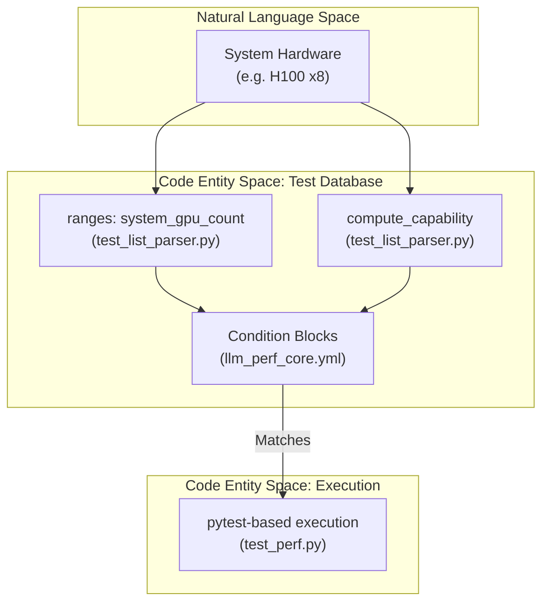

<!-- source: DeepWiki mcp.deepwiki.com · repo NVIDIA/TensorRT-LLM · page 17.2 Backend-Specific Performance Configuration · fetched 2026-10-26 -->

# Backend-Specific Performance Configuration

Relevant source files

The following files were used as context for generating this wiki page:

- [examples/disaggregated/slurm/benchmark/README.md](examples/disaggregated/slurm/benchmark/README.md)
- [examples/disaggregated/slurm/benchmark/config.yaml](examples/disaggregated/slurm/benchmark/config.yaml)
- [examples/disaggregated/slurm/benchmark/disaggr_torch.slurm](examples/disaggregated/slurm/benchmark/disaggr_torch.slurm)
- [examples/disaggregated/slurm/benchmark/get_env.py](examples/disaggregated/slurm/benchmark/get_env.py)
- [examples/disaggregated/slurm/benchmark/run_benchmark.sh](examples/disaggregated/slurm/benchmark/run_benchmark.sh)
- [examples/disaggregated/slurm/benchmark/run_benchmark_nv_sa.sh](examples/disaggregated/slurm/benchmark/run_benchmark_nv_sa.sh)
- [examples/disaggregated/slurm/benchmark/start_server.sh](examples/disaggregated/slurm/benchmark/start_server.sh)
- [examples/disaggregated/slurm/benchmark/start_worker.sh](examples/disaggregated/slurm/benchmark/start_worker.sh)
- [examples/disaggregated/slurm/benchmark/submit.py](examples/disaggregated/slurm/benchmark/submit.py)
- [examples/disaggregated/slurm/benchmark/wait_server.sh](examples/disaggregated/slurm/benchmark/wait_server.sh)
- [examples/wide_ep/README.md](examples/wide_ep/README.md)
- [examples/wide_ep/slurm_scripts/README.md](examples/wide_ep/slurm_scripts/README.md)
- [examples/wide_ep/slurm_scripts/config.yaml](examples/wide_ep/slurm_scripts/config.yaml)
- [tensorrt_llm/bench/benchmark/__init__.py](tensorrt_llm/bench/benchmark/__init__.py)
- [tests/integration/defs/examples/serve/test_configs/Nemotron3_Nano_Omni_30B_NVFP4.yml](tests/integration/defs/examples/serve/test_configs/Nemotron3_Nano_Omni_30B_NVFP4.yml)
- [tests/integration/defs/examples/serve/test_configs/Qwen3-30B-A3B-FP8.yml](tests/integration/defs/examples/serve/test_configs/Qwen3-30B-A3B-FP8.yml)
- [tests/integration/defs/examples/serve/test_serve.py](tests/integration/defs/examples/serve/test_serve.py)
- [tests/integration/defs/perf/README.md](tests/integration/defs/perf/README.md)
- [tests/integration/defs/perf/_model_paths.py](tests/integration/defs/perf/_model_paths.py)
- [tests/integration/defs/perf/base_perf_pytorch.csv](tests/integration/defs/perf/base_perf_pytorch.csv)
- [tests/integration/defs/perf/pytorch_model_config.py](tests/integration/defs/perf/pytorch_model_config.py)
- [tests/integration/defs/perf/sanity_perf_check.py](tests/integration/defs/perf/sanity_perf_check.py)
- [tests/integration/defs/perf/test_perf.py](tests/integration/defs/perf/test_perf.py)
- [tests/integration/defs/perf/utils.py](tests/integration/defs/perf/utils.py)
- [tests/integration/test_lists/qa/README.md](tests/integration/test_lists/qa/README.md)
- [tests/integration/test_lists/qa/llm_perf_core.yml](tests/integration/test_lists/qa/llm_perf_core.yml)
- [tests/integration/test_lists/qa/llm_spark_core.txt](tests/integration/test_lists/qa/llm_spark_core.txt)
- [tests/integration/test_lists/qa/llm_spark_func.yml](tests/integration/test_lists/qa/llm_spark_func.yml)
- [tests/integration/test_lists/qa/llm_spark_perf.yml](tests/integration/test_lists/qa/llm_spark_perf.yml)
- [tests/integration/test_lists/test-db/l0_perf.yml](tests/integration/test_lists/test-db/l0_perf.yml)
- [tests/scripts/perf/disaggregated/gb300_kimi-k3-fp4_8k1k_con512_ctx1_dep16_gen1_dep16_eplb0_mtp0_ccb-NIXL.yaml](tests/scripts/perf/disaggregated/gb300_kimi-k3-fp4_8k1k_con512_ctx1_dep16_gen1_dep16_eplb0_mtp0_ccb-NIXL.yaml)

This page documents how performance tests are configured in TensorRT-LLM, specifically covering the model path registries, the `PerfTestConfig` class, the `get_model_yaml_config` function in `pytorch_model_config.py`, and the specialized configuration system for disaggregated serving performance tests. This page focuses on the *configuration* aspects of the performance testing system. For the test execution framework and metrics reporting, see [17.1]() and [17.3]().

---

## Model Path Registries

`test_perf.py` and `_model_paths.py` define dictionaries that map logical model names to filesystem or Hugging Face Hub paths. These mappings are essential for the benchmarking tools to locate weights and tokenizers.

| Dictionary | Key Format | Value Example | Used For |
|---|---|---|---|
| `MODEL_PATH_DICT` | `"llama_v3.1_8b"` | `"llama-3.1-model/Llama-3.1-8B-Instruct"` | Local model dirs relative to `llm_models_root()` |
| `HF_MODEL_PATH` | `"nemotron_3_ultra_550b_nvfp4"` | `"nvidia/NVIDIA-Nemotron-3-Ultra-550B-A55B-NVFP4"` | HuggingFace Hub paths |
| `LORA_MODEL_PATH` | `"llama_v3.1_8b_instruct_fp8"` | `"lora/llama-3-chinese-8b-instruct-v2-lora/"` | LoRA adapter directories |

The registry includes modern architectures such as `deepseek_v4_pro_fp4`, `llama_v4_scout_17b_16e_instruct`, `gemma_3_27b_it`, and `qwen3_235b_a22b_fp4`.

**Sources:** [tests/integration/defs/perf/test_perf.py:34-35](), [tests/integration/defs/perf/test_perf.py:108-114](), [tests/integration/defs/perf/_model_paths.py:18-113]()

### Model Metadata and Specialized Groups

- `TRUST_REMOTE_CODE_MODELS`: A `set` of model names requiring `trust_remote_code=True` (e.g., `kimi_k2.5_fp4`, `nemotron_3_super_120b_nvfp4`, `minimax_m3_fp4`). [tests/integration/defs/perf/test_perf.py:57-69]()
- `AUTODEPLOY_MODEL_CONFIGS`: Maps model names to config YAML paths relative to the TRT-LLM root (e.g., `nemotron_nano_3_30b_fp8` → `examples/auto_deploy/nano_v3.yaml`). [tests/integration/defs/perf/test_perf.py:101-105]()
- `SPEC_DEC_MODELS`: Identifies models using speculative decoding (MTP, Eagle3, DSpark, etc.) to skip stability-breaking flags like `--ignore-eos`. [tests/integration/defs/perf/test_perf.py:94-100]()
- `SERVE_IMAGE_MODELS`: Maps multimodal models to their expected image dimensions (width, height, num_images) for dataset preparation (e.g., `nemotron_3_nano_omni_nvfp4_image` maps to `(1526, 1024, 1)`). [tests/integration/defs/perf/test_perf.py:74-76]()
- `OPENAI_CHAT_BACKEND_MODELS`: Models that require the `openai-chat` backend for `benchmark_serving`, typically reasoning or multimodal models. [tests/integration/defs/perf/test_perf.py:81-84]()

---

## PyTorch Model Configuration (`pytorch_model_config.py`)

The `get_model_yaml_config` function produces a dictionary that is serialized to YAML and passed to the `trtllm-bench` tool via the `--config` argument. This enables deep customization of the PyTorch execution backend during performance runs. [tests/integration/defs/perf/pytorch_model_config.py:55-63]()

### Pattern-Based Configuration System

The function uses a `pattern_configs` list to apply overrides. It matches the generated `model_label` (the test ID string) against substrings to apply specific architectural or optimization flags. [tests/integration/defs/perf/pytorch_model_config.py:84-180]()

**Notable Pattern Overrides:**

| Pattern Substring | Key Overrides Applied |
|---|---|
| `deepseek_r1` | `enable_attention_dp: True` |
| `deepseek_v4_pro_dspark` | `moe_config: { backend: MEGAMOE_DEEPGEMM }`, `speculative_config: { decoding_type: DSpark }` |
| `deepseek_v4_pro_fp4-bench-pytorch-float4-maxbs:32` | `enable_attention_dp: True`, `moe_config: { backend: TRTLLM }`, `num_postprocess_workers: 4` |
| `deepseek_v3_lite_fp8` | `moe_config.backend: DEEPGEMM` (if on Hopper/SM90) |

**Sources:** [tests/integration/defs/perf/pytorch_model_config.py:27-30](), [tests/integration/defs/perf/pytorch_model_config.py:86-91](), [tests/integration/defs/perf/pytorch_model_config.py:117-143](), [tests/integration/defs/perf/pytorch_model_config.py:148-180]()

### LoRA Performance Testing

The `get_model_yaml_config` function supports LoRA (Low-Rank Adaptation) configurations. If `lora_dirs` are provided, the `lora_config` section is added to the YAML output, specifying adapter paths and mapping them to task UIDs. [tests/integration/defs/perf/pytorch_model_config.py:55-56]()

**Sources:** [tests/integration/defs/perf/pytorch_model_config.py:55-63]()

---

## Disaggregated Performance Benchmarking

For disaggregated serving scenarios (Context vs. Generation separation), TensorRT-LLM provides specialized benchmarking tools to orchestrate multiple server instances, typically using Slurm for distributed resource management.

### Slurm Benchmarking Orchestration

The disaggregated benchmarking workflow is managed by `submit.py`, which allocates GPUs and generates the necessary configuration files for Context (CTX) and Generation (GEN) workers.

**Key Orchestration Scripts:**
- `submit.py`: The entry point for submitting Slurm jobs. It handles GPU allocation logic (compact vs. round-robin packing) and converts high-level YAML configs into environment-specific scripts. [examples/disaggregated/slurm/benchmark/submit.py:34-53](), [examples/disaggregated/slurm/benchmark/submit.py:93-177]()
- `start_worker.sh`: A wrapper script executed by `srun` that sets `CUDA_VISIBLE_DEVICES`, applies NUMA bindings, and launches `trtllm-llmapi-launch` with the `trtllm-serve` command. [examples/disaggregated/slurm/benchmark/start_worker.sh:6-39](), [examples/disaggregated/slurm/benchmark/start_worker.sh:95-98]()
- `run_benchmark.sh`: The client-side script that executes `benchmark_serving` against the disaggregated cluster. It includes a UCX warmup phase to stabilize P2P connections before measurement. [examples/disaggregated/slurm/benchmark/run_benchmark.sh:134-149](), [examples/disaggregated/slurm/benchmark/run_benchmark.sh:159-178]()

**Diagram: Disaggregated Benchmarking Resource Flow**

**Sources:** [examples/disaggregated/slurm/benchmark/submit.py:93-177](), [examples/disaggregated/slurm/benchmark/start_worker.sh:95-98](), [examples/disaggregated/slurm/benchmark/run_benchmark.sh:134-178]()

### Disaggregated Configuration (`config.yaml`)

The disaggregated serving performance is controlled via a centralized `config.yaml` file that defines both hardware and worker-specific parameters.

- **Hardware Allocation**: Specifies `num_ctx_servers`, `num_gen_servers`, and `gpus_per_node`. [examples/disaggregated/slurm/benchmark/config.yaml:25-28]()
- **Worker Parameters**: Separate `gen` and `ctx` sections define tensor parallelism (`tensor_parallel_size`), expert parallelism (`moe_expert_parallel_size`), and KV cache settings (`kv_cache_config`). [examples/disaggregated/slurm/benchmark/config.yaml:67-141]()
- **Communication**: The `cache_transceiver_config` block configures the `max_tokens_in_buffer` for KV cache transfer between context and generation nodes. [examples/disaggregated/slurm/benchmark/config.yaml:111-113](), [examples/disaggregated/slurm/benchmark/config.yaml:136-138]()

---

## Performance Sanity Test Lists

Tests are orchestrated through high-level YAML files that define which `test_perf.py` cases to run on specific hardware.

| File | Purpose |
|---|---|
| `l0_perf.yml` | Pre-merge performance gating for TRT and PyTorch backends. [tests/integration/test_lists/test-db/l0_perf.yml:2-16]() |
| `llm_perf_core.yml` | Comprehensive performance coverage for core models (Qwen 3.5, Nemotron Nano) across different GPU counts and architectures. [tests/integration/test_lists/qa/llm_perf_core.yml:22-40]() |
| `llm_spark_perf.yml` | Specialized cases for high-throughput and spec-dec models (Eagle3, MTP) and multimodal models (Qwen2.5-VL, Nemotron-3-Nano-Omni). [tests/integration/test_lists/qa/llm_spark_perf.yml:6-70]() |

### GPU Condition Gating
Test execution is gated by hardware capability requirements (compute capability, GPU count, and memory) defined in the YAML files. [tests/integration/test_lists/qa/llm_perf_core.yml:23-28](), [tests/integration/test_lists/qa/llm_perf_core.yml:58-66]()

**Diagram: Test List Gating Logic**

**Sources:** [tests/integration/test_lists/test-db/l0_perf.yml:3-14](), [tests/integration/test_lists/qa/llm_perf_core.yml:23-28](), [tests/integration/test_lists/qa/llm_spark_perf.yml:6-10]()

---

