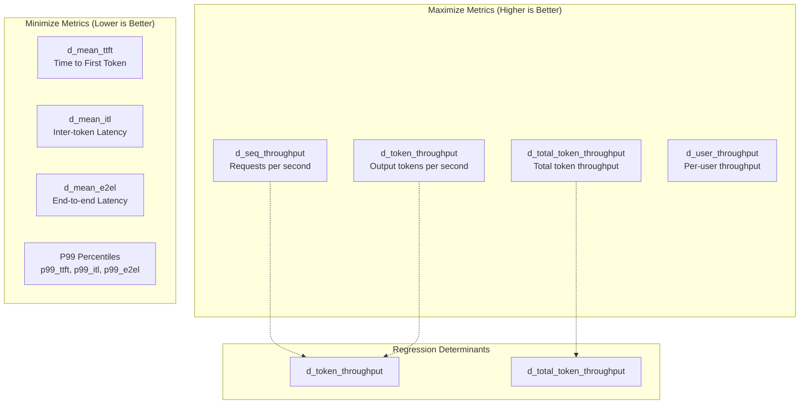
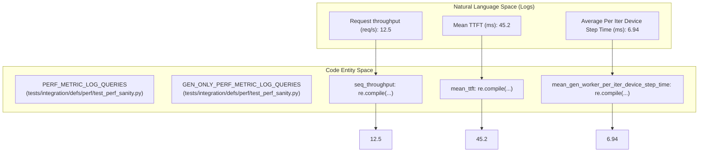
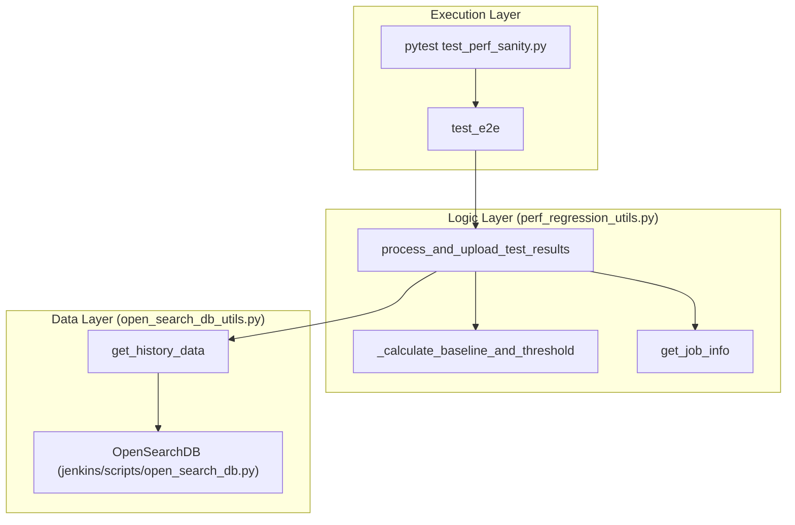
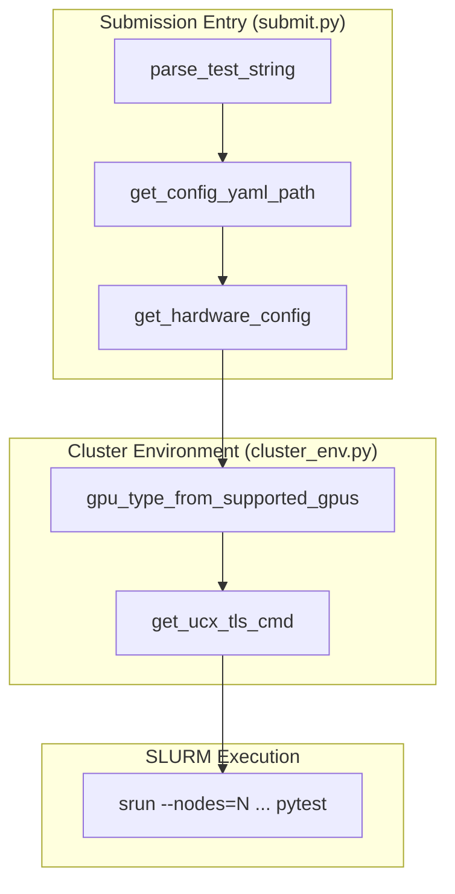
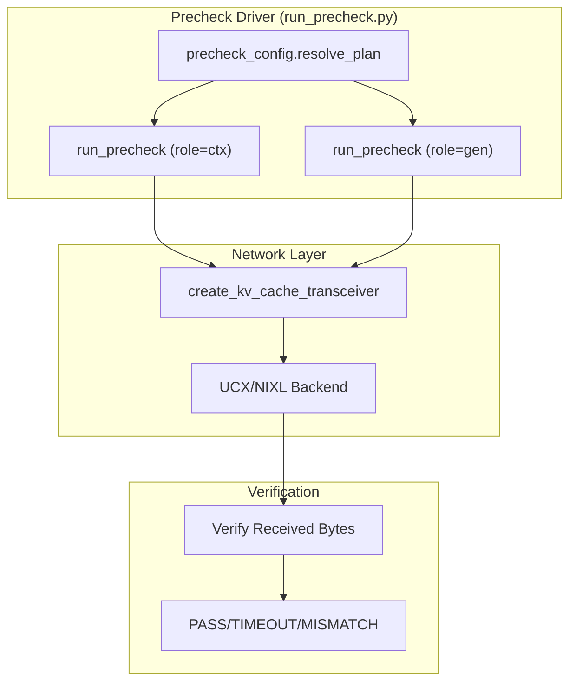

<!-- source: DeepWiki mcp.deepwiki.com · repo NVIDIA/TensorRT-LLM · page 17.3 Performance Metrics and Regression Detection · fetched 2026-10-26 -->

# Performance Metrics and Regression Detection

Relevant source files

The following files were used as context for generating this wiki page:

- [examples/disaggregated/slurm/cache_transceiver_test/run_cache_transceiver_test.py](examples/disaggregated/slurm/cache_transceiver_test/run_cache_transceiver_test.py)
- [examples/layer_wise_benchmarks/README.md](examples/layer_wise_benchmarks/README.md)
- [examples/layer_wise_benchmarks/mpi_launch.sh](examples/layer_wise_benchmarks/mpi_launch.sh)
- [examples/layer_wise_benchmarks/parse.py](examples/layer_wise_benchmarks/parse.py)
- [examples/layer_wise_benchmarks/run.py](examples/layer_wise_benchmarks/run.py)
- [examples/layer_wise_benchmarks/run.sh](examples/layer_wise_benchmarks/run.sh)
- [examples/layer_wise_benchmarks/slurm_init_containers.sh](examples/layer_wise_benchmarks/slurm_init_containers.sh)
- [examples/layer_wise_benchmarks/slurm_launch.sh](examples/layer_wise_benchmarks/slurm_launch.sh)
- [examples/layer_wise_benchmarks/slurm_query_container_name.sh](examples/layer_wise_benchmarks/slurm_query_container_name.sh)
- [jenkins/scripts/perf/cluster_env.py](jenkins/scripts/perf/cluster_env.py)
- [jenkins/scripts/perf/disaggregated/slurm_ct_precheck_gate.sh](jenkins/scripts/perf/disaggregated/slurm_ct_precheck_gate.sh)
- [jenkins/scripts/perf/disaggregated/slurm_launch_draft.sh](jenkins/scripts/perf/disaggregated/slurm_launch_draft.sh)
- [jenkins/scripts/perf/local/submit.py](jenkins/scripts/perf/local/submit.py)
- [jenkins/scripts/perf/submit.py](jenkins/scripts/perf/submit.py)
- [tensorrt_llm/tools/layer_wise_benchmarks/__init__.py](tensorrt_llm/tools/layer_wise_benchmarks/__init__.py)
- [tensorrt_llm/tools/layer_wise_benchmarks/mark_utils.py](tensorrt_llm/tools/layer_wise_benchmarks/mark_utils.py)
- [tensorrt_llm/tools/layer_wise_benchmarks/runner.py](tensorrt_llm/tools/layer_wise_benchmarks/runner.py)
- [tests/integration/defs/perf/open_search_db_utils.py](tests/integration/defs/perf/open_search_db_utils.py)
- [tests/integration/defs/perf/test_perf_sanity.py](tests/integration/defs/perf/test_perf_sanity.py)
- [tests/integration/test_lists/qa/llm_perf_multinode.yml](tests/integration/test_lists/qa/llm_perf_multinode.yml)
- [tests/integration/test_lists/test-db/l0_gb200_multi_gpus_perf_sanity.yml](tests/integration/test_lists/test-db/l0_gb200_multi_gpus_perf_sanity.yml)
- [tests/scripts/perf-sanity/aggregated/super_ad_blackwell.yaml](tests/scripts/perf-sanity/aggregated/super_ad_blackwell.yaml)
- [tests/scripts/perf-sanity/cache_transceiver_precheck/README.md](tests/scripts/perf-sanity/cache_transceiver_precheck/README.md)
- [tests/scripts/perf-sanity/cache_transceiver_precheck/precheck_config.py](tests/scripts/perf-sanity/cache_transceiver_precheck/precheck_config.py)
- [tests/scripts/perf-sanity/cache_transceiver_precheck/run_precheck.py](tests/scripts/perf-sanity/cache_transceiver_precheck/run_precheck.py)
- [tests/unittest/others/test_cache_transceiver_precheck_config.py](tests/unittest/others/test_cache_transceiver_precheck_config.py)
- [tests/unittest/others/test_cache_transceiver_precheck_run.py](tests/unittest/others/test_cache_transceiver_precheck_run.py)
- [tests/unittest/scripts/test_cluster_env.py](tests/unittest/scripts/test_cluster_env.py)
- [tests/unittest/scripts/test_perf_sanity_helpers.py](tests/unittest/scripts/test_perf_sanity_helpers.py)
- [tests/unittest/scripts/test_perf_submit.py](tests/unittest/scripts/test_perf_submit.py)
- [tests/unittest/tools/test_layer_wise_benchmarks.py](tests/unittest/tools/test_layer_wise_benchmarks.py)

## Purpose and Scope

This document describes the performance metric collection and regression detection mechanisms in TensorRT-LLM. It covers the types of metrics collected, how they are extracted from benchmark logs using regular expressions, threshold-based validation to detect performance regressions, and OpenSearch database integration for historical tracking.

Performance metrics are extracted from benchmark output logs and validated against configurable thresholds. The framework supports both relative (percentage-based) and absolute thresholds to detect meaningful regressions while filtering out noise from minor variations. The core logic for this system is implemented in `test_perf_sanity.py` [tests/integration/defs/perf/test_perf_sanity.py:15-38]() and its associated utility modules.

Sources: [tests/integration/defs/perf/test_perf_sanity.py:15-38](), [tests/integration/defs/perf/open_search_db_utils.py:15-20](), [tests/integration/defs/perf/perf_regression_utils.py:15-35]()

---

## Metric Type Definitions

### Performance Metric Classification

The framework identifies and categorizes metrics into those that should be maximized (throughput) and those that should be minimized (latency). These definitions drive the regression detection logic.

Title: Performance Metric Classification

The `PERF_METRIC_LOG_QUERIES` dictionary designates throughput and latency metrics for extraction [tests/integration/defs/perf/test_perf_sanity.py:156-173](). Specialized metrics for speculative decoding, such as "Mean Avg Decoded Tokens per Iter" (`al`), are also tracked [tests/integration/defs/perf/test_perf_sanity.py:177-179](). For disaggregated serving, generation-specific metrics like "Average Per Iter Device Step Time" are extracted via `GEN_ONLY_PERF_METRIC_LOG_QUERIES` [tests/integration/defs/perf/test_perf_sanity.py:181-182]().

Sources: [tests/integration/defs/perf/test_perf_sanity.py:156-182]()

---

## Metric Extraction from Logs

### Log Parsing Architecture

Performance metrics are extracted from benchmark stdout/stderr using regular expressions. The framework supports multiple benchmark types, including aggregated serving and disaggregated serving (where context and generation workers run on separate nodes).

Title: Log Extraction Mapping (Natural Language to Code Entity Space)

### Regex Pattern Sets

The following patterns are used to parse benchmark output in the performance sanity tests:

| Metric Key | Regex Pattern [tests/integration/defs/perf/test_perf_sanity.py:157-182]() | Purpose |
|:---|:---|:---|
| `seq_throughput` | `r"Request throughput \(req\/s\):\s+(-?[\d\.]+)` | Requests per second |
| `token_throughput` | `r"Output token throughput \(tok\/s\):\s+(-?[\d\.]+)"` | Tokens per second |
| `mean_ttft` | `r"Mean TTFT \(ms\):\s+(-?[\d\.]+)"` | Time to First Token |
| `al` | `r"Mean Avg Decoded Tokens per Iter:\s+(-?[\d\.]+)"` | Speculative decoding efficiency |
| `mean_gen_worker...` | `r"Average Per Iter Device Step Time \(ms\):\s+(-?[\d\.]+)"` | Disaggregated Gen-only latency |

For disaggregated serving, the framework targets `prev_device_step_time` from rank-specific logs using `_DEVICE_STEP_TIME_RE` and correlates it with `num_generation_tokens` via `_NUM_GEN_TOKENS_RE` [tests/integration/defs/perf/test_perf_sanity.py:184-185](). The system uses `gen_worker_log_sizes` to snapshot log offsets before launching clients to delimit per-client segments [tests/integration/defs/perf/test_perf_sanity.py:188-198]().

Sources: [tests/integration/defs/perf/test_perf_sanity.py:157-198]()

---

## Regression Detection Logic

### OpenSearch Database Integration

Performance results are stored in an OpenSearch database to track historical baselines. The system handles historical data matching via `benchmark_data_matches` [tests/integration/defs/perf/open_search_db_utils.py:27](), which compares configuration keys. It includes specific logic for boolean fields (prefixed with `b_`) to treat missing fields in older records as `False`, ensuring backward compatibility when new features are added [tests/integration/defs/perf/open_search_db_utils.py:148-176]().

### Regression Logic and Thresholds

Regression detection is orchestrated by `process_and_upload_test_results` [tests/integration/defs/perf/test_perf_sanity.py:40](). The system supports both relative thresholds and absolute thresholds defined in the historical records.

| Comparison Method | Source |
|:---|:---|
| **Historical Baseline** | `get_history_data` queries the last 90 days of post-merge results [tests/integration/defs/perf/open_search_db_utils.py:47-142](). |
| **Latest Thresholds** | `get_latest_baseline_threshold` retrieves `d_baseline_*` and `d_threshold_*` fields from the most recent valid entry [tests/integration/defs/perf/open_search_db_utils.py:95-116](). |

Title: Regression Detection Component Interaction

The `get_history_data` function specifically filters for valid, post-merge, non-baseline entries within the `QUERY_LOOKBACK_DAYS` window [tests/integration/defs/perf/open_search_db_utils.py:121-146](). It parses various timestamp formats to identify the latest entries correctly [tests/integration/defs/perf/open_search_db_utils.py:58-83]().

Sources: [tests/integration/defs/perf/open_search_db_utils.py:27-176](), [tests/integration/defs/perf/test_perf_sanity.py:40](), [tests/integration/defs/perf/perf_regression_utils.py:15-35]()

---

## Performance Sanity Test Lists

The performance sanity system uses YAML-based test lists to define coverage across different hardware and software configurations.

### Hardware-Specific Sanity Lists

*   **GB200 Sanity**: `l0_gb200_multi_gpus_perf_sanity.yml` defines high-performance tests for Blackwell systems. It covers DeepSeek-R1-FP4 with MTP and disaggregated serving context-only tests [tests/integration/test_lists/test-db/l0_gb200_multi_gpus_perf_sanity.yml:1-62]().
*   **Multi-Node Disaggregated**: Specialized test lists define massive scale tests with multiple nodes, covering DeepSeek and Qwen architectures in disaggregated serving modes [tests/integration/test_lists/test-db/l0_gb200_multi_gpus_perf_sanity.yml:21-26]().

Sources: [tests/integration/test_lists/test-db/l0_gb200_multi_gpus_perf_sanity.yml:1-62](), [tests/integration/defs/perf/test_perf_sanity.py:43-54]()

---

## SLURM Integration and Multi-Node Orchestration

Multi-node performance tests are orchestrated via SLURM scripts generated by `jenkins/scripts/perf/submit.py` [jenkins/scripts/perf/submit.py:17-33]().

### Test Slicing and Load Balancing

The system uses `pytest-split`'s `LeastDurationAlgorithm` to distribute tests across multiple CI nodes based on historical execution time [jenkins/scripts/perf/submit.py:188-202](). The duration data is loaded from `.test_durations` [jenkins/scripts/perf/submit.py:146-186]().

### Node Slicing for Disaggregated Serving

The framework supports multiple test shapes including multi-node aggregated serving and disaggregated serving [jenkins/scripts/perf/submit.py:22-30](). The `parse_test_string` function handles prefixes like `aggr_upload` and `disagg_upload` to determine the runtime mode [jenkins/scripts/perf/local/submit.py:88-139]().

Title: Performance Test Submission Flow

The system uses specific hardware configurations defined in YAML files to determine the required `gpus_per_node` and total node count for multi-GPU execution [jenkins/scripts/perf/local/submit.py:169-186]().

Sources: [jenkins/scripts/perf/submit.py:17-202](), [jenkins/scripts/perf/local/submit.py:88-186](), [jenkins/scripts/perf/cluster_env.py]()

---

## Layer-Wise Benchmarking

The `layer_wise_benchmarks` tool profiles individual layers of LLM models to compare layer-wise performance with end-to-end results [examples/layer_wise_benchmarks/README.md:1-5]().

### Architecture and NVTX Marking

The tool uses `nsys` to profile a contiguous slice of transformer layers. Each profiled iteration calls `model.forward` directly, bypassing the scheduler and decoding loop [examples/layer_wise_benchmarks/README.md:5-6]().

The `mark_ranges` function in `mark_utils.py` annotates key model components with NVTX ranges for granular profiling:
*   **Attention**: `MLA.forward`, `Attention.forward` [tensorrt_llm/tools/layer_wise_benchmarks/mark_utils.py:48-49]().
*   **MoE**: `DeepseekV3Gate.forward`, `NemotronHMOE.forward`, `MoE.forward` [tensorrt_llm/tools/layer_wise_benchmarks/mark_utils.py:28-31, 50]().
*   **Hybrid Modules**: `KimiKDALinearAttention.forward`, `Mamba2Mixer.forward` [tensorrt_llm/tools/layer_wise_benchmarks/mark_utils.py:42, 52]().

### Execution Runner

The `Runner` class in `runner.py` handles model construction and KV-cache setup for these benchmarks [tensorrt_llm/tools/layer_wise_benchmarks/runner.py:18](). It includes sophisticated logic for generating balanced expert selection to simulate realistic MoE workloads [tensorrt_llm/tools/layer_wise_benchmarks/runner.py:66-113]().

Sources: [examples/layer_wise_benchmarks/README.md:1-41](), [tensorrt_llm/tools/layer_wise_benchmarks/mark_utils.py:27-61](), [tensorrt_llm/tools/layer_wise_benchmarks/runner.py:18-113]()

---

## Cache-Transceiver Precheck

Disaggregated performance tests include a fast go/no-go network check called the **Cache-Transceiver Precheck**. This runs before the expensive model bring-up to verify the KV transfer network path.

### Architecture and Parity

The precheck ensures parity with the real test by construction:
*   **Topology**: Uses the same MPI instance count and node placement.
*   **Config**: Vertically inherits the `cache_transceiver_config` from the test YAML.
*   **Runtime**: Resolves the KV cache manager version and transceiver runtime (NIXL vs Python).

### Execution Flow

The precheck is driven by `run_precheck.py`. It performs a transfer of deterministic KV data from the context (CTX) server to the generation (GEN) server and verifies the received bytes.

Title: Cache-Transceiver Precheck Logic

The `_import_precheck_config` function dynamically loads the precheck configuration from the repository to ensure the single owner of enable policies and timeout formulas is used [jenkins/scripts/perf/submit.py:49-59]().

Sources: [jenkins/scripts/perf/submit.py:49-59](), [jenkins/scripts/perf/local/submit.py:34-44](), [tests/scripts/perf-sanity/cache_transceiver_precheck/precheck_config.py]()

---

