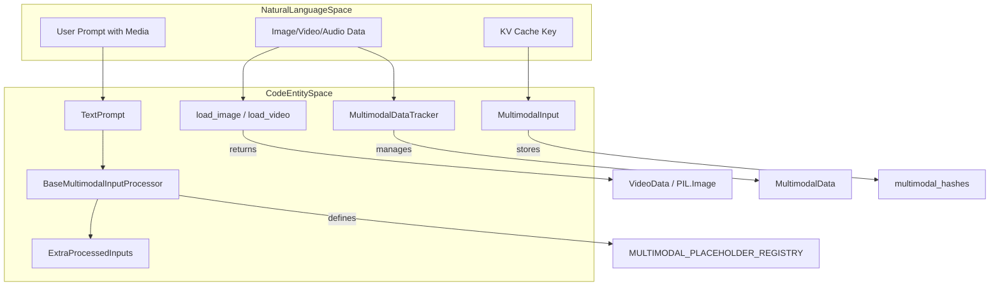
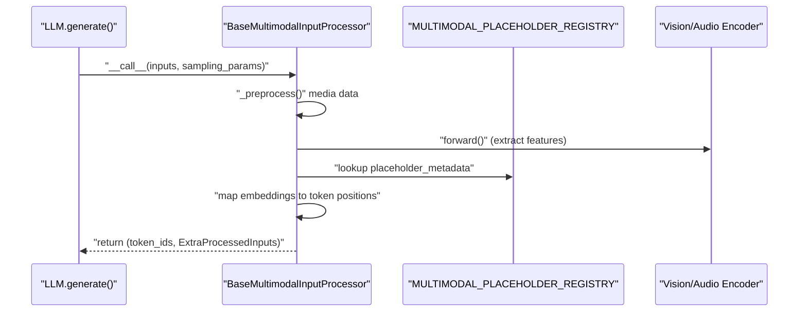

<!-- source: DeepWiki mcp.deepwiki.com · repo NVIDIA/TensorRT-LLM · page 18.1 Multimodal Input Processing · fetched 2026-10-26 -->

# Multimodal Input Processing

Relevant source files

The following files were used as context for generating this wiki page:

- [docs/source/models/supported-models.md](docs/source/models/supported-models.md)
- [examples/models/core/multimodal/qwen_image_bench_eval.py](examples/models/core/multimodal/qwen_image_bench_eval.py)
- [tensorrt_llm/_torch/models/__init__.py](tensorrt_llm/_torch/models/__init__.py)
- [tensorrt_llm/_torch/models/checkpoints/hf/qwen3_5_weight_mapper.py](tensorrt_llm/_torch/models/checkpoints/hf/qwen3_5_weight_mapper.py)
- [tensorrt_llm/_torch/models/modeling_deepseekv3.py](tensorrt_llm/_torch/models/modeling_deepseekv3.py)
- [tensorrt_llm/_torch/models/modeling_gemma3vl.py](tensorrt_llm/_torch/models/modeling_gemma3vl.py)
- [tensorrt_llm/_torch/models/modeling_hyperclovax.py](tensorrt_llm/_torch/models/modeling_hyperclovax.py)
- [tensorrt_llm/_torch/models/modeling_llama.py](tensorrt_llm/_torch/models/modeling_llama.py)
- [tensorrt_llm/_torch/models/modeling_llava_next.py](tensorrt_llm/_torch/models/modeling_llava_next.py)
- [tensorrt_llm/_torch/models/modeling_multimodal_utils.py](tensorrt_llm/_torch/models/modeling_multimodal_utils.py)
- [tensorrt_llm/_torch/models/modeling_nemotron_nano.py](tensorrt_llm/_torch/models/modeling_nemotron_nano.py)
- [tensorrt_llm/_torch/models/modeling_parakeet.py](tensorrt_llm/_torch/models/modeling_parakeet.py)
- [tensorrt_llm/_torch/models/modeling_phi4mm.py](tensorrt_llm/_torch/models/modeling_phi4mm.py)
- [tensorrt_llm/_torch/models/modeling_qwen2vl.py](tensorrt_llm/_torch/models/modeling_qwen2vl.py)
- [tensorrt_llm/_torch/models/modeling_qwen3_5.py](tensorrt_llm/_torch/models/modeling_qwen3_5.py)
- [tensorrt_llm/_torch/models/modeling_qwen3_next.py](tensorrt_llm/_torch/models/modeling_qwen3_next.py)
- [tensorrt_llm/_torch/models/modeling_qwen3vl.py](tensorrt_llm/_torch/models/modeling_qwen3vl.py)
- [tensorrt_llm/_torch/models/modeling_radio.py](tensorrt_llm/_torch/models/modeling_radio.py)
- [tensorrt_llm/_torch/models/modeling_utils.py](tensorrt_llm/_torch/models/modeling_utils.py)
- [tensorrt_llm/_torch/models/modeling_vila.py](tensorrt_llm/_torch/models/modeling_vila.py)
- [tensorrt_llm/_torch/models/multimodal_encoder_graph.py](tensorrt_llm/_torch/models/multimodal_encoder_graph.py)
- [tensorrt_llm/_torch/modules/attention.py](tensorrt_llm/_torch/modules/attention.py)
- [tensorrt_llm/_torch/pyexecutor/config_utils.py](tensorrt_llm/_torch/pyexecutor/config_utils.py)
- [tensorrt_llm/inputs/__init__.py](tensorrt_llm/inputs/__init__.py)
- [tensorrt_llm/inputs/media_io.py](tensorrt_llm/inputs/media_io.py)
- [tensorrt_llm/inputs/multimodal.py](tensorrt_llm/inputs/multimodal.py)
- [tensorrt_llm/inputs/multimodal_data.py](tensorrt_llm/inputs/multimodal_data.py)
- [tensorrt_llm/inputs/registry.py](tensorrt_llm/inputs/registry.py)
- [tensorrt_llm/inputs/utils.py](tensorrt_llm/inputs/utils.py)
- [tensorrt_llm/serve/chat_utils.py](tensorrt_llm/serve/chat_utils.py)
- [tests/integration/defs/accuracy/references/mmmu.yaml](tests/integration/defs/accuracy/references/mmmu.yaml)
- [tests/integration/defs/accuracy/test_llm_api_pytorch_multimodal.py](tests/integration/defs/accuracy/test_llm_api_pytorch_multimodal.py)
- [tests/integration/test_lists/test-db/l0_a30.yml](tests/integration/test_lists/test-db/l0_a30.yml)
- [tests/integration/test_lists/test-db/l0_l40s.yml](tests/integration/test_lists/test-db/l0_l40s.yml)
- [tests/unittest/_torch/modeling/test_modeling_multimodal.py](tests/unittest/_torch/modeling/test_modeling_multimodal.py)
- [tests/unittest/_torch/modeling/test_modeling_nemotron_nano_v2_vl.py](tests/unittest/_torch/modeling/test_modeling_nemotron_nano_v2_vl.py)
- [tests/unittest/_torch/modeling/test_modeling_parakeet.py](tests/unittest/_torch/modeling/test_modeling_parakeet.py)
- [tests/unittest/_torch/modeling/test_modeling_qwen2_5vl.py](tests/unittest/_torch/modeling/test_modeling_qwen2_5vl.py)
- [tests/unittest/_torch/modeling/test_modeling_qwen3_5_vl_moe.py](tests/unittest/_torch/modeling/test_modeling_qwen3_5_vl_moe.py)
- [tests/unittest/_torch/modeling/test_modeling_qwen3vl.py](tests/unittest/_torch/modeling/test_modeling_qwen3vl.py)
- [tests/unittest/_torch/modeling/test_modeling_radio.py](tests/unittest/_torch/modeling/test_modeling_radio.py)
- [tests/unittest/_torch/modeling/test_multimodal_encoder_graph.py](tests/unittest/_torch/modeling/test_multimodal_encoder_graph.py)
- [tests/unittest/_torch/modeling/test_nemotron_nano_preprocessing.py](tests/unittest/_torch/modeling/test_nemotron_nano_preprocessing.py)
- [tests/unittest/_torch/modeling/test_qwen_image_bench_e2e.py](tests/unittest/_torch/modeling/test_qwen_image_bench_e2e.py)
- [tests/unittest/_torch/modeling/test_qwen_image_bench_modeling.py](tests/unittest/_torch/modeling/test_qwen_image_bench_modeling.py)
- [tests/unittest/_torch/multimodal/golden/generate_qwen_image_bench_cat_piano_golden.py](tests/unittest/_torch/multimodal/golden/generate_qwen_image_bench_cat_piano_golden.py)
- [tests/unittest/_torch/multimodal/golden/qwen_image_bench_cat_piano_alignment.json](tests/unittest/_torch/multimodal/golden/qwen_image_bench_cat_piano_alignment.json)
- [tests/unittest/_torch/multimodal/test_external_embedding.py](tests/unittest/_torch/multimodal/test_external_embedding.py)
- [tests/unittest/_torch/multimodal/test_find_num_image_tokens.py](tests/unittest/_torch/multimodal/test_find_num_image_tokens.py)
- [tests/unittest/_torch/multimodal/test_mm_encoder_standalone.py](tests/unittest/_torch/multimodal/test_mm_encoder_standalone.py)
- [tests/unittest/_torch/multimodal/test_qwen3vl_mixed_modality_encoder.py](tests/unittest/_torch/multimodal/test_qwen3vl_mixed_modality_encoder.py)
- [tests/unittest/_torch/test_utils.py](tests/unittest/_torch/test_utils.py)
- [tests/unittest/inputs/test_video_data_hashing.py](tests/unittest/inputs/test_video_data_hashing.py)
- [tests/unittest/inputs/test_video_decode.py](tests/unittest/inputs/test_video_decode.py)
- [tests/unittest/llmapi/apps/test_chat_utils.py](tests/unittest/llmapi/apps/test_chat_utils.py)
- [tests/unittest/llmapi/test_llm_kv_cache_events.py](tests/unittest/llmapi/test_llm_kv_cache_events.py)

TensorRT-LLM provides a comprehensive infrastructure for processing multimodal inputs (images, video, and audio) alongside text. The system is designed to handle media loading, content-based hashing for KV cache reuse, and the integration of multimodal embeddings into the LLM's transformer layers.

## Architecture Overview

The multimodal processing pipeline bridges the gap between raw media files and the high-dimensional embedding space required by the LLM. It consists of three primary stages:
1.  **Data Loading & Preprocessing**: Fetching media from URLs or base64 strings and converting them into tensors or processed frames using `tensorrt_llm.inputs.utils` [tensorrt_llm/inputs/utils.py:43-281]().
2.  **Input Registration & Processing**: Mapping multimodal tokens within a text prompt to their corresponding media data using the `MULTIMODAL_PLACEHOLDER_REGISTRY` and model-specific `InputProcessor` implementations [tensorrt_llm/inputs/registry.py:35-52]().
3.  **Embedding Fusion**: Running modality-specific encoders (e.g., SigLIP, CLIP, or Audio Encoders) and splicing the resulting embeddings into the text embedding sequence via `fuse_input_embeds` [tensorrt_llm/_torch/models/modeling_multimodal_utils.py:47-47]().

### Natural Language to Code Entity Space Mapping

The following diagram illustrates how high-level multimodal concepts map to specific classes and functions within the `tensorrt_llm` codebase.

**Concept to Code Mapping**

Sources: [tensorrt_llm/inputs/registry.py:35-44](), [tensorrt_llm/inputs/registry.py:151-174](), [tensorrt_llm/inputs/multimodal.py:42-68](), [tensorrt_llm/inputs/utils.py:67-121]()

## Multimodal Data Loading

The utility module `tensorrt_llm/inputs/utils.py` provides robust functions for loading various media types. These functions support local file paths, HTTP(S) URLs, and base64-encoded data.

### Supported Modalities
*   **Images**: Handled via `load_image` and `async_load_image`. Supports loading from PIL objects, web URLs, or base64 strings [tensorrt_llm/inputs/utils.py:67-91](), [tensorrt_llm/inputs/utils.py:93-122]().
*   **Video**: Handled via `load_video` and `async_load_video`. Returns a `VideoData` object containing sampled frames processed by OpenCV [tensorrt_llm/inputs/utils.py:137-177](), [tensorrt_llm/inputs/utils.py:179-219]().
*   **Audio**: Handled via `async_load_audio`, utilizing `soundfile` for loading and supporting base64-encoded audio content [tensorrt_llm/inputs/utils.py:238-283]().
*   **Embeddings**: Supports loading pre-computed base64-encoded PyTorch tensors directly into `torch.Tensor` objects via `load_base64_image_embeds` [tensorrt_llm/inputs/utils.py:58-64]().

### Multimodal Data Tracker
The `MultimodalDataTracker` manages the lifecycle of media data during input processing. It tracks processed items and interfaces with the `MEDIA_IO_REGISTRY` to construct modality-specific loaders [tensorrt_llm/serve/chat_utils.py:95-111]().

Sources: [tensorrt_llm/inputs/utils.py:1-283](), [tensorrt_llm/inputs/multimodal.py:1-40](), [tensorrt_llm/serve/chat_utils.py:95-111]()

## The Inputs Registry and Processors

Multimodal models require specialized input processing to handle tokens that represent media (e.g., `<image>` or `<|vision_start|>`).

### BaseMultimodalInputProcessor
This abstract base class defines the interface for model-specific processing. Key responsibilities include:
*   **Tokenization**: Converting text prompts into token IDs [tensorrt_llm/inputs/registry.py:170-174]().
*   **Placeholder Management**: Identifying where media embeddings should be inserted using `MultimodalPlaceholderPlacement` and `MultimodalPlaceholderMetadata` [tensorrt_llm/inputs/registry.py:38-43]().
*   **Fast Path Support**: Models can set `supports_token_id_mm_expansion = True` to avoid detokenizing prompts when multimodal data is present [tensorrt_llm/inputs/registry.py:177-177]().
*   **Bidirectional Blocks**: Certain models set `mm_bidirectional_blocks = True`, requiring the chunked-prefill scheduler to keep multimodal blocks intact [tensorrt_llm/inputs/registry.py:173-173]().

### Registration Mechanism
Models register their specific input processors using the `@register_input_processor` decorator. This links a model type (e.g., `qwen2_vl`) to its processor implementation [tensorrt_llm/_torch/models/modeling_qwen2vl.py:42-43]().

**Input Processing Data Flow**

Sources: [tensorrt_llm/inputs/registry.py:34-52](), [tensorrt_llm/inputs/registry.py:156-180](), [tensorrt_llm/_torch/models/modeling_qwen2vl.py:38-43]()

## KV Cache Reuse and Hashing

TensorRT-LLM implements content-based hashing for multimodal data to enable KV cache reuse across different requests, significantly reducing redundant computation for identical media items.

### MultimodalInput Class
The `MultimodalInput` dataclass stores metadata required by the C++ runtime to identify cached multimodal blocks:
*   `multimodal_hashes`: BLAKE3 hash digests of the media content [tensorrt_llm/inputs/multimodal.py:18-24]().
*   `multimodal_positions`: Prompt position of each logical unit's first multimodal token [tensorrt_llm/inputs/multimodal.py:46-52]().
*   `multimodal_lengths`: Per logical unit count of prompt-side multimodal tokens [tensorrt_llm/inputs/multimodal.py:54-68]().

### Hashing Logic
The system uses `blake3` as the default hasher via `default_hasher` [tensorrt_llm/inputs/multimodal.py:18-18](). For cache stability, the system validates that multimodal positions and lengths fit within `int32` ranges for the executor and KV-cache code [tensorrt_llm/inputs/multimodal.py:100-101]().

Sources: [tensorrt_llm/inputs/multimodal.py:1-155](), [tensorrt_llm/inputs/multimodal.py:18-18]()

## Implementation Details: Model Examples

Different models implement the `BaseMultimodalInputProcessor` or utilize specialized multimodal utilities to handle unique architectural requirements.

| Model | Implementation File | Key Implementation Detail |
| :--- | :--- | :--- |
| **Qwen2-VL** | [tensorrt_llm/_torch/models/modeling_qwen2vl.py]() | Prepares `mrope_config` and vision attention metadata [tensorrt_llm/_torch/models/modeling_qwen2vl.py:86-137](). |
| **Qwen3-VL** | [tensorrt_llm/_torch/models/modeling_qwen3vl.py]() | Uses `_expand_prompt_token_ids_for_mm_handoff` for sparse MM layout [tensorrt_llm/_torch/models/modeling_qwen3vl.py:74-164](). |
| **LLaVA** | [tensorrt_llm/_torch/models/modeling_llama.py]() | Uses `fuse_input_embeds` to combine vision and text [tensorrt_llm/_torch/models/modeling_llama.py:47-47](). |
| **Gemma-3 VL** | [tensorrt_llm/_torch/models/modeling_gemma3vl.py]() | Support for Google's Gemma-3 multimodal vision processing via `Gemma3VLM` [tensorrt_llm/_torch/models/__init__.py:42-42](). |
| **Gemma-4 / MM** | [tensorrt_llm/_torch/models/modeling_gemma4.py]() | Implementation for Gemma 4 architectures including `Gemma4ForConditionalGeneration` and `Gemma4MMForCausalLM` [tensorrt_llm/_torch/models/__init__.py:43-45](). |
| **Phi-4 MM** | [tensorrt_llm/_torch/models/modeling_phi4mm.py]() | Optimized vision encoder forward with SigLip config and audio embedding support via `Phi4MMForCausalLM` [tensorrt_llm/_torch/models/__init__.py:71-71](). |
| **VILA** | [tensorrt_llm/_torch/models/modeling_vila.py]() | Implementation for the VILA model family via `VilaModel` [tensorrt_llm/_torch/models/__init__.py:94-94](). |
| **mLLaMA** | [tensorrt_llm/_torch/models/modeling_mllama.py]() | Implementation for multimodal Llama architectures via `MllamaForConditionalGeneration` [tensorrt_llm/_torch/models/__init__.py:65-65](). |
| **Kimi K2.5 / K3** | [tensorrt_llm/_torch/models/modeling_kimi_k25.py]() | Integrated via `KimiK25ForConditionalGeneration` and `KimiK3ForConditionalGeneration` with MoonViT3d support [tensorrt_llm/_torch/models/__init__.py:51-52](). |
| **Step3.7VL** | [tensorrt_llm/_torch/models/modeling_step3p7vl.py]() | Support for Step-3.7-VL architectures via `Step3p7VLForConditionalGeneration` [tensorrt_llm/_torch/models/__init__.py:92-92](). |
| **MiniMaxM3VL**| [tensorrt_llm/_torch/models/modeling_minimaxm3.py]() | Support for MiniMax-M3 multimodal via `MiniMaxM3VLForConditionalGeneration` [tensorrt_llm/_torch/models/__init__.py:61-61](). |
| **MiniCPM-V 4.6** | [tensorrt_llm/_torch/models/modeling_minicpmv.py]() | Implementation for `MiniCPMV4_6Model` [tensorrt_llm/_torch/models/__init__.py:58-58](). |
| **Pixtral** | [tensorrt_llm/_torch/models/modeling_pixtral.py]() | Support for Pixtral architectures via `Mistral3VLM` [tensorrt_llm/_torch/models/__init__.py:62-62](). |
| **Nemotron-Nano VL** | [tensorrt_llm/_torch/models/modeling_nemotron_nano.py]() | Calculates target pixel dimensions preserving aspect ratio for video [tensorrt_llm/_torch/models/modeling_nemotron_nano.py:68-105](). |
| **HyperCLOVA-X** | [tensorrt_llm/_torch/models/modeling_hyperclovax.py]() | Implementation for vision-enabled HyperCLOVA-X via `HCXVisionForCausalLM` [tensorrt_llm/_torch/models/__init__.py:48-48](). |
| **Parakeet** | [tensorrt_llm/_torch/models/modeling_parakeet.py]() | Audio encoder implementation for speech-to-text and multimodal audio tasks [tensorrt_llm/_torch/models/__init__.py:29-29](). |

### Embedding Fusion
During the model `forward` pass, text and multimodal embeddings are combined. The function `fuse_input_embeds` performs the splicing of encoder-generated features into the sequence at positions defined by the multimodal tokens [tensorrt_llm/_torch/models/modeling_multimodal_utils.py:47-47](). This function handles both dense and sparse multimodal layouts.

### Multimodal Disaggregated Serving
Models like Qwen2-VL and Nemotron-Nano support multimodal disaggregated serving, where context (prefill) and generation (decode) are separated. This is checked via `_is_mm_disagg()` which looks for the `TLLM_MULTIMODAL_DISAGGREGATED` environment variable [tensorrt_llm/_torch/models/modeling_multimodal_utils.py:28-28](). In this mode, prefill results (including vision/audio embeddings) are transferred to the decode engine via the KV cache transceiver.

Sources: [tensorrt_llm/_torch/models/modeling_qwen2vl.py:86-137](), [tensorrt_llm/_torch/models/modeling_qwen3vl.py:74-164](), [tensorrt_llm/_torch/models/modeling_nemotron_nano.py:68-105](), [tensorrt_llm/_torch/models/modeling_multimodal_utils.py:28-47](), [tensorrt_llm/_torch/models/modeling_llama.py:47-52](), [tensorrt_llm/_torch/models/__init__.py:29-94]()

---

