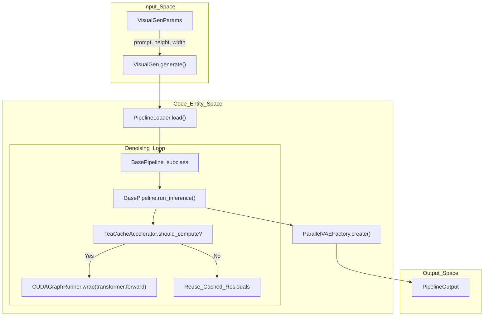
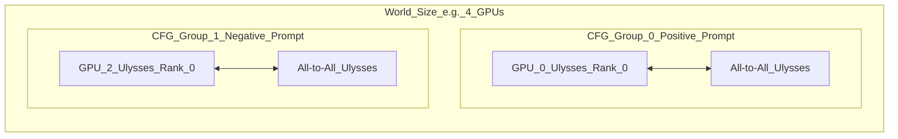
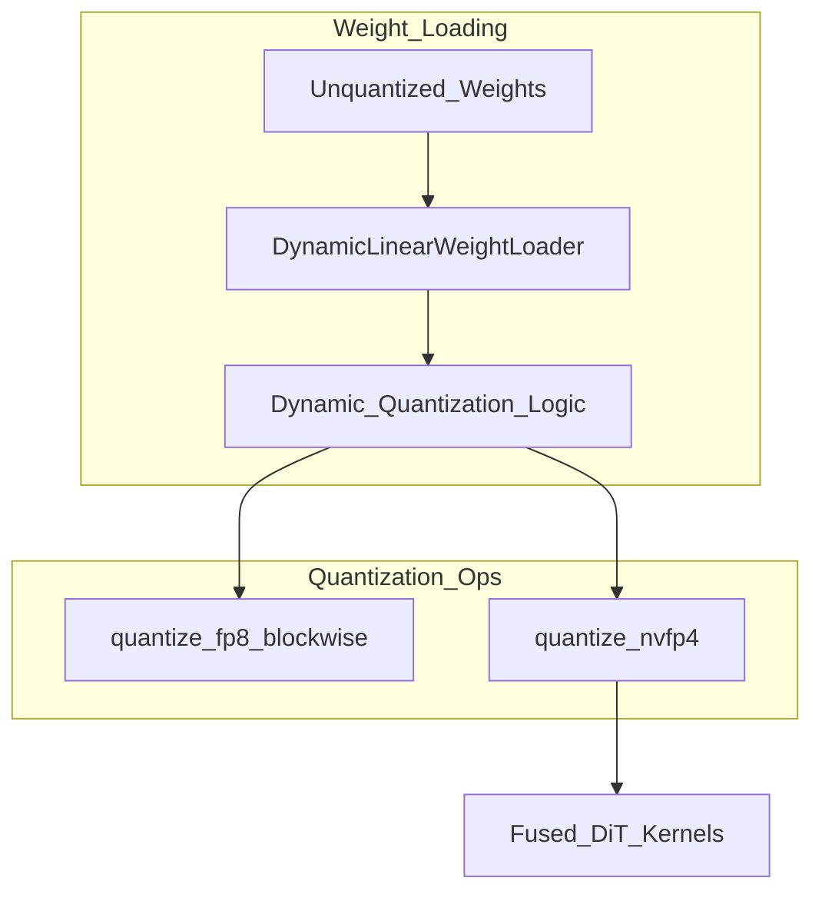

<!-- source: DeepWiki mcp.deepwiki.com · repo NVIDIA/TensorRT-LLM · page 18.2 Visual Generation Pipelines · fetched 2026-10-26 -->

# Visual Generation Pipelines

Relevant source files

The following files were used as context for generating this wiki page:

- [docs/source/commands/trtllm-serve/trtllm-serve.rst](docs/source/commands/trtllm-serve/trtllm-serve.rst)
- [docs/source/models/visual-generation.md](docs/source/models/visual-generation.md)
- [docs/source/release-notes.md](docs/source/release-notes.md)
- [examples/visual_gen/README.md](examples/visual_gen/README.md)
- [examples/visual_gen/configs/cosmos3-nano-1gpu.yaml](examples/visual_gen/configs/cosmos3-nano-1gpu.yaml)
- [examples/visual_gen/configs/cosmos3-super-4gpu.yaml](examples/visual_gen/configs/cosmos3-super-4gpu.yaml)
- [examples/visual_gen/models/cosmos3/README.md](examples/visual_gen/models/cosmos3/README.md)
- [examples/visual_gen/models/cosmos3/cosmos3.py](examples/visual_gen/models/cosmos3/cosmos3.py)
- [examples/visual_gen/models/glm_image.py](examples/visual_gen/models/glm_image.py)
- [examples/visual_gen/serve/README.md](examples/visual_gen/serve/README.md)
- [examples/visual_gen/serve/sync_video_gen.py](examples/visual_gen/serve/sync_video_gen.py)
- [tensorrt_llm/__init__.py](tensorrt_llm/__init__.py)
- [tensorrt_llm/_torch/shared_tensor/__init__.py](tensorrt_llm/_torch/shared_tensor/__init__.py)
- [tensorrt_llm/_torch/shared_tensor/shared_tensor.py](tensorrt_llm/_torch/shared_tensor/shared_tensor.py)
- [tensorrt_llm/_torch/visual_gen/__init__.py](tensorrt_llm/_torch/visual_gen/__init__.py)
- [tensorrt_llm/_torch/visual_gen/attention_backend/__init__.py](tensorrt_llm/_torch/visual_gen/attention_backend/__init__.py)
- [tensorrt_llm/_torch/visual_gen/attention_backend/flash_attn4.py](tensorrt_llm/_torch/visual_gen/attention_backend/flash_attn4.py)
- [tensorrt_llm/_torch/visual_gen/attention_backend/interface.py](tensorrt_llm/_torch/visual_gen/attention_backend/interface.py)
- [tensorrt_llm/_torch/visual_gen/attention_backend/parallel.py](tensorrt_llm/_torch/visual_gen/attention_backend/parallel.py)
- [tensorrt_llm/_torch/visual_gen/attention_backend/trtllm.py](tensorrt_llm/_torch/visual_gen/attention_backend/trtllm.py)
- [tensorrt_llm/_torch/visual_gen/attention_backend/utils.py](tensorrt_llm/_torch/visual_gen/attention_backend/utils.py)
- [tensorrt_llm/_torch/visual_gen/attention_backend/vanilla.py](tensorrt_llm/_torch/visual_gen/attention_backend/vanilla.py)
- [tensorrt_llm/_torch/visual_gen/config.py](tensorrt_llm/_torch/visual_gen/config.py)
- [tensorrt_llm/_torch/visual_gen/executor.py](tensorrt_llm/_torch/visual_gen/executor.py)
- [tensorrt_llm/_torch/visual_gen/models/__init__.py](tensorrt_llm/_torch/visual_gen/models/__init__.py)
- [tensorrt_llm/_torch/visual_gen/models/cosmos3/defaults.py](tensorrt_llm/_torch/visual_gen/models/cosmos3/defaults.py)
- [tensorrt_llm/_torch/visual_gen/models/cosmos3/pipeline_cosmos3.py](tensorrt_llm/_torch/visual_gen/models/cosmos3/pipeline_cosmos3.py)
- [tensorrt_llm/_torch/visual_gen/models/cosmos3/sampling.py](tensorrt_llm/_torch/visual_gen/models/cosmos3/sampling.py)
- [tensorrt_llm/_torch/visual_gen/models/cosmos3/transformer_cosmos3.py](tensorrt_llm/_torch/visual_gen/models/cosmos3/transformer_cosmos3.py)
- [tensorrt_llm/_torch/visual_gen/models/flux/pipeline_flux.py](tensorrt_llm/_torch/visual_gen/models/flux/pipeline_flux.py)
- [tensorrt_llm/_torch/visual_gen/models/flux/pipeline_flux2.py](tensorrt_llm/_torch/visual_gen/models/flux/pipeline_flux2.py)
- [tensorrt_llm/_torch/visual_gen/models/glm_image/__init__.py](tensorrt_llm/_torch/visual_gen/models/glm_image/__init__.py)
- [tensorrt_llm/_torch/visual_gen/models/glm_image/pipeline_glm_image.py](tensorrt_llm/_torch/visual_gen/models/glm_image/pipeline_glm_image.py)
- [tensorrt_llm/_torch/visual_gen/models/glm_image/transformer_glm_image.py](tensorrt_llm/_torch/visual_gen/models/glm_image/transformer_glm_image.py)
- [tensorrt_llm/_torch/visual_gen/models/ltx2/ltx2_core/rope.py](tensorrt_llm/_torch/visual_gen/models/ltx2/ltx2_core/rope.py)
- [tensorrt_llm/_torch/visual_gen/models/ltx2/ltx2_core/transformer_args.py](tensorrt_llm/_torch/visual_gen/models/ltx2/ltx2_core/transformer_args.py)
- [tensorrt_llm/_torch/visual_gen/models/ltx2/pipeline_ltx2.py](tensorrt_llm/_torch/visual_gen/models/ltx2/pipeline_ltx2.py)
- [tensorrt_llm/_torch/visual_gen/models/ltx2/pipeline_ltx2_two_stages.py](tensorrt_llm/_torch/visual_gen/models/ltx2/pipeline_ltx2_two_stages.py)
- [tensorrt_llm/_torch/visual_gen/models/ltx2/transformer_ltx2.py](tensorrt_llm/_torch/visual_gen/models/ltx2/transformer_ltx2.py)
- [tensorrt_llm/_torch/visual_gen/models/wan/__init__.py](tensorrt_llm/_torch/visual_gen/models/wan/__init__.py)
- [tensorrt_llm/_torch/visual_gen/models/wan/dup_up3d.py](tensorrt_llm/_torch/visual_gen/models/wan/dup_up3d.py)
- [tensorrt_llm/_torch/visual_gen/models/wan/parallel_vae.py](tensorrt_llm/_torch/visual_gen/models/wan/parallel_vae.py)
- [tensorrt_llm/_torch/visual_gen/models/wan/pipeline_wan.py](tensorrt_llm/_torch/visual_gen/models/wan/pipeline_wan.py)
- [tensorrt_llm/_torch/visual_gen/models/wan/pipeline_wan_i2v.py](tensorrt_llm/_torch/visual_gen/models/wan/pipeline_wan_i2v.py)
- [tensorrt_llm/_torch/visual_gen/models/wan/transformer_wan.py](tensorrt_llm/_torch/visual_gen/models/wan/transformer_wan.py)
- [tensorrt_llm/_torch/visual_gen/models/wan/vae_loader.py](tensorrt_llm/_torch/visual_gen/models/wan/vae_loader.py)
- [tensorrt_llm/_torch/visual_gen/models/wan/wan_vae.py](tensorrt_llm/_torch/visual_gen/models/wan/wan_vae.py)
- [tensorrt_llm/_torch/visual_gen/modules/attention.py](tensorrt_llm/_torch/visual_gen/modules/attention.py)
- [tensorrt_llm/_torch/visual_gen/modules/vae/__init__.py](tensorrt_llm/_torch/visual_gen/modules/vae/__init__.py)
- [tensorrt_llm/_torch/visual_gen/modules/vae/conv.py](tensorrt_llm/_torch/visual_gen/modules/vae/conv.py)
- [tensorrt_llm/_torch/visual_gen/modules/vae/parallel_vae_interface.py](tensorrt_llm/_torch/visual_gen/modules/vae/parallel_vae_interface.py)
- [tensorrt_llm/_torch/visual_gen/output.py](tensorrt_llm/_torch/visual_gen/output.py)
- [tensorrt_llm/_torch/visual_gen/pipeline.py](tensorrt_llm/_torch/visual_gen/pipeline.py)
- [tensorrt_llm/_torch/visual_gen/pipeline_loader.py](tensorrt_llm/_torch/visual_gen/pipeline_loader.py)
- [tensorrt_llm/_torch/visual_gen/pipeline_registry.py](tensorrt_llm/_torch/visual_gen/pipeline_registry.py)
- [tensorrt_llm/_torch/visual_gen/runtime_lora.py](tensorrt_llm/_torch/visual_gen/runtime_lora.py)
- [tensorrt_llm/bench/benchmark/visual_gen.py](tensorrt_llm/bench/benchmark/visual_gen.py)
- [tensorrt_llm/serve/openai_video_routes.py](tensorrt_llm/serve/openai_video_routes.py)
- [tensorrt_llm/serve/scripts/benchmark_visual_gen.py](tensorrt_llm/serve/scripts/benchmark_visual_gen.py)
- [tensorrt_llm/serve/visual_gen_metrics.py](tensorrt_llm/serve/visual_gen_metrics.py)
- [tensorrt_llm/serve/visual_gen_utils.py](tensorrt_llm/serve/visual_gen_utils.py)
- [tensorrt_llm/visual_gen/__init__.py](tensorrt_llm/visual_gen/__init__.py)
- [tensorrt_llm/visual_gen/args.py](tensorrt_llm/visual_gen/args.py)
- [tensorrt_llm/visual_gen/visual_gen.py](tensorrt_llm/visual_gen/visual_gen.py)
- [tests/integration/defs/examples/visual_gen/golden/visual_gen_lpips/glm_image_fp8_blockwise_lpips_golden.json](tests/integration/defs/examples/visual_gen/golden/visual_gen_lpips/glm_image_fp8_blockwise_lpips_golden.json)
- [tests/integration/defs/examples/visual_gen/golden/visual_gen_lpips/glm_image_lpips_golden.json](tests/integration/defs/examples/visual_gen/golden/visual_gen_lpips/glm_image_lpips_golden.json)
- [tests/integration/defs/examples/visual_gen/golden/visual_gen_lpips/glm_image_nvfp4_lpips_golden.json](tests/integration/defs/examples/visual_gen/golden/visual_gen_lpips/glm_image_nvfp4_lpips_golden.json)
- [tests/integration/defs/examples/visual_gen/golden/visual_gen_lpips/visual_gen_lpips_golden_media.zip](tests/integration/defs/examples/visual_gen/golden/visual_gen_lpips/visual_gen_lpips_golden_media.zip)
- [tests/unittest/_torch/visual_gen/multi_gpu/test_attn2d_attention.py](tests/unittest/_torch/visual_gen/multi_gpu/test_attn2d_attention.py)
- [tests/unittest/_torch/visual_gen/multi_gpu/test_cosmos3_transformer_parallel.py](tests/unittest/_torch/visual_gen/multi_gpu/test_cosmos3_transformer_parallel.py)
- [tests/unittest/_torch/visual_gen/multi_gpu/test_flux_ulysses.py](tests/unittest/_torch/visual_gen/multi_gpu/test_flux_ulysses.py)
- [tests/unittest/_torch/visual_gen/multi_gpu/test_ltx2_async_ulysses.py](tests/unittest/_torch/visual_gen/multi_gpu/test_ltx2_async_ulysses.py)
- [tests/unittest/_torch/visual_gen/multi_gpu/test_ltx2_ulysses.py](tests/unittest/_torch/visual_gen/multi_gpu/test_ltx2_ulysses.py)
- [tests/unittest/_torch/visual_gen/multi_gpu/test_parallel_conv.py](tests/unittest/_torch/visual_gen/multi_gpu/test_parallel_conv.py)
- [tests/unittest/_torch/visual_gen/multi_gpu/test_parallel_vae.py](tests/unittest/_torch/visual_gen/multi_gpu/test_parallel_vae.py)
- [tests/unittest/_torch/visual_gen/multi_gpu/test_ulysses_attention.py](tests/unittest/_torch/visual_gen/multi_gpu/test_ulysses_attention.py)
- [tests/unittest/_torch/visual_gen/test_attention_integration.py](tests/unittest/_torch/visual_gen/test_attention_integration.py)
- [tests/unittest/_torch/visual_gen/test_attention_perf.py](tests/unittest/_torch/visual_gen/test_attention_perf.py)
- [tests/unittest/_torch/visual_gen/test_cosmos3_distilled.py](tests/unittest/_torch/visual_gen/test_cosmos3_distilled.py)
- [tests/unittest/_torch/visual_gen/test_cosmos3_pipeline.py](tests/unittest/_torch/visual_gen/test_cosmos3_pipeline.py)
- [tests/unittest/_torch/visual_gen/test_cosmos3_transformer.py](tests/unittest/_torch/visual_gen/test_cosmos3_transformer.py)
- [tests/unittest/_torch/visual_gen/test_flux_pipeline.py](tests/unittest/_torch/visual_gen/test_flux_pipeline.py)
- [tests/unittest/_torch/visual_gen/test_ltx2_attention.py](tests/unittest/_torch/visual_gen/test_ltx2_attention.py)
- [tests/unittest/_torch/visual_gen/test_ltx2_pipeline.py](tests/unittest/_torch/visual_gen/test_ltx2_pipeline.py)
- [tests/unittest/_torch/visual_gen/test_ltx2_transformer.py](tests/unittest/_torch/visual_gen/test_ltx2_transformer.py)
- [tests/unittest/_torch/visual_gen/test_model_loader.py](tests/unittest/_torch/visual_gen/test_model_loader.py)
- [tests/unittest/_torch/visual_gen/test_runtime_lora.py](tests/unittest/_torch/visual_gen/test_runtime_lora.py)
- [tests/unittest/_torch/visual_gen/test_trtllm_serve_e2e.py](tests/unittest/_torch/visual_gen/test_trtllm_serve_e2e.py)
- [tests/unittest/_torch/visual_gen/test_trtllm_serve_endpoints.py](tests/unittest/_torch/visual_gen/test_trtllm_serve_endpoints.py)
- [tests/unittest/_torch/visual_gen/test_visual_gen_args.py](tests/unittest/_torch/visual_gen/test_visual_gen_args.py)
- [tests/unittest/_torch/visual_gen/test_visual_gen_utils.py](tests/unittest/_torch/visual_gen/test_visual_gen_utils.py)
- [tests/unittest/_torch/visual_gen/test_wan_dup_up3d.py](tests/unittest/_torch/visual_gen/test_wan_dup_up3d.py)
- [tests/unittest/_torch/visual_gen/test_wan_vae.py](tests/unittest/_torch/visual_gen/test_wan_vae.py)
- [tests/unittest/_torch/visual_gen/test_wan_vae_halo.py](tests/unittest/_torch/visual_gen/test_wan_vae_halo.py)
- [tests/unittest/visual_gen/test_executor_shared_tensor_ipc.py](tests/unittest/visual_gen/test_executor_shared_tensor_ipc.py)

The Visual Generation system in TensorRT-LLM provides a high-performance, distributed infrastructure for running state-of-the-art image and video generation models, such as **FLUX.1/FLUX.2**, **Wan (2.1/2.2)**, **LTX-2**, **Cosmos3**, **HunyuanVideo 1.5**, **GLM-Image**, and **Qwen-Image**. Unlike the standard Causal LM path, this system is optimized for Diffusion Transformers (DiT) and Flow-Matching models, supporting complex denoising loops, multi-stage transformer execution, and specialized visual parallelism strategies [docs/source/models/visual-generation.md:8-21]().

## System Architecture

The visual generation system is built on a modular pipeline architecture that decouples model loading, distributed execution logic, and runtime optimizations like TeaCache and CUDA Graphs.

### Core Pipeline Logic
The system is centered around the `BasePipeline` class, which manages the lifecycle of transformer components, VAEs, and text encoders.

*   **`BasePipeline`**: The abstract base class providing the skeleton for diffusion denoising loops, CUDA graph management, and warmup logic [tensorrt_llm/_torch/visual_gen/pipeline.py:68-114]().
*   **`PipelineLoader`**: Responsible for discovering the correct pipeline implementation (e.g., `WanPipeline`, `FluxPipeline`, `LTX2Pipeline`) based on the checkpoint's `model_index.json` or embedded metadata and initializing components [tensorrt_llm/_torch/visual_gen/executor.py:19](), [tensorrt_llm/_torch/visual_gen/pipeline_loader.py:1-50]().
*   **`VisualGen`**: The primary user-facing class that orchestrates worker processes and provides the generation interface [tensorrt_llm/visual_gen/visual_gen.py:1-50]().
*   **`_IterationStatsTracker`**: A visual-gen analog of the LLM iteration-stats producer, providing metrics for queued and active requests, current step progress, and timestamps for observability [tensorrt_llm/_torch/visual_gen/executor.py:39-91]().

### Pipeline Component Mapping
Visual generation models typically consist of several distinct modules. The system identifies these using the `PipelineComponent` enum [tensorrt_llm/_torch/visual_gen/pipeline_registry.py:28-40]():

| Component | Description |
| :--- | :--- |
| `TRANSFORMER` | The primary DiT (Diffusion Transformer) or MM-DiT block. |
| `VAE` | Variational Autoencoder for encoding/decoding latents. |
| `TEXT_ENCODER` | Typically T5, CLIP, or decoder-only models (Gemma3, Mistral3) for prompt embedding. |
| `SCHEDULER` | Manages the noise schedule (e.g., FlowMatchEuler). |
| `IMAGE_ENCODER` | Used in Image-to-Video (I2V) or multimodal conditioning tasks. |

### Code Entity Association
The following diagram bridges the conceptual generation steps to the specific code entities implementing them.

**Generation Pipeline Data Flow**

Sources: [tensorrt_llm/_torch/visual_gen/executor.py:39-91](), [tensorrt_llm/_torch/visual_gen/pipeline.py:68-114](), [tensorrt_llm/_torch/visual_gen/pipeline_registry.py:28](), [tensorrt_llm/_torch/visual_gen/pipeline.py:38](), [tensorrt_llm/visual_gen/visual_gen.py:1-50]()

---

## Distributed Execution & Parallelism

Visual generation models, particularly high-resolution video models like Wan 2.2 and LTX-2, require sophisticated parallelism to fit into GPU memory and maintain low latency [docs/source/models/visual-generation.md:19]().

### 1. CFG Parallelism (`cfg_size`)
Classifier-Free Guidance (CFG) requires evaluating the model twice: once with the prompt and once with a null/negative prompt.
*   **Mechanism**: If `cfg_size=2`, the positive and negative prompts are distributed across different GPU groups [tensorrt_llm/visual_gen/args.py:39]().
*   **Implementation**: Handled by the `Mapping` logic where `cfg_size` splits the world size into groups for parallel prompt processing [tensorrt_llm/_torch/visual_gen/pipeline.py:88-90]().

### 2. Ulysses Sequence Parallelism (`ulysses_size`)
Distributes the sequence (tokens) within a single CFG group.
*   **Mechanism**: The sequence is sharded across GPUs. During attention, All-to-All communication is used to gather heads for local computation [tensorrt_llm/_torch/visual_gen/modules/attention.py:95-97]().
*   **Implementation**: The `Attention` module wraps the inner backend with `wrap_parallel_attention` which handles Ulysses logic when `ulysses_size > 1` [tensorrt_llm/_torch/visual_gen/modules/attention.py:12-13](). LTX2Attention also supports an "Async-Ulysses" opt-in to interleave Q/K/V GEMMs with communication [tensorrt_llm/_torch/visual_gen/models/ltx2/transformer_ltx2.py:123-127]().

### 3. Attention2D Parallelism
A 2D context parallelism strategy that shards the sequence across a grid.
*   **Mechanism**: Uses a mesh defined by `attn2d_row_size` and `attn2d_col_size` [tensorrt_llm/_torch/visual_gen/models/ltx2/transformer_ltx2.py:144-148]().
*   **Implementation**: Wrapped via `wrap_parallel_attention` in the attention layer [tensorrt_llm/_torch/visual_gen/modules/attention.py:12-13]().

### 4. Parallel VAE
Large video latents can exceed the memory of a single GPU during decoding.
*   **Implementation**: `ParallelVAEFactory` creates a VAE that shards the spatial dimensions (width or height) across GPUs to perform decoding in parallel [tensorrt_llm/_torch/visual_gen/pipeline.py:38](). LTX2 specifically supports `tile_parallel_decode` for tiled video decoding [tensorrt_llm/_torch/visual_gen/models/ltx2/pipeline_ltx2.py:47]().

**Parallel Configuration Layout**

Sources: [tensorrt_llm/visual_gen/args.py:39](), [tensorrt_llm/_torch/visual_gen/modules/attention.py:12-13](), [tensorrt_llm/_torch/visual_gen/pipeline.py:38](), [tensorrt_llm/_torch/visual_gen/models/ltx2/transformer_ltx2.py:123-127]()

---

## Runtime Optimizations

### Diffusion Cache Acceleration
The system supports multiple caching backends to skip transformer computations when the timestep or hidden state changes slowly [docs/source/models/visual-generation.md:20]().

*   **TeaCache**: A training-free acceleration method. If the relative L1 distance between embeddings is below a threshold, it reuses the cached residual [tensorrt_llm/_torch/visual_gen/pipeline.py:34]().
    *   **Implementation**: Models like FLUX use `_compute_flux_timestep_embedding` to extract features for distance calculation [tensorrt_llm/_torch/visual_gen/models/flux/pipeline_flux.py:73-106](). Wan uses `_compute_wan_timestep_embedding` [tensorrt_llm/_torch/visual_gen/models/wan/pipeline_wan.py:139-164](). FLUX.2 uses a modulated input from the first transformer block [tensorrt_llm/_torch/visual_gen/models/flux/pipeline_flux2.py:149-181]().
*   **Cache-DiT**: Supports block-level acceleration policies for Diffusion Transformers [tensorrt_llm/_torch/visual_gen/pipeline.py:34]().

### CUDA Graphs
To eliminate CPU overhead in the denoising loop, the pipeline supports CUDA Graph capture and replay.
*   **`CUDAGraphRunner`**: Wraps the `transformer.forward` method. It handles the capture of the graph during the first step and replays it for subsequent steps with the same input shapes [tensorrt_llm/_torch/visual_gen/pipeline.py:137-172]().

---

## Model-Specific Implementations

### FLUX.1 & FLUX.2
The FLUX pipelines support `schnell` (fast) and `dev` variants [tensorrt_llm/_torch/visual_gen/models/flux/pipeline_flux.py:47-51]().
*   **FLUX.1**: Uses CLIP and T5 encoders for prompt processing [tensorrt_llm/_torch/visual_gen/models/flux/pipeline_flux.py:157-185]().
*   **FLUX.2**: Uses decoder-only models (Mistral3 or Qwen3) as encoders via multi-layer hidden state extraction [tensorrt_llm/_torch/visual_gen/models/flux/pipeline_flux2.py:8-19](). It extracts specific layers (e.g., 10, 20, 30 for Mistral3) to form sequence embeddings [tensorrt_llm/_torch/visual_gen/models/flux/pipeline_flux2.py:115-127]().
*   **TeaCache**: Uses specific coefficients for variants to determine cache similarity [tensorrt_llm/_torch/visual_gen/models/flux/pipeline_flux.py:29-39](), [tensorrt_llm/_torch/visual_gen/models/flux/pipeline_flux2.py:54-59]().

### LTX-2
LTX-2 is a multimodal diffusion model supporting video and audio generation [docs/source/models/visual-generation.md:38]().
*   **Modality Support**: Handles `Modality` objects for video and audio latents [tensorrt_llm/_torch/visual_gen/models/ltx2/transformer_ltx2.py:49]().
*   **Two-Stage Pipeline**: LTX2 supports a specialized two-stage pipeline resolving auxiliary checkpoint paths for spatial upsampling and distilled LoRAs [tensorrt_llm/_torch/visual_gen/models/ltx2/pipeline_ltx2_two_stages.py:52-53]().
*   **Transformer**: Implements `LTX2Attention` which extends base attention with LTX-specific 3D RoPE (INTERLEAVED or SPLIT) and gated attention [tensorrt_llm/_torch/visual_gen/models/ltx2/transformer_ltx2.py:81-95]().

### Wan (2.1/2.2)
Supports Text-to-Video (T2V) and Image-to-Video (I2V) tasks [tensorrt_llm/_torch/visual_gen/models/wan/pipeline_wan.py:51-55]().
*   **Two-Stage Denoising**: Wan 2.2 A14B supports a two-stage denoising process using a second transformer component [tensorrt_llm/_torch/visual_gen/models/wan/pipeline_wan.py:117-124]().
*   **I2V Pipeline**: `WanImageToVideoPipeline` handles image conditioning via vision models and specialized image latents [tensorrt_llm/_torch/visual_gen/models/wan/pipeline_wan_i2v.py:106-123]().
*   **Sparse Attention**: Supports Video Sparse Attention (VSA) for high-resolution 720P generation on Blackwell hardware [docs/source/models/visual-generation.md:75](), [tensorrt_llm/_torch/visual_gen/models/wan/pipeline_wan.py:28-31]().

### Cosmos3
NVIDIA Cosmos3 models support T2I, T2V, and I2V tasks [docs/source/models/visual-generation.md:43-47]().
*   **Distilled Variants**: Supports fixed 4-step schedule models (DMD2-distilled) [docs/source/models/visual-generation.md:45-46]().
*   **Backbone**: Edge variants use Nemotron-dense backbones [docs/source/models/visual-generation.md:47]().

---

## Quantization Support

The visual generation system integrates TensorRT-LLM's quantization kernels for high-efficiency inference [docs/source/models/visual-generation.md:15-18](). VisualGen supports both **dynamic quantization** (on-the-fly at weight-loading time from BF16 checkpoints) and **static quantization** (loading pre-quantized checkpoints).

| Method | Description |
| :--- | :--- |
| **FP8 Per-Tensor** | Standard E4M3 quantization for weights and activations. |
| **FP8 Blockwise** | Fine-grained quantization with block-level scaling factors. [tensorrt_llm/_torch/visual_gen/models/ltx2/pipeline_ltx2_two_stages.py:20]() |
| **NVFP4** | Next-generation 4-bit floating point quantization for Blackwell architectures. [tensorrt_llm/_torch/visual_gen/models/ltx2/pipeline_ltx2_two_stages.py:20]() |
| **QK16PV8** | Quantized attention (Bmm2) on Blackwell `CUTEDSL` backend. [docs/source/models/visual-generation.md:17]() |

**Weight Quantization Pipeline**

Sources: [tensorrt_llm/_torch/visual_gen/config.py:112-116](), [tensorrt_llm/_torch/visual_gen/modules/attention.py:65-68](), [tensorrt_llm/_torch/visual_gen/models/ltx2/transformer_ltx2.py:42](), [tensorrt_llm/_torch/visual_gen/models/ltx2/pipeline_ltx2_two_stages.py:20]()

---

## Technical Reference

### Key Classes and Functions

| Class/Function | File Path | Role |
| :--- | :--- | :--- |
| `BasePipeline` | `tensorrt_llm/_torch/visual_gen/pipeline.py` | Base class for diffusion pipelines, managing components and CUDA graphs. [tensorrt_llm/_torch/visual_gen/pipeline.py:68]() |
| `Attention` | `tensorrt_llm/_torch/visual_gen/modules/attention.py` | DiT attention module with support for QK Norm, RoPE, and Ulysses/Attn2D parallelism. [tensorrt_llm/_torch/visual_gen/modules/attention.py:38]() |
| `FluxPipeline` | `tensorrt_llm/_torch/visual_gen/models/flux/pipeline_flux.py` | FLUX.1 text-to-image pipeline implementation. [tensorrt_llm/_torch/visual_gen/models/flux/pipeline_flux.py:47]() |
| `Flux2Pipeline` | `tensorrt_llm/_torch/visual_gen/models/flux/pipeline_flux2.py` | FLUX.2 text-to-image pipeline with decoder-only text encoders. [tensorrt_llm/_torch/visual_gen/models/flux/pipeline_flux2.py:101]() |
| `LTX2Pipeline` | `tensorrt_llm/_torch/visual_gen/models/ltx2/pipeline_ltx2.py` | LTX-2 pipeline for video and audio generation. [tensorrt_llm/_torch/visual_gen/models/ltx2/pipeline_ltx2.py:44]() |
| `WanPipeline` | `tensorrt_llm/_torch/visual_gen/models/wan/pipeline_wan.py` | Wan 2.1/2.2 pipeline for video generation. [tensorrt_llm/_torch/visual_gen/models/wan/pipeline_wan.py:114]() |
| `DiffusionModelConfig` | `tensorrt_llm/_torch/visual_gen/config.py` | Internal configuration for one model component. [tensorrt_llm/_torch/visual_gen/config.py:98]() |
| `apply_rotary_emb` | `tensorrt_llm/_torch/visual_gen/modules/attention.py` | Utility to apply rotary positional embeddings. [tensorrt_llm/_torch/visual_gen/modules/attention.py:25]() |

Sources: [tensorrt_llm/_torch/visual_gen/pipeline.py:68](), [tensorrt_llm/_torch/visual_gen/modules/attention.py:38](), [tensorrt_llm/_torch/visual_gen/models/flux/pipeline_flux.py:47](), [tensorrt_llm/_torch/visual_gen/models/flux/pipeline_flux2.py:101](), [tensorrt_llm/_torch/visual_gen/models/ltx2/pipeline_ltx2.py:44](), [tensorrt_llm/_torch/visual_gen/models/wan/pipeline_wan.py:114](), [tensorrt_llm/_torch/visual_gen/config.py:98](), [tensorrt_llm/_torch/visual_gen/modules/attention.py:25]()

---

