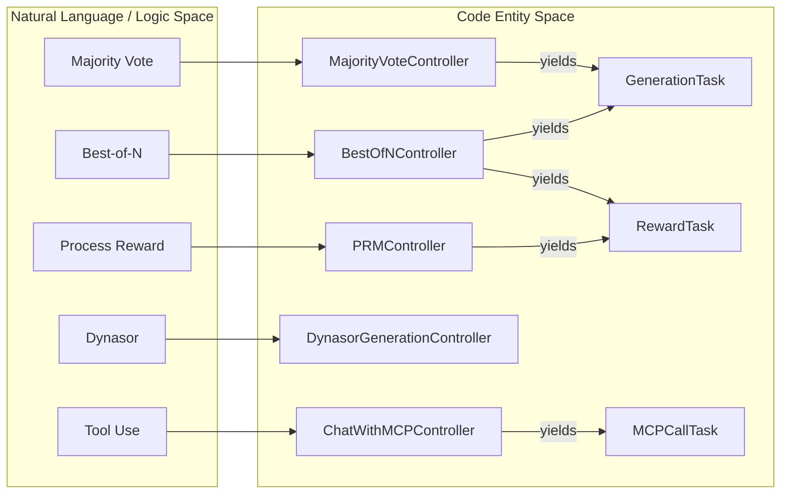

<!-- source: DeepWiki mcp.deepwiki.com · repo NVIDIA/TensorRT-LLM · page 19 Scaffolding Framework · fetched 2026-10-26 -->

# Scaffolding Framework

<details>
<summary>Relevant source files</summary>

The following files were used as context for generating this wiki page:

- [examples/scaffolding/contrib/Dynasor/scaffolding_dynasor_run.py](examples/scaffolding/contrib/Dynasor/scaffolding_dynasor_run.py)
- [examples/scaffolding/run_basic_generation.py](examples/scaffolding/run_basic_generation.py)
- [examples/scaffolding/run_best_of_n_with_reward.py](examples/scaffolding/run_best_of_n_with_reward.py)
- [examples/scaffolding/run_majority_vote_aime24.py](examples/scaffolding/run_majority_vote_aime24.py)
- [examples/scaffolding/token_budget_majority_vote.py](examples/scaffolding/token_budget_majority_vote.py)
- [tensorrt_llm/scaffolding/__init__.py](tensorrt_llm/scaffolding/__init__.py)
- [tensorrt_llm/scaffolding/contrib/Dynasor/dynasor_controller.py](tensorrt_llm/scaffolding/contrib/Dynasor/dynasor_controller.py)
- [tensorrt_llm/scaffolding/controller.py](tensorrt_llm/scaffolding/controller.py)
- [tensorrt_llm/scaffolding/result.py](tensorrt_llm/scaffolding/result.py)
- [tensorrt_llm/scaffolding/scaffolding_llm.py](tensorrt_llm/scaffolding/scaffolding_llm.py)
- [tensorrt_llm/scaffolding/task.py](tensorrt_llm/scaffolding/task.py)
- [tensorrt_llm/scaffolding/task_collection.py](tensorrt_llm/scaffolding/task_collection.py)
- [tensorrt_llm/scaffolding/worker.py](tensorrt_llm/scaffolding/worker.py)
- [tests/unittest/scaffolding/test_bench.py](tests/unittest/scaffolding/test_bench.py)
- [tests/unittest/scaffolding/test_mcp_worker.py](tests/unittest/scaffolding/test_mcp_worker.py)
- [tests/unittest/scaffolding/test_parallel_process.py](tests/unittest/scaffolding/test_parallel_process.py)
- [tests/unittest/scaffolding/test_scaffolding.py](tests/unittest/scaffolding/test_scaffolding.py)
- [tests/unittest/scaffolding/test_task_collection.py](tests/unittest/scaffolding/test_task_collection.py)
- [tests/unittest/scaffolding/test_worker.py](tests/unittest/scaffolding/test_worker.py)

</details>


The Scaffolding Framework in TensorRT-LLM is a high-level system designed to support "inference-time compute" and "test-time scaling" methods. It allows for complex orchestration of LLM calls, such as majority voting, best-of-n sampling with reward models, and iterative reasoning loops, by decoupling the generation logic (Controllers) from the execution engine (Workers).

## Framework Overview

The framework provides a structured way to define multi-step inference pipelines. Instead of a single model call, a `ScaffoldingLlm` instance manages a `Controller` that yields `Task` objects. These tasks are then dispatched to specialized `Worker` instances for execution. This architecture supports local TensorRT-LLM execution, remote OpenAI-compatible API calls, and Model Context Protocol (MCP) tool interactions.

### High-Level Component Relationship

The following diagram illustrates how natural language requests are transformed into structured code entities and executed through the scaffolding system.

**Scaffolding Request Flow**
```mermaid
graph TD
    [User_Prompt] -- "generate()" --> [ScaffoldingLlm]
    [ScaffoldingLlm] -- "clone()" --> [Controller_Instance]
    [Controller_Instance] -- "yield tasks" --> [Task_Object]
    [Task_Object] -- "worker_tag" --> [Worker_Instance]
    [Worker_Instance] -- "execute" --> [Backend_Engine]
    [Backend_Engine] -- "results" --> [Worker_Instance]
    [Worker_Instance] -- "update" --> [Task_Object]
    [Task_Object] -- "resume" --> [Controller_Instance]
    [Controller_Instance] -- "final output" --> [ScaffoldingLlm]
    [ScaffoldingLlm] -- "ScaffoldingResult" --> [User_Prompt]

    subgraph "Code Entities"
        [ScaffoldingLlm]
        [Controller_Instance]
        [Task_Object]
        [Worker_Instance]
    end
```
**Sources:** [tensorrt_llm/scaffolding/scaffolding_llm.py:26-36](), [tensorrt_llm/scaffolding/controller.py:17-30](), [tensorrt_llm/scaffolding/task.py:34-63]()

## Core Components

### ScaffoldingLlm
The `ScaffoldingLlm` class is the main entry point for the framework. It maintains a mapping of `Worker` instances identified by tags and manages an internal `asyncio` event loop to handle concurrent requests [tensorrt_llm/scaffolding/scaffolding_llm.py:28-41](). It supports both synchronous `generate()` and asynchronous `generate_async()` methods [tensorrt_llm/scaffolding/scaffolding_llm.py:171-198](). It also includes a top-level scheduler to manage maximum parallel requests, defaulting to 64 [tensorrt_llm/scaffolding/scaffolding_llm.py:48-50]().

### Controllers and Tasks
*   **Controller**: An abstract base class that defines the logic for a scaling method. It uses a Python generator (`process`) to yield lists of `Task` objects that need to be executed [tensorrt_llm/scaffolding/controller.py:17-33]().
*   **Task**: A dataclass representing a unit of work (e.g., `GenerationTask`, `RewardTask`, `StreamGenerationTask`, `ChatTask`, `MCPCallTask`). Tasks contain input parameters and placeholders for results like `output_str`, `output_tokens`, or `context_logits` [tensorrt_llm/scaffolding/task.py:66-139]().
*   **ParallelProcess**: A specialized object that allows the framework to execute multiple sub-generators (controllers) concurrently, enabling complex nested logic and improved performance via concurrent execution [tensorrt_llm/scaffolding/controller.py:36-47]().

### Workers and Backends
*   **Worker**: An abstract base class for execution backends. It registers handlers for specific `Task` types via `task_handlers` [tensorrt_llm/scaffolding/worker.py:51-64]().
*   **Backends**: The framework supports multiple backends, including a native `TRTLLMWorker` for local execution using the `LLM` API [tensorrt_llm/scaffolding/worker.py:32-35](), `OpenaiWorker` for remote API calls [tensorrt_llm/scaffolding/worker.py:106-156](), and `MCPWorker` for Model Context Protocol tool calling [tensorrt_llm/scaffolding/worker.py:26-27]().

## System Mapping: Logic to Code

This diagram bridges the conceptual "Scaling Strategy" to the specific classes and file structures used in the implementation.

**Scaling Strategy Implementation Map**

**Sources:** [tensorrt_llm/scaffolding/controller.py:80-167](), [tensorrt_llm/scaffolding/task.py:66-210](), [tensorrt_llm/scaffolding/__init__.py:3-14]()

## Summary of Scaling Methods

The framework includes several built-in controllers and specialized utilities for common scaling techniques:

| Controller | Purpose | Key Dependencies |
| :--- | :--- | :--- |
| `NativeGenerationController` | Standard single-pass generation. | `GenerationTask` [tensorrt_llm/scaffolding/controller.py:80-108]() |
| `MajorityVoteController` | Runs $N$ samples and selects the most frequent answer. | `NativeGenerationController` [tensorrt_llm/scaffolding/__init__.py:3-6]() |
| `BestOfNController` | Generates $N$ candidates and ranks them using a reward model. | `NativeRewardController` [tensorrt_llm/scaffolding/__init__.py:3-6]() |
| `PRMController` | Implements Process Reward Model scoring for step-by-step reasoning. | `tokenizer`, `separate_token` [tensorrt_llm/scaffolding/controller.py:138-167]() |
| `ChatWithMCPController` | Integrates LLM generation with Model Context Protocol tools. | `MCPCallTask` [tensorrt_llm/scaffolding/__init__.py:3-6]() |
| `DynasorGenerationController` | Contrib example for dynamic scaling methods. | `TRTLLMWorker` [examples/scaffolding/contrib/Dynasor/dynasor_controller.py:6-7]() |

The framework also provides math utilities for result extraction, such as `extract_answer_from_boxed` [tensorrt_llm/scaffolding/math_utils.py:8-9]() and `get_digit_majority_vote_result` [tensorrt_llm/scaffolding/math_utils.py:8-9](). For performance evaluation, the `async_scaffolding_benchmark` utility allows measuring throughput and execution time using different load generation strategies like `PoissonRateStrategy` or `ConstantRateStrategy` [tensorrt_llm/scaffolding/benchmark.py:2-2](), [tensorrt_llm/scaffolding/load_generation_strategy.py:17-18]().

## Detailed Documentation

For more detailed information on specific parts of the framework, refer to the following child pages:

*   **[Scaffolding Architecture and Controllers](#19.1)**: Detailed documentation of the `ScaffoldingLlm` lifecycle, the `Controller` hierarchy (including `ParallelProcess`), and how `Task` objects are managed through the generator-based execution model.
*   **[Scaffolding Workers and Backends](#19.2)**: Technical details on `TRTLLMWorker` initialization, OpenAI-compatible worker integration, MCP tool worker setup, and task handler registration for both streaming and non-streaming workloads.

**Sources:** [tensorrt_llm/scaffolding/__init__.py:1-88](), [tensorrt_llm/scaffolding/scaffolding_llm.py:26-198](), [tensorrt_llm/scaffolding/worker.py:51-187](), [tensorrt_llm/scaffolding/controller.py:17-167]()

---

