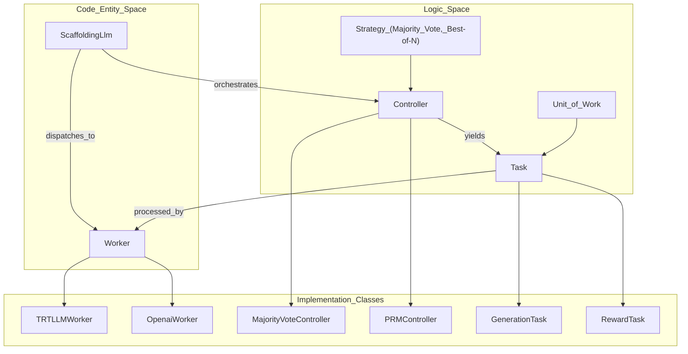
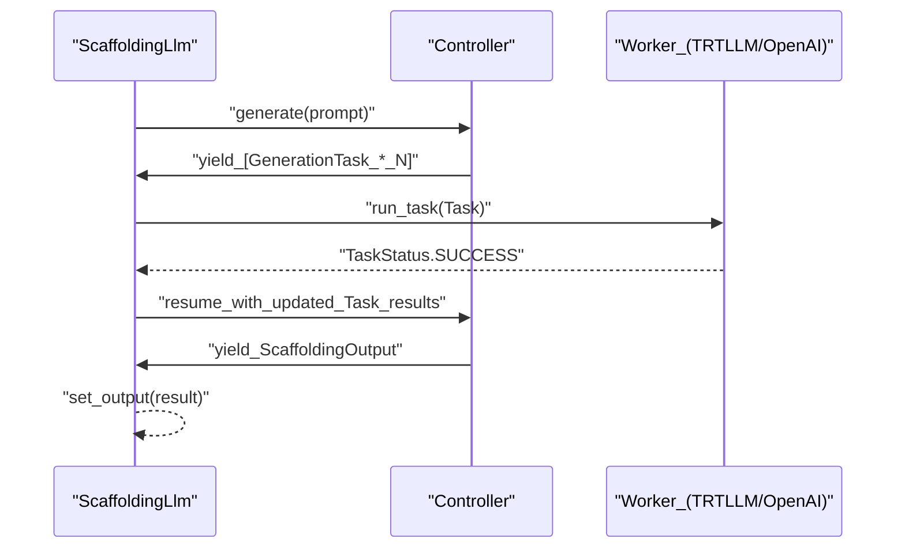
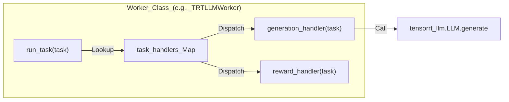

<!-- source: DeepWiki mcp.deepwiki.com · repo NVIDIA/TensorRT-LLM · page 19.1 Scaffolding Architecture and Controllers · fetched 2026-10-26 -->

# Scaffolding Architecture and Controllers

Relevant source files

The following files were used as context for generating this wiki page:

- [examples/scaffolding/contrib/Dynasor/scaffolding_dynasor_run.py](examples/scaffolding/contrib/Dynasor/scaffolding_dynasor_run.py)
- [examples/scaffolding/run_basic_generation.py](examples/scaffolding/run_basic_generation.py)
- [examples/scaffolding/run_best_of_n_with_reward.py](examples/scaffolding/run_best_of_n_with_reward.py)
- [examples/scaffolding/run_majority_vote_aime24.py](examples/scaffolding/run_majority_vote_aime24.py)
- [examples/scaffolding/token_budget_majority_vote.py](examples/scaffolding/token_budget_majority_vote.py)
- [tensorrt_llm/scaffolding/__init__.py](tensorrt_llm/scaffolding/__init__.py)
- [tensorrt_llm/scaffolding/contrib/Dynasor/dynasor_controller.py](tensorrt_llm/scaffolding/contrib/Dynasor/dynasor_controller.py)
- [tensorrt_llm/scaffolding/controller.py](tensorrt_llm/scaffolding/controller.py)
- [tensorrt_llm/scaffolding/result.py](tensorrt_llm/scaffolding/result.py)
- [tensorrt_llm/scaffolding/scaffolding_llm.py](tensorrt_llm/scaffolding/scaffolding_llm.py)
- [tensorrt_llm/scaffolding/task.py](tensorrt_llm/scaffolding/task.py)
- [tensorrt_llm/scaffolding/task_collection.py](tensorrt_llm/scaffolding/task_collection.py)
- [tensorrt_llm/scaffolding/worker.py](tensorrt_llm/scaffolding/worker.py)
- [tests/unittest/scaffolding/test_bench.py](tests/unittest/scaffolding/test_bench.py)
- [tests/unittest/scaffolding/test_mcp_worker.py](tests/unittest/scaffolding/test_mcp_worker.py)
- [tests/unittest/scaffolding/test_parallel_process.py](tests/unittest/scaffolding/test_parallel_process.py)
- [tests/unittest/scaffolding/test_scaffolding.py](tests/unittest/scaffolding/test_scaffolding.py)
- [tests/unittest/scaffolding/test_task_collection.py](tests/unittest/scaffolding/test_task_collection.py)
- [tests/unittest/scaffolding/test_worker.py](tests/unittest/scaffolding/test_worker.py)

The Scaffolding framework in TensorRT-LLM provides a high-level orchestration layer for "inference-time compute" and test-time scaling methods. It enables complex multi-step reasoning patterns, such as Majority Voting, Best-of-N sampling, and Process Reward Model (PRM) guided search, by abstracting the interaction between execution logic (**Controllers**) and inference engines (**Workers**).

## Architecture Overview

The architecture is built around the `ScaffoldingLlm` class, which manages an asynchronous event loop to coordinate tasks across different worker backends. It decouples the generation strategy from the underlying hardware or API implementation.

### Key Components and Data Flow

1.  **ScaffoldingLlm**: The central entry point. It manages the request queue, schedules tasks, and maintains the event loop [[tensorrt_llm/scaffolding/scaffolding_llm.py:26-46]]().
2.  **Controller**: Defines the logic of how a prompt is processed. It implements a generator that yields `Task` objects to be executed by workers [[tensorrt_llm/scaffolding/controller.py:17-33]]().
3.  **Task**: A data structure representing a unit of work (e.g., generation, reward scoring) [[tensorrt_llm/scaffolding/task.py:34-43]]().
4.  **Worker**: An abstraction for the execution backend. It handles specific task types like `GenerationTask` or `RewardTask` [[tensorrt_llm/scaffolding/worker.py:51-64]]().

### System Entity Mapping

The following diagram maps high-level scaffolding concepts to their corresponding code entities.

**Scaffolding Entity Mapping**

Sources: [[tensorrt_llm/scaffolding/scaffolding_llm.py:26-35]](), [[tensorrt_llm/scaffolding/controller.py:17-18]](), [[tensorrt_llm/scaffolding/worker.py:51-64]](), [[tensorrt_llm/scaffolding/task.py:34-43]]().

---

## Controllers and the Generation Loop

A `Controller` implements a generator-based `process` method. Instead of executing inference directly, it yields a list of `Task` objects. The `ScaffoldingLlm` catches these tasks, sends them to the appropriate `Worker` via `run_task`, and resumes the controller once the tasks are complete [[tensorrt_llm/scaffolding/scaffolding_llm.py:79-87]]().

### Controller Hierarchy

| Class | Purpose | Key Parameters |
| :--- | :--- | :--- |
| `NativeGenerationController` | Standard single-pass generation [[tensorrt_llm/scaffolding/controller.py:80-96]](). | `sampling_params`, `streaming` |
| `NativeChatController` | Chat-optimized generation using `ChatTask` [[tensorrt_llm/scaffolding/controller.py:110-119]](). | `sampling_params`, `streaming` |
| `MajorityVoteController` | Generates $N$ candidates and selects the most frequent answer [[tensorrt_llm/scaffolding/controller.py:255-261]](). | `generation_controller`, `default_sample_num` |
| `BestOfNController` | Generates $N$ candidates and ranks them using a reward model [[tensorrt_llm/scaffolding/controller.py:311-318]](). | `generation_controller`, `reward_controller` |
| `PRMController` | Scores reasoning steps using a Process Reward Model [[tensorrt_llm/scaffolding/controller.py:138-166]](). | `step_token`, `separate_token`, `split_steps` |
| `DynasorGenerationController` | Specialized controller for Dynasor-based generation [[examples/scaffolding/contrib/Dynasor/scaffolding_dynasor_run.py:37-40]](). | `generation_dir`, `max_tokens` |

### Parallel Execution with ParallelProcess
To enable branching or parallel sub-strategies, the framework uses `ParallelProcess`. When a controller yields a `ParallelProcess` object, the `ScaffoldingLlm` executes multiple controller generators concurrently using `asyncio.gather` [[tensorrt_llm/scaffolding/scaffolding_llm.py:94-113]](). This allows running multiple independent reasoning paths simultaneously [[tensorrt_llm/scaffolding/controller.py:36-49]]().

**Controller Interaction Flow**

Sources: [[tensorrt_llm/scaffolding/controller.py:25-30]](), [[tensorrt_llm/scaffolding/scaffolding_llm.py:79-87]](), [[tensorrt_llm/scaffolding/worker.py:58-62]](), [[tensorrt_llm/scaffolding/controller.py:98-108]]().

---

## Task and Worker Abstractions

### Task Types
Tasks are the communication protocol between controllers and workers.
*   **`GenerationTask`**: Contains prompt string/tokens and OpenAI-compatible sampling parameters like `temperature`, `top_p`, and `max_tokens` [[tensorrt_llm/scaffolding/task.py:66-98]]().
*   **`ChatTask`**: Specialized task for multi-turn chat interactions [[tensorrt_llm/scaffolding/task.py:241-245]]().
*   **`RewardTask`**: Used for scoring existing text sequences [[tensorrt_llm/scaffolding/task.py:175-179]]().
*   **`StreamGenerationTask`**: Supports incremental token delivery via `streaming_step` and cancellation via `cancel_flag` [[tensorrt_llm/scaffolding/task.py:162-177]]().
*   **`DropKVCacheTask`**: Explicitly instructs the worker to drop KV cache for specific requests [[tensorrt_llm/scaffolding/task.py:221-224]]().
*   **`MCPCallTask`**: Represents a call to a Model Context Protocol server [[tensorrt_llm/scaffolding/task.py:260-264]]().
*   **`TokenizeTask`**: Requests the worker to tokenize a string into token IDs [[tensorrt_llm/scaffolding/task.py:207-210]]().

### Worker Implementations
Workers encapsulate the specific API or engine logic.
*   **`TRTLLMWorker`**: Directly wraps the TensorRT-LLM `LLM` class. It handles tokenization and internal sampling parameter conversion [[tensorrt_llm/scaffolding/worker.py:215-263]](). It can be initialized with a new engine via `init_with_new_llm` [[tensorrt_llm/scaffolding/worker.py:226-236]]().
*   **`OpenaiWorker`**: Uses the `openai.AsyncOpenAI` client to route tasks to remote endpoints [[tensorrt_llm/scaffolding/worker.py:106-114]](). It includes a dynamic patch `create_kv_cache_hint` to support KV cache management via HTTP [[tensorrt_llm/scaffolding/worker.py:148-150]]().
*   **`TRTOpenaiWorker`**: An extension of the OpenAI worker that adds support for TRT-LLM specific parameters like `top_k` via `extra_body` [[tensorrt_llm/scaffolding/worker.py:206-212]]().
*   **`MCPWorker`**: Implements Model Context Protocol (MCP) support for tool calling and server interactions [[tensorrt_llm/scaffolding/worker.py:270-280]]().

### Task Handling Mechanism
Workers use a registration pattern to map Task types to handler functions [[tensorrt_llm/scaffolding/worker.py:53-56]](). The `run_task` method lookups the handler based on `type(task)` in the `task_handlers` dictionary and executes it asynchronously [[tensorrt_llm/scaffolding/worker.py:58-62]]().

**Worker Execution Flow**

Sources: [[tensorrt_llm/scaffolding/worker.py:51-64]](), [[tensorrt_llm/scaffolding/worker.py:215-224]](), [[tensorrt_llm/scaffolding/task.py:34-179]]().

---

## ScaffoldingLlm Execution Engine

The `ScaffoldingLlm` acts as the runtime for the scaffolding system. It manages concurrency and provides both synchronous (`generate`) and asynchronous (`generate_async`) interfaces.

### Main Event Loop
The engine maintains a `task_queue` for incoming `ScaffoldingRequest` objects [[tensorrt_llm/scaffolding/scaffolding_llm.py:39]](). It implements a scheduler that limits `max_parallel_requests` (default 64) to prevent resource exhaustion [[tensorrt_llm/scaffolding/scaffolding_llm.py:48-50]](). If created without an existing running loop, it spawns its own thread via `_run_main_loop_thread` [[tensorrt_llm/scaffolding/scaffolding_llm.py:42-43]]().

### Initialization and Shutdown
*   **`__init__`**: Initializes the event loop and sets up the worker map [[tensorrt_llm/scaffolding/scaffolding_llm.py:28-46]]().
*   **`shutdown`**: Stops the main loop and optionally calls `shutdown()` on all registered workers to release GPU memory or close network connections [[tensorrt_llm/scaffolding/scaffolding_llm.py:228-243]]().

### Internal Scheduling Logic
When a request is submitted, it is placed in a `pending_queue` [[tensorrt_llm/scaffolding/scaffolding_llm.py:190]](). The `_maybe_schedule` method promotes requests to the running state as long as `running_req_count < max_parallel_requests` [[tensorrt_llm/scaffolding/scaffolding_llm.py:184-194]](). Requests are processed individually via `_handle_single_request`, which establishes a per-request `ExecutionScope` [[tensorrt_llm/scaffolding/scaffolding_llm.py:146-153]]().

### Scaffolding Benchmarking
The framework includes a specialized benchmark utility `async_scaffolding_benchmark` [[tensorrt_llm/scaffolding/__init__.py:2]](). It allows measuring performance with specific `TaskCollection` types, such as `GenerationTokenCounter`, to track output token counts and execution times across concurrent requests [[examples/scaffolding/run_majority_vote_aime24.py:90-92]](). It supports various load generation strategies:
*   **`SynchronousStrategy`**: Processes requests one by one [[tests/unittest/scaffolding/test_bench.py:161]]().
*   **`ConcurrentStrategy`**: Maintains a fixed number of concurrent requests [[tests/unittest/scaffolding/test_bench.py:162]]().
*   **`ThroughputStrategy`**: Maximizes throughput by submitting all requests [[tests/unittest/scaffolding/test_bench.py:163]]().
*   **`ConstantRateStrategy`**: Submits requests at a fixed rate (e.g., 2.0 req/s) [[tests/unittest/scaffolding/test_bench.py:164]]().
*   **`PoissonRateStrategy`**: Submits requests following a Poisson distribution [[tests/unittest/scaffolding/test_bench.py:165]]().

Sources: [[tensorrt_llm/scaffolding/scaffolding_llm.py:26-67]](), [[tensorrt_llm/scaffolding/scaffolding_llm.py:184-194]](), [[tensorrt_llm/scaffolding/scaffolding_llm.py:228-243]](), [[tensorrt_llm/scaffolding/scaffolding_llm.py:146-168]](), [[tests/unittest/scaffolding/test_bench.py:154-173]]().

---

