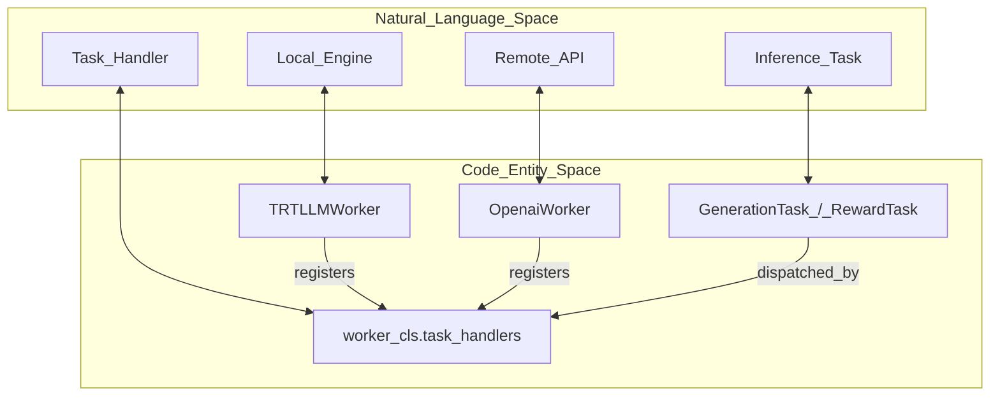
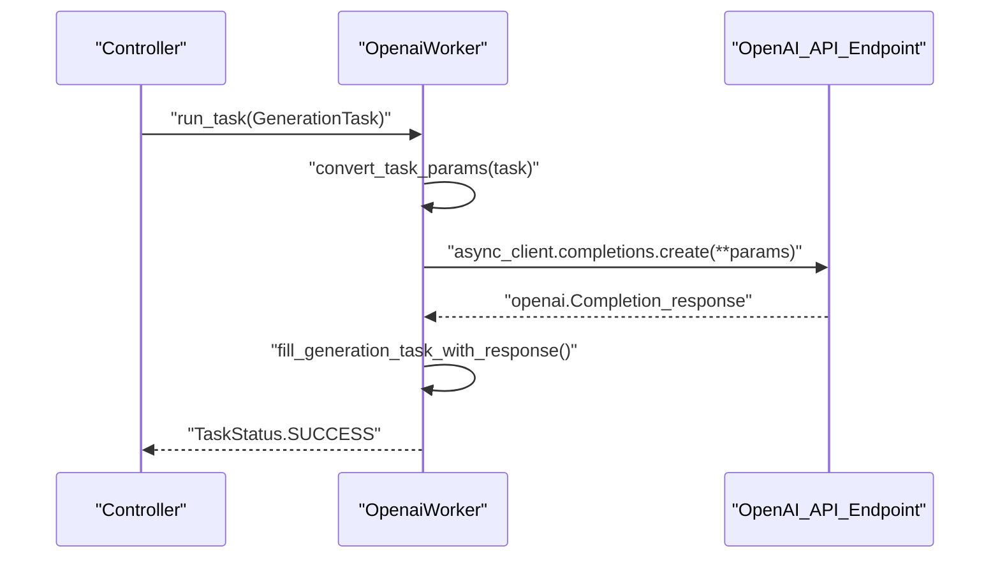
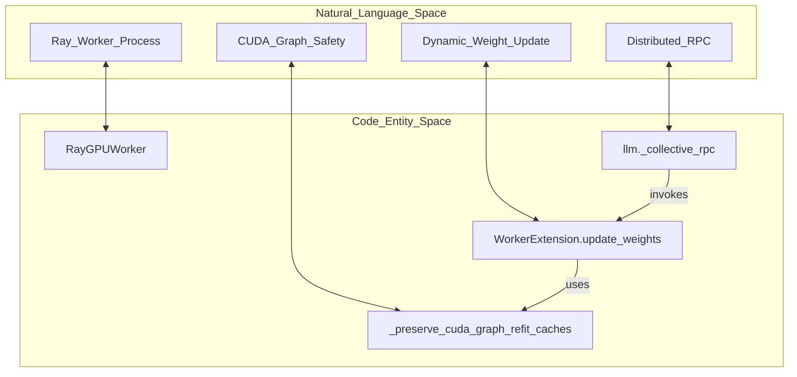

<!-- source: DeepWiki mcp.deepwiki.com · repo NVIDIA/TensorRT-LLM · page 19.2 Scaffolding Workers and Backends · fetched 2026-10-26 -->

# Scaffolding Workers and Backends

Relevant source files

The following files were used as context for generating this wiki page:

- [examples/llm-api/llm_logits_processor.py](examples/llm-api/llm_logits_processor.py)
- [examples/scaffolding/contrib/Dynasor/scaffolding_dynasor_run.py](examples/scaffolding/contrib/Dynasor/scaffolding_dynasor_run.py)
- [examples/scaffolding/run_basic_generation.py](examples/scaffolding/run_basic_generation.py)
- [examples/scaffolding/run_best_of_n_with_reward.py](examples/scaffolding/run_best_of_n_with_reward.py)
- [examples/scaffolding/run_majority_vote_aime24.py](examples/scaffolding/run_majority_vote_aime24.py)
- [examples/scaffolding/token_budget_majority_vote.py](examples/scaffolding/token_budget_majority_vote.py)
- [tensorrt_llm/_bootstrap.py](tensorrt_llm/_bootstrap.py)
- [tensorrt_llm/_common.py](tensorrt_llm/_common.py)
- [tensorrt_llm/_ray_utils.py](tensorrt_llm/_ray_utils.py)
- [tensorrt_llm/_torch/async_llm.py](tensorrt_llm/_torch/async_llm.py)
- [tensorrt_llm/_torch/models/checkpoints/hf/qwen3_next_weight_mapper.py](tensorrt_llm/_torch/models/checkpoints/hf/qwen3_next_weight_mapper.py)
- [tensorrt_llm/executor/ray_executor.py](tensorrt_llm/executor/ray_executor.py)
- [tensorrt_llm/executor/ray_gpu_worker.py](tensorrt_llm/executor/ray_gpu_worker.py)
- [tensorrt_llm/llmapi/rlhf_utils.py](tensorrt_llm/llmapi/rlhf_utils.py)
- [tensorrt_llm/llmapi/utils.py](tensorrt_llm/llmapi/utils.py)
- [tensorrt_llm/ray_stub.py](tensorrt_llm/ray_stub.py)
- [tensorrt_llm/scaffolding/__init__.py](tensorrt_llm/scaffolding/__init__.py)
- [tensorrt_llm/scaffolding/contrib/Dynasor/dynasor_controller.py](tensorrt_llm/scaffolding/contrib/Dynasor/dynasor_controller.py)
- [tensorrt_llm/scaffolding/controller.py](tensorrt_llm/scaffolding/controller.py)
- [tensorrt_llm/scaffolding/result.py](tensorrt_llm/scaffolding/result.py)
- [tensorrt_llm/scaffolding/scaffolding_llm.py](tensorrt_llm/scaffolding/scaffolding_llm.py)
- [tensorrt_llm/scaffolding/task.py](tensorrt_llm/scaffolding/task.py)
- [tensorrt_llm/scaffolding/task_collection.py](tensorrt_llm/scaffolding/task_collection.py)
- [tensorrt_llm/scaffolding/worker.py](tensorrt_llm/scaffolding/worker.py)
- [tensorrt_llm/serialization.py](tensorrt_llm/serialization.py)
- [tests/unittest/_torch/ray_orchestrator/conftest.py](tests/unittest/_torch/ray_orchestrator/conftest.py)
- [tests/unittest/_torch/ray_orchestrator/multi_gpu/test_accuracy_with_allreduce_strategy.py](tests/unittest/_torch/ray_orchestrator/multi_gpu/test_accuracy_with_allreduce_strategy.py)
- [tests/unittest/_torch/ray_orchestrator/multi_gpu/test_llm_update_weights_multi_gpu.py](tests/unittest/_torch/ray_orchestrator/multi_gpu/test_llm_update_weights_multi_gpu.py)
- [tests/unittest/_torch/ray_orchestrator/multi_gpu/test_ops.py](tests/unittest/_torch/ray_orchestrator/multi_gpu/test_ops.py)
- [tests/unittest/_torch/ray_orchestrator/single_gpu/test_llm_update_weights.py](tests/unittest/_torch/ray_orchestrator/single_gpu/test_llm_update_weights.py)
- [tests/unittest/executor/test_ray_stub.py](tests/unittest/executor/test_ray_stub.py)
- [tests/unittest/executor/test_shim_ray.py](tests/unittest/executor/test_shim_ray.py)
- [tests/unittest/llmapi/test_async_llm.py](tests/unittest/llmapi/test_async_llm.py)
- [tests/unittest/llmapi/test_serialization.py](tests/unittest/llmapi/test_serialization.py)
- [tests/unittest/scaffolding/test_bench.py](tests/unittest/scaffolding/test_bench.py)
- [tests/unittest/scaffolding/test_mcp_worker.py](tests/unittest/scaffolding/test_mcp_worker.py)
- [tests/unittest/scaffolding/test_parallel_process.py](tests/unittest/scaffolding/test_parallel_process.py)
- [tests/unittest/scaffolding/test_scaffolding.py](tests/unittest/scaffolding/test_scaffolding.py)
- [tests/unittest/scaffolding/test_task_collection.py](tests/unittest/scaffolding/test_task_collection.py)
- [tests/unittest/scaffolding/test_worker.py](tests/unittest/scaffolding/test_worker.py)

This page documents the worker infrastructure and backend integration within the TensorRT-LLM Scaffolding framework. These components are responsible for the actual execution of LLM tasks (generation, reward scoring) requested by Scaffolding Controllers.

## Worker Architecture

The `Worker` class is an abstract base class that defines the interface for executing `Task` objects [tensorrt_llm/scaffolding/worker.py:51](). Workers act as the bridge between the high-level scaffolding logic and the low-level inference backends, such as the TensorRT-LLM native API, Ray-orchestrated workers, or external OpenAI-compatible services.

### Core Worker Interface
The base `Worker` implementation provides a registration mechanism to map specific `Task` types to handler functions.

*   **`register_task_handler`**: Allows users to add or override the function responsible for processing a specific `Task` subclass [tensorrt_llm/scaffolding/worker.py:53-56]().
*   **`run_task`**: The primary entry point for task execution. It looks up the appropriate handler for the task type in the `task_handlers` map and executes it asynchronously [tensorrt_llm/scaffolding/worker.py:58-62]().
*   **`on_scope_end`**: Called when an `ExecutionScope` finishes to release resources like SSE connections or sandboxes [tensorrt_llm/scaffolding/worker.py:66-72]().
*   **`shutdown`**: Handles resource cleanup [tensorrt_llm/scaffolding/worker.py:74-75]().

### Task to Code Mapping
The following diagram illustrates how natural language task concepts are associated with specific code entities in the worker layer.

**Diagram: Scaffolding Worker Entity Mapping**

Sources: [tensorrt_llm/scaffolding/worker.py:51-86](), [tensorrt_llm/scaffolding/task.py:34-191]()

---

## TRTLLMWorker Implementation

The `TRTLLMWorker` is the primary backend for local high-performance inference. It wraps the TensorRT-LLM `LLM` class to provide integrated tokenization and generation capabilities within the scaffolding environment [tensorrt_llm/scaffolding/worker.py:32-33]().

### Initialization and Resource Management
A `TRTLLMWorker` can be initialized with an existing `LLM` instance or by creating a new one using `init_with_new_llm` [tensorrt_llm/scaffolding/worker.py:359-396]().

| Parameter | Description | Source |
| :--- | :--- | :--- |
| `model_dir` | Path to the directory containing the model weights and config. | [tensorrt_llm/scaffolding/worker.py:361]() |
| `backend` | Execution backend (e.g., "pytorch" or "tensorrt"). | [tensorrt_llm/scaffolding/worker.py:362]() |
| `kv_cache_free_gpu_memory_fraction` | GPU memory allocated for KV cache. | [tensorrt_llm/scaffolding/worker.py:366]() |
| `max_batch_size` | Maximum number of concurrent requests in the engine. | [tensorrt_llm/scaffolding/worker.py:364]() |
| `disable_overlap_scheduler` | Control for the overlapping scheduler. | [tensorrt_llm/scaffolding/worker.py:367]() |

### Data Flow for Generation
When a `GenerationTask` is processed by `TRTLLMWorker`:
1.  **Parameter Conversion**: The task's fields (e.g., `max_tokens`, `temperature`, `top_p`, `top_k`) are converted into a `SamplingParams` object via `convert_task_to_sampling_params` [tensorrt_llm/scaffolding/worker.py:398-410]().
2.  **Inference**: The worker calls `self.llm.generate` or `self.llm.generate_async` [tensorrt_llm/scaffolding/worker.py:472-474]().
3.  **Result Capture**: The worker waits for the `GenerationResult` and populates the task's `output_str`, `output_tokens`, and optional `context_logits` [tensorrt_llm/scaffolding/worker.py:481-490]().

### Streaming Support
`TRTLLMWorker` supports incremental generation via the `streaming_generate_helper`. It uses `generate_result._aresult_step()` to pull tokens one-by-one or in chunks defined by `streaming_step` [tensorrt_llm/scaffolding/worker.py:412-436]().

Sources: [tensorrt_llm/scaffolding/worker.py:359-490](), [tensorrt_llm/scaffolding/task.py:66-147]()

---

## OpenaiWorker and Remote Backends

The scaffolding framework supports remote execution through the `OpenaiWorker`. This allows controllers to scale inference across multiple providers or utilize existing LLM deployments.

### OpenaiWorker
Wraps the `openai.AsyncOpenAI` client [tensorrt_llm/scaffolding/worker.py:106-114](). It translates `GenerationTask` attributes into standard OpenAI API request parameters (e.g., `best_of`, `presence_penalty`, `logit_bias`) [tensorrt_llm/scaffolding/worker.py:157-184](). It uses the `completions.create` endpoint to fulfill tasks [tensorrt_llm/scaffolding/worker.py:276]().

### KV Cache Hints and Truncation
`OpenaiWorker` includes dynamic patching to support KV cache hints, allowing the worker to request the server to truncate or retain specific prefix tokens [tensorrt_llm/scaffolding/worker.py:116-150](). The `send_kv_cache_truncate_tokens` method hits the `/_control/kv_cache/truncate_tokens` endpoint to free radix-tree blocks [tensorrt_llm/scaffolding/worker.py:157-184]().

### TRTOpenaiWorker
A specialized subclass of `OpenaiWorker` that adds support for TensorRT-LLM specific extensions in the OpenAI-compatible server, such as passing `top_k` via the `extra_body` parameter [tensorrt_llm/scaffolding/worker.py:352-357]().

**Diagram: Remote API Task Execution**

Sources: [tensorrt_llm/scaffolding/worker.py:106-285]()

---

## Ray and RLHF Backend Integration

The scaffolding and LLM API provide specialized extensions for distributed Ray workers, particularly for RLHF (Reinforcement Learning from Human Feedback) workflows requiring dynamic weight updates.

### WorkerExtension and Weight Updates
The `WorkerExtension` class allows users to extend Ray workers with custom collective RPC methods [tensorrt_llm/llmapi/rlhf_utils.py:55-75](). A key application is `update_weights`, which enables loading new model weights from IPC (Inter-Process Communication) handles, typically sent from a training process like FSDP [tensorrt_llm/llmapi/rlhf_utils.py:94-110]().

*   **IPC Serialization**: Weight handles are base64-encoded and deserialized using a restricted unpickler for security [tensorrt_llm/llmapi/rlhf_utils.py:128-160]().
*   **CUDA Graph Stability**: The `_preserve_cuda_graph_refit_caches` context manager ensures that tensor addresses remain stable across post-load hooks, preventing CUDA Graph replay failures after a weight refit [tensorrt_llm/llmapi/rlhf_utils.py:19-53]().

### Ray Orchestration Entity Mapping
The following diagram bridges the distributed Ray concepts to the underlying code entities.

**Diagram: Ray Worker Extension Mapping**

Sources: [tensorrt_llm/executor/ray_gpu_worker.py:25](), [tensorrt_llm/llmapi/rlhf_utils.py:55-120](), [tests/unittest/_torch/ray_orchestrator/multi_gpu/test_llm_update_weights_multi_gpu.py:113-118]()

---

## Contrib Examples and Advanced Backends

The scaffolding framework includes specialized controllers and worker integrations for advanced research methods and tool use.

### Dynasor Integration
The `DynasorGenerationController` integrates with the scaffolding system for dynamic resource allocation during inference [tensorrt_llm/scaffolding/contrib/Dynasor/dynasor_controller.py:1](). It leverages the `ScaffoldingLlm` to dispatch tasks to appropriate workers, typically a `TRTLLMWorker`.

### Reward Model Backends (PRM)
The `PRMController` (Process Reward Model) requires workers to return context logits for scoring [tensorrt_llm/scaffolding/controller.py:138-161]().
*   **Logit Processing**: The controller processes `context_logits` using `_calc_steps_score` (product of probabilities at step tokens) or `_calc_last_token_score` [tensorrt_llm/scaffolding/controller.py:168-181]().

### MCPWorker
The `MCPWorker` facilitates integration with the **Model Context Protocol (MCP)**, allowing scaffolding to interact with external tools via an `mcp.ClientSession` [tensorrt_llm/scaffolding/worker.py:553-568]().

---

## Summary of Worker Tasks

Workers handle types of tasks defined in `tensorrt_llm.scaffolding.task`:

| Task Class | Purpose | Key Attributes |
| :--- | :--- | :--- |
| `GenerationTask` | Standard text generation. | `input_str`, `max_tokens`, `context_logits` [tensorrt_llm/scaffolding/task.py:66-109]() |
| `StreamGenerationTask` | Incremental generation. | `streaming_step`, `request_handle` [tensorrt_llm/scaffolding/task.py:162-177]() |
| `RewardTask` | Scoring a sequence. | `input_str`, `input_tokens` [tensorrt_llm/scaffolding/task.py:186-191]() |
| `ChatTask` | Structured conversation. | `messages`, `tools` [tensorrt_llm/scaffolding/task.py:239-256]() |
| `MCPCallTask` | MCP tool execution. | `name`, `arguments` [tensorrt_llm/scaffolding/task.py:269-272]() |
| `DropKVCacheTask` | Release radix-tree blocks. | `messages_to_retain`, `chat_task` [tensorrt_llm/scaffolding/task.py:284-287]() |

Sources: [tensorrt_llm/scaffolding/task.py:34-290](), [tensorrt_llm/scaffolding/worker.py:398-436](), [tensorrt_llm/llmapi/rlhf_utils.py:55-120]()

---

