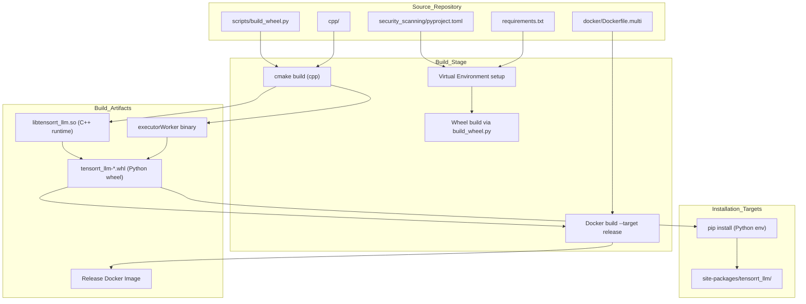
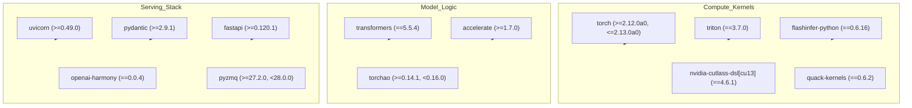

<!-- source: DeepWiki mcp.deepwiki.com · repo NVIDIA/TensorRT-LLM · page 2 Installation and Dependencies · fetched 2026-10-26 -->

# Installation and Dependencies

<details>
<summary>Relevant source files</summary>

The following files were used as context for generating this wiki page:

- [.devcontainer/docker-compose.yml](.devcontainer/docker-compose.yml)
- [.gitignore](.gitignore)
- [ATTRIBUTIONS-Python.md](ATTRIBUTIONS-Python.md)
- [CONTAINER_SOURCE.md](CONTAINER_SOURCE.md)
- [constraints.txt](constraints.txt)
- [cpp/CMakeLists.txt](cpp/CMakeLists.txt)
- [cpp/include/tensorrt_llm/batch_manager/kvCacheTransferManager.h](cpp/include/tensorrt_llm/batch_manager/kvCacheTransferManager.h)
- [cpp/tensorrt_llm/CMakeLists.txt](cpp/tensorrt_llm/CMakeLists.txt)
- [cpp/tensorrt_llm/batch_manager/CMakeLists.txt](cpp/tensorrt_llm/batch_manager/CMakeLists.txt)
- [cpp/tensorrt_llm/batch_manager/kvCacheTransferManager.cpp](cpp/tensorrt_llm/batch_manager/kvCacheTransferManager.cpp)
- [cpp/tensorrt_llm/executor/kvCacheRetentionConfig.cpp](cpp/tensorrt_llm/executor/kvCacheRetentionConfig.cpp)
- [cpp/tensorrt_llm/nanobind/CMakeLists.txt](cpp/tensorrt_llm/nanobind/CMakeLists.txt)
- [cpp/tensorrt_llm/nanobind/bindings.cpp](cpp/tensorrt_llm/nanobind/bindings.cpp)
- [cpp/tests/unit_tests/batch_manager/CMakeLists.txt](cpp/tests/unit_tests/batch_manager/CMakeLists.txt)
- [cpp/tests/unit_tests/batch_manager/kvCacheManagerV2SlotAllocatorTest.cpp](cpp/tests/unit_tests/batch_manager/kvCacheManagerV2SlotAllocatorTest.cpp)
- [docker/Dockerfile.multi](docker/Dockerfile.multi)
- [docker/Makefile](docker/Makefile)
- [docker/common/install_base.sh](docker/common/install_base.sh)
- [docker/common/install_ccache.sh](docker/common/install_ccache.sh)
- [docker/common/install_ci.sh](docker/common/install_ci.sh)
- [docker/common/install_cmake.sh](docker/common/install_cmake.sh)
- [docker/common/install_etcd.sh](docker/common/install_etcd.sh)
- [docker/common/install_mpi4py.sh](docker/common/install_mpi4py.sh)
- [docker/common/install_nixl.sh](docker/common/install_nixl.sh)
- [docker/common/install_polygraphy.sh](docker/common/install_polygraphy.sh)
- [docker/common/install_triton.sh](docker/common/install_triton.sh)
- [docker/common/install_ucx.sh](docker/common/install_ucx.sh)
- [docs/source/installation/build-from-source.md](docs/source/installation/build-from-source.md)
- [jenkins/Build.groovy](jenkins/Build.groovy)
- [jenkins/BuildDockerImage.groovy](jenkins/BuildDockerImage.groovy)
- [jenkins/L0_MergeRequest.groovy](jenkins/L0_MergeRequest.groovy)
- [jenkins/L0_Test.groovy](jenkins/L0_Test.groovy)
- [jenkins/controlCCache.groovy](jenkins/controlCCache.groovy)
- [jenkins/current_image_tags.properties](jenkins/current_image_tags.properties)
- [requirements.txt](requirements.txt)
- [scripts/build_wheel.py](scripts/build_wheel.py)
- [scripts/generate_container_oss_attribution.sh](scripts/generate_container_oss_attribution.sh)
- [scripts/get_wheel_from_package.py](scripts/get_wheel_from_package.py)
- [scripts/rename_docker_images.py](scripts/rename_docker_images.py)
- [security_scanning/examples/apps/poetry.lock](security_scanning/examples/apps/poetry.lock)
- [security_scanning/examples/auto_deploy/poetry.lock](security_scanning/examples/auto_deploy/poetry.lock)
- [security_scanning/examples/models/contrib/hyperclovax/poetry.lock](security_scanning/examples/models/contrib/hyperclovax/poetry.lock)
- [security_scanning/examples/ngram/poetry.lock](security_scanning/examples/ngram/poetry.lock)
- [security_scanning/examples/quantization/poetry.lock](security_scanning/examples/quantization/poetry.lock)
- [security_scanning/examples/ray_orchestrator/poetry.lock](security_scanning/examples/ray_orchestrator/poetry.lock)
- [security_scanning/examples/trtllm-eval/poetry.lock](security_scanning/examples/trtllm-eval/poetry.lock)
- [security_scanning/metadata.json](security_scanning/metadata.json)
- [security_scanning/poetry.lock](security_scanning/poetry.lock)
- [security_scanning/pyproject.toml](security_scanning/pyproject.toml)
- [security_scanning/triton_backend/poetry.lock](security_scanning/triton_backend/poetry.lock)
- [setup.py](setup.py)
- [tests/integration/test_lists/qa/llm_perf_disagg.yml](tests/integration/test_lists/qa/llm_perf_disagg.yml)
- [tests/integration/test_lists/qa/llm_perf_multinode.txt](tests/integration/test_lists/qa/llm_perf_multinode.txt)
- [tests/unittest/scripts/test_build_wheel_copy_back.py](tests/unittest/scripts/test_build_wheel_copy_back.py)

</details>


## Purpose and Scope

This document provides a high-level overview of the installation processes for TensorRT-LLM, including dependency management and environment setup. It covers multiple installation pathways such as Python package installation, Docker-based deployment, and system-level build requirements, focusing on compatibility and version constraints for target architectures like `x86_64` and `aarch64` (SBSA) [[security_scanning/metadata.json:1-4]]().

For granular details on Python dependencies, Poetry configurations, and the custom wheel build process, refer to the child page [Python Package and Dependencies](#2.1). For comprehensive information on Docker images, container multi-stage builds, and third-party integration libraries (e.g., NIXL, UCX, ETCD), see [Docker Images and Container Setup](#2.2).

---

## Installation Methods Overview

TensorRT-LLM supports three main installation approaches:

| Method                 | Use Case                               | Complexity | Key Files                                                        |
|------------------------|--------------------------------------|------------|-----------------------------------------------------------------|
| **Pre-built Docker Images**  | Production environments and quick deployment | Low        | [[jenkins/L0_MergeRequest.groovy:68-81]]() |
| **Docker Build from Source** | Customized builds and active development    | Medium     | [[docker/Dockerfile.multi:1-165]]()   |
| **Python Package / Wheel**    | Integration within existing Python environments | High       | [[security_scanning/pyproject.toml:1-92]](), <br> [[scripts/build_wheel.py:1-125]]() |

**Diagram: Installation Paths and Build Artifacts**



This diagram depicts the source-level files, build stages, artifacts generated, and the final installation targets relevant for each installation method.

Sources: [[security_scanning/pyproject.toml:1-92]](), [[docker/Dockerfile.multi:121-141]](), [[scripts/build_wheel.py:175-191]]()

---

## Python Package Dependencies

Python package dependencies are declared in `security_scanning/pyproject.toml` following Poetry conventions, with full resolution available in `poetry.lock` files. These dependencies cover libraries for core deep learning runtime, model APIs, serving infrastructure, and utilities [[security_scanning/pyproject.toml:1-92]](), [[security_scanning/poetry.lock:1-46]]().

The project requires Python 3.10 up to but not including 3.13 [[security_scanning/pyproject.toml:9]]().

**Diagram: Python Dependency Groups and Code Entities**



### Critical Version Constraints and Version Pinning

Several libraries are pinned to specific versions to ensure ABI and API compatibility as well as stability of runtime behaviors:

| Package              | Version Constraint         | Purpose / Rationale                               |
|----------------------|----------------------------|-------------------------------------------------|
| `transformers`       | `==5.5.4`                  | Model loader API stability [[security_scanning/pyproject.toml:33]]() |
| `flashinfer-python`  | `==0.6.16`                 | Optimized attention kernels [[security_scanning/pyproject.toml:58]]() |
| `torch`              | `>=2.12.0a0, <=2.13.0a0`   | Base PyTorch runtime compatibility [[security_scanning/pyproject.toml:30]]() |
| `triton`             | `==3.7.0`                  | Vendored kernel compatibility [[security_scanning/pyproject.toml:68]]() |
| `nvidia-nccl-cu13`   | `>=2.29.7, <=2.30.4`       | Distributed communications backend [[security_scanning/pyproject.toml:31]]() |
| `mpi4py`             | `>=4.1.2, <5.0.0`          | MPI Python bindings for distributed execution [[security_scanning/pyproject.toml:19]]() |

For exhaustive dependency versions, please consult the `pyproject.toml` and `poetry.lock` files, and the dedicated child page [Python Package and Dependencies](#2.1).

Sources: [[security_scanning/pyproject.toml:1-92]](), [[security_scanning/poetry.lock:1-46]](), [[requirements.txt:1-106]]()

---

## Build Process Overview

The native C++ runtime and Python bindings are packaged via the `scripts/build_wheel.py` script. This process compiles the core TensorRT-LLM runtime, executor binaries, and embeds custom TensorRT plugins before assembling a Python wheel package [[docker/Dockerfile.multi:132-140]]().

Key aspects include:

- **Environment Preparation:** The build process utilizes `requirements.txt` to install necessary build-time tools like `meson`, `ninja`, and `build` [[requirements.txt:4,72,73]]().
- **C++ Core Compilation:** Sources under `cpp/` are built, producing shared libraries like `libtensorrt_llm.so` [[docker/Dockerfile.multi:123,156]]().
- **Python Bindings:** The package includes compiled libraries to enable efficient interoperability between C++ and Python code [[docker/Dockerfile.multi:126]]().
- **Build Invocation:** The `Dockerfile.multi` orchestrates the build by copying source directories and running the wheel build script [[docker/Dockerfile.multi:121-140]]().

**Diagram: Build Process Flow**

```mermaid
flowchart TD
    subgraph "Build Execution: Docker/Scripts"
        start["Start Build"]
        reqs["Install requirements.txt"]
        cmake["Compile cpp/ source"]
        bindings["Generate Python Bindings"]
        package["scripts/build_wheel.py"]
        end["Output: .whl Package"]
    end

    start --> reqs --> cmake --> bindings --> package --> end
```

Sources: [[docker/Dockerfile.multi:121-152]](), [[requirements.txt:1-106]](), [[scripts/build_wheel.py:1-125]]()

---

## Runtime Environment Setup

After installation via generated wheel or Docker image, the runtime environment requires proper configuration:

- **Shared Library and Binary Exposure:** The release image copies build context files and ensures that the environment is ready for inference [[docker/Dockerfile.multi:154-165]]().
- **MPI and Distributed Execution:** Multi-GPU runtime uses MPI for coordination, facilitated by Python `mpi4py` bindings, and NVIDIA NCCL for device communication [[security_scanning/pyproject.toml:19,31]]().  
- **IPC Mechanisms:** ZeroMQ-based IPC using `pyzmq` enables communication between processes (e.g., between the `GenerationExecutorProxy` and worker processes) [[security_scanning/pyproject.toml:49]]().
- **High-Performance Networking:** Specialized drivers and libraries like UCX, NIXL, and ETCD are installed via dedicated scripts to support high-speed interconnects and service discovery [[docker/Dockerfile.multi:78-86]]().
- **Environment Variables:** The Docker environment sets critical variables such as `PYTORCH_ALLOC_CONF` to manage memory allocation behavior [[docker/Dockerfile.multi:46]]().

Sources: [[security_scanning/pyproject.toml:1-92]](), [[docker/Dockerfile.multi:42-165]]()

---

## References to Child Pages

- For details on Python package dependency management, the Poetry configuration, development dependencies, and the caching mechanism for third-party C++ libraries, see [Python Package and Dependencies](#2.1).
- For detailed Docker multi-stage builds, installation images, and scripts including NIXL, UCX, and FlashAttention 4 support, see [Docker Images and Container Setup](#2.2).

---

# Summary

TensorRT-LLM accommodates multiple installation workflows targeting various deployment scenarios, from local development to large-scale production serving. The build system emphasizes version consistency (pinning `torch`, `triton`, and `transformers`) and isolating dependencies via virtual environments [[scripts/build_wheel.py:152-172]](). High-level dependency management uses Poetry with manifest locking, and specialized multi-stage Docker images provide optimized containerized runtime environments including support for advanced networking via NIXL and UCX [[docker/Dockerfile.multi:78-87]]().

Sources:  
[[security_scanning/metadata.json:1-4]](), [[security_scanning/pyproject.toml:1-92]](), [[security_scanning/poetry.lock:1-46]](), [[jenkins/L0_MergeRequest.groovy:64-81]](), [[docker/Dockerfile.multi:1-165]](), [[requirements.txt:1-106]]()

---

