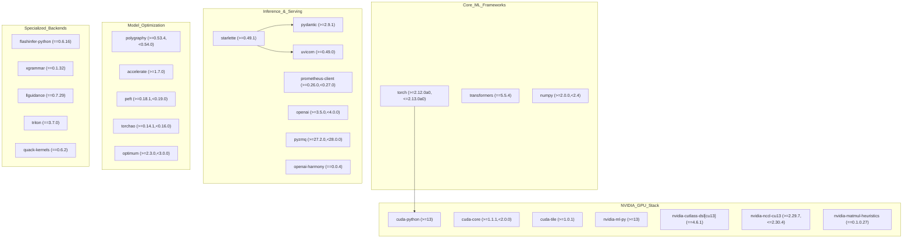
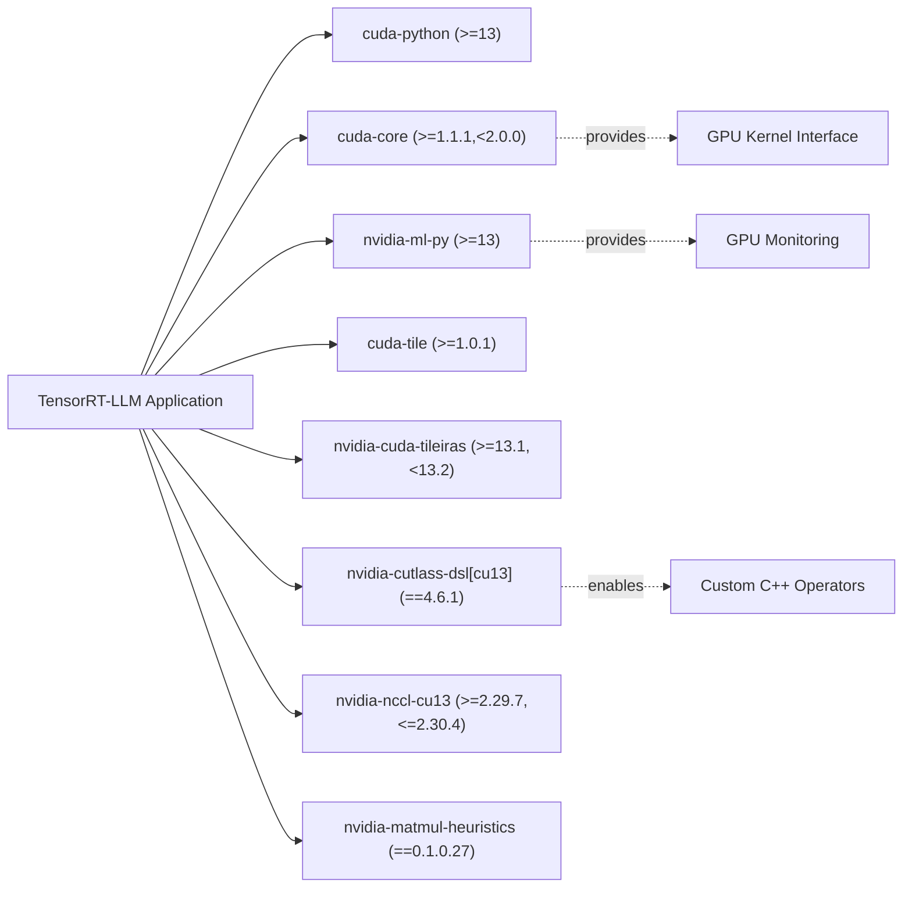
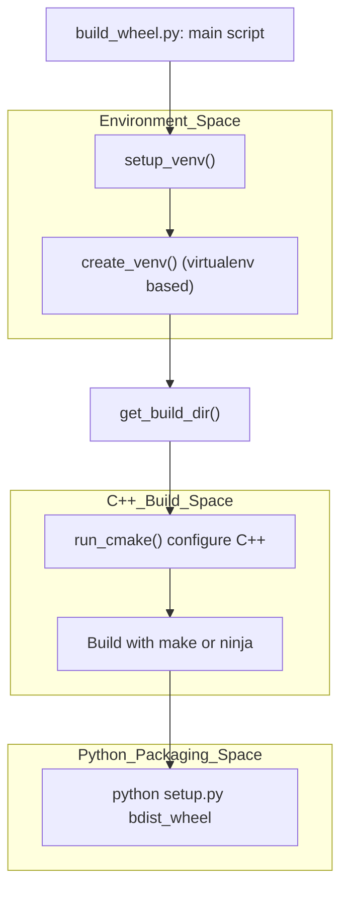

<!-- source: DeepWiki mcp.deepwiki.com · repo NVIDIA/TensorRT-LLM · page 2.1 Python Package and Dependencies · fetched 2026-10-26 -->

# Python Package and Dependencies

<details>
<summary>Relevant source files</summary>

The following files were used as context for generating this wiki page:

- [.gitignore](.gitignore)
- [.pre-commit-config.yaml](.pre-commit-config.yaml)
- [cpp/CMakeLists.txt](cpp/CMakeLists.txt)
- [cpp/include/tensorrt_llm/batch_manager/kvCacheTransferManager.h](cpp/include/tensorrt_llm/batch_manager/kvCacheTransferManager.h)
- [cpp/tensorrt_llm/CMakeLists.txt](cpp/tensorrt_llm/CMakeLists.txt)
- [cpp/tensorrt_llm/batch_manager/CMakeLists.txt](cpp/tensorrt_llm/batch_manager/CMakeLists.txt)
- [cpp/tensorrt_llm/batch_manager/kvCacheTransferManager.cpp](cpp/tensorrt_llm/batch_manager/kvCacheTransferManager.cpp)
- [cpp/tensorrt_llm/executor/kvCacheRetentionConfig.cpp](cpp/tensorrt_llm/executor/kvCacheRetentionConfig.cpp)
- [cpp/tensorrt_llm/nanobind/CMakeLists.txt](cpp/tensorrt_llm/nanobind/CMakeLists.txt)
- [cpp/tensorrt_llm/nanobind/bindings.cpp](cpp/tensorrt_llm/nanobind/bindings.cpp)
- [cpp/tests/unit_tests/batch_manager/CMakeLists.txt](cpp/tests/unit_tests/batch_manager/CMakeLists.txt)
- [cpp/tests/unit_tests/batch_manager/kvCacheManagerV2SlotAllocatorTest.cpp](cpp/tests/unit_tests/batch_manager/kvCacheManagerV2SlotAllocatorTest.cpp)
- [docs/source/installation/build-from-source.md](docs/source/installation/build-from-source.md)
- [legacy-files.txt](legacy-files.txt)
- [pyproject.toml](pyproject.toml)
- [ruff-legacy.toml](ruff-legacy.toml)
- [scripts/build_wheel.py](scripts/build_wheel.py)
- [scripts/check_test_list.py](scripts/check_test_list.py)
- [security_scanning/examples/apps/poetry.lock](security_scanning/examples/apps/poetry.lock)
- [security_scanning/examples/auto_deploy/poetry.lock](security_scanning/examples/auto_deploy/poetry.lock)
- [security_scanning/examples/models/contrib/hyperclovax/poetry.lock](security_scanning/examples/models/contrib/hyperclovax/poetry.lock)
- [security_scanning/examples/ngram/poetry.lock](security_scanning/examples/ngram/poetry.lock)
- [security_scanning/examples/quantization/poetry.lock](security_scanning/examples/quantization/poetry.lock)
- [security_scanning/examples/ray_orchestrator/poetry.lock](security_scanning/examples/ray_orchestrator/poetry.lock)
- [security_scanning/examples/trtllm-eval/poetry.lock](security_scanning/examples/trtllm-eval/poetry.lock)
- [security_scanning/metadata.json](security_scanning/metadata.json)
- [security_scanning/poetry.lock](security_scanning/poetry.lock)
- [security_scanning/pyproject.toml](security_scanning/pyproject.toml)
- [security_scanning/triton_backend/poetry.lock](security_scanning/triton_backend/poetry.lock)
- [setup.py](setup.py)
- [tests/README.md](tests/README.md)
- [tests/integration/README.md](tests/integration/README.md)
- [tests/integration/defs/test_list_parser.py](tests/integration/defs/test_list_parser.py)
- [tests/integration/defs/triton_server/test_list_parser.py](tests/integration/defs/triton_server/test_list_parser.py)
- [tests/integration/test_lists/qa/llm_perf_disagg.yml](tests/integration/test_lists/qa/llm_perf_disagg.yml)
- [tests/integration/test_lists/qa/llm_perf_multinode.txt](tests/integration/test_lists/qa/llm_perf_multinode.txt)
- [tests/unittest/scripts/test_build_wheel_copy_back.py](tests/unittest/scripts/test_build_wheel_copy_back.py)
- [tests/unittest/scripts/test_check_test_list.py](tests/unittest/scripts/test_check_test_list.py)

</details>


## Purpose and Scope

This page documents the Python package structure, dependency management, and build-from-source infrastructure for TensorRT-LLM. It covers project configuration in `pyproject.toml`, dependency resolution through Poetry lock files, and the `build_wheel.py` script used to compile the C++ runtime and package it into a Python wheel. This infrastructure ensures reproducible environments for model optimization, serving, and evaluation.

## Project Configuration

TensorRT-LLM uses Poetry for Python dependency management with configuration defined in [security_scanning/pyproject.toml:1-94]().

### Package Metadata

```toml
[project]
name = "tensorrt-llm"
version = "0.1.0"
requires-python = ">=3.10,<3.13"
```

The package supports Python versions 3.10 through 3.12 [security_scanning/pyproject.toml:9](). The build system uses `poetry-core>=2.0.0` as specified in [security_scanning/pyproject.toml:97-98]().

**Sources:** [security_scanning/pyproject.toml:1-98]()

## Dependency Categories

The project maintains direct dependencies organized into functional categories to support the full LLM lifecycle.

### Logical Dependency Map

This diagram associates logical system components with their specific package requirements as defined in the project configuration.



**Sources:** [security_scanning/pyproject.toml:10-93]()

### ML Framework Dependencies

| Package         | Version Constraint         | Purpose                                          |
|-----------------|----------------------------|------------------------------------------------|
| `torch`         | `>=2.12.0a0,<=2.13.0a0`    | PyTorch ML framework for model execution [security_scanning/pyproject.toml:30]() |
| `transformers`  | `==5.5.4`                  | HuggingFace model architectures (pinned) [security_scanning/pyproject.toml:33]() |
| `accelerate`    | `>=1.7.0`                  | Distributed execution utilities [security_scanning/pyproject.toml:11]() |
| `datasets`      | `==3.1.0`                  | Dataset loading (pinned) [security_scanning/pyproject.toml:43]() |
| `diffusers`     | `>=0.39.0,<0.40`           | Diffusion model support [security_scanning/pyproject.toml:15]() |

**Sources:** [security_scanning/pyproject.toml:10-45]()

### NVIDIA CUDA Stack

The stack integrates low-level CUDA interfaces with high-level Python bindings to enable efficient GPU execution and communication.



**Sources:** [security_scanning/pyproject.toml:14,25,31,73-74,84-86]()

## Building from Source: `build_wheel.py`

The `scripts/build_wheel.py` script is the primary entry point for building the TensorRT-LLM Python package from source. It orchestrates environment setup, C++ compilation, and Python wheel packaging.

### Build Orchestration Flow

The following diagram maps major build stages and the functions responsible within `build_wheel.py`.



### Key Functions and Implementation Details

- `setup_venv`: Creates or updates a Python virtual environment, or uses current environment if already inside a venv or explicitly requested via `--no-venv` [scripts/build_wheel.py:179-194]().
- `create_venv`: Uses the `virtualenv` package (version constraint `>=20.29.1,<22.0`) to create a venv with system site packages enabled [scripts/build_wheel.py:152-172]().
- `get_available_cpu_count`: Limits build concurrency by respecting CPU affinity on Linux via `os.sched_getaffinity()` [scripts/build_wheel.py:46-57]().
- `apply_version_override`: Allows modifying the package version in `tensorrt_llm/version.py` before building the wheel [scripts/build_wheel.py:74-94]().
- `get_build_dir`: Determines the build directory based on build type (Release vs others) and root configuration [scripts/build_wheel.py:100-119]().

**Sources:** [scripts/build_wheel.py:46-194]()

## C++ 3rdparty and FetchContent

TensorRT-LLM manages C++ dependencies primarily through CMake's `FetchContent` mechanism. External libraries are defined and cached to speed up build times.

### Dependency Management

C++ dependencies are managed in `cpp/CMakeLists.txt` and `cpp/tensorrt_llm/CMakeLists.txt`. Key external projects include:
- **GoogleTest/Benchmark**: For unit testing and performance measurement.
- **NCCL**: For distributed communication.
- **NVRTC**: For runtime compilation of CUDA kernels.
- **fmha_sm100**: Fused Multi-Head Attention kernels for Blackwell, staged under `3rdparty/fmha_sm100` via CMake FetchContent [setup.py:61-67]().

The project uses a `fetch-cache` mechanism to avoid re-downloading large dependencies if they already exist in a specified local directory.

**Sources:** [cpp/CMakeLists.txt:1-100](), [cpp/tensorrt_llm/CMakeLists.txt:1-50](), [setup.py:61-67]()

## Poetry Lock Files

Poetry lock files guarantee reproducible builds by locking dependency versions tightly across various project sub-components.

| Component Lock File | Purpose |
|---------------------|---------|
| `security_scanning/poetry.lock` | Main project dependency lock [security_scanning/poetry.lock:1]() |
| `security_scanning/examples/auto_deploy/poetry.lock` | AutoDeploy tool specific dependencies [security_scanning/examples/auto_deploy/poetry.lock:1]() |
| `security_scanning/examples/trtllm-eval/poetry.lock` | Evaluation harness dependencies [security_scanning/examples/trtllm-eval/poetry.lock:1]() |
| `security_scanning/triton_backend/poetry.lock` | Triton Inference Server backend dependencies [security_scanning/triton_backend/poetry.lock:1]() |

**Sources:** [security_scanning/poetry.lock:1](), [security_scanning/examples/auto_deploy/poetry.lock:1](), [security_scanning/examples/trtllm-eval/poetry.lock:1](), [security_scanning/triton_backend/poetry.lock:1]()

## Security Scanning Infrastructure

The `security_scanning/` directory includes metadata for vulnerability scanning, tracking the current commit hash and scan timestamp to ensure build integrity.

### Metadata File
```json
{
  "commit_hash": "141260367a0cfdd7c1bacff30b20fe81080fed95",
  "timestamp": "2026-08-27T02:52:09Z"
}
```
**Sources:** [security_scanning/metadata.json:1-4]()

## Version Pinning Strategy

TensorRT-LLM uses strict version pinning for core and compatibility-sensitive packages.

| Package | Version | Reason |
|---------|---------|--------|
| `transformers` | `==5.5.4` | Architecture compatibility [security_scanning/pyproject.toml:33]() |
| `triton` | `==3.7.0` | Kernel backend alignment [security_scanning/pyproject.toml:68]() |
| `flashinfer-python` | `==0.6.16` | Sampling and attention kernels [security_scanning/pyproject.toml:58]() |
| `datasets` | `==3.1.0` | Evaluation consistency [security_scanning/pyproject.toml:43]() |
| `nvidia-cutlass-dsl[cu13]` | `==4.6.1` | FP8/FP4 GEMM generation [security_scanning/pyproject.toml:73]() |

**Sources:** [security_scanning/pyproject.toml:10-94]()

---

