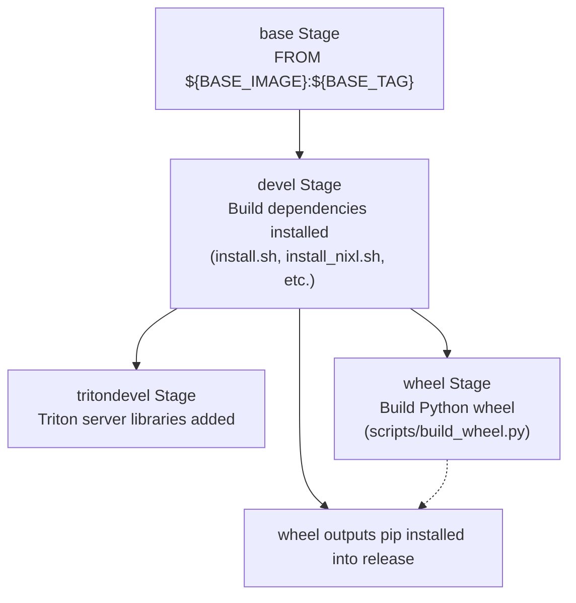
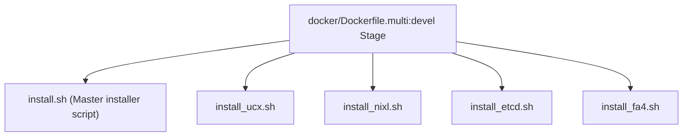
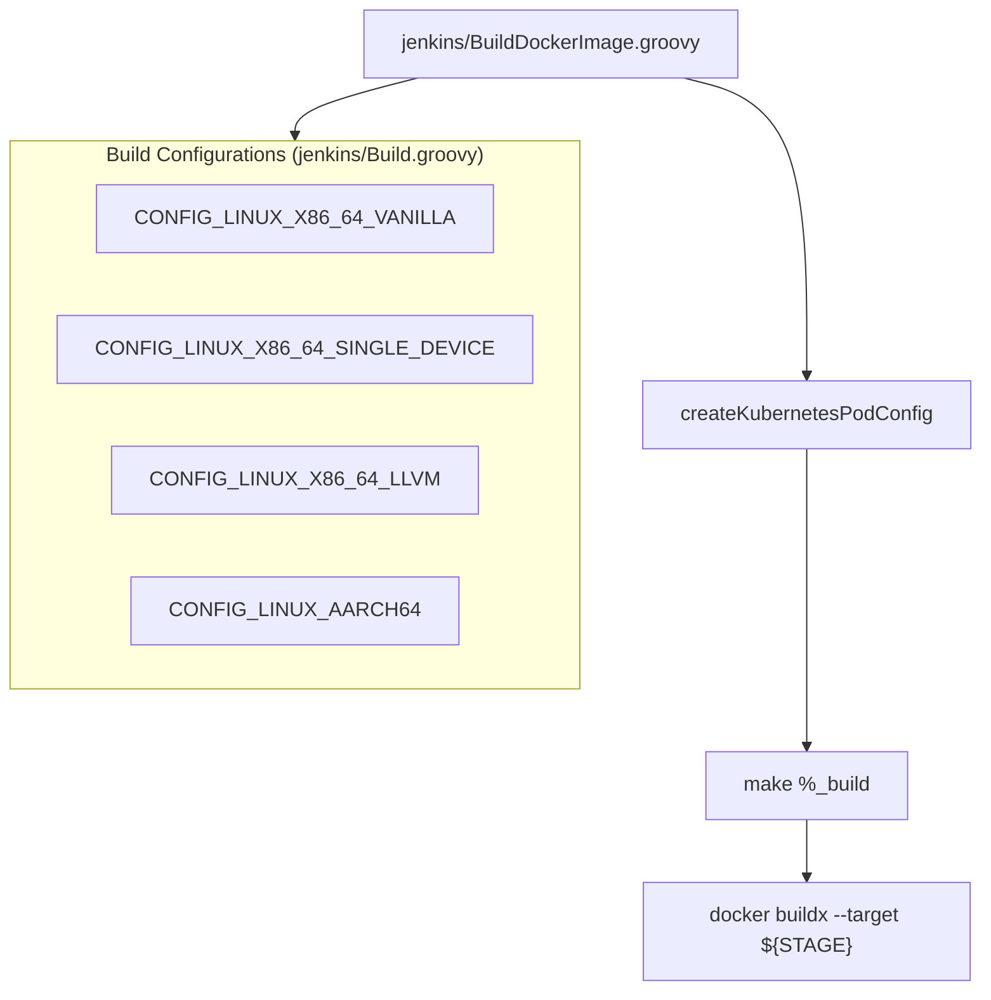
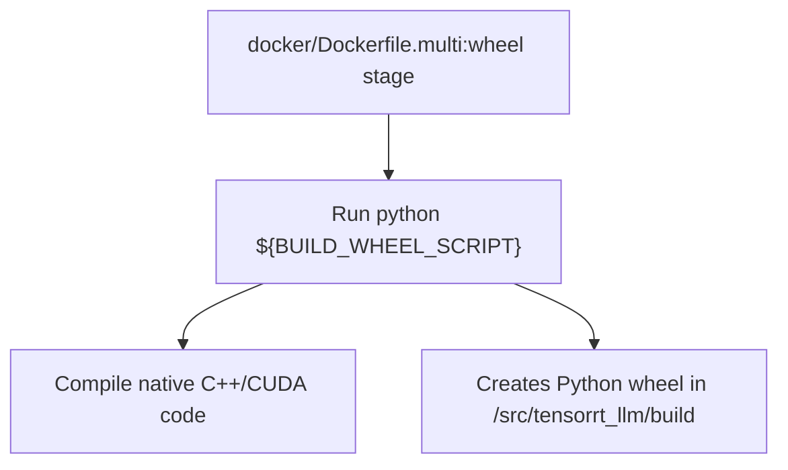

<!-- source: DeepWiki mcp.deepwiki.com · repo NVIDIA/TensorRT-LLM · page 2.2 Docker Images and Container Setup · fetched 2026-10-26 -->

# Docker Images and Container Setup

Relevant source files

The following files were used as context for generating this wiki page:

- [.devcontainer/docker-compose.yml](.devcontainer/docker-compose.yml)
- [ATTRIBUTIONS-Python.md](ATTRIBUTIONS-Python.md)
- [CONTAINER_SOURCE.md](CONTAINER_SOURCE.md)
- [constraints.txt](constraints.txt)
- [docker/Dockerfile.multi](docker/Dockerfile.multi)
- [docker/Makefile](docker/Makefile)
- [docker/common/install_base.sh](docker/common/install_base.sh)
- [docker/common/install_ccache.sh](docker/common/install_ccache.sh)
- [docker/common/install_ci.sh](docker/common/install_ci.sh)
- [docker/common/install_cmake.sh](docker/common/install_cmake.sh)
- [docker/common/install_etcd.sh](docker/common/install_etcd.sh)
- [docker/common/install_mpi4py.sh](docker/common/install_mpi4py.sh)
- [docker/common/install_nixl.sh](docker/common/install_nixl.sh)
- [docker/common/install_polygraphy.sh](docker/common/install_polygraphy.sh)
- [docker/common/install_triton.sh](docker/common/install_triton.sh)
- [docker/common/install_ucx.sh](docker/common/install_ucx.sh)
- [jenkins/Build.groovy](jenkins/Build.groovy)
- [jenkins/BuildDockerImage.groovy](jenkins/BuildDockerImage.groovy)
- [jenkins/L0_MergeRequest.groovy](jenkins/L0_MergeRequest.groovy)
- [jenkins/L0_Test.groovy](jenkins/L0_Test.groovy)
- [jenkins/controlCCache.groovy](jenkins/controlCCache.groovy)
- [jenkins/current_image_tags.properties](jenkins/current_image_tags.properties)
- [requirements.txt](requirements.txt)
- [scripts/generate_container_oss_attribution.sh](scripts/generate_container_oss_attribution.sh)
- [scripts/get_wheel_from_package.py](scripts/get_wheel_from_package.py)
- [scripts/rename_docker_images.py](scripts/rename_docker_images.py)
- [security_scanning/docs/poetry.lock](security_scanning/docs/poetry.lock)

## Purpose and Scope

This document describes the Docker container infrastructure for TensorRT-LLM, covering multi-stage builds, container image variants, automated dependency installations including third-party libraries such as NIXL and UCX, and integration with the Jenkins CI/CD pipeline. The container system ensures consistent and reproducible development and deployment environments with all necessary dependencies pre-installed and configured.

Key elements include:
- Multi-stage Dockerfiles for optimized layer caching and modular builds. [docker/Dockerfile.multi:1-173]()
- Distinct image variants for development, wheel building, runtime, and Triton integration. [docker/Dockerfile.multi:22-142]()
- Installation scripts orchestrating CUDA, TensorRT, UCX, NIXL, and other dependencies. [docker/common/install_nixl.sh:1-52](), [docker/Dockerfile.multi:53-88]()
- Naming conventions and image tagging encoding architecture, OS, Python, and runtime versions. [jenkins/L0_Test.groovy:58-64](), [jenkins/current_image_tags.properties:1-20]()
- CI/CD pipeline automation to build, test, and publish images efficiently. [jenkins/BuildDockerImage.groovy:1-176]()

Sources: [docker/Dockerfile.multi:1-173](), [jenkins/BuildDockerImage.groovy:1-176](), [jenkins/current_image_tags.properties:1-20]()

---

## Multi-Stage Dockerfile Architecture

TensorRT-LLM employs a multi-stage Docker build strategy implemented in `docker/Dockerfile.multi`. This approach produces various reusable image layers to optimize both build time and deployment size.

### Stage Overview

| Stage | Purpose | Description |
|---|---|---|
| `base` | Base OS and environment setup | From a PyTorch base image (default `26.05-py3`), sets environment variables (`SH_ENV`, `BASH_ENV`), shell initialization, and NVIDIA license labels. [docker/Dockerfile.multi:22-40]() |
| `devel` | Development environment | Installs build tools (CMake, ccache); dependencies including CUDA toolkit, Polygraphy, MPI, and PyTorch. Also installs UCX, NIXL, ETCD, and FlashAttention 4. [docker/Dockerfile.multi:42-93]() |
| `tritondevel` | Devel + Triton Server integration | Combines the `devel` image with Triton server libraries and adds Mooncake (except on Rocky8) and CI tooling. [docker/Dockerfile.multi:102-119]() |
| `wheel` | Wheel build environment | Copies source code and scripts, then runs `build_wheel.py` to compile C++ binaries and package the Python wheel. [docker/Dockerfile.multi:121-140]() |
| `release` | Production runtime image | Starts from `devel`, installs the built wheel from the `wheel` stage, sets up runtime library paths (`libtensorrt_llm.so`), and includes examples. [docker/Dockerfile.multi:142-173]() |

### Docker Multi-Stage Build Flow Diagram

Title: Dockerfile.multi Stage Transitions

Sources: [docker/Dockerfile.multi:22-173]()

---

## Dependency Installation Scripts

TensorRT-LLM utilizes modular shell scripts under `docker/common/` that install and configure third-party dependencies. These scripts are integrated into the Docker builds via `RUN --mount=type=bind` commands. [docker/Dockerfile.multi:53-65]()

### Orchestration and Key Scripts

- `install.sh`: Master installation script called in the `devel` stage that delegates to component installers like `--cmake`, `--ccache`, and `--cuda_toolkit`. [docker/Dockerfile.multi:64-65]()
- Networking and communication installers:
  - `install_ucx.sh`: Installs UCX (Unified Communication X) for high-performance communication. [docker/Dockerfile.multi:84]()
  - `install_nixl.sh`: Installs NIXL (NVIDIA Inter-GPU eXchange Library), required for distributed KV cache transfers. It uses `meson` and `ninja` for compilation. [docker/common/install_nixl.sh:21-47]()
  - `install_etcd.sh`: Installs ETCD, used for service discovery and coordination in disaggregated serving. [docker/Dockerfile.multi:86]()
  - `install_fa4.sh`: Installs FlashAttention 4 dependencies. [docker/Dockerfile.multi:87]()

### Dependency Installation Flow Diagram

Title: Docker Dependency Installation Orchestration

### Details on NIXL Installation

The NIXL installer (`install_nixl.sh`) clones the repository at version `v1.3.1`, compiles it with `meson` and `ninja`, and installs it. [docker/common/install_nixl.sh:7-47](). It specifically configures `LD_LIBRARY_PATH` to include the NIXL library path (`/opt/nvidia/nvda_nixl/lib`) in the container environment. [docker/common/install_nixl.sh:52]()

Sources: [docker/Dockerfile.multi:53-88](), [docker/common/install_nixl.sh:1-52]()

---

## Python Dependencies and Constraints

TensorRT-LLM manages its Python dependencies via `requirements.txt` and `setup.py`.

- `requirements.txt` lists core dependencies including PyTorch (pinned between `2.12.0a0` and `2.13.0a0`), `nvidia-nccl-cu13`, `flashinfer-python==0.6.16`, `transformers==5.5.4`, and `triton==3.7.0`. [requirements.txt:29-76]()
- The system uses `constraints.txt` during pip installs in Docker to enforce specific version constraints and security workarounds, such as specific versions for `h5py==3.12.1`. [requirements.txt:2](), [docker/Dockerfile.multi:68-76]()
- Special dependencies like `nvidia-cutlass-dsl[cu13]==4.6.1` are required for Blackwell CuTe DSL kernels. [requirements.txt:81]()
- The `devel` stage explicitly uninstalls conflicting packages like `tornado`, `black`, and older `nvidia-cutlass-dsl` versions before installing from `constraints.txt`. [docker/Dockerfile.multi:71-75]()

Sources: [requirements.txt:1-105](), [docker/Dockerfile.multi:68-76]()

---

## Image Variant Matrix and Tagging

### Image Tagging Convention

The image tags encode critical build and runtime details:
`[base_image_name]-[arch]-[os](-[python_version])-[trt_version]-[torch_install_type]-[stage]-[date]-[mr_id]` [jenkins/L0_Test.groovy:60]()

### Main Image Variables

The file `jenkins/current_image_tags.properties` tracks the latest valid images produced by CI. [jenkins/current_image_tags.properties:1-20]()

| Env Variable | Example Image URI |
|---|---|
| `LLM_DOCKER_IMAGE` | `...:pytorch-26.05-py3-x86_64-ubuntu24.04-skip-tritondevel-...` [jenkins/current_image_tags.properties:16]() |
| `LLM_SBSA_DOCKER_IMAGE` | `...:pytorch-26.05-py3-sbsa-ubuntu24.04-skip-tritondevel-...` [jenkins/current_image_tags.properties:17]() |
| `LLM_ROCKYLINUX8_PY310_DOCKER_IMAGE` | `...:cuda-13.2.1-devel-rocky8-x86_64-rocky8-py310-skip-tritondevel-...` [jenkins/current_image_tags.properties:18]() |
| `LLM_ROCKYLINUX8_PY312_DOCKER_IMAGE` | `...:cuda-13.2.1-devel-rocky8-x86_64-rocky8-py312-skip-tritondevel-...` [jenkins/current_image_tags.properties:19]() |

Sources: [jenkins/current_image_tags.properties:1-20](), [jenkins/L0_Test.groovy:58-64](), [jenkins/L0_MergeRequest.groovy:64-81]()

---

## CI/CD Pipeline Integration

Image building is automated via Jenkins pipelines, leveraging Kubernetes pods.

### Jenkins Pipeline Workflow

- `BuildDockerImage.groovy` provisions Kubernetes pods with isolated Docker environments (`docker:dind`). [jenkins/BuildDockerImage.groovy:175-176]()
- It orchestrates parallel builds for different architectures (x86_64, SBSA/aarch64) and configurations. [jenkins/Build.groovy:73-103]()
- Pod configurations include specific node selectors for architectures (`amd64`, `arm64`) and block unstable nodes to ensure build reliability. [jenkins/BuildDockerImage.groovy:81-149]()
- The `docker/Makefile` provides the `_build` and `_push` targets used by the pipeline to trigger `docker buildx build`. [docker/Makefile:81-126]()

### Jenkins Pipeline to Docker Code Mapping Diagram

Title: CI/CD Infrastructure and Build Orchestration

Sources: [jenkins/BuildDockerImage.groovy:1-176](), [jenkins/Build.groovy:73-103](), [docker/Makefile:81-126]()

---

## Python Wheel Building and Installation

### Wheel Build Process

The `wheel` stage in the Dockerfile performs a full build of the TensorRT-LLM Python wheel.

- Source code directories (`cpp`, `docker`, `scripts`, `tensorrt_llm`, `triton_kernels`, `3rdparty`) are copied into the image. [docker/Dockerfile.multi:123-129]()
- The build uses `scripts/build_wheel.py` with arguments defined in `BUILD_WHEEL_ARGS` (default `--clean`). [docker/Dockerfile.multi:134-140]()
- C++ compilation is accelerated via `CCACHE_DIR=/root/.cache/ccache`. [docker/Dockerfile.multi:131-136]()
- The `release` stage then installs the wheel using `pip install "${TRTLLM_WHEEL}[mx]"`. [docker/Dockerfile.multi:152]()

### Wheel Build Pipeline Diagram

Title: Native Build and Wheel Packaging Flow

Sources: [docker/Dockerfile.multi:121-140](), [docker/Makefile:41-44]()

---

