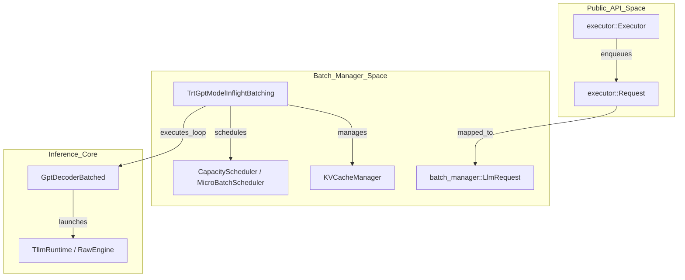
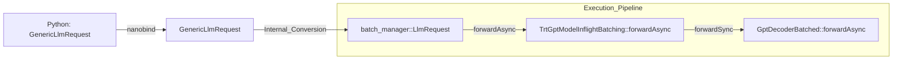

<!-- source: DeepWiki mcp.deepwiki.com · repo NVIDIA/TensorRT-LLM · page 20 C++ Runtime and Batch Manager · fetched 2026-10-26 -->

# C++ Runtime and Batch Manager

Relevant source files

The following files were used as context for generating this wiki page:

- [cpp/include/tensorrt_llm/batch_manager/cacheTransceiver.h](cpp/include/tensorrt_llm/batch_manager/cacheTransceiver.h)
- [cpp/include/tensorrt_llm/batch_manager/kvCacheManager.h](cpp/include/tensorrt_llm/batch_manager/kvCacheManager.h)
- [cpp/include/tensorrt_llm/batch_manager/llmRequest.h](cpp/include/tensorrt_llm/batch_manager/llmRequest.h)
- [cpp/include/tensorrt_llm/executor/dataTransceiverState.h](cpp/include/tensorrt_llm/executor/dataTransceiverState.h)
- [cpp/include/tensorrt_llm/executor/executor.h](cpp/include/tensorrt_llm/executor/executor.h)
- [cpp/tensorrt_llm/batch_manager/cacheFormatter.cpp](cpp/tensorrt_llm/batch_manager/cacheFormatter.cpp)
- [cpp/tensorrt_llm/batch_manager/cacheFormatter.h](cpp/tensorrt_llm/batch_manager/cacheFormatter.h)
- [cpp/tensorrt_llm/batch_manager/cacheTransceiver.cpp](cpp/tensorrt_llm/batch_manager/cacheTransceiver.cpp)
- [cpp/tensorrt_llm/batch_manager/dataTransceiver.cpp](cpp/tensorrt_llm/batch_manager/dataTransceiver.cpp)
- [cpp/tensorrt_llm/batch_manager/dataTransceiver.h](cpp/tensorrt_llm/batch_manager/dataTransceiver.h)
- [cpp/tensorrt_llm/batch_manager/kvCacheManager.cpp](cpp/tensorrt_llm/batch_manager/kvCacheManager.cpp)
- [cpp/tensorrt_llm/batch_manager/llmRequest.cpp](cpp/tensorrt_llm/batch_manager/llmRequest.cpp)
- [cpp/tensorrt_llm/batch_manager/mlaCacheFormatter.cpp](cpp/tensorrt_llm/batch_manager/mlaCacheFormatter.cpp)
- [cpp/tensorrt_llm/batch_manager/mlaCacheFormatter.h](cpp/tensorrt_llm/batch_manager/mlaCacheFormatter.h)
- [cpp/tensorrt_llm/executor/cache_transmission/cacheSplitConcat.cu](cpp/tensorrt_llm/executor/cache_transmission/cacheSplitConcat.cu)
- [cpp/tensorrt_llm/executor/cache_transmission/cacheSplitConcat.h](cpp/tensorrt_llm/executor/cache_transmission/cacheSplitConcat.h)
- [cpp/tensorrt_llm/executor/serialization.cpp](cpp/tensorrt_llm/executor/serialization.cpp)
- [cpp/tensorrt_llm/nanobind/batch_manager/bindings.cpp](cpp/tensorrt_llm/nanobind/batch_manager/bindings.cpp)
- [cpp/tensorrt_llm/nanobind/batch_manager/cacheTransceiver.cpp](cpp/tensorrt_llm/nanobind/batch_manager/cacheTransceiver.cpp)
- [cpp/tensorrt_llm/nanobind/batch_manager/kvCacheManager.cpp](cpp/tensorrt_llm/nanobind/batch_manager/kvCacheManager.cpp)
- [cpp/tensorrt_llm/nanobind/executor/request.cpp](cpp/tensorrt_llm/nanobind/executor/request.cpp)
- [cpp/tests/unit_tests/batch_manager/capacitySchedulerTest.cpp](cpp/tests/unit_tests/batch_manager/capacitySchedulerTest.cpp)
- [cpp/tests/unit_tests/batch_manager/kvCacheManagerTest.cpp](cpp/tests/unit_tests/batch_manager/kvCacheManagerTest.cpp)
- [cpp/tests/unit_tests/batch_manager/kvCacheUtilsTest.cpp](cpp/tests/unit_tests/batch_manager/kvCacheUtilsTest.cpp)
- [cpp/tests/unit_tests/executor/serializeUtilsTest.cpp](cpp/tests/unit_tests/executor/serializeUtilsTest.cpp)
- [cpp/tests/unit_tests/multi_gpu/cacheTransceiverTest.cpp](cpp/tests/unit_tests/multi_gpu/cacheTransceiverTest.cpp)
- [tensorrt_llm/_torch/pyexecutor/kv_cache_transceiver.py](tensorrt_llm/_torch/pyexecutor/kv_cache_transceiver.py)
- [tests/unittest/bindings/test_bindings_ut.py](tests/unittest/bindings/test_bindings_ut.py)
- [tests/unittest/bindings/test_executor_bindings.py](tests/unittest/bindings/test_executor_bindings.py)
- [tests/unittest/others/test_kv_cache_transceiver.py](tests/unittest/others/test_kv_cache_transceiver.py)

The TensorRT-LLM C++ Runtime and Batch Manager form the high-performance core of the inference engine. While the Python LLM API provides a user-friendly interface, the underlying execution is orchestrated by a sophisticated C++ system designed for **In-Flight Batching** (IFB). This architecture allows new requests to be added to the running batch and completed requests to be removed at every iteration, maximizing GPU utilization and minimizing latency.

The system is primarily composed of the **Batch Manager** (which handles request scheduling and resource management), the **GptDecoderBatched** (which manages the token generation loop), and the **Executor API** (which provides a stable interface for both C++ and Python integrations).

### System Architecture Overview

The following diagram illustrates the relationship between the high-level Executor API and the internal Batch Manager components.

**C++ Runtime Component Interaction**

**Sources:** [cpp/tensorrt_llm/batch_manager/trtGptModelInflightBatching.h:116-153](), [cpp/tensorrt_llm/batch_manager/trtGptModelInflightBatching.cpp:18-47]()

---

## In-flight Batching and Decoder

The core of the C++ runtime is `TrtGptModelInflightBatching`. Unlike traditional static batching, IFB processes requests at the granularity of individual tokens. It utilizes several sub-components to manage the lifecycle of a request:

*   **Schedulers**: `CapacityScheduler` and `MicroBatchScheduler` determine which requests from the pending queue can fit into the current GPU memory and compute budget [cpp/tensorrt_llm/batch_manager/trtGptModelInflightBatching.h:90-93]().
*   **Decoder**: `GptDecoderBatched` manages the sampling and decoding logic (e.g., Beam Search, Top-K, Top-P) across the entire batch [cpp/tensorrt_llm/runtime/gptDecoderBatched.cpp:39-43](). It wraps the lower-level `IGptDecoder` which performs the actual token selection [cpp/tensorrt_llm/runtime/gptDecoderBatched.cpp:96-97]() and uses `decoderState` to maintain decoding inputs and outputs [cpp/tensorrt_llm/runtime/decoderState.cpp:48-65]().
*   **Buffer Management**: `DecoderInputBuffers` and `DecoderOutputBuffers` handle the task of mapping request-specific data into the contiguous tensors required by TensorRT engines [cpp/include/tensorrt_llm/batch_manager/decoderBuffers.h:36-83]().
*   **Request Creation**: `CreateNewDecoderRequests` handles the transition of requests from the context phase to the generation phase, including copying sequence lengths and setting up batch slots [cpp/tensorrt_llm/batch_manager/createNewDecoderRequests.cpp:56-92]().
*   **State Tracking**: `DecoderState` maintains the joint decoding inputs and outputs, including `ids`, `lengths`, and `finishReasons` for the entire batch [cpp/tensorrt_llm/runtime/decoderState.cpp:67-114]().

For details, see [Inflight Batching and Decoder](#20.1).

**Sources:** [cpp/tensorrt_llm/batch_manager/trtGptModelInflightBatching.cpp:182-189](), [cpp/tensorrt_llm/runtime/gptDecoderBatched.cpp:76-100](), [cpp/tensorrt_llm/batch_manager/trtGptModelInflightBatching.h:90-103](), [cpp/tensorrt_llm/runtime/decoderState.cpp:48-65](), [cpp/tensorrt_llm/batch_manager/createNewDecoderRequests.cpp:56-92]()

---

## C++ Executor and Python Bindings

The `executor::Executor` is the primary entry point for users of the C++ library. It abstracts the complexities of MPI initialization, model loading, and multi-GPU orchestration.

### Request Lifecycle
The runtime uses two primary request representations:
1.  **`executor::Request`**: A public-facing structure used by the API [cpp/include/tensorrt_llm/executor/executor.h:203-250]().
2.  **`batch_manager::LlmRequest`**: An internal object that tracks the request's progress, including prompt length, sampling configurations, and sequence slots [cpp/include/tensorrt_llm/batch_manager/llmRequest.h:87-140](). Requests transition through various states like `kCONTEXT_INIT` and `kGENERATION_IN_PROGRESS` during their lifecycle [cpp/include/tensorrt_llm/batch_manager/llmRequest.h:48-75]().

**Executor to Batch Manager Mapping**

**Sources:** [cpp/tensorrt_llm/nanobind/batch_manager/bindings.cpp:96-140](), [cpp/tensorrt_llm/batch_manager/trtGptModelInflightBatching.cpp:182-189](), [cpp/include/tensorrt_llm/batch_manager/llmRequest.h:48-75]()

The Python bindings are implemented using `nanobind`, providing a high-performance bridge that allows Python objects to interact with the C++ runtime. The bindings expose core classes like `GenericLlmRequest` and `KVCacheManager` to Python [cpp/tensorrt_llm/nanobind/batch_manager/bindings.cpp:97-153](), [cpp/tensorrt_llm/nanobind/batch_manager/kvCacheManager.cpp:69-212](). Serialization logic handles the transfer of complex request metadata, such as `RequestPerfMetrics`, across the API boundary [cpp/tensorrt_llm/executor/serialization.cpp:83-115]().

For details, see [C++ Executor and Python Bindings](#20.2).

**Sources:** [cpp/tensorrt_llm/nanobind/batch_manager/kvCacheManager.cpp:69-212](), [cpp/include/tensorrt_llm/batch_manager/llmRequest.h:87-140](), [cpp/tensorrt_llm/executor/serialization.cpp:116-140]()

---

## KV Cache Transfer and Disaggregated Cache

To support advanced serving scenarios like **Disaggregated Serving** (where context processing and token generation happen on different nodes), the C++ runtime includes specialized KV cache management and transmission logic using `CacheTransceiver` [cpp/tensorrt_llm/batch_manager/cacheTransceiver.cpp:37-41]().

*   **KV Cache Management**: The `KVCacheManager` handles block allocation, sequence tracking, and prefix reuse via a `RadixBlockTree` [cpp/tensorrt_llm/batch_manager/kvCacheManager.cpp:124-140](). It supports different pool levels, such as primary (GPU) and secondary (Host) levels [cpp/include/tensorrt_llm/batch_manager/kvCacheManager.h:67-69]().
*   **Transfer Coordination**: The `CacheTransceiver` coordinates the movement of KV cache data between context and generation instances using backends like `UCX`, `NIXL`, or `MPI` [cpp/tensorrt_llm/batch_manager/cacheTransceiver.cpp:107-119](). It uses a `TransferSession` to manage the lifecycle of a specific transfer operation, providing `send` and `recv` primitives [cpp/tensorrt_llm/batch_manager/dataTransceiver.cpp:47-75]().
*   **Data Formatting**: `CacheFormatter` and `MLACacheFormatter` handle the serialization and sharding of KV cache data for transmission [cpp/tensorrt_llm/batch_manager/cacheFormatter.cpp:42-58](). `MLACacheFormatter` specifically handles Multi-head Latent Attention cache structures, including indexing and connection picking [cpp/tensorrt_llm/batch_manager/mlaCacheFormatter.cpp:42-85]().
*   **Disaggregated State**: Requests track disaggregated-specific states such as `kDISAGG_GENERATION_TRANS_IN_PROGRESS` and `kDISAGG_CONTEXT_COMPLETE` [cpp/include/tensorrt_llm/batch_manager/llmRequest.h:57-72]().

For details, see [KV Cache Transfer and Disaggregated Cache](#20.3).

**Sources:** [cpp/tensorrt_llm/batch_manager/cacheTransceiver.cpp:107-119](), [cpp/tensorrt_llm/batch_manager/dataTransceiver.cpp:47-75](), [cpp/tensorrt_llm/batch_manager/cacheFormatter.cpp:42-58](), [cpp/tensorrt_llm/batch_manager/mlaCacheFormatter.cpp:125-135](), [cpp/include/tensorrt_llm/batch_manager/llmRequest.h:48-75]()

---

