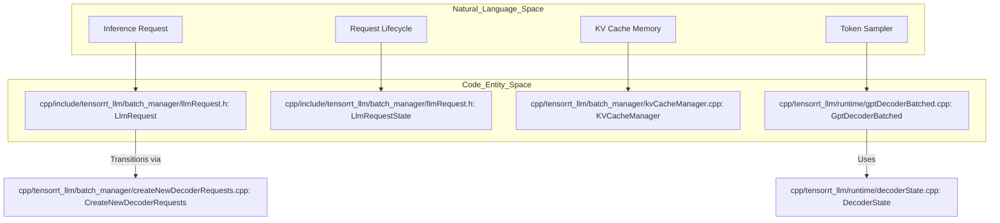
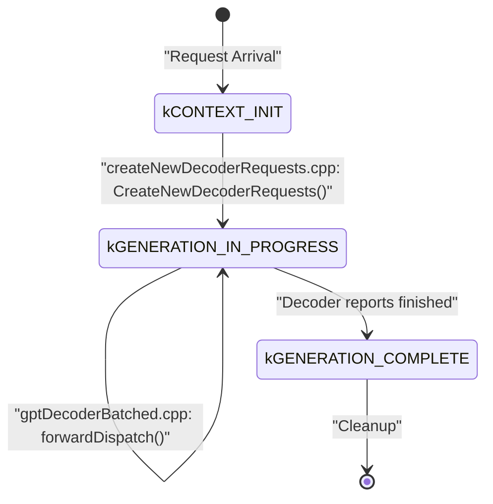
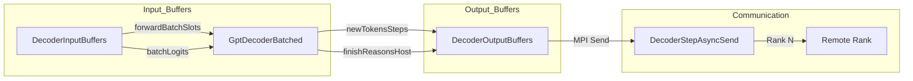

<!-- source: DeepWiki mcp.deepwiki.com · repo NVIDIA/TensorRT-LLM · page 20.1 Inflight Batching and Decoder · fetched 2026-10-26 -->

# Inflight Batching and Decoder

<details>
<summary>Relevant source files</summary>

The following files were used as context for generating this wiki page:

- [cpp/include/tensorrt_llm/batch_manager/createNewDecoderRequests.h](cpp/include/tensorrt_llm/batch_manager/createNewDecoderRequests.h)
- [cpp/include/tensorrt_llm/batch_manager/decoderBuffers.h](cpp/include/tensorrt_llm/batch_manager/decoderBuffers.h)
- [cpp/include/tensorrt_llm/batch_manager/kvCacheManager.h](cpp/include/tensorrt_llm/batch_manager/kvCacheManager.h)
- [cpp/include/tensorrt_llm/batch_manager/llmRequest.h](cpp/include/tensorrt_llm/batch_manager/llmRequest.h)
- [cpp/include/tensorrt_llm/executor/dataTransceiverState.h](cpp/include/tensorrt_llm/executor/dataTransceiverState.h)
- [cpp/include/tensorrt_llm/executor/executor.h](cpp/include/tensorrt_llm/executor/executor.h)
- [cpp/include/tensorrt_llm/runtime/decoderState.h](cpp/include/tensorrt_llm/runtime/decoderState.h)
- [cpp/include/tensorrt_llm/runtime/decodingInput.h](cpp/include/tensorrt_llm/runtime/decodingInput.h)
- [cpp/include/tensorrt_llm/runtime/decodingOutput.h](cpp/include/tensorrt_llm/runtime/decodingOutput.h)
- [cpp/include/tensorrt_llm/runtime/gptDecoder.h](cpp/include/tensorrt_llm/runtime/gptDecoder.h)
- [cpp/include/tensorrt_llm/runtime/gptDecoderBatched.h](cpp/include/tensorrt_llm/runtime/gptDecoderBatched.h)
- [cpp/include/tensorrt_llm/runtime/iGptDecoderBatched.h](cpp/include/tensorrt_llm/runtime/iGptDecoderBatched.h)
- [cpp/tensorrt_llm/batch_manager/createNewDecoderRequests.cpp](cpp/tensorrt_llm/batch_manager/createNewDecoderRequests.cpp)
- [cpp/tensorrt_llm/batch_manager/decoderBuffers.cpp](cpp/tensorrt_llm/batch_manager/decoderBuffers.cpp)
- [cpp/tensorrt_llm/batch_manager/kvCacheManager.cpp](cpp/tensorrt_llm/batch_manager/kvCacheManager.cpp)
- [cpp/tensorrt_llm/batch_manager/llmRequest.cpp](cpp/tensorrt_llm/batch_manager/llmRequest.cpp)
- [cpp/tensorrt_llm/executor/serialization.cpp](cpp/tensorrt_llm/executor/serialization.cpp)
- [cpp/tensorrt_llm/nanobind/batch_manager/bindings.cpp](cpp/tensorrt_llm/nanobind/batch_manager/bindings.cpp)
- [cpp/tensorrt_llm/nanobind/batch_manager/kvCacheManager.cpp](cpp/tensorrt_llm/nanobind/batch_manager/kvCacheManager.cpp)
- [cpp/tensorrt_llm/nanobind/executor/request.cpp](cpp/tensorrt_llm/nanobind/executor/request.cpp)
- [cpp/tensorrt_llm/runtime/decoderState.cpp](cpp/tensorrt_llm/runtime/decoderState.cpp)
- [cpp/tensorrt_llm/runtime/gptDecoder.cpp](cpp/tensorrt_llm/runtime/gptDecoder.cpp)
- [cpp/tensorrt_llm/runtime/gptDecoderBatched.cpp](cpp/tensorrt_llm/runtime/gptDecoderBatched.cpp)
- [cpp/tests/unit_tests/batch_manager/capacitySchedulerTest.cpp](cpp/tests/unit_tests/batch_manager/capacitySchedulerTest.cpp)
- [cpp/tests/unit_tests/batch_manager/kvCacheManagerTest.cpp](cpp/tests/unit_tests/batch_manager/kvCacheManagerTest.cpp)
- [cpp/tests/unit_tests/batch_manager/kvCacheUtilsTest.cpp](cpp/tests/unit_tests/batch_manager/kvCacheUtilsTest.cpp)
- [cpp/tests/unit_tests/executor/serializeUtilsTest.cpp](cpp/tests/unit_tests/executor/serializeUtilsTest.cpp)
- [tests/unittest/bindings/test_bindings_ut.py](tests/unittest/bindings/test_bindings_ut.py)
- [tests/unittest/bindings/test_executor_bindings.py](tests/unittest/bindings/test_executor_bindings.py)

</details>


This page documents the C++ implementation of the **Inflight Batching (IFB)** system and the **Decoder** pipeline in TensorRT-LLM. These components are responsible for dynamic request scheduling, resource allocation (KV cache), and the iterative token generation process.

## Overview

The C++ runtime manages LLM inference through the high-level batch management system, which orchestrates the lifecycle of multiple `LlmRequest` objects. Unlike static batching, inflight batching allows new requests to enter the batch (context phase) while others are still generating tokens (generation phase), maximizing GPU utilization.

### Key Components

| Class | Responsibility |
| :--- | :--- |
| `LlmRequest` | Encapsulates the state, configuration, and buffers for a single inference request. |
| `GptDecoderBatched` | Manages the decoding kernels (sampling, beam search) for a batch of requests. |
| `KVCacheManager` | Handles paged KV cache allocation, radix-tree based block reuse, and eviction policies. |
| `DecoderState` | Maintains the persistent state (ids, lengths, finish reasons) for requests across iterations. |
| `CreateNewDecoderRequests` | Logic to initialize and transition requests from context phase to generation phase. |

Sources: `[cpp/include/tensorrt_llm/batch_manager/llmRequest.h:78-83]()`, `[cpp/tensorrt_llm/runtime/gptDecoderBatched.cpp:40-44]()`, `[cpp/tensorrt_llm/runtime/decoderState.cpp:49-55]()`, `[cpp/tensorrt_llm/batch_manager/createNewDecoderRequests.cpp:133-138]()`

---

## Code Entity Architecture

The following diagram maps logical serving concepts to the specific C++ classes and files that implement them.

**Diagram: Serving Concept to Code Entity Mapping**

Sources: `[cpp/include/tensorrt_llm/batch_manager/llmRequest.h:49-76]()`, `[cpp/tensorrt_llm/runtime/gptDecoderBatched.cpp:17-44]()`, `[cpp/tensorrt_llm/runtime/decoderState.cpp:49-55]()`

---

## Inflight Batching Pipeline

The inflight batching system implements an execution loop that drives the LLM by managing requests across different phases.

### Request States
Requests transition through several states defined in `LlmRequestState` `[cpp/include/tensorrt_llm/batch_manager/llmRequest.h:49-76]()`:
*   `kCONTEXT_INIT`: The request is in the prompt processing phase.
*   `kGENERATION_IN_PROGRESS`: The request is iteratively generating new tokens.
*   `kDISAGG_GENERATION_TRANS_IN_PROGRESS`: Used in disaggregated serving for KV cache transmission `[cpp/include/tensorrt_llm/batch_manager/llmRequest.h:57-57]()`.
*   `kDISAGG_CONTEXT_COMPLETE`: Context phase and cache transmission finished `[cpp/include/tensorrt_llm/batch_manager/llmRequest.h:71-71]()`.

### Execution Flow
1.  **Scheduling**: The system determines which requests can fit into the current iteration based on KV cache availability. `KVCacheManager` manages these blocks via `RadixBlockTree` `[cpp/tensorrt_llm/batch_manager/kvCacheManager.cpp:18-24]()`.
2.  **Buffer Preparation**: `DecoderInputBuffers` are prepared to hold IDs, logits, and batch slots `[cpp/include/tensorrt_llm/batch_manager/decoderBuffers.h:36-83]()`.
3.  **Decoding**: `GptDecoderBatched` processes the logits to sample new tokens via `forwardAsync` `[cpp/tensorrt_llm/runtime/gptDecoderBatched.cpp:162-181]()`.
4.  **State Update**: `CreateNewDecoderRequests` updates the `DecoderState` (e.g., sequence lengths) for requests finishing their context phase `[cpp/tensorrt_llm/batch_manager/createNewDecoderRequests.cpp:148-150]()`.

**Diagram: Request State Transition and Code Flow**

Sources: `[cpp/include/tensorrt_llm/batch_manager/llmRequest.h:49-76]()`, `[cpp/tensorrt_llm/batch_manager/createNewDecoderRequests.cpp:133-164]()`, `[cpp/tensorrt_llm/runtime/gptDecoderBatched.cpp:144-160]()`

---

## Decoder Pipeline

The `GptDecoderBatched` class is a wrapper around `IGptDecoder` that handles the logic for sampling tokens from model outputs across a batch.

### Decoder Setup and State
The decoder maintains a `DecoderState` object which holds GPU tensors for:
*   `ids`: The sequence of generated token IDs `[cpp/tensorrt_llm/runtime/decoderState.cpp:85-85]()`.
*   `lengths`: The current length of each sequence `[cpp/tensorrt_llm/runtime/decoderState.cpp:91-91]()`.
*   `finishedSum`: A counter of how many sequences in the batch have hit a stop condition `[cpp/tensorrt_llm/runtime/decoderState.cpp:93-93]()`.
*   `finishReasons`: The reason for termination (e.g., EOS, length) `[cpp/tensorrt_llm/runtime/decoderState.cpp:98-100]()`.

The `DecoderState` is initialized and reshaped to accommodate the maximum batch size and beam width `[cpp/tensorrt_llm/runtime/decoderState.cpp:57-66]()`.

### Token Generation Steps
The `forwardDispatch` function iterates through `maxDecoderSteps` (used in speculative decoding) and calls the underlying decoder kernels:

```cpp
// [cpp/tensorrt_llm/runtime/gptDecoderBatched.cpp:144-160]
void GptDecoderBatched::forwardDispatch(decoder::DecoderState const& decoderState, tb::DecoderInputBuffers const& input)
{
    TLLM_LOG_TRACE("%s start", __PRETTY_FUNCTION__);

    for (SizeType32 step = 0; step < input.maxDecoderSteps; ++step)
    {
        BufferManager manager{mDecoderStream};
        prepareForward(decoderState, step, input, manager);

        if (decoderState.getJointDecodingInput().batchSize > 0)
        {
            mDecoder->forwardAsync(decoderState.getJointDecodingOutput(), decoderState.getJointDecodingInput());
        }
    }

    TLLM_LOG_TRACE("%s stop", __PRETTY_FUNCTION__);
}
```

### Speculative Decoding Support
`GptDecoderBatched` supports advanced decoding modes like Medusa, Eagle, and Lookahead. When speculative decoding is active, the `DecoderState` includes specialized buffers like `nextDraftTokens` and `medusaPaths` `[cpp/tensorrt_llm/runtime/decoderState.cpp:141-158]()`. The `setupSpeculativeDecoding` method allocates these specific tensors based on the `SpeculativeDecodingMode` `[cpp/tensorrt_llm/runtime/decoderState.cpp:117-126]()`.

Sources: `[cpp/tensorrt_llm/runtime/gptDecoderBatched.cpp:144-160]()`, `[cpp/tensorrt_llm/runtime/decoderState.cpp:83-100]()`, `[cpp/tensorrt_llm/runtime/gptDecoderBatched.cpp:77-101]()`, `[cpp/tensorrt_llm/runtime/decoderState.cpp:128-158]()`

---

## Batch Manager Utilities

### CreateNewDecoderRequests
This class handles the transition of a request from the **Context** phase to the **Generation** phase. It initializes sequence lengths in the decoder state once the prompt has been processed `[cpp/tensorrt_llm/batch_manager/createNewDecoderRequests.cpp:56-90]()`. It extracts `SamplingConfig` from `LlmRequest` to configure the decoder for the subsequent generation steps `[cpp/tensorrt_llm/batch_manager/createNewDecoderRequests.cpp:158-163]()`. It also handles `embeddingBias` casting if the input type does not match the model's logit type `[cpp/tensorrt_llm/batch_manager/createNewDecoderRequests.cpp:94-127]()`.

### Decoder Buffers and MPI Communication
`DecoderInputBuffers` encapsulate the tensors needed for a batch of requests, including `forwardBatchSlots` and `batchLogits` `[cpp/include/tensorrt_llm/batch_manager/decoderBuffers.h:36-83]()`. 

In multi-GPU setups, `DecoderStepAsyncSend` manages the asynchronous transfer of generated tokens and metadata between ranks using MPI `[cpp/include/tensorrt_llm/batch_manager/decoderBuffers.h:112-142]()`. It uses specific MPI tags like `kDecoderStepNewOutputTokensHost` to ensure correct message routing `[cpp/tensorrt_llm/batch_manager/decoderBuffers.cpp:133-134]()`.

**Diagram: Decoder Buffer Data Flow**

Sources: `[cpp/include/tensorrt_llm/batch_manager/decoderBuffers.h:36-142]()`, `[cpp/tensorrt_llm/batch_manager/decoderBuffers.cpp:126-158]()`, `[cpp/tensorrt_llm/runtime/gptDecoderBatched.cpp:144-160]()`

### KV Cache Management
`KVCacheManager` organizes memory into `KVCacheBlock` objects `[cpp/tensorrt_llm/batch_manager/kvCacheManager.cpp:124-140]()`. It supports:
*   **Radix Tree Reuse**: Shared prefixes are stored in `RadixBlockTree` to avoid redundant computation `[cpp/tensorrt_llm/batch_manager/kvCacheManager.cpp:24-24]()`.
*   **Paged Attention**: Blocks are indexed using `KVCacheIndex` `[cpp/tensorrt_llm/batch_manager/kvCacheManager.cpp:124-126]()`.
*   **Secondary Pools**: Support for offloading blocks to CPU or secondary memory pools `[cpp/include/tensorrt_llm/batch_manager/kvCacheManager.h:69-69]()`.

Sources: `[cpp/tensorrt_llm/batch_manager/kvCacheManager.cpp:124-189]()`, `[cpp/include/tensorrt_llm/batch_manager/kvCacheManager.h:54-139]()`

### Serialization and Bindings
The C++ entities are exposed to Python via `nanobind` bindings in `cpp/tensorrt_llm/nanobind/`.
*   `GenericLlmRequest` is bound to `GenericLlmRequest` in Python, providing access to tokens and sampling parameters `[cpp/tensorrt_llm/nanobind/batch_manager/bindings.cpp:100-158]()`.
*   `KVCacheManager` is bound to `BaseKVCacheManager` to allow Python-side control of memory pools `[cpp/tensorrt_llm/nanobind/batch_manager/kvCacheManager.cpp:69-114]()`.
*   `Serialization` class handles the conversion of metrics and states for IPC `[cpp/tensorrt_llm/executor/serialization.cpp:18-37]()`.

Sources: `[cpp/tensorrt_llm/nanobind/batch_manager/bindings.cpp:59-158]()`, `[cpp/tensorrt_llm/nanobind/batch_manager/kvCacheManager.cpp:69-213]()`, `[cpp/tensorrt_llm/executor/serialization.cpp:83-115]()`

---

