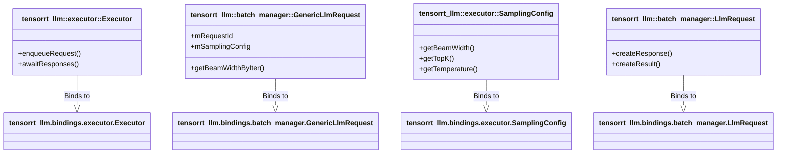

<!-- source: DeepWiki mcp.deepwiki.com · repo NVIDIA/TensorRT-LLM · page 20.2 C++ Executor and Python Bindings · fetched 2026-10-26 -->

# C++ Executor and Python Bindings

<details>
<summary>Relevant source files</summary>

The following files were used as context for generating this wiki page:

- [cpp/include/tensorrt_llm/batch_manager/kvCacheManager.h](cpp/include/tensorrt_llm/batch_manager/kvCacheManager.h)
- [cpp/include/tensorrt_llm/batch_manager/llmRequest.h](cpp/include/tensorrt_llm/batch_manager/llmRequest.h)
- [cpp/include/tensorrt_llm/executor/dataTransceiverState.h](cpp/include/tensorrt_llm/executor/dataTransceiverState.h)
- [cpp/include/tensorrt_llm/executor/executor.h](cpp/include/tensorrt_llm/executor/executor.h)
- [cpp/tensorrt_llm/batch_manager/kvCacheManager.cpp](cpp/tensorrt_llm/batch_manager/kvCacheManager.cpp)
- [cpp/tensorrt_llm/batch_manager/kv_cache_manager_v2/blockRadixTree.cpp](cpp/tensorrt_llm/batch_manager/kv_cache_manager_v2/blockRadixTree.cpp)
- [cpp/tensorrt_llm/batch_manager/kv_cache_manager_v2/blockRadixTree.h](cpp/tensorrt_llm/batch_manager/kv_cache_manager_v2/blockRadixTree.h)
- [cpp/tensorrt_llm/batch_manager/kv_cache_manager_v2/exceptions.h](cpp/tensorrt_llm/batch_manager/kv_cache_manager_v2/exceptions.h)
- [cpp/tensorrt_llm/batch_manager/kv_cache_manager_v2/kvCache.cpp](cpp/tensorrt_llm/batch_manager/kv_cache_manager_v2/kvCache.cpp)
- [cpp/tensorrt_llm/batch_manager/kv_cache_manager_v2/kvCache.h](cpp/tensorrt_llm/batch_manager/kv_cache_manager_v2/kvCache.h)
- [cpp/tensorrt_llm/batch_manager/kv_cache_manager_v2/kvCacheManager.cpp](cpp/tensorrt_llm/batch_manager/kv_cache_manager_v2/kvCacheManager.cpp)
- [cpp/tensorrt_llm/batch_manager/kv_cache_manager_v2/kvCacheManager.h](cpp/tensorrt_llm/batch_manager/kv_cache_manager_v2/kvCacheManager.h)
- [cpp/tensorrt_llm/batch_manager/kv_cache_manager_v2/storageManager.cpp](cpp/tensorrt_llm/batch_manager/kv_cache_manager_v2/storageManager.cpp)
- [cpp/tensorrt_llm/batch_manager/llmRequest.cpp](cpp/tensorrt_llm/batch_manager/llmRequest.cpp)
- [cpp/tensorrt_llm/executor/serialization.cpp](cpp/tensorrt_llm/executor/serialization.cpp)
- [cpp/tensorrt_llm/nanobind/batch_manager/bindings.cpp](cpp/tensorrt_llm/nanobind/batch_manager/bindings.cpp)
- [cpp/tensorrt_llm/nanobind/batch_manager/kvCacheManager.cpp](cpp/tensorrt_llm/nanobind/batch_manager/kvCacheManager.cpp)
- [cpp/tensorrt_llm/nanobind/batch_manager/kvCacheManagerV2.cpp](cpp/tensorrt_llm/nanobind/batch_manager/kvCacheManagerV2.cpp)
- [cpp/tensorrt_llm/nanobind/executor/request.cpp](cpp/tensorrt_llm/nanobind/executor/request.cpp)
- [cpp/tests/unit_tests/batch_manager/capacitySchedulerTest.cpp](cpp/tests/unit_tests/batch_manager/capacitySchedulerTest.cpp)
- [cpp/tests/unit_tests/batch_manager/kvCacheManagerTest.cpp](cpp/tests/unit_tests/batch_manager/kvCacheManagerTest.cpp)
- [cpp/tests/unit_tests/batch_manager/kvCacheUtilsTest.cpp](cpp/tests/unit_tests/batch_manager/kvCacheUtilsTest.cpp)
- [cpp/tests/unit_tests/executor/serializeUtilsTest.cpp](cpp/tests/unit_tests/executor/serializeUtilsTest.cpp)
- [tests/unittest/bindings/test_bindings_ut.py](tests/unittest/bindings/test_bindings_ut.py)
- [tests/unittest/bindings/test_executor_bindings.py](tests/unittest/bindings/test_executor_bindings.py)
- [tests/unittest/kv_cache_manager_v2_tests/test_kv_cache_stats_life_cycles.py](tests/unittest/kv_cache_manager_v2_tests/test_kv_cache_stats_life_cycles.py)
- [tests/unittest/kv_cache_manager_v2_tests/test_nvbug_6625710.py](tests/unittest/kv_cache_manager_v2_tests/test_nvbug_6625710.py)

</details>


The C++ Executor API is the primary interface for high-performance inference in TensorRT-LLM. It abstracts the complexities of batch management, KV cache allocation, and multi-GPU orchestration. This system is exposed to Python through a high-performance binding layer using `nanobind`, allowing the `LLM` class and other Python utilities to leverage the C++ runtime with minimal overhead.

## Architecture Overview

The C++ Executor system follows a client-server architecture where the `Executor` class acts as the entry point for enqueuing requests and retrieving responses. Internally, it manages an implementation that handles the heavy lifting of scheduling and model execution.

### Data Flow Diagram

The following diagram illustrates the flow of a request from the Python space into the C++ Executor core and back.

**Request and Response Lifecycle**
```mermaid
graph TD
    subgraph "Python_Space"
        ["tensorrt_llm.hlapi.llm.Request"] -- "nanobind" --> ["tensorrt_llm::executor::Request"]
        ["tensorrt_llm::executor::Response"] -- "nanobind" --> ["tensorrt_llm.hlapi.llm.Response"]
    end

    subgraph "C++_Executor_Space"
        ["tensorrt_llm::executor::Request"] -- "enqueue_request()" --> ["tensorrt_llm::executor::Executor"]
        ["tensorrt_llm::executor::Executor"] -- "mImpl" --> ["tensorrt_llm::executor::ExecutorImpl"]
        ["tensorrt_llm::executor::ExecutorImpl"] -- "forwardAsync()" --> ["tensorrt_llm::batch_manager::TrtGptModelInflightBatching"]
        ["tensorrt_llm::batch_manager::TrtGptModelInflightBatching"] -- "Token Generated" --> ["Response Queue"]
        ["Response Queue"] -- "await_responses()" --> ["tensorrt_llm::executor::Executor"]
        ["tensorrt_llm::executor::Executor"] -- "Response Object" --> ["tensorrt_llm::executor::Response"]
    end

    subgraph "Hardware_Runtime"
        ["tensorrt_llm::batch_manager::TrtGptModelInflightBatching"] -- "forwardSync()" --> ["tensorrt_llm::runtime::GptDecoderBatched"]
        ["tensorrt_llm::runtime::GptDecoderBatched"] -- "CUDA Kernels" --> ["NVIDIA GPU"]
    end
```
Sources: [cpp/include/tensorrt_llm/executor/executor.h:47-170](), [tests/unittest/bindings/test_executor_bindings.py:117-155]()

## The LlmRequest and Sampling Configuration

The fundamental unit of work in the executor is the `Request`. This class tracks the state, tokens, and configurations for a single inference task.

### Key Components of Request
*   **Token Management**: Stores input tokens and manages output tokens through the `Response` interface. The `GenericLlmRequest` class handles `VecTokens` and `BeamTokens` for both input and generated output [cpp/include/tensorrt_llm/batch_manager/llmRequest.h:102-113]().
*   **Sampling Configuration**: The `SamplingConfig` class controls top-k, top-p, temperature, and penalties. It includes parameters such as `beamWidth`, `topK`, `topP`, `temperature`, and `repetitionPenalty` [cpp/include/tensorrt_llm/executor/executor.h:63-128]().
*   **Performance Metrics**: `RequestPerfMetrics` tracks timing for arrival, scheduling, first token, and KV cache transfers using `TimePoint` structures [cpp/tensorrt_llm/executor/serialization.cpp:83-114]().
*   **State Tracking**: Requests transition through states such as `kCONTEXT_INIT`, `kGENERATION_IN_PROGRESS`, and `kGENERATION_COMPLETE`. Disaggregated serving adds states like `kDISAGG_GENERATION_TRANS_IN_PROGRESS` and `kDISAGG_CONTEXT_WAIT_SCHEDULER` [cpp/include/tensorrt_llm/batch_manager/llmRequest.h:49-76]().

### Request Types
The system supports primary request types defined in `LlmRequestType` [cpp/include/tensorrt_llm/batch_manager/llmRequest.h:78-83]():
1.  `LLMREQUEST_TYPE_CONTEXT_AND_GENERATION`: Standard end-to-end inference.
2.  `LLMREQUEST_TYPE_CONTEXT_ONLY`: Prefill phase only (used in disaggregated serving).
3.  `LLMREQUEST_TYPE_GENERATION_ONLY`: Decoding phase only (resumes from a transferred KV cache).

Sources: [cpp/include/tensorrt_llm/executor/executor.h:60-128](), [cpp/tensorrt_llm/executor/serialization.cpp:65-114](), [cpp/include/tensorrt_llm/batch_manager/llmRequest.h:49-113](), [cpp/tensorrt_llm/nanobind/batch_manager/bindings.cpp:85-89]()

## KV Cache Manager Implementation

The `KVCacheManager` handles the allocation and mapping of KV cache blocks. It utilizes a `BlockManager` to track free and used blocks across primary (GPU) and secondary (Host/UVM) memory pools [cpp/tensorrt_llm/batch_manager/kvCacheManager.cpp:18-54]().

### Key Features
*   **Radix Block Tree**: Implements prefix caching by storing KV blocks in a `RadixBlockTree` structure, allowing for efficient reuse of common prefixes [cpp/tensorrt_llm/batch_manager/kvCacheManager.cpp:24]().
*   **Placeholder Blocks**: Supports placeholder blocks via `KVCacheBlock::createPlaceholder()` for disaggregated serving where KV cache might be resident on a different node, preventing GPU memory allocation until needed [cpp/tensorrt_llm/batch_manager/kvCacheManager.cpp:142-159]().
*   **Cache Layout Description**: The `CacheState` class describes the data structure for cache layout, used to infer location associations between different processes to determine suitable senders and receivers [cpp/include/tensorrt_llm/executor/dataTransceiverState.h:42-128]().
*   **Parallelism Awareness**: `CacheState` tracks `ParallelConfig` including tensor, pipeline, and context parallelism ranks [cpp/include/tensorrt_llm/executor/dataTransceiverState.h:144-152]().
*   **Advanced Attention Support**: Includes specific configurations for Multi-head Latent Attention (MLA) and indexer-based K-cache (e.g., for DeepSeek models) [cpp/include/tensorrt_llm/executor/dataTransceiverState.h:47-52](), [cpp/include/tensorrt_llm/executor/dataTransceiverState.h:68-72]().
*   **Linear Attention Support**: The `LinearAttentionMetadata` structure manages states for RNN/SSM models (like Mamba) including `rnnDState`, `rnnDConv`, and `rnnNGroups` [cpp/include/tensorrt_llm/batch_manager/kvCacheManager.h:148-175]().

Sources: [cpp/tensorrt_llm/batch_manager/kvCacheManager.cpp:18-159](), [cpp/include/tensorrt_llm/batch_manager/kvCacheManager.h:148-175](), [cpp/include/tensorrt_llm/executor/dataTransceiverState.h:42-152]()

## Python Bindings (nanobind)

TensorRT-LLM uses `nanobind` to create efficient mappings between C++ and Python. The bindings allow direct interaction with the C++ Executor and KV Cache structures.

### Binding Mapping: Code to Python
The following diagram maps C++ classes to their exposed Python counterparts.

**Entity Mapping Diagram**

Sources: [cpp/tensorrt_llm/nanobind/batch_manager/bindings.cpp:100-158](), [cpp/tensorrt_llm/nanobind/executor/request.cpp:112-132](), [cpp/include/tensorrt_llm/batch_manager/llmRequest.h:122-145]()

### Implementation Details
*   **Serialization**: The `Serialization` class provides binary serialization for `SamplingConfig`, `RequestPerfMetrics`, and `IterationStats` to support IPC and state transfer [cpp/tensorrt_llm/executor/serialization.cpp:65-160](). It handles complex structures like `MultimodalInput` extensions and `RequestPerfMetrics` timing [cpp/tensorrt_llm/executor/serialization.cpp:45-114]().
*   **Token Access**: `GenericLlmRequest` provides specialized methods like `get_tokens_view` using `nb::ndarray` for zero-copy read-only access to token buffers, and `get_tokens_range` for efficient slicing [cpp/tensorrt_llm/nanobind/batch_manager/bindings.cpp:109-148]().
*   **Torch Integration**: Bindings utilize `tensorrt_llm/runtime/torch.h` and `tensorrt_llm/runtime/torchView.h` to facilitate data sharing between PyTorch and the C++ runtime [cpp/tensorrt_llm/nanobind/batch_manager/bindings.cpp:31-32]().
*   **Exception Handling**: Custom exception translators bridge C++ errors like `LoraCacheFullException` and `PeftTaskNotCachedException` to Python [cpp/tensorrt_llm/nanobind/batch_manager/bindings.cpp:60-84]().
*   **KV Cache V2**: A new `kvCacheManagerV2` provides a more flexible page-based storage system with `IKvCacheColdPageCodec` for encoding/decoding cache pages to host memory [cpp/tensorrt_llm/nanobind/batch_manager/kvCacheManagerV2.cpp:69-157]().

Sources: [cpp/tensorrt_llm/executor/serialization.cpp:45-160](), [cpp/tensorrt_llm/nanobind/batch_manager/bindings.cpp:60-158](), [cpp/tensorrt_llm/nanobind/executor/request.cpp:58-132](), [cpp/tensorrt_llm/nanobind/batch_manager/kvCacheManagerV2.cpp:69-157](), [tests/unittest/bindings/test_executor_bindings.py:118-173]()

---

