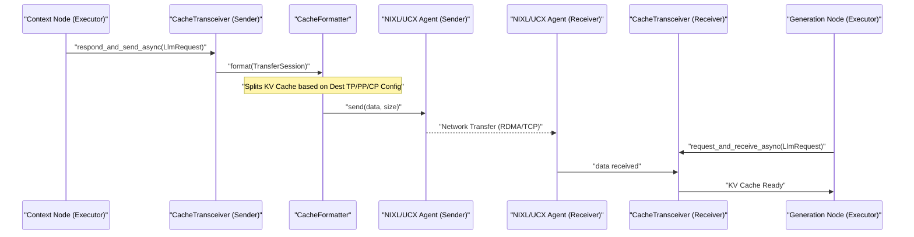
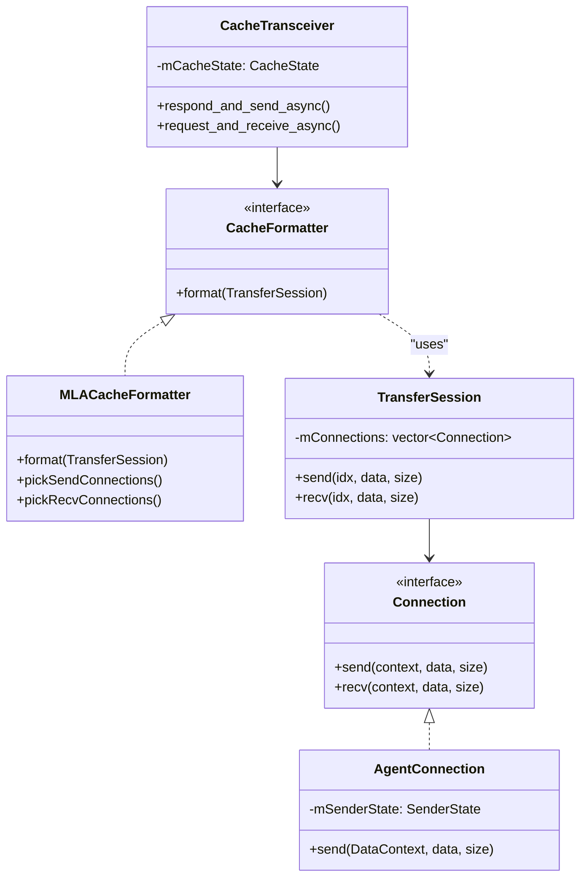

<!-- source: DeepWiki mcp.deepwiki.com · repo NVIDIA/TensorRT-LLM · page 20.3 KV Cache Transfer and Disaggregated Cache · fetched 2026-10-26 -->

# KV Cache Transfer and Disaggregated Cache

Relevant source files

The following files were used as context for generating this wiki page:

- [cpp/include/tensorrt_llm/batch_manager/cacheTransceiver.h](cpp/include/tensorrt_llm/batch_manager/cacheTransceiver.h)
- [cpp/include/tensorrt_llm/executor/transferAgent.h](cpp/include/tensorrt_llm/executor/transferAgent.h)
- [cpp/tensorrt_llm/batch_manager/cacheFormatter.cpp](cpp/tensorrt_llm/batch_manager/cacheFormatter.cpp)
- [cpp/tensorrt_llm/batch_manager/cacheFormatter.h](cpp/tensorrt_llm/batch_manager/cacheFormatter.h)
- [cpp/tensorrt_llm/batch_manager/cacheTransceiver.cpp](cpp/tensorrt_llm/batch_manager/cacheTransceiver.cpp)
- [cpp/tensorrt_llm/batch_manager/dataTransceiver.cpp](cpp/tensorrt_llm/batch_manager/dataTransceiver.cpp)
- [cpp/tensorrt_llm/batch_manager/dataTransceiver.h](cpp/tensorrt_llm/batch_manager/dataTransceiver.h)
- [cpp/tensorrt_llm/batch_manager/mlaCacheFormatter.cpp](cpp/tensorrt_llm/batch_manager/mlaCacheFormatter.cpp)
- [cpp/tensorrt_llm/batch_manager/mlaCacheFormatter.h](cpp/tensorrt_llm/batch_manager/mlaCacheFormatter.h)
- [cpp/tensorrt_llm/common/envUtils.cpp](cpp/tensorrt_llm/common/envUtils.cpp)
- [cpp/tensorrt_llm/common/envUtils.h](cpp/tensorrt_llm/common/envUtils.h)
- [cpp/tensorrt_llm/executor/CMakeLists.txt](cpp/tensorrt_llm/executor/CMakeLists.txt)
- [cpp/tensorrt_llm/executor/cache_transmission/agent_utils/connection.cpp](cpp/tensorrt_llm/executor/cache_transmission/agent_utils/connection.cpp)
- [cpp/tensorrt_llm/executor/cache_transmission/agent_utils/connection.h](cpp/tensorrt_llm/executor/cache_transmission/agent_utils/connection.h)
- [cpp/tensorrt_llm/executor/cache_transmission/cacheSplitConcat.cu](cpp/tensorrt_llm/executor/cache_transmission/cacheSplitConcat.cu)
- [cpp/tensorrt_llm/executor/cache_transmission/cacheSplitConcat.h](cpp/tensorrt_llm/executor/cache_transmission/cacheSplitConcat.h)
- [cpp/tensorrt_llm/executor/cache_transmission/mooncake_utils/CMakeLists.txt](cpp/tensorrt_llm/executor/cache_transmission/mooncake_utils/CMakeLists.txt)
- [cpp/tensorrt_llm/executor/cache_transmission/mooncake_utils/transferAgent.cpp](cpp/tensorrt_llm/executor/cache_transmission/mooncake_utils/transferAgent.cpp)
- [cpp/tensorrt_llm/executor/cache_transmission/mooncake_utils/transferAgent.h](cpp/tensorrt_llm/executor/cache_transmission/mooncake_utils/transferAgent.h)
- [cpp/tensorrt_llm/executor/cache_transmission/nixl_utils/CMakeLists.txt](cpp/tensorrt_llm/executor/cache_transmission/nixl_utils/CMakeLists.txt)
- [cpp/tensorrt_llm/executor/cache_transmission/nixl_utils/agentBindings.cpp](cpp/tensorrt_llm/executor/cache_transmission/nixl_utils/agentBindings.cpp)
- [cpp/tensorrt_llm/executor/cache_transmission/nixl_utils/transferAgent.cpp](cpp/tensorrt_llm/executor/cache_transmission/nixl_utils/transferAgent.cpp)
- [cpp/tensorrt_llm/executor/cache_transmission/nixl_utils/transferAgent.h](cpp/tensorrt_llm/executor/cache_transmission/nixl_utils/transferAgent.h)
- [cpp/tensorrt_llm/executor/cache_transmission/transferAgent.cpp](cpp/tensorrt_llm/executor/cache_transmission/transferAgent.cpp)
- [cpp/tensorrt_llm/nanobind/batch_manager/cacheTransceiver.cpp](cpp/tensorrt_llm/nanobind/batch_manager/cacheTransceiver.cpp)
- [cpp/tests/unit_tests/executor/CMakeLists.txt](cpp/tests/unit_tests/executor/CMakeLists.txt)
- [cpp/tests/unit_tests/executor/genUniqueAgentNameTest.cpp](cpp/tests/unit_tests/executor/genUniqueAgentNameTest.cpp)
- [cpp/tests/unit_tests/executor/transferAgentTest.cpp](cpp/tests/unit_tests/executor/transferAgentTest.cpp)
- [cpp/tests/unit_tests/multi_gpu/cacheTransceiverTest.cpp](cpp/tests/unit_tests/multi_gpu/cacheTransceiverTest.cpp)
- [tensorrt_llm/_torch/disaggregation/base/agent.py](tensorrt_llm/_torch/disaggregation/base/agent.py)
- [tensorrt_llm/_torch/disaggregation/base/transfer.py](tensorrt_llm/_torch/disaggregation/base/transfer.py)
- [tensorrt_llm/_torch/disaggregation/native/auxiliary.py](tensorrt_llm/_torch/disaggregation/native/auxiliary.py)
- [tensorrt_llm/_torch/disaggregation/native/bounce/impl.py](tensorrt_llm/_torch/disaggregation/native/bounce/impl.py)
- [tensorrt_llm/_torch/disaggregation/native/mixers/attention/peer.py](tensorrt_llm/_torch/disaggregation/native/mixers/attention/peer.py)
- [tensorrt_llm/_torch/disaggregation/native/mixers/ssm/peer.py](tensorrt_llm/_torch/disaggregation/native/mixers/ssm/peer.py)
- [tensorrt_llm/_torch/disaggregation/native/peer.py](tensorrt_llm/_torch/disaggregation/native/peer.py)
- [tensorrt_llm/_torch/disaggregation/native/transfer.py](tensorrt_llm/_torch/disaggregation/native/transfer.py)
- [tensorrt_llm/_torch/disaggregation/resource/cache_reuse.py](tensorrt_llm/_torch/disaggregation/resource/cache_reuse.py)
- [tensorrt_llm/_torch/disaggregation/resource/kv_extractor.py](tensorrt_llm/_torch/disaggregation/resource/kv_extractor.py)
- [tensorrt_llm/_torch/disaggregation/resource/page.py](tensorrt_llm/_torch/disaggregation/resource/page.py)
- [tensorrt_llm/_torch/disaggregation/resource/utils.py](tensorrt_llm/_torch/disaggregation/resource/utils.py)
- [tensorrt_llm/_torch/disaggregation/transceiver.py](tensorrt_llm/_torch/disaggregation/transceiver.py)
- [tensorrt_llm/_torch/pyexecutor/kv_cache_transceiver.py](tensorrt_llm/_torch/pyexecutor/kv_cache_transceiver.py)
- [tests/unittest/bindings/test_transfer_agent_bindings.py](tests/unittest/bindings/test_transfer_agent_bindings.py)
- [tests/unittest/disaggregated/test_bounce.py](tests/unittest/disaggregated/test_bounce.py)
- [tests/unittest/disaggregated/test_cache_reuse_adapter.py](tests/unittest/disaggregated/test_cache_reuse_adapter.py)
- [tests/unittest/disaggregated/test_cache_transceiver_single_process.py](tests/unittest/disaggregated/test_cache_transceiver_single_process.py)
- [tests/unittest/disaggregated/test_extractor.py](tests/unittest/disaggregated/test_extractor.py)
- [tests/unittest/disaggregated/test_kda_mamba_transfer.py](tests/unittest/disaggregated/test_kda_mamba_transfer.py)
- [tests/unittest/disaggregated/test_kv_transfer.py](tests/unittest/disaggregated/test_kv_transfer.py)
- [tests/unittest/disaggregated/test_kv_transfer_mp.py](tests/unittest/disaggregated/test_kv_transfer_mp.py)
- [tests/unittest/disaggregated/test_mamba_transfer.py](tests/unittest/disaggregated/test_mamba_transfer.py)
- [tests/unittest/disaggregated/test_peer.py](tests/unittest/disaggregated/test_peer.py)
- [tests/unittest/disaggregated/test_py_cache_transceiver_mp.py](tests/unittest/disaggregated/test_py_cache_transceiver_mp.py)
- [tests/unittest/others/test_kv_cache_transceiver.py](tests/unittest/others/test_kv_cache_transceiver.py)

This page documents the KV cache transfer mechanisms in TensorRT-LLM, which enable disaggregated serving by decoupling context processing (prefill) from generation (decoding). This architecture allows KV cache data to be transferred across different GPU nodes or clusters using specialized high-performance agents.

## Overview

In a disaggregated serving architecture, a **Context Node** processes the initial prompt and generates the KV cache, which is then transferred to a **Generation Node** for token production. TensorRT-LLM facilitates this through a pluggable transceiver system supporting multiple backends, including NIXL, UCX, Mooncake, and MPI [cpp/tensorrt_llm/batch_manager/cacheTransceiver.cpp:107-119]().

### Key Components
*   **CacheTransceiver**: The high-level orchestrator that manages the lifecycle of KV cache transfers. It exists in both C++ and Python implementations [cpp/tensorrt_llm/batch_manager/cacheTransceiver.cpp:37-45]() [tensorrt_llm/_torch/pyexecutor/kv_cache_transceiver.py:23-26]().
*   **CacheFormatter**: Handles the splitting and redistribution of KV cache tensors to match different parallelism configurations (TP/PP/CP) between sender and receiver [cpp/tensorrt_llm/batch_manager/cacheFormatter.cpp:48-58]().
*   **TransferSession**: Encapsulates the state of a single request's transfer, including timing metrics, connection handles, and request metadata [cpp/tensorrt_llm/batch_manager/dataTransceiver.cpp:47-125]().
*   **Data Agents (NIXL/UCX/Mooncake)**: Low-level communication libraries that perform the actual data movement over the network using RDMA or optimized TCP [cpp/tensorrt_llm/batch_manager/cacheTransceiver.cpp:23-34]().
*   **ContextTransferCoordinator**: Manages consensus for transfer outcomes (completion, failure, timeout) across distributed ranks [cpp/tensorrt_llm/batch_manager/cacheTransceiver.cpp:136-156]() [cpp/tests/unit_tests/multi_gpu/cacheTransceiverTest.cpp:96-107]().
*   **KVCacheTransferManager**: Manages local block copies, including offloading to DRAM/CPU or onloading to GPU using pitched copies for layer-first layouts [cpp/tensorrt_llm/batch_manager/kvCacheTransferManager.cpp:107-153]().

**Sources:** [cpp/tensorrt_llm/batch_manager/cacheTransceiver.cpp:107-156](), [tensorrt_llm/_torch/pyexecutor/kv_cache_transceiver.py:23-26](), [cpp/tensorrt_llm/batch_manager/cacheFormatter.cpp:48-58](), [cpp/tensorrt_llm/batch_manager/dataTransceiver.cpp:47-125](), [cpp/tests/unit_tests/multi_gpu/cacheTransceiverTest.cpp:96-107](), [cpp/tensorrt_llm/batch_manager/kvCacheTransferManager.cpp:107-153]()

---

## Architecture and Data Flow

The transfer process involves several layers of abstraction to handle tensor sharding and network communication. TensorRT-LLM overlaps the KV cache transmission with computation for multiple independent requests to optimize performance.

### KV Cache Transfer Sequence
The following diagram illustrates the interaction between the `CacheTransceiver`, the `CacheFormatter`, and the underlying communication agents.

**Title: Disaggregated KV Cache Transfer Flow**

**Sources:** [cpp/tensorrt_llm/batch_manager/cacheTransceiver.cpp:121-160](), [cpp/tensorrt_llm/batch_manager/mlaCacheFormatter.cpp:125-152](), [cpp/tensorrt_llm/batch_manager/dataTransceiver.cpp:77-111]()

---

## Implementation Details

### CacheTransceiver
The `CacheTransceiver` is initialized via `create_kv_cache_transceiver` in Python or its C++ factory equivalent. It determines the backend (NIXL, UCX, Mooncake, or MPI) based on configuration or environment variables [tensorrt_llm/_torch/pyexecutor/kv_cache_transceiver.py:114-150]().

*   **Initialization**: It sets up `CacheState` for both the local node and the remote peer, accounting for differences in `tensor_parallelism`, `pipeline_parallelism`, and `context_parallelism` [cpp/tests/unit_tests/multi_gpu/cacheTransceiverTest.cpp:151-179]().
*   **Backend Selection**: Priority is given to `CacheTransceiverConfig.backend`. If not set, it falls back to environment variables like `TRTLLM_USE_NIXL_KVCACHE` or `TRTLLM_USE_UCX_KVCACHE` [tensorrt_llm/_torch/pyexecutor/kv_cache_transceiver.py:142-150]().
*   **Consensus Mechanism**: For distributed ranks, `CacheTransceiver` uses a consensus logic to ensure all ranks agree on the completion or failure of a transfer session via `gatherPackedTransferStates` [cpp/tensorrt_llm/batch_manager/cacheTransceiver.cpp:198-210]().
*   **In-flight Cancellation**: An experimental feature `TRTLLM_DISAGG_ENABLE_INFLIGHT_CANCEL` allows cancelling transfers that are already in progress, currently supported for the C++ runtime with NIXL/UCX backends [tensorrt_llm/_torch/pyexecutor/kv_cache_transceiver.py:37-48]().

### CacheFormatter and Parallelism Mapping
Because the Context and Generation nodes may have different parallelism strategies (e.g., Context Node uses TP=8, Generation Node uses TP=2), the `CacheFormatter` must redistribute KV cache blocks.

*   **Target Rank Calculation**: `computeBufferIdx` decomposes a local index into (CP, TP, PP) ranks to find the correct buffer slice for a specific connection, accounting for `mPeerDupHeadFactor` [cpp/tensorrt_llm/batch_manager/cacheFormatter.cpp:48-58]().
*   **MLA Support**: `MLACacheFormatter` provides specialized logic for Multi-Head Latent Attention (MLA). It handles specialized pools like the `IndexerKCachePool` and calculates connections via `pickSendConnections` and `pickRecvConnections` [cpp/tensorrt_llm/batch_manager/mlaCacheFormatter.cpp:42-85]() [cpp/tensorrt_llm/batch_manager/mlaCacheFormatter.cpp:159-162]().
*   **Parallel Send**: `sendAllBuffers` can parallelize the transmission of multiple cache shards if `getEnvEnableReceiveKVCacheParallel()` is enabled, using `std::future` to manage concurrency [cpp/tensorrt_llm/batch_manager/cacheFormatter.cpp:126-153]().

**Title: Code Entity Mapping for Cache Formatting**

**Sources:** [cpp/tensorrt_llm/batch_manager/cacheTransceiver.cpp:121-160](), [cpp/tensorrt_llm/batch_manager/dataTransceiver.cpp:47-108](), [cpp/tensorrt_llm/batch_manager/mlaCacheFormatter.cpp:40-83](), [cpp/tensorrt_llm/executor/cache_transmission/agent_utils/connection.cpp:115-125]()

---

## Disaggregated Cache in Python Runtime

The Python `kv_cache_transceiver.py` module provides the entry point for creating transceivers in the PyExecutor runtime [tensorrt_llm/_torch/pyexecutor/kv_cache_transceiver.py:114-150]().

*   **Initialization**: `create_kv_cache_transceiver` checks `cache_transceiver_config.transceiver_runtime`. If set to `"PYTHON"`, it initializes `KvCacheTransceiverV2` and supports specialized managers like `MixedMambaHybridCacheManager` [tensorrt_llm/_torch/pyexecutor/kv_cache_transceiver.py:134-138]() [tensorrt_llm/_torch/disaggregation/transceiver.py:76-83]().
*   **Mixed Mamba Hybrid**: The Python transceiver runtime is mandatory when using `MixedMambaHybridCacheManager` in disaggregated serving [tensorrt_llm/_torch/pyexecutor/kv_cache_transceiver.py:134-138]().
*   **TransferWorker**: The `KvCacheTransceiverV2` utilizes a `TransferWorker` to manage per-rank native NIXL/UCX initialization and KV memory registration [tensorrt_llm/_torch/disaggregation/transceiver.py:117-133]().
*   **Fabric Memory**: The system can automatically enable fabric memory for the C++ KV pool when using the Python transceiver to optimize cross-node access [tensorrt_llm/_torch/pyexecutor/kv_cache_transceiver.py:38-65]().

### UCX and NIXL Agent Management
For backends like UCX and NIXL, the system manages worker addresses and endpoints across nodes.
*   **AgentConnection**: Manages metadata exchange for NIXL/UCX, including memory descriptors (`MemoryDesc`) which contain addresses, lengths, and device IDs [cpp/tensorrt_llm/executor/cache_transmission/agent_utils/connection.cpp:142-164]().
*   **Unique Agent Naming**: Agents are assigned unique names incorporating the hostname, PID, and a random suffix to disambiguate instances across containers [cpp/tensorrt_llm/executor/cache_transmission/agent_utils/connection.cpp:30-47]().
*   **RecvReqInfo**: In the native Python transfer implementation, `RecvReqInfo` encapsulates request metadata including `block_ids_per_layer_groups` and `unique_rid` for communication between context and generation instances [tensorrt_llm/_torch/disaggregation/native/transfer.py:96-136]().

**Sources:** [tensorrt_llm/_torch/pyexecutor/kv_cache_transceiver.py:38-150](), [tensorrt_llm/_torch/disaggregation/transceiver.py:76-133](), [cpp/tensorrt_llm/executor/cache_transmission/agent_utils/connection.cpp:30-164](), [tensorrt_llm/_torch/disaggregation/native/transfer.py:96-136]()

---

## Local Block Management (Offloading)

The `KVCacheTransferManager` handles local data movement between GPU and host (DRAM) or between primary and secondary pools.

*   **Layer-First Layout Support**: For models with layer-first layouts, data is non-contiguous across layers. The manager uses `cudaMemcpy2DAsync` to copy per-block slices across all layers in a single pitched operation [cpp/tensorrt_llm/batch_manager/kvCacheTransferManager.cpp:128-153]().
*   **POSIX Fallback**: If standard CUDA copies fail, the manager includes POSIX-based fallbacks `gpuToFilePosix` and `fileToGpuPosix` for writing/reading GPU memory to/from files [cpp/tensorrt_llm/batch_manager/kvCacheTransferManager.cpp:39-77]().
*   **Loopback Agent**: Supports loopback transfers via `BaseLoopbackAgent` for internal node testing and management [cpp/tensorrt_llm/batch_manager/kvCacheTransferManager.cpp:79-85]().

**Sources:** [cpp/tensorrt_llm/batch_manager/kvCacheTransferManager.cpp:39-153]()

---

## Environment Configuration

Key environment variables for tuning KV cache transfer defined in `envUtils.cpp` and `envUtils.h`:

| Variable | Description |
| :--- | :--- |
| `TRTLLM_USE_NIXL_KVCACHE` | Enables NIXL backend for KV cache transfer [cpp/tensorrt_llm/common/envUtils.h:92]() |
| `TRTLLM_USE_UCX_KVCACHE` | Enables UCX backend for KV cache transfer [cpp/tensorrt_llm/common/envUtils.h:88]() |
| `TRTLLM_ENABLE_RECEIVE_KVCACHE_PARALLEL` | Enables parallel receiving of KV cache shards [cpp/tensorrt_llm/common/envUtils.h:112]() |
| `TRTLLM_KV_CACHE_TRANSFER_USE_ASYNC_BUFFER` | Uses asynchronous buffers for transfer optimization [cpp/tensorrt_llm/common/envUtils.h:142]() |
| `TRTLLM_KV_CACHE_TIME_OUTPUT_PATH` | Path to export transfer timing CSVs [cpp/tensorrt_llm/common/envUtils.h:114]() |
| `TRTLLM_DISAGG_ENABLE_INFLIGHT_CANCEL` | Opt-in for in-flight cancellation of KV transfers [tensorrt_llm/_torch/pyexecutor/kv_cache_transceiver.py:28]() |
| `TRTLLM_DISAGG_LAYERWISE` | Enables layer-wise transfer mode [tensorrt_llm/_torch/pyexecutor/kv_cache_transceiver.py:31]() |
| `TRTLLM_MEM_SIZE_FOR_KV_CACHE_TRANSFER_BUFFER` | Configures memory size for the transfer buffer [cpp/tensorrt_llm/common/envUtils.h:149]() |
| `TRTLLM_KVCACHE_POOL_USE_FABRIC_MEMORY` | Defaults KV pool to fabric memory for Python transceiver [tensorrt_llm/_torch/pyexecutor/kv_cache_transceiver.py:33]() |

**Sources:** [cpp/tensorrt_llm/common/envUtils.h:83-163](), [tensorrt_llm/_torch/pyexecutor/kv_cache_transceiver.py:28-33]()

---

## Metrics and Telemetry

The `TransferSession` tracks performance metrics for every transfer. These can be exported to a CSV file for analysis using `exportMeasure` [cpp/tensorrt_llm/batch_manager/dataTransceiver.cpp:186-234]().

*   **Timing Points**: Tracks `kTimePreparation`, `kTimePreprocess`, `kTimeTransmissions`, and `kTimePostprocess` phases [cpp/tensorrt_llm/batch_manager/dataTransceiver.cpp:127-133]().
*   **Bandwidth Calculation**: Bandwidth is calculated in Gbps using the formula: `(size * 8.0) / duration_ms / 1e6` [cpp/tensorrt_llm/batch_manager/dataTransceiver.cpp:227-228]().
*   **Output Format**: The CSV header includes `RequestID`, `RequestInfo`, `Preparation`, `Preprocess`, `Transmissions`, `Postprocess`, and per-transmission `Delay`, `Duration`, and `Bandwidth` [cpp/tensorrt_llm/batch_manager/dataTransceiver.cpp:196-202]().
*   **PerfLogger**: The Python implementation uses `perf_log_manager` and `PerfTimer` to capture high-resolution timing for native transfer operations [tensorrt_llm/_torch/disaggregation/native/transfer.py:65]().

**Sources:** [cpp/tensorrt_llm/batch_manager/dataTransceiver.cpp:127-234](), [tensorrt_llm/_torch/disaggregation/native/transfer.py:65]()

---

