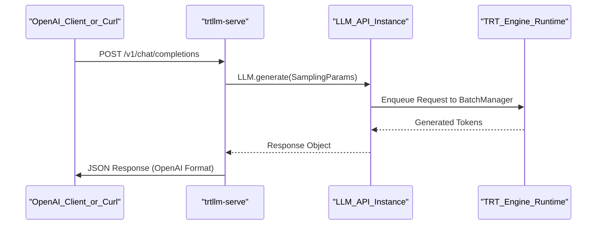

<!-- source: DeepWiki mcp.deepwiki.com · repo NVIDIA/TensorRT-LLM · page 21 Triton Inference Server Backend · fetched 2026-10-26 -->

# Triton Inference Server Backend

<details>
<summary>Relevant source files</summary>

The following files were used as context for generating this wiki page:

- [docker/Dockerfile.user](docker/Dockerfile.user)
- [docker/develop.md](docker/develop.md)
- [docker/release.md](docker/release.md)
- [docs/requirements.txt](docs/requirements.txt)
- [docs/source/_static/custom.css](docs/source/_static/custom.css)
- [docs/source/_static/switcher.json](docs/source/_static/switcher.json)
- [docs/source/commands/trtllm-serve/run-benchmark-with-trtllm-serve.md](docs/source/commands/trtllm-serve/run-benchmark-with-trtllm-serve.md)
- [docs/source/conf.py](docs/source/conf.py)
- [docs/source/deployment-guide/deployment-guide-for-deepseek-r1-on-trtllm.md](docs/source/deployment-guide/deployment-guide-for-deepseek-r1-on-trtllm.md)
- [docs/source/deployment-guide/deployment-guide-for-glm-5-on-trtllm.md](docs/source/deployment-guide/deployment-guide-for-glm-5-on-trtllm.md)
- [docs/source/deployment-guide/deployment-guide-for-gpt-oss-on-trtllm.md](docs/source/deployment-guide/deployment-guide-for-gpt-oss-on-trtllm.md)
- [docs/source/deployment-guide/deployment-guide-for-llama3.3-70b-on-trtllm.md](docs/source/deployment-guide/deployment-guide-for-llama3.3-70b-on-trtllm.md)
- [docs/source/deployment-guide/deployment-guide-for-llama4-scout-on-trtllm.md](docs/source/deployment-guide/deployment-guide-for-llama4-scout-on-trtllm.md)
- [docs/source/helper.py](docs/source/helper.py)
- [docs/source/index.rst](docs/source/index.rst)
- [docs/source/installation/containers.md](docs/source/installation/containers.md)
- [docs/source/quick-start-guide.md](docs/source/quick-start-guide.md)
- [examples/llm-api/llm_mgmn_llm_distributed.sh](examples/llm-api/llm_mgmn_llm_distributed.sh)
- [examples/llm-api/llm_mgmn_trtllm_bench.sh](examples/llm-api/llm_mgmn_trtllm_bench.sh)
- [examples/llm-api/llm_mgmn_trtllm_serve.sh](examples/llm-api/llm_mgmn_trtllm_serve.sh)
- [scripts/cuda_driver_stub.py](scripts/cuda_driver_stub.py)

</details>


The Triton Inference Server integration for TensorRT-LLM provides a robust, production-ready serving solution. It supports both a high-performance C++ backend for In-flight Batching and a flexible Python-based backend that leverages the `llmapi`. This integration allows users to serve TensorRT-LLM engines with features like streaming, decoupled responses, and complex model ensembles (preprocessing, inference, and postprocessing).

## System Architecture and Code Mapping

The following diagram illustrates how Triton Server concepts map to specific code entities within the `triton_backend` directory and the core C++ runtime.

### Triton-to-Code Entity Map
```mermaid
graph TD
    subgraph "Triton_Server_Space"
        [tritonserver_binary]
        [Model_Repository_all_models/]
        [config.pbtxt]
    end

    subgraph "Code_Entity_Space"
        [launch_triton_server.py]
        [inflight_batcher_llm_CPP]
        [TritonPythonModel_model.py]
        [tensorrt_llm.llmapi]
        [LlmRequest_CPP]
        [trtllm-serve]
    end

    [launch_triton_server.py] -- "spawns" --> [tritonserver_binary]
    [tritonserver_binary] -- "loads" --> [Model_Repository_all_models/]
    [Model_Repository_all_models/] -- "defines" --> [config.pbtxt]
    [config.pbtxt] -- "specifies" --> [inflight_batcher_llm_CPP]
    [config.pbtxt] -- "specifies" --> [TritonPythonModel_model.py]
    [TritonPythonModel_model.py] -- "uses" --> [tensorrt_llm.llmapi]
    [inflight_batcher_llm_CPP] -- "manages" --> [LlmRequest_CPP]
    [trtllm-serve] -- "launches_OpenAI_API" --> [tensorrt_llm.llmapi]
```
**Sources:** `docs/source/quick-start-guide.md:13-20`, `docs/source/commands/trtllm-serve/run-benchmark-with-trtllm-serve.md:3-10`

## Triton Backend Architecture

TensorRT-LLM provides two primary backend implementations within Triton:

1.  **C++ In-flight Batcher (`inflight_batcher_llm`)**: A high-performance C++ implementation designed for maximum throughput and low latency. It interacts directly with the C++ `BatchManager` and supports advanced scheduling policies.
2.  **Python LLM API Backend**: A `python` backend implementation located in `all_models/llmapi`. This backend leverages the `LLM` class and the unified `llmapi` to handle model loading, optimization, and inference [docs/source/quick-start-guide.md:90-95]().

The deployment of these backends is often orchestrated via the `trtllm-serve` command, which provides an OpenAI-compatible API [docs/source/quick-start-guide.md:13-15](). For multi-GPU and multi-node setups, the `trtllm-llmapi-launch` script is used to manage MPI processes [docs/source/commands/trtllm-serve/run-benchmark-with-trtllm-serve.md:63-66]().

For details, see [Triton Backend Architecture](#21.1).

**Sources:** `docs/source/quick-start-guide.md:13-20`, `docs/source/quick-start-guide.md:90-95`, `docs/source/commands/trtllm-serve/run-benchmark-with-trtllm-serve.md:63-66`

## Model Configurations and Tools

The Triton integration supports a wide variety of model architectures and precision modes. For instance, the GPT-OSS model is supported with `MXFP4` weights using the `TRTLLM` backend on Blackwell hardware [docs/source/deployment-guide/deployment-guide-for-gpt-oss-on-trtllm.md:22-31](). DeepSeek R1 models are similarly supported with specific backend selections like `CUTLASS`, `DEEPGEMM`, or `CUTEDSL` depending on the hardware (Hopper vs. Blackwell) and quantization type [docs/source/deployment-guide/deployment-guide-for-deepseek-r1-on-trtllm.md:23-35]().

### Request Flow and Data Structures

**Sources:** `docs/source/quick-start-guide.md:42-53`, `docs/source/quick-start-guide.md:90-95`

Benchmarking tools like `benchmark_serving.py` are used to measure key metrics such as Time to First Token (TTFT), Time Per Output Token (TPOT), and Inter-token Latency (ITL) [docs/source/commands/trtllm-serve/run-benchmark-with-trtllm-serve.md:152-160]().

For details, see [Triton Model Configurations and Tools](#21.2).

**Sources:** `docs/source/commands/trtllm-serve/run-benchmark-with-trtllm-serve.md:152-176`, `docs/source/deployment-guide/deployment-guide-for-deepseek-r1-on-trtllm.md:23-35`

## Key Configuration Parameters

Serving behavior is controlled via YAML configuration files or CLI flags. These parameters influence memory allocation, batching strategy, and parallelism.

| Parameter | Description |
| :--- | :--- |
| `tensor_parallel_size` | Number of GPUs used for a single model instance [docs/source/deployment-guide/deployment-guide-for-gpt-oss-on-trtllm.md:127-130](). |
| `kv_cache_free_gpu_memory_fraction` | Fraction of GPU memory reserved for KV cache (default often ~0.9) [docs/source/deployment-guide/deployment-guide-for-gpt-oss-on-trtllm.md:135-138](). |
| `max_batch_size` | Maximum number of requests grouped in a single batch [docs/source/deployment-guide/deployment-guide-for-gpt-oss-on-trtllm.md:140-142](). |
| `moe_expert_parallel_size` | Expert-parallel size for MoE models [docs/source/deployment-guide/deployment-guide-for-gpt-oss-on-trtllm.md:131-133](). |
| `enable_attention_dp` | Enables Attention Data Parallelism for long sequences [docs/source/commands/trtllm-serve/run-benchmark-with-trtllm-serve.md:43-44](). |

**Sources:** `docs/source/deployment-guide/deployment-guide-for-gpt-oss-on-trtllm.md:121-150`, `docs/source/commands/trtllm-serve/run-benchmark-with-trtllm-serve.md:43-51`

## Deployment and Slurm Integration

TensorRT-LLM provides specialized scripts for deploying Triton-based serving on Slurm clusters. The `llm_mgmn_trtllm_serve.sh` script demonstrates how to launch `trtllm-serve` across multiple nodes using `srun` and the `trtllm-llmapi-launch` utility [examples/llm-api/llm_mgmn_trtllm_serve.sh:87-92](). This allows for scaling models that require high tensor parallelism (e.g., `tp_size 16`) across multiple GPU nodes [examples/llm-api/llm_mgmn_trtllm_serve.sh:55-57]().

For development and benchmarking, the `trtllm-bench` tool can also be launched via Slurm to evaluate throughput using the `pytorch` or `tensorrt` backends [examples/llm-api/llm_mgmn_trtllm_bench.sh:120-130]().

**Sources:** `examples/llm-api/llm_mgmn_trtllm_serve.sh:51-92`, `examples/llm-api/llm_mgmn_trtllm_bench.sh:119-130`

---

