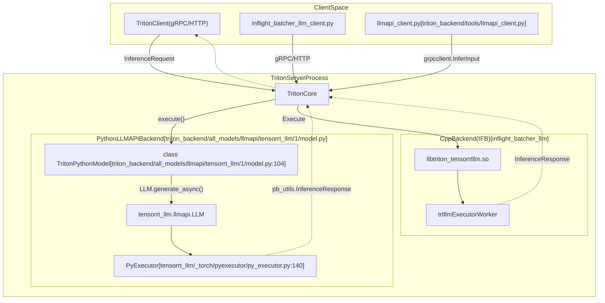
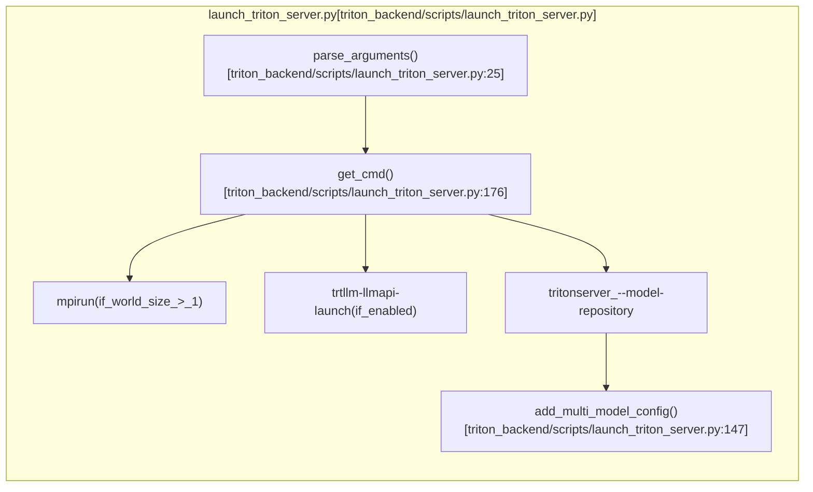
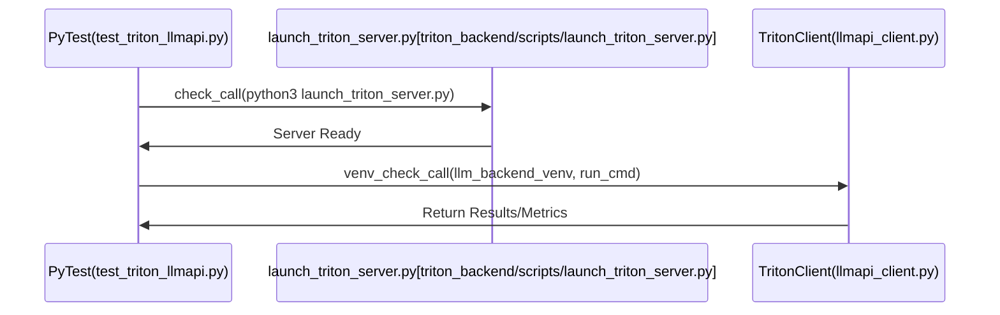

<!-- source: DeepWiki mcp.deepwiki.com · repo NVIDIA/TensorRT-LLM · page 21.1 Triton Backend Architecture · fetched 2026-10-26 -->

# Triton Backend Architecture

Relevant source files

The following files were used as context for generating this wiki page:

- [docker/Dockerfile.user](docker/Dockerfile.user)
- [docker/develop.md](docker/develop.md)
- [docker/release.md](docker/release.md)
- [docs/requirements.txt](docs/requirements.txt)
- [docs/source/_static/custom.css](docs/source/_static/custom.css)
- [docs/source/_static/switcher.json](docs/source/_static/switcher.json)
- [docs/source/commands/trtllm-serve/run-benchmark-with-trtllm-serve.md](docs/source/commands/trtllm-serve/run-benchmark-with-trtllm-serve.md)
- [docs/source/conf.py](docs/source/conf.py)
- [docs/source/deployment-guide/deployment-guide-for-deepseek-r1-on-trtllm.md](docs/source/deployment-guide/deployment-guide-for-deepseek-r1-on-trtllm.md)
- [docs/source/deployment-guide/deployment-guide-for-glm-5-on-trtllm.md](docs/source/deployment-guide/deployment-guide-for-glm-5-on-trtllm.md)
- [docs/source/deployment-guide/deployment-guide-for-gpt-oss-on-trtllm.md](docs/source/deployment-guide/deployment-guide-for-gpt-oss-on-trtllm.md)
- [docs/source/deployment-guide/deployment-guide-for-llama3.3-70b-on-trtllm.md](docs/source/deployment-guide/deployment-guide-for-llama3.3-70b-on-trtllm.md)
- [docs/source/deployment-guide/deployment-guide-for-llama4-scout-on-trtllm.md](docs/source/deployment-guide/deployment-guide-for-llama4-scout-on-trtllm.md)
- [docs/source/helper.py](docs/source/helper.py)
- [docs/source/index.rst](docs/source/index.rst)
- [docs/source/installation/containers.md](docs/source/installation/containers.md)
- [docs/source/quick-start-guide.md](docs/source/quick-start-guide.md)
- [examples/llm-api/llm_mgmn_llm_distributed.sh](examples/llm-api/llm_mgmn_llm_distributed.sh)
- [examples/llm-api/llm_mgmn_trtllm_bench.sh](examples/llm-api/llm_mgmn_trtllm_bench.sh)
- [examples/llm-api/llm_mgmn_trtllm_serve.sh](examples/llm-api/llm_mgmn_trtllm_serve.sh)
- [scripts/cuda_driver_stub.py](scripts/cuda_driver_stub.py)
- [tensorrt_llm/_torch/pyexecutor/_util.py](tensorrt_llm/_torch/pyexecutor/_util.py)
- [tensorrt_llm/_torch/pyexecutor/llm_request.py](tensorrt_llm/_torch/pyexecutor/llm_request.py)
- [tensorrt_llm/_torch/pyexecutor/model_engine.py](tensorrt_llm/_torch/pyexecutor/model_engine.py)
- [tensorrt_llm/_torch/pyexecutor/py_executor.py](tensorrt_llm/_torch/pyexecutor/py_executor.py)
- [tensorrt_llm/_torch/pyexecutor/py_executor_creator.py](tensorrt_llm/_torch/pyexecutor/py_executor_creator.py)
- [tensorrt_llm/_torch/pyexecutor/resource_manager.py](tensorrt_llm/_torch/pyexecutor/resource_manager.py)
- [tensorrt_llm/commands/serve.py](tensorrt_llm/commands/serve.py)
- [tensorrt_llm/llmapi/llm_args.py](tensorrt_llm/llmapi/llm_args.py)
- [tests/unittest/_torch/executor/test_benchmark_disagg.py](tests/unittest/_torch/executor/test_benchmark_disagg.py)
- [tests/unittest/_torch/executor/test_disagg_fill_gate_stall_bound.py](tests/unittest/_torch/executor/test_disagg_fill_gate_stall_bound.py)
- [tests/unittest/_torch/executor/test_py_executor.py](tests/unittest/_torch/executor/test_py_executor.py)
- [tests/unittest/_torch/executor/test_seq_slot_sizing.py](tests/unittest/_torch/executor/test_seq_slot_sizing.py)
- [tests/unittest/api_stability/references/llm.yaml](tests/unittest/api_stability/references/llm.yaml)
- [tests/unittest/api_stability/references/trtllm_serve_cli.yaml](tests/unittest/api_stability/references/trtllm_serve_cli.yaml)
- [tests/unittest/llmapi/test_llm_args.py](tests/unittest/llmapi/test_llm_args.py)

The TensorRT-LLM Triton integration provides a high-performance serving solution by wrapping the TensorRT-LLM C++ runtime and the Python LLM API (LLMAPI) within the Triton Inference Server framework. This architecture supports advanced features like In-flight Batching (IFB), decoupled streaming responses, and multi-instance GPU deployments.

## Architecture Overview

The integration consists of two primary backend implementations:
1.  **`inflight_batcher_llm`**: A C++ backend designed for maximum performance, directly interfacing with the C++ `Executor` and `BatchManager`. It is built as a shared library `libtriton_tensorrtllm.so` and uses `trtllmExecutorWorker` for request processing.
2.  **Python LLMAPI Backend**: A `model.py` implementation that utilizes the `tensorrt_llm.llmapi` to provide a simplified, high-level interface within Triton's Python backend `[triton_backend/all_models/llmapi/tensorrt_llm/1/model.py:48-52]()`.

### System Data Flow

The following diagram illustrates the request flow from a Triton client through the various backend components, mapping system names to specific code entities.

**Triton Request Lifecycle and Code Entities**

Sources: `[triton_backend/all_models/llmapi/tensorrt_llm/1/model.py:104-132]()`, `[triton_backend/scripts/launch_triton_server.py:201-220]()`, `[triton_backend/tools/llmapi_client.py:39-73]()`, `[tensorrt_llm/_torch/pyexecutor/py_executor.py:140-151]()`

---

## Python LLMAPI Backend (`model.py`)

The Python backend for LLMAPI is implemented in `triton_backend/all_models/llmapi/tensorrt_llm/1/model.py`. It serves as a bridge between Triton's `InferenceRequest` objects and the TensorRT-LLM `LLM` class.

### Key Classes and Functions
-   **`TritonPythonModel`**: The main entry point for Triton. It handles initialization and request execution `[triton_backend/all_models/llmapi/tensorrt_llm/1/model.py:104]()`.
-   **`initialize`**: Loads the `model.yaml` configuration and initializes the `LLM` instance. It handles multi-instance logic by partitioning GPUs based on `gpu_device_ids`. It defers `tensorrt_llm` imports to this stage to ensure CUDA is not initialized before a potential fork `[triton_backend/all_models/llmapi/tensorrt_llm/1/model.py:48-52]()`, `[triton_backend/all_models/llmapi/tensorrt_llm/1/model.py:132-180]()`.
-   **`execute`**: Processes a batch of `InferenceRequest` objects. It extracts sampling parameters using `get_sampling_params_from_request` and calls the asynchronous generation engine `[triton_backend/all_models/llmapi/tensorrt_llm/1/model.py:228-270]()`.

### Request Handling Logic
The backend supports both synchronous and decoupled (streaming) modes. In decoupled mode, it uses a `response_sender` to push tokens back to the client as they are generated `[triton_backend/all_models/llmapi/tensorrt_llm/1/model.py:147-148]()`.

| Component | Responsibility |
| :--- | :--- |
| `helpers.py` | Extracts `SamplingParams` (temperature, top_k, etc.) and `LoRARequest` from Triton tensors `[triton_backend/all_models/llmapi/tensorrt_llm/1/helpers.py:63-93]()`, `[triton_backend/all_models/llmapi/tensorrt_llm/1/helpers.py:130-170]()`. |
| `RequestData` | A dataclass tracking the mapping between Triton request IDs and LLMAPI response iterators `[triton_backend/all_models/llmapi/tensorrt_llm/1/model.py:54-60]()`. |
| `auto_complete_config` | Dynamically updates Triton's `config.pbtxt` with values from `model.yaml` at runtime `[triton_backend/all_models/llmapi/tensorrt_llm/1/model.py:106-130]()`. |
| `get_model_config` | Parses the YAML configuration file to load engine and triton arguments `[triton_backend/all_models/llmapi/tensorrt_llm/1/model.py:62-85]()`. |

Sources: `[triton_backend/all_models/llmapi/tensorrt_llm/1/model.py:54-270]()`, `[triton_backend/all_models/llmapi/tensorrt_llm/1/helpers.py:63-170]()`

---

## Triton Model Configuration (`config.pbtxt`)

Triton models are defined by a `config.pbtxt` file which specifies inputs, outputs, and backend types. For TensorRT-LLM, these configurations are often nested in an ensemble or BLS (Business Logic Scripting) setup.

### Input/Output Tensors
The `llmapi` variant of the configuration defines specific tensors to control generation:
-   **Inputs**: `text_input` (string), `streaming` (bool), and various `sampling_param_*` tensors (e.g., `sampling_param_max_tokens`, `sampling_param_temperature`, `sampling_param_stop`) `[triton_backend/all_models/llmapi/tensorrt_llm/config.pbtxt:48-126]()`.
-   **LoRA Inputs**: Supports `lora_id`, `lora_name`, `lora_path`, and `lora_ckpt_source` for dynamic adapter loading `[triton_backend/all_models/llmapi/tensorrt_llm/config.pbtxt:161-184]()`.
-   **Outputs**: `text_output`, `finish_reason`, `stop_reason`, and performance metrics like `kv_cache_hit_rate`, `arrival_time_ns`, and `acceptance_rate` `[triton_backend/all_models/llmapi/tensorrt_llm/config.pbtxt:189-270]()`.

### Multi-Instance Deployment
Multi-instance mode allows running multiple model instances on different subsets of GPUs within a single Triton process.
-   **`gpu_device_ids`**: A string parameter (e.g., `"0,1;2,3"`) where each semicolon-separated group assigns GPUs to a specific model instance. The code extracts the instance index from the instance name (e.g., `tensorrt_llm_0`) using regex to select the correct GPU group `[triton_backend/all_models/llmapi/tensorrt_llm/1/model.py:159-175]()`.

Sources: `[triton_backend/all_models/llmapi/tensorrt_llm/config.pbtxt:48-270]()`, `[triton_backend/all_models/llmapi/tensorrt_llm/1/model.py:152-175]()`

---

## Server Launch Script (`launch_triton_server.py`)

The `launch_triton_server.py` script simplifies the orchestration of Triton, especially for distributed (Multi-GPU) configurations using MPI.

### Key Features
-   **MPI Integration**: Automatically wraps the `tritonserver` command with `mpirun` if `world_size > 1` `[triton_backend/scripts/launch_triton_server.py:196-203]()`.
-   **Port Management**: Configures gRPC (`8001`), HTTP (`8000`), and Metrics (`8002`) ports `[triton_backend/scripts/launch_triton_server.py:166-173]()`.
-   **LLMAPI Launch**: Supports the `trtllm-llmapi-launch` wrapper for specialized LLM API environments `[triton_backend/scripts/launch_triton_server.py:204-205]()`.
-   **Multi-Model Support**: Allows loading multiple TRT-LLM models and handles CUDA memory pool allocation for multi-model configurations `[triton_backend/scripts/launch_triton_server.py:147-156]()`.

### Command Generation Logic
The script builds the execution command based on hardware availability and user arguments.

**Command Orchestration Flow**

Sources: `[triton_backend/scripts/launch_triton_server.py:25-128]()`, `[triton_backend/scripts/launch_triton_server.py:176-220]()`, `[triton_backend/scripts/launch_triton_server.py:147-156]()`

---

## PyExecutor and Resource Management

In the LLMAPI backend, the `PyExecutor` handles the actual model execution and scheduling.

### Key Components
- **`PyExecutor`**: Orchestrates the main event loop, request scheduling, and model engine forward passes `[tensorrt_llm/_torch/pyexecutor/py_executor.py:140-151]()`.
- **`ResourceManager`**: Manages KV cache allocation and other runtime resources `[tensorrt_llm/_torch/pyexecutor/resource_manager.py:99-106]()`.
- **`ModelEngine`**: Executes the model forward pass, potentially using CUDA graphs for optimization `[tensorrt_llm/_torch/pyexecutor/model_engine.py:84-89]()`.

**PyExecutor Internal Data Flow**

```mermaid
graph TD
    subgraph "PyExecutor[tensorrt_llm/_torch/pyexecutor/py_executor.py]"
        Q["ExecutorRequestQueue[tensorrt_llm/_torch/pyexecutor/executor_request_queue.py]"]
        S["RequestScheduler[tensorrt_llm/_torch/pyexecutor/scheduler.py]"]
        RM["ResourceManager[tensorrt_llm/_torch/pyexecutor/resource_manager.py]"]
        ME["ModelEngine[tensorrt_llm/_torch/pyexecutor/model_engine.py]"]
        SA["Sampler[tensorrt_llm/_torch/pyexecutor/sampler.py]"]
    end

    Q -->|"New Requests"| S
    S -->|"Admit Requests"| RM
    RM -->|"Allocated Slots"| ME
    ME -->|"Logits"| SA
    SA -->|"Tokens"| Q
```

Sources: `[tensorrt_llm/_torch/pyexecutor/py_executor.py:71-102]()`, `[tensorrt_llm/_torch/pyexecutor/model_engine.py:84-105]()`, `[tensorrt_llm/_torch/pyexecutor/resource_manager.py:143-164]()`

---

## Integration Testing Infrastructure

Testing of the Triton backend is performed via `pytest` and specialized clients.

### Test Matrix
Integration tests cover various batching strategies and features:
-   **Backend Testing**: Specific tests exist for the `llmapi` backend, verifying features like LoRA and multi-instance deployment `[tests/integration/test_lists/qa/llm_triton_integration.txt:1-6]()`.
-   **Speculative Decoding**: Specialized testing scripts like `speculative_decoding_test.py` handle two-model configurations (draft and target) by orchestrating requests across different model URLs `[triton_backend/tools/inflight_batcher_llm/speculative_decoding_test.py:52-98]()`.

### Test Environment
The test infrastructure utilizes a `PythonVenvRunnerImpl` to manage isolated environments for Triton backend testing `[tests/integration/defs/triton_server/conftest.py:114-122]()`.

**Test Execution Sequence**

Sources: `[tests/integration/defs/triton_server/conftest.py:114-122]()`, `[triton_backend/tools/llmapi_client.py:102-214]()`, `[tests/integration/test_lists/qa/llm_triton_integration.txt:1-6]()`

---

