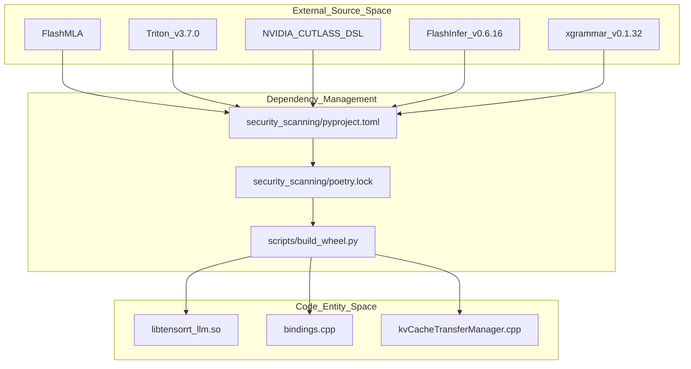
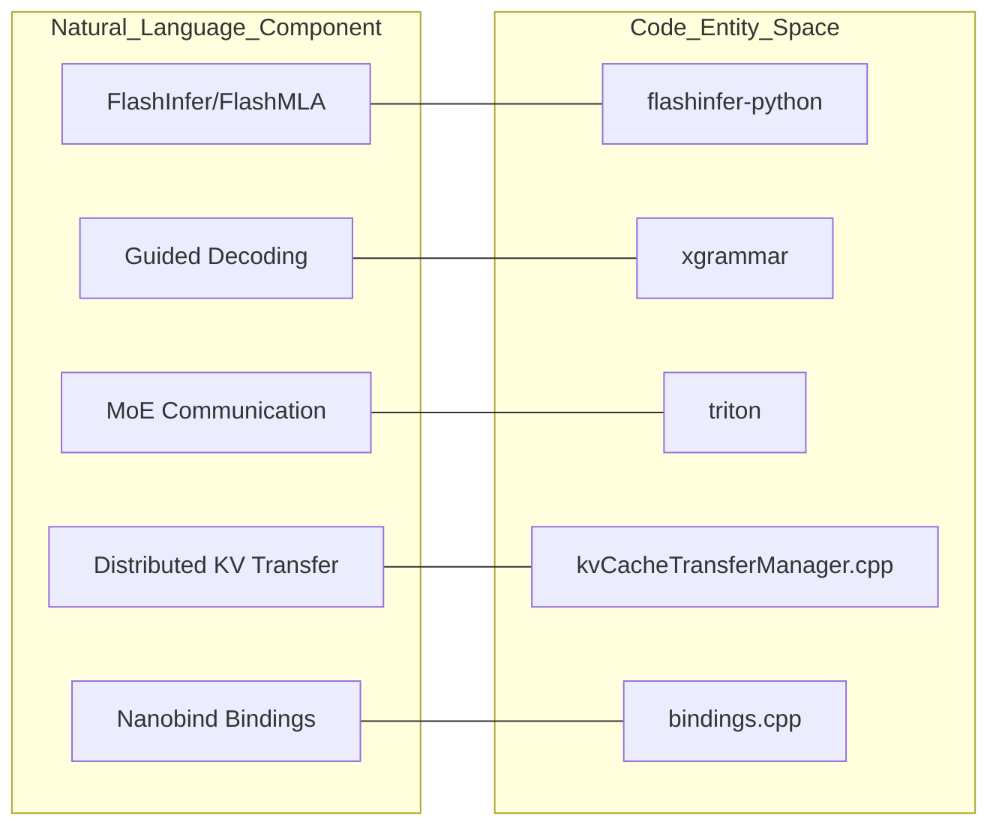

<!-- source: DeepWiki mcp.deepwiki.com · repo NVIDIA/TensorRT-LLM · page 22 Vendored Libraries and Third-Party Kernels · fetched 2026-10-26 -->

# Vendored Libraries and Third-Party Kernels

Relevant source files

The following files were used as context for generating this wiki page:

- [.gitignore](.gitignore)
- [cpp/CMakeLists.txt](cpp/CMakeLists.txt)
- [cpp/include/tensorrt_llm/batch_manager/kvCacheTransferManager.h](cpp/include/tensorrt_llm/batch_manager/kvCacheTransferManager.h)
- [cpp/tensorrt_llm/CMakeLists.txt](cpp/tensorrt_llm/CMakeLists.txt)
- [cpp/tensorrt_llm/batch_manager/CMakeLists.txt](cpp/tensorrt_llm/batch_manager/CMakeLists.txt)
- [cpp/tensorrt_llm/batch_manager/kvCacheTransferManager.cpp](cpp/tensorrt_llm/batch_manager/kvCacheTransferManager.cpp)
- [cpp/tensorrt_llm/executor/kvCacheRetentionConfig.cpp](cpp/tensorrt_llm/executor/kvCacheRetentionConfig.cpp)
- [cpp/tensorrt_llm/nanobind/CMakeLists.txt](cpp/tensorrt_llm/nanobind/CMakeLists.txt)
- [cpp/tensorrt_llm/nanobind/bindings.cpp](cpp/tensorrt_llm/nanobind/bindings.cpp)
- [cpp/tests/unit_tests/batch_manager/CMakeLists.txt](cpp/tests/unit_tests/batch_manager/CMakeLists.txt)
- [cpp/tests/unit_tests/batch_manager/kvCacheManagerV2SlotAllocatorTest.cpp](cpp/tests/unit_tests/batch_manager/kvCacheManagerV2SlotAllocatorTest.cpp)
- [docs/source/installation/build-from-source.md](docs/source/installation/build-from-source.md)
- [scripts/build_wheel.py](scripts/build_wheel.py)
- [security_scanning/examples/apps/poetry.lock](security_scanning/examples/apps/poetry.lock)
- [security_scanning/examples/auto_deploy/poetry.lock](security_scanning/examples/auto_deploy/poetry.lock)
- [security_scanning/examples/models/contrib/hyperclovax/poetry.lock](security_scanning/examples/models/contrib/hyperclovax/poetry.lock)
- [security_scanning/examples/ngram/poetry.lock](security_scanning/examples/ngram/poetry.lock)
- [security_scanning/examples/quantization/poetry.lock](security_scanning/examples/quantization/poetry.lock)
- [security_scanning/examples/ray_orchestrator/poetry.lock](security_scanning/examples/ray_orchestrator/poetry.lock)
- [security_scanning/examples/trtllm-eval/poetry.lock](security_scanning/examples/trtllm-eval/poetry.lock)
- [security_scanning/metadata.json](security_scanning/metadata.json)
- [security_scanning/poetry.lock](security_scanning/poetry.lock)
- [security_scanning/pyproject.toml](security_scanning/pyproject.toml)
- [security_scanning/triton_backend/poetry.lock](security_scanning/triton_backend/poetry.lock)
- [setup.py](setup.py)
- [tests/integration/test_lists/qa/llm_perf_disagg.yml](tests/integration/test_lists/qa/llm_perf_disagg.yml)
- [tests/integration/test_lists/qa/llm_perf_multinode.txt](tests/integration/test_lists/qa/llm_perf_multinode.txt)
- [tests/unittest/scripts/test_build_wheel_copy_back.py](tests/unittest/scripts/test_build_wheel_copy_back.py)

TensorRT-LLM integrates several third-party libraries and kernels to provide high-performance implementations of specific operations, such as Mixture of Experts (MoE), specialized attention mechanisms, and automated developer tools. These components are "vendored" into the codebase to ensure version stability, allow for local optimizations, and simplify the build process across different environments.

The project manages these dependencies through a combination of Git submodules, `FetchContent` in CMake, and dedicated vendoring directories. This page provides a high-level overview of these external integrations and links to detailed documentation for each.

## Triton Kernels (Vendored)

TensorRT-LLM vendors a specific version of the `triton_kernels` library to leverage OpenAI Triton's high-level language for GPU programming. This integration allows the engine to execute complex kernels for MatMul, MoE routing, TopK selection, and various tensor utilities without requiring manual CUDA C++ implementation for every variant.

The project tracks Triton version `3.7.0` as specified in the primary dependency configuration `[security_scanning/pyproject.toml:68-68]()`. These kernels are integrated into the Python-based `_torch` and `auto_deploy` systems to provide optimized paths for sharding and quantization. In the MoE subsystem, Triton is one of the supported backends for fused operations.

For details, see [Triton Kernels (Vendored)](#22.1).

**Sources:**
- `[security_scanning/pyproject.toml:68-68]()` (Specification of `triton == 3.7.0`)
- `[security_scanning/poetry.lock:1-100]()` (Deterministic lock for Python dependencies)

## Claude Code Skills and Developer Agents

To assist with the development and maintenance of the complex TensorRT-LLM codebase, the repository includes a set of vendored "skills" and sub-agents located in the `.claude/` directory. These are specialized tools designed for the Claude Code developer agent to perform tasks such as performance analysis, kernel writing, and automated model onboarding.

The repository also contains `.codex/` definitions for similar agent functionality in Codex environments, providing a standardized way to define developer workflows that interact with the TensorRT-LLM build system and runtime.

For details, see [Claude Code Skills and Developer Agents](#22.2).

**Sources:**
- `[security_scanning/pyproject.toml:79-79]()` (Inclusion of `mcp` for Model Context Protocol support)

## Core External Dependencies

TensorRT-LLM relies on several critical C++ and CUDA libraries. While many are managed via CMake `FetchContent` in `[cpp/CMakeLists.txt]()`, the project also tracks a comprehensive set of Python-based third-party dependencies.

### High-Level Dependency Mapping

The following diagram illustrates how external libraries are integrated into the core `tensorrt_llm` library and its Python-based flows.

**Diagram: Third-Party Library Integration Flow**

**Sources:**
- `[security_scanning/pyproject.toml:58-69]()` (Definitions for `flashinfer-python`, `xgrammar`, `triton`, and `xdsl`)
- `[security_scanning/pyproject.toml:73-74]()` (Definitions for `nvidia-cutlass-dsl` and `nvidia-matmul-heuristics`)
- `[scripts/build_wheel.py:179-191]()` (Logic for setting up build environments and requirements)

### Key Components and Code Entities

The association between high-level third-party components and their corresponding file system/build entities is detailed below.

**Diagram: Component to Code Entity Association**

**Sources:**
- `[security_scanning/pyproject.toml:58-68]()` (Python package mappings for FlashInfer, XGrammar, and Triton)
- `[cpp/tensorrt_llm/batch_manager/kvCacheTransferManager.cpp:1-50]()` (Implementation of KV cache transfer using external protocols)
- `[cpp/tensorrt_llm/nanobind/bindings.cpp:1-40]()` (C++ to Python binding entry point)

### Component Roles
| Component | Role | Code Entity |
| :--- | :--- | :--- |
| **Triton** | High-level GPU programming language | `triton` `[security_scanning/pyproject.toml:68-68]()` |
| **FlashInfer** | Optimized attention kernels for LLMs | `flashinfer-python` `[security_scanning/pyproject.toml:58-58]()` |
| **xgrammar** | Structured output and grammar-based decoding | `xgrammar` `[security_scanning/pyproject.toml:59-59]()` |
| **CUTLASS DSL** | Domain Specific Language for CUTLASS kernels | `nvidia-cutlass-dsl` `[security_scanning/pyproject.toml:73-73]()` |
| **Nanobind** | High-performance C++ Python bindings | `cpp/tensorrt_llm/nanobind` `[cpp/tensorrt_llm/nanobind/CMakeLists.txt:1-10]()` |
| **UCX/NIXL** | High-performance communication for KV transfer | `kvCacheTransferManager` `[cpp/include/tensorrt_llm/batch_manager/kvCacheTransferManager.h:1-25]()` |

**Sources:**
- `[security_scanning/pyproject.toml:1-94]()` (Comprehensive list of Python dependencies)
- `[setup.py:168-185]()` (Packaging of binary shared libraries including `libtensorrt_llm_ucx_wrapper.so` and `libtensorrt_llm_nixl_wrapper.so`)
- `[cpp/tensorrt_llm/CMakeLists.txt:1-100]()` (C++ project structure and dependency inclusion)

## Versioning and Security

TensorRT-LLM tracks the specific commit hash and timestamp of the security scanning environment to ensure that vendored components are audited against known vulnerabilities.

**Sources:**
- `[security_scanning/metadata.json:1-4]()` (Commit hash and timestamp for security scanning)
- `[security_scanning/poetry.lock:1-100]()` (Lockfile ensuring deterministic dependency resolution)

---

