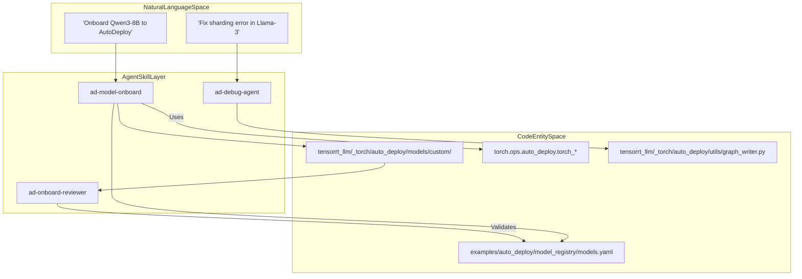
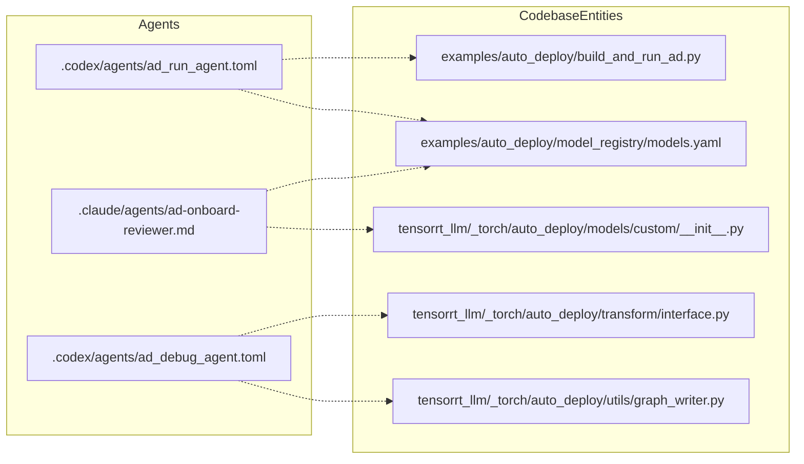

<!-- source: DeepWiki mcp.deepwiki.com · repo NVIDIA/TensorRT-LLM · page 22.2 Claude Code Skills and Developer Agents · fetched 2026-10-26 -->

# Claude Code Skills and Developer Agents

Relevant source files

The following files were used as context for generating this wiki page:

- [.claude/agents/ad-conf-check-update.md](.claude/agents/ad-conf-check-update.md)
- [.claude/agents/ad-debug-agent.md](.claude/agents/ad-debug-agent.md)
- [.claude/agents/ad-onboard-reviewer.md](.claude/agents/ad-onboard-reviewer.md)
- [.claude/agents/ad-run-agent.md](.claude/agents/ad-run-agent.md)
- [.claude/skills/ad-add-fusion-transformation/SKILL.md](.claude/skills/ad-add-fusion-transformation/SKILL.md)
- [.claude/skills/ad-conf-check/SKILL.md](.claude/skills/ad-conf-check/SKILL.md)
- [.claude/skills/ad-conf-check/references/config_log_patterns.md](.claude/skills/ad-conf-check/references/config_log_patterns.md)
- [.claude/skills/ad-conf-check/references/graph_verification_patterns.md](.claude/skills/ad-conf-check/references/graph_verification_patterns.md)
- [.claude/skills/ad-conf-check/scripts/parse_config.py](.claude/skills/ad-conf-check/scripts/parse_config.py)
- [.claude/skills/ad-graph-dump/SKILL.md](.claude/skills/ad-graph-dump/SKILL.md)
- [.claude/skills/ad-model-onboard/SKILL.md](.claude/skills/ad-model-onboard/SKILL.md)
- [.codex/AGENTS.md](.codex/AGENTS.md)
- [.codex/agents/ad_debug_agent.toml](.codex/agents/ad_debug_agent.toml)
- [.codex/agents/ad_onboard_reviewer.toml](.codex/agents/ad_onboard_reviewer.toml)
- [.codex/agents/ad_run_agent.toml](.codex/agents/ad_run_agent.toml)
- [.codex/agents/onboard_update_reviewer.toml](.codex/agents/onboard_update_reviewer.toml)
- [.codex/config.toml](.codex/config.toml)
- [.codex/skills/ad-model-onboard/SKILL.md](.codex/skills/ad-model-onboard/SKILL.md)
- [examples/auto_deploy/.gitignore](examples/auto_deploy/.gitignore)
- [examples/auto_deploy/cookbooks/minimax_m2.7_trtllm_cookbook.ipynb](examples/auto_deploy/cookbooks/minimax_m2.7_trtllm_cookbook.ipynb)
- [examples/auto_deploy/model_registry/configs/minimax_m2.7.yaml](examples/auto_deploy/model_registry/configs/minimax_m2.7.yaml)
- [examples/auto_deploy/model_registry/models.yaml](examples/auto_deploy/model_registry/models.yaml)
- [tensorrt_llm/_torch/auto_deploy/models/__init__.py](tensorrt_llm/_torch/auto_deploy/models/__init__.py)
- [tensorrt_llm/_torch/auto_deploy/models/custom/__init__.py](tensorrt_llm/_torch/auto_deploy/models/custom/__init__.py)

This page documents the specialized development infrastructure located in the `.claude/` and `.codex/` directories of the TensorRT-LLM repository. These resources provide custom "skills" and sub-agents designed to assist developers in common workflows such as AutoDeploy model onboarding, performance analysis, CI failure debugging, and serving configuration.

## Purpose and Scope

The Claude Code skills are a set of automated tools and guidelines that enable AI-driven developer agents to interact deeply with the TensorRT-LLM codebase. They bridge the gap between high-level natural language instructions and complex technical tasks like retrieving CI logs, upgrading dependencies, or configuring serving environments.

Key capabilities include:
*   **AutoDeploy Model Onboarding**: Translating HuggingFace models into prefill-only AutoDeploy custom models using reference custom ops and validating them with hierarchical equivalence tests [`.claude/skills/ad-model-onboard/SKILL.md:1-13`]().
*   **AutoDeploy Debugging**: Iterative debugging of onboarding failures by inspecting FX graph dumps and log files [`.claude/agents/ad-debug-agent.md:1-9`]().
*   **Performance Analysis**: Tools for evaluating generation quality and assessing whether output is coherent or repetitive nonsense [`.claude/agents/ad-run-agent.md:79-85`]().
*   **Registry Management**: Automating the addition of models to the `models.yaml` registry with appropriate `yaml_extra` configurations (e.g., `world_size_N.yaml`) [`.claude/agents/ad-run-agent.md:13-26`]().
*   **Graph Visualization**: Enabling and interpreting FX graph text dumps via `AD_DUMP_GRAPHS_DIR` to verify fusion transformations [`.claude/skills/ad-graph-dump/SKILL.md:1-12`]().
*   **Multi-Modal Support**: Ensuring vision towers and multimodal `nn.Module` hierarchies are correctly implemented and verified via state_dict assertions [`.claude/agents/ad-onboard-reviewer.md:41-49`]().

**Sources:** [`.claude/skills/ad-model-onboard/SKILL.md:1-13`](), [`.claude/agents/ad-debug-agent.md:1-9`](), [`.claude/agents/ad-run-agent.md:79-85`](), [`.claude/agents/ad-run-agent.md:13-26`](), [`.claude/skills/ad-graph-dump/SKILL.md:1-12`](), [`.claude/agents/ad-onboard-reviewer.md:41-49`]()

## System Architecture

Claude Code supports two extensibility mechanisms: **skills** (markdown playbooks/instructions) and **agents** (specialist workers with specific toolsets and developer instructions). These are automatically discovered by Claude Code or Codex at startup when working within the project directory. 

### AutoDeploy Onboarding Data Flow

The following diagram illustrates how an agent moves from a natural language onboarding request to executing code-level operations within the AutoDeploy ecosystem.

**Model Onboarding Workflow**

**Sources:** [`.claude/skills/ad-model-onboard/SKILL.md:11-13`](), [`.claude/agents/ad-debug-agent.md:60-68`](), [`.claude/agents/ad-onboard-reviewer.md:11-24`]()

## Core Agents and Skills

### AutoDeploy Onboarding (`ad-model-onboard`)
This skill defines a multi-phase process for adding new model architectures to the AutoDeploy system.

1.  **Phase 0: Resource Gathering**: Performs GPU memory sanity checks using `nvidia-smi` and downloads model code via `huggingface-cli` [`.claude/skills/ad-model-onboard/SKILL.md:15-37`]().
2.  **Phase 1: Survey**: Analyzes the model family and checks for existing registrations in `tensorrt_llm/_torch/auto_deploy/models/custom/__init__.py` [`.claude/skills/ad-model-onboard/SKILL.md:38-66`]().
3.  **Phase 2: Lean Modeling**: Creates a minimal prefill-only `nn.Module` stripped of training paths, KV cache logic, and dropout [`.claude/skills/ad-model-onboard/SKILL.md:67-80`]().
4.  **Phase 3: Canonical Ops**: Enforces the use of `torch.ops.auto_deploy.torch_*` ops (e.g., `torch_attention`, `torch_rmsnorm`, `torch_moe`) to ensure backend-agnostic optimization [`.claude/skills/ad-model-onboard/SKILL.md:81-93`]().

**Sources:** [`.claude/skills/ad-model-onboard/SKILL.md:15-93`](), [`.claude/skills/ad-model-onboard/SKILL.md:38-66`]()

### AutoDeploy Debug Agent (`ad-debug-agent`)
A specialized agent for iterating on failed model builds. It manages GPU selection and orchestrates runs using `build_and_run_ad.py` [`.claude/agents/ad-debug-agent.md:32-65`]().

*   **GPU Selection**: Checks for free GPUs (memory < 1000 MiB, 0% utilization) via `nvidia-smi` and sets `CUDA_VISIBLE_DEVICES` [`.claude/agents/ad-debug-agent.md:40-53`]().
*   **Graph Inspection**: Utilizes `AD_DUMP_GRAPHS_DIR` to inspect FX graphs produced during the transformation pipeline [`.claude/skills/ad-graph-dump/SKILL.md:41-54`]().
*   **Iteration Strategies**: Suggests reducing hidden layers via `model_kwargs` in the registry or toggling sharding via `world_size` adjustments [`.claude/agents/ad-debug-agent.md:77-80`]().

**Sources:** [`.claude/agents/ad-debug-agent.md:32-80`](), [`.claude/skills/ad-graph-dump/SKILL.md:41-54`]()

### AutoDeploy Run Agent (`ad-run-agent`)
Orchestrates the execution of AutoDeploy flows and archives results into a structured workspace [`.claude/agents/ad-run-agent.md:11-37`]().

*   **Workspace**: Maintains logs in `$PWD/ad-test-workspace/ad_run_logs/` and a markdown worklog for each model [`.claude/agents/ad-run-agent.md:29-37`]().
*   **Execution**: Launches `examples/auto_deploy/build_and_run_ad.py` with `--use-registry` to resolve configurations from `models.yaml` [`.claude/agents/ad-run-agent.md:63-76`]().
*   **Status Tracking**: Categorizes runs as `success`, `compile_error`, `runtime_error`, or `bad_generation` [`.claude/agents/ad-run-agent.md:88-93`]().

**Sources:** [`.claude/agents/ad-run-agent.md:11-93`]()

## Agent-to-Code Entity Mapping

The following diagram maps specific agent definitions to the codebase components they interact with or configure.

**Agent-to-Code Entity Mapping**

**Sources:** [`.codex/agents/ad_run_agent.toml:1-8`](), [`.codex/agents/ad_debug_agent.toml:1-8`](), [`.claude/agents/ad-onboard-reviewer.md:1-22`](), [`.claude/skills/ad-graph-dump/SKILL.md:47-54`]()

## Validation Checklist (Adversarial Review)

The `ad-onboard-reviewer` agent follows a strict checklist to ensure quality in model onboarding [`.claude/agents/ad-onboard-reviewer.md:24-81`]:

| Category | Requirement | Verification Method |
| :--- | :--- | :--- |
| **Self-Containment** | No imports from other AD custom models. | Grep for `from .modeling_` [`.claude/agents/ad-onboard-reviewer.md:33`]() |
| **Canonical Ops** | Must use `torch.ops.auto_deploy.torch_*`. | Identify attention/RoPE/MoE blocks [`.claude/agents/ad-onboard-reviewer.md:54`]() |
| **Leanness** | No KV cache, training paths, or dropout. | Grep for `past_key_value`, `dropout` [`.claude/agents/ad-onboard-reviewer.md:57-58`]() |
| **Input Contract** | `position_ids` must be asserted not None. | Check forward entry point [`.claude/agents/ad-onboard-reviewer.md:67`]() |
| **Checkpoint** | Hierarchy must match safetensor JSON. | Compare `nn.Module` names with weights [`.claude/agents/ad-onboard-reviewer.md:38`]() |
| **Vision/Multi-Modal** | Vision tower `nn.Module` hierarchy must be present. | Grep for vision class names (e.g. `VisionTower`) [`.claude/agents/ad-onboard-reviewer.md:45`]() |
| **MoE Structure** | Experts use `nn.ModuleList`. | Verify expert structure [`.claude/agents/ad-onboard-reviewer.md:78`]() |

**Sources:** [`.claude/agents/ad-onboard-reviewer.md:24-81`](), [`.claude/agents/ad-onboard-reviewer.md:33-78`]()

## Directory Structure and Metadata

| Directory | Environment | Purpose |
| :--- | :--- | :--- |
| `.claude/skills/` | Claude Code | Markdown-based skill definitions and reference patterns [`.claude/skills/ad-model-onboard/SKILL.md:1-9`](). |
| `.claude/agents/` | Claude Code | Agent personality and tool-use definitions [`.claude/agents/ad-run-agent.md:1-9`](). |
| `.codex/agents/` | Codex | TOML-based agent configurations for Codex environments [`.codex/agents/ad_run_agent.toml:1-8`](). |
| `examples/auto_deploy/model_registry/` | AutoDeploy | Central registry (`models.yaml`) and model-specific configs used by agents [`examples/auto_deploy/model_registry/models.yaml:1-152`](). |

**Sources:** [`.claude/skills/ad-model-onboard/SKILL.md:1-9`](), [`.claude/agents/ad-run-agent.md:1-9`](), [`.codex/agents/ad_run_agent.toml:1-8`](), [`examples/auto_deploy/model_registry/models.yaml:1-152`]()

---

