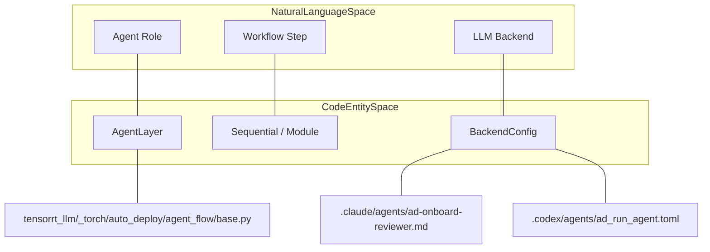
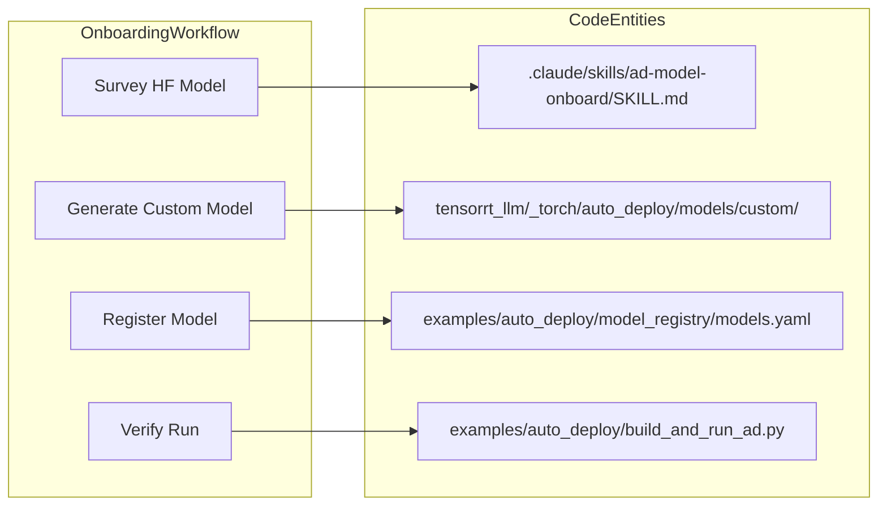

<!-- source: DeepWiki mcp.deepwiki.com · repo NVIDIA/TensorRT-LLM · page 23 Agent-Flow: Multi-Agent Workflow Framework · fetched 2026-10-26 -->

# Agent-Flow: Multi-Agent Workflow Framework

Relevant source files

The following files were used as context for generating this wiki page:

- [.claude/agents/ad-conf-check-update.md](.claude/agents/ad-conf-check-update.md)
- [.claude/agents/ad-debug-agent.md](.claude/agents/ad-debug-agent.md)
- [.claude/agents/ad-onboard-reviewer.md](.claude/agents/ad-onboard-reviewer.md)
- [.claude/agents/ad-run-agent.md](.claude/agents/ad-run-agent.md)
- [.claude/skills/ad-add-fusion-transformation/SKILL.md](.claude/skills/ad-add-fusion-transformation/SKILL.md)
- [.claude/skills/ad-conf-check/SKILL.md](.claude/skills/ad-conf-check/SKILL.md)
- [.claude/skills/ad-conf-check/references/config_log_patterns.md](.claude/skills/ad-conf-check/references/config_log_patterns.md)
- [.claude/skills/ad-conf-check/references/graph_verification_patterns.md](.claude/skills/ad-conf-check/references/graph_verification_patterns.md)
- [.claude/skills/ad-conf-check/scripts/parse_config.py](.claude/skills/ad-conf-check/scripts/parse_config.py)
- [.claude/skills/ad-graph-dump/SKILL.md](.claude/skills/ad-graph-dump/SKILL.md)
- [.claude/skills/ad-model-onboard/SKILL.md](.claude/skills/ad-model-onboard/SKILL.md)
- [.codex/AGENTS.md](.codex/AGENTS.md)
- [.codex/agents/ad_debug_agent.toml](.codex/agents/ad_debug_agent.toml)
- [.codex/agents/ad_onboard_reviewer.toml](.codex/agents/ad_onboard_reviewer.toml)
- [.codex/agents/ad_run_agent.toml](.codex/agents/ad_run_agent.toml)
- [.codex/agents/onboard_update_reviewer.toml](.codex/agents/onboard_update_reviewer.toml)
- [.codex/config.toml](.codex/config.toml)
- [.codex/skills/ad-model-onboard/SKILL.md](.codex/skills/ad-model-onboard/SKILL.md)
- [examples/auto_deploy/.gitignore](examples/auto_deploy/.gitignore)
- [examples/auto_deploy/cookbooks/minimax_m2.7_trtllm_cookbook.ipynb](examples/auto_deploy/cookbooks/minimax_m2.7_trtllm_cookbook.ipynb)
- [examples/auto_deploy/model_registry/configs/minimax_m2.7.yaml](examples/auto_deploy/model_registry/configs/minimax_m2.7.yaml)
- [examples/auto_deploy/model_registry/models.yaml](examples/auto_deploy/model_registry/models.yaml)
- [tensorrt_llm/_torch/auto_deploy/models/__init__.py](tensorrt_llm/_torch/auto_deploy/models/__init__.py)
- [tensorrt_llm/_torch/auto_deploy/models/custom/__init__.py](tensorrt_llm/_torch/auto_deploy/models/custom/__init__.py)

The **Agent-Flow** framework is a specialized system within TensorRT-LLM designed to orchestrate multiple AI agents to automate complex engineering tasks. Its primary application is the **Modeling Bring-Up** workflow, which automates the onboarding of new HuggingFace model architectures into the TensorRT-LLM ecosystem, specifically targeting the **AutoDeploy** and **PyExecutor** backends.

By composing agents with specific roles—such as `PlanDrafter`, `Coder`, and `Reviewer`—the framework reduces the manual effort required to implement custom modeling files, sharding transformations, and verification tests.

## Architecture and Abstractions

Agent-Flow adopts a design philosophy inspired by deep learning frameworks like PyTorch, using modular components that can be composed into sequential or branching pipelines.

*   **AgentLayer / Module**: The fundamental building block of a workflow. Each layer represents a discrete step or a specialized agent role.
*   **BackendConfig**: Configures the underlying LLM engine powering the agents. It supports different environments, such as **Claude Code** (using `.claude/` skills) and **Codex** (using `.codex/` configurations).
*   **SessionConfig**: Manages the state, workspace, and persistence of a multi-agent session, allowing for long-running workflows to be checkpointed and resumed.

For a detailed breakdown of the internal classes and package structure, see **[Agent-Flow Architecture and AgentLayer](#23.1)**.

### Natural Language to Code Entity Mapping: Architecture

The following diagram maps high-level agent concepts to their specific implementations in the codebase.

Sources: [.claude/agents/ad-onboard-reviewer.md:1-9](), [.codex/agents/ad_run_agent.toml:1-10]()

## Modeling Bring-Up Workflow

The flagship application of Agent-Flow is the automated onboarding of new models. This workflow follows a strict state machine to ensure that generated code is both functional and optimized.

| Phase | Agent / Tool | Responsibility |
| :--- | :--- | :--- |
| **Survey** | `ad-model-onboard` | Analyzes HF `config.json` and `modeling_*.py` to identify attention types, MoE, and RoPE variants. [.claude/skills/ad-model-onboard/SKILL.md:38-66]() |
| **Drafting** | `PlanDrafter` | Creates a lean, prefill-only model implementation using canonical IR ops. [.claude/skills/ad-model-onboard/SKILL.md:67-80]() |
| **Coding** | `Coder` | Implements the custom model in `tensorrt_llm/_torch/auto_deploy/models/custom/`. [.claude/skills/ad-model-onboard/SKILL.md:68-68]() |
| **Review** | `ad-onboard-reviewer` | Validates code against `ENGINEERING_CRITERIA.md` and `CODING_GUIDELINES.md`. [.claude/agents/ad-onboard-reviewer.md:1-5]() |
| **Verification** | `ad-run-agent` | Executes `build_and_run_ad.py` to verify numerical correctness and generation quality. [.claude/agents/ad-run-agent.md:61-78]() |

For details on the task configuration and Slurm integration, see **[Modeling Bring-Up and Agent-Team Workflows](#23.2)**.

### Natural Language to Code Entity Mapping: Modeling Workflow

This diagram illustrates how the automated onboarding process interacts with the AutoDeploy registry and modeling files.

Sources: [.claude/skills/ad-model-onboard/SKILL.md:11-15](), [examples/auto_deploy/model_registry/models.yaml:1-20](), [.claude/agents/ad-run-agent.md:61-70]()

## Key Capabilities and Skills

The framework leverages a set of "skills"—specialized scripts and prompts—that allow agents to interact directly with the TensorRT-LLM codebase:

*   **Graph Analysis**: Agents use `ad-graph-dump` to inspect the AutoDeploy transformation pipeline and verify that fusions (like `torch_rmsnorm`) are correctly applied. [.claude/skills/ad-graph-dump/SKILL.md:1-49]()
*   **Registry Management**: Automated updates to `models.yaml` to include new variants with appropriate `world_size` and `yaml_extra` configurations. [examples/auto_deploy/model_registry/models.yaml:4-24]()
*   **Hardware Awareness**: The `ad-run-agent` performs GPU memory sanity checks and manages `CUDA_VISIBLE_DEVICES` based on `nvidia-smi` output before launching tests. [.claude/agents/ad-run-agent.md:39-60]()
*   **Canonical Op Usage**: Onboarding logic enforces the use of `torch.ops.auto_deploy.torch_*` canonical ops (e.g., `torch_attention`, `torch_rmsnorm`) to enable downstream AutoDeploy transformations. [.claude/skills/ad-model-onboard/SKILL.md:80-92]()
*   **Custom Model Registration**: New architectures are dynamically registered in the `_MODEL_MODULES` map to ensure visibility to the AutoDeploy engine. [tensorrt_llm/_torch/auto_deploy/models/custom/__init__.py:28-66]()

### Implementation References
*   **Model Registry**: `examples/auto_deploy/model_registry/models.yaml` [4-24]()
*   **Custom Model Entry Point**: `tensorrt_llm/_torch/auto_deploy/models/custom/__init__.py` [28-66]()
*   **Onboarding Logic**: `.claude/skills/ad-model-onboard/SKILL.md` [67-94]()
*   **Execution Agent**: `.claude/agents/ad-run-agent.md` [39-60]()
*   **Debug Agent**: `.codex/agents/ad_debug_agent.toml` [7-43]()

For further information, refer to the sub-pages:
*   [Agent-Flow Architecture and AgentLayer](#23.1)
*   [Modeling Bring-Up and Agent-Team Workflows](#23.2)

---

