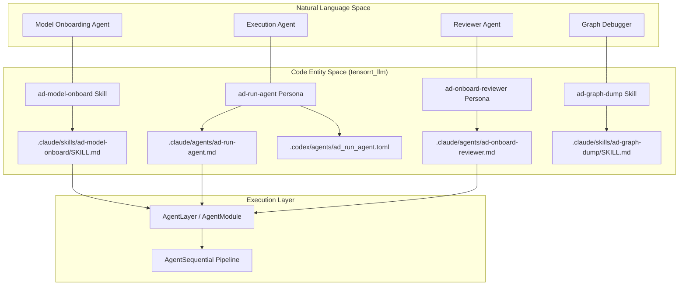
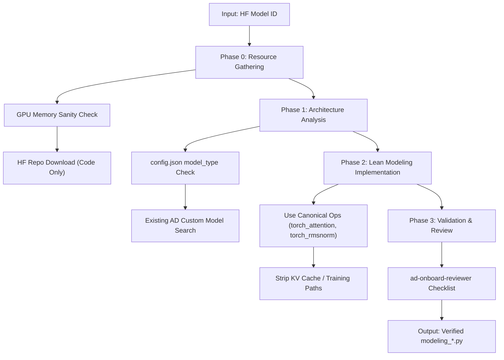

<!-- source: DeepWiki mcp.deepwiki.com · repo NVIDIA/TensorRT-LLM · page 23.1 Agent-Flow Architecture and AgentLayer · fetched 2026-10-26 -->

# Agent-Flow Architecture and AgentLayer

Relevant source files

The following files were used as context for generating this wiki page:

- [.claude/agents/ad-conf-check-update.md](.claude/agents/ad-conf-check-update.md)
- [.claude/agents/ad-debug-agent.md](.claude/agents/ad-debug-agent.md)
- [.claude/agents/ad-onboard-reviewer.md](.claude/agents/ad-onboard-reviewer.md)
- [.claude/agents/ad-run-agent.md](.claude/agents/ad-run-agent.md)
- [.claude/skills/ad-add-fusion-transformation/SKILL.md](.claude/skills/ad-add-fusion-transformation/SKILL.md)
- [.claude/skills/ad-conf-check/SKILL.md](.claude/skills/ad-conf-check/SKILL.md)
- [.claude/skills/ad-conf-check/references/config_log_patterns.md](.claude/skills/ad-conf-check/references/config_log_patterns.md)
- [.claude/skills/ad-conf-check/references/graph_verification_patterns.md](.claude/skills/ad-conf-check/references/graph_verification_patterns.md)
- [.claude/skills/ad-conf-check/scripts/parse_config.py](.claude/skills/ad-conf-check/scripts/parse_config.py)
- [.claude/skills/ad-graph-dump/SKILL.md](.claude/skills/ad-graph-dump/SKILL.md)
- [.claude/skills/ad-model-onboard/SKILL.md](.claude/skills/ad-model-onboard/SKILL.md)
- [.codex/AGENTS.md](.codex/AGENTS.md)
- [.codex/agents/ad_debug_agent.toml](.codex/agents/ad_debug_agent.toml)
- [.codex/agents/ad_onboard_reviewer.toml](.codex/agents/ad_onboard_reviewer.toml)
- [.codex/agents/ad_run_agent.toml](.codex/agents/ad_run_agent.toml)
- [.codex/agents/onboard_update_reviewer.toml](.codex/agents/onboard_update_reviewer.toml)
- [.codex/config.toml](.codex/config.toml)
- [.codex/skills/ad-model-onboard/SKILL.md](.codex/skills/ad-model-onboard/SKILL.md)
- [examples/auto_deploy/.gitignore](examples/auto_deploy/.gitignore)
- [examples/auto_deploy/cookbooks/minimax_m2.7_trtllm_cookbook.ipynb](examples/auto_deploy/cookbooks/minimax_m2.7_trtllm_cookbook.ipynb)
- [examples/auto_deploy/model_registry/configs/minimax_m2.7.yaml](examples/auto_deploy/model_registry/configs/minimax_m2.7.yaml)
- [examples/auto_deploy/model_registry/models.yaml](examples/auto_deploy/model_registry/models.yaml)
- [tensorrt_llm/_torch/auto_deploy/models/__init__.py](tensorrt_llm/_torch/auto_deploy/models/__init__.py)
- [tensorrt_llm/_torch/auto_deploy/models/custom/__init__.py](tensorrt_llm/_torch/auto_deploy/models/custom/__init__.py)

The Agent-Flow framework provides a modular, PyTorch-like abstraction for composing AI agent-backed workflows. It is designed to facilitate automated development tasks within TensorRT-LLM, such as model onboarding, kernel optimization, and CI failure analysis. By using standardized layers and sequential compositions, developers can build complex multi-agent systems that interact with the codebase, execute tools, and maintain state across sessions.

## Core Abstractions

Agent-Flow mirrors the design of deep learning frameworks by providing `AgentLayer`, `AgentModule`, and `AgentSequential` classes to manage agent interactions.

### AgentLayer and AgentModule
The `AgentLayer` is the fundamental unit of execution. It encapsulates a specific AI agent (e.g., a Claude-backed sub-agent) or a functional tool. Similar to `nn.Module` in PyTorch, `AgentModule` serves as a base class for complex agents that might contain sub-layers. These components are designed to be composable into pipelines.

### AgentSequential
`AgentSequential` allows for the linear composition of agent layers. A request flows through each layer in the sequence, with the output of one agent serving as the input (or context) for the next. This is used extensively in workflows where a `PlanDrafter` precedes a `Coder`.

### Configuration Systems
The framework utilizes two primary configuration structures to manage agent behavior and environment:

*   **BackendConfig**: Defines the LLM backend providing the agent's intelligence. Supported backends include **Claude Code** (configured via `.claude/` skills) and **Codex** (configured via `.codex/` agent definitions) [.claude/skills/ad-model-onboard/SKILL.md:1-9](), [.codex/agents/ad_run_agent.toml:1-7]().
*   **SessionConfig**: Manages the runtime environment, including workspace directories (e.g., `ad-test-workspace`), log paths, and persistent state for resume/checkpoint logic [.claude/agents/ad-run-agent.md:27-35]().

### Data Flow Diagram: Natural Language to Code Entity Space
The following diagram illustrates how high-level agent roles defined in documentation map to specific code entities and configuration files within the repository.

**Agent Role to Code Mapping**

**Sources:** [.claude/skills/ad-model-onboard/SKILL.md:1-13](), [.claude/agents/ad-run-agent.md:1-11](), [.claude/agents/ad-onboard-reviewer.md:1-16](), [.claude/skills/ad-graph-dump/SKILL.md:1-16]().

---

## Agent-Flow Package Structure

The agent-flow logic is distributed between specialized skill definitions and agent orchestrators located in the `.claude/` and `.codex/` directories.

| Component | Path | Role |
| :--- | :--- | :--- |
| **Claude Skills** | `.claude/skills/` | Contains custom Claude Code skills for model onboarding, graph dumping, and configuration checking [.claude/skills/ad-model-onboard/SKILL.md:2-5](). |
| **Codex Agents** | `.codex/agents/` | Contains agent definitions for Codex environments, including run and debug agents [.codex/agents/ad_run_agent.toml:8-10](). |
| **Model Registry** | `examples/auto_deploy/model_registry/` | Source of truth for model configurations and world size requirements [examples/auto_deploy/model_registry/models.yaml:3-6](). |
| **Custom Modeling** | `tensorrt_llm/_torch/auto_deploy/models/custom/` | Internal implementation for PyTorch-based execution used by agents [tensorrt_llm/_torch/auto_deploy/models/custom/__init__.py:28-66](). |

### Installation
The agent-flow components are typically part of the developer environment setup. They require:
1.  A supported LLM backend (Claude or Codex).
2.  The `transformers` library for model configuration resolution [.claude/skills/ad-model-onboard/SKILL.md:26-31]().
3.  Access to GPU resources, verified via `nvidia-smi` [.claude/agents/ad-run-agent.md:47-52]().

---

## Pipeline Composition and Execution

Agents compose into pipelines to automate complex workflows. A primary example is the "Modeling Bring-Up" process, which leverages the `AutoDeploy` backend.

### The Modeling Bring-Up Pipeline
This pipeline automates the translation of HuggingFace models into TensorRT-LLM optimized implementations using AutoDeploy canonical ops.

**Model Onboarding Pipeline Flow**

**Sources:** [.claude/skills/ad-model-onboard/SKILL.md:15-80](), [.claude/agents/ad-onboard-reviewer.md:24-70]().

### Key Functions and Classes
*   **Auto-Discovery**: Models are registered in `tensorrt_llm/_torch/auto_deploy/models/custom/__init__.py`, which maps module names to causal LM classes [tensorrt_llm/_torch/auto_deploy/models/custom/__init__.py:28-66]().
*   **Canonical Ops**: Agents are instructed to use `torch.ops.auto_deploy.torch_*` (e.g., `torch_attention`, `torch_moe`, `torch_rmsnorm`) to ensure the model can be transformed by the AutoDeploy engine [.claude/skills/ad-model-onboard/SKILL.md:80-92]().
*   **Graph Tracing**: The `GraphWriter` (triggered by `AD_DUMP_GRAPHS_DIR`) allows agents to inspect FX graphs after each transform stage [.claude/skills/ad-graph-dump/SKILL.md:41-54]().

### Session Management
The framework tracks progress through a `worklog.md` file located in the workspace. This file records the status of each run (`success`, `compile_error`, `runtime_error`, `bad_generation`) and provides a summary for the developer [.claude/agents/ad-run-agent.md:94-110]().

**Sources:**
* `.claude/skills/ad-model-onboard/SKILL.md:1-100`
* `.claude/agents/ad-run-agent.md:1-120`
* `.claude/agents/ad-onboard-reviewer.md:1-80`
* `tensorrt_llm/_torch/auto_deploy/models/custom/__init__.py:1-80`
* `.claude/skills/ad-graph-dump/SKILL.md:1-119`

---

