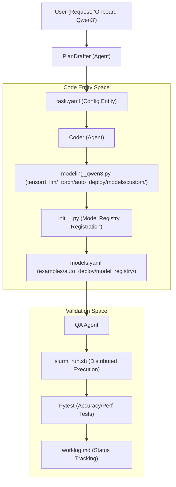
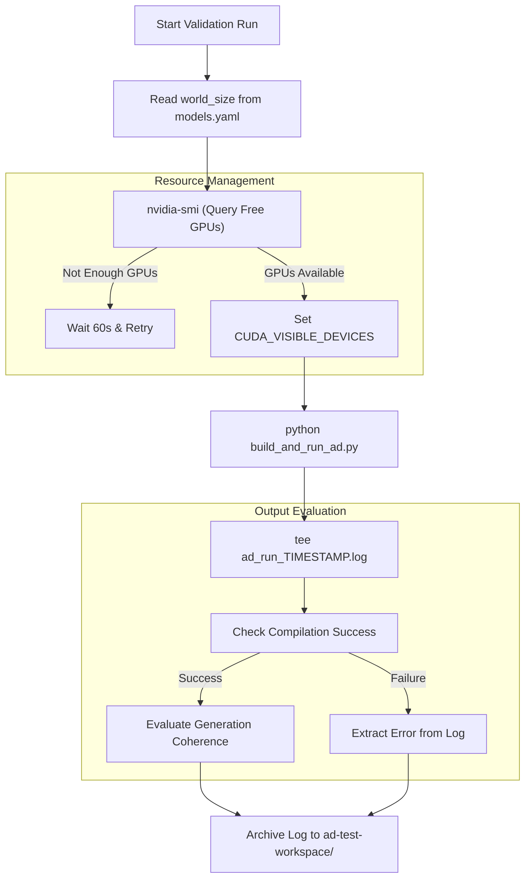

<!-- source: DeepWiki mcp.deepwiki.com · repo NVIDIA/TensorRT-LLM · page 23.2 Modeling Bring-Up and Agent-Team Workflows · fetched 2026-10-26 -->

# Modeling Bring-Up and Agent-Team Workflows

Relevant source files

The following files were used as context for generating this wiki page:

- [.claude/agents/ad-conf-check-update.md](.claude/agents/ad-conf-check-update.md)
- [.claude/agents/ad-debug-agent.md](.claude/agents/ad-debug-agent.md)
- [.claude/agents/ad-onboard-reviewer.md](.claude/agents/ad-onboard-reviewer.md)
- [.claude/agents/ad-run-agent.md](.claude/agents/ad-run-agent.md)
- [.claude/skills/ad-add-fusion-transformation/SKILL.md](.claude/skills/ad-add-fusion-transformation/SKILL.md)
- [.claude/skills/ad-conf-check/SKILL.md](.claude/skills/ad-conf-check/SKILL.md)
- [.claude/skills/ad-conf-check/references/config_log_patterns.md](.claude/skills/ad-conf-check/references/config_log_patterns.md)
- [.claude/skills/ad-conf-check/references/graph_verification_patterns.md](.claude/skills/ad-conf-check/references/graph_verification_patterns.md)
- [.claude/skills/ad-conf-check/scripts/parse_config.py](.claude/skills/ad-conf-check/scripts/parse_config.py)
- [.claude/skills/ad-graph-dump/SKILL.md](.claude/skills/ad-graph-dump/SKILL.md)
- [.claude/skills/ad-model-onboard/SKILL.md](.claude/skills/ad-model-onboard/SKILL.md)
- [.codex/AGENTS.md](.codex/AGENTS.md)
- [.codex/agents/ad_debug_agent.toml](.codex/agents/ad_debug_agent.toml)
- [.codex/agents/ad_onboard_reviewer.toml](.codex/agents/ad_onboard_reviewer.toml)
- [.codex/agents/ad_run_agent.toml](.codex/agents/ad_run_agent.toml)
- [.codex/agents/onboard_update_reviewer.toml](.codex/agents/onboard_update_reviewer.toml)
- [.codex/config.toml](.codex/config.toml)
- [.codex/skills/ad-model-onboard/SKILL.md](.codex/skills/ad-model-onboard/SKILL.md)
- [examples/auto_deploy/.gitignore](examples/auto_deploy/.gitignore)
- [examples/auto_deploy/cookbooks/minimax_m2.7_trtllm_cookbook.ipynb](examples/auto_deploy/cookbooks/minimax_m2.7_trtllm_cookbook.ipynb)
- [examples/auto_deploy/model_registry/configs/minimax_m2.7.yaml](examples/auto_deploy/model_registry/configs/minimax_m2.7.yaml)
- [examples/auto_deploy/model_registry/models.yaml](examples/auto_deploy/model_registry/models.yaml)
- [examples/ray_orchestrator/disaggregated/README.md](examples/ray_orchestrator/disaggregated/README.md)
- [examples/ray_orchestrator/disaggregated/disagg_serving_local.sh](examples/ray_orchestrator/disaggregated/disagg_serving_local.sh)
- [examples/ray_orchestrator/llm_inference_async_ray.py](examples/ray_orchestrator/llm_inference_async_ray.py)
- [jenkins/scripts/bash_utils.sh](jenkins/scripts/bash_utils.sh)
- [jenkins/scripts/slurm_install.sh](jenkins/scripts/slurm_install.sh)
- [jenkins/scripts/slurm_run.sh](jenkins/scripts/slurm_run.sh)
- [tensorrt_llm/_torch/auto_deploy/models/__init__.py](tensorrt_llm/_torch/auto_deploy/models/__init__.py)
- [tensorrt_llm/_torch/auto_deploy/models/custom/__init__.py](tensorrt_llm/_torch/auto_deploy/models/custom/__init__.py)
- [tests/integration/defs/examples/test_ray.py](tests/integration/defs/examples/test_ray.py)
- [tests/integration/defs/ray_orchestrator/RL/run_rl_perf_reproduce.py](tests/integration/defs/ray_orchestrator/RL/run_rl_perf_reproduce.py)
- [tests/integration/defs/test_infra_dry_run_benchmark.py](tests/integration/defs/test_infra_dry_run_benchmark.py)
- [tests/integration/defs/verl/.gitignore](tests/integration/defs/verl/.gitignore)
- [tests/integration/defs/verl/test_verl_cases.py](tests/integration/defs/verl/test_verl_cases.py)
- [tests/integration/defs/verl/verl_config.yml](tests/integration/defs/verl/verl_config.yml)
- [tests/integration/test_lists/test-db/infra_dry_run.yml](tests/integration/test_lists/test-db/infra_dry_run.yml)
- [tests/integration/test_lists/test-db/l0_verl.yml](tests/integration/test_lists/test-db/l0_verl.yml)
- [tests/unittest/_torch/ray_orchestrator/multi_gpu/test_executor.py](tests/unittest/_torch/ray_orchestrator/multi_gpu/test_executor.py)
- [tests/unittest/_torch/ray_orchestrator/multi_gpu/test_multi_instance.py](tests/unittest/_torch/ray_orchestrator/multi_gpu/test_multi_instance.py)
- [tests/unittest/tools/test_infra_dry_run_pipeline.py](tests/unittest/tools/test_infra_dry_run_pipeline.py)
- [tests/unittest/tools/test_infra_dry_run_pytest.py](tests/unittest/tools/test_infra_dry_run_pytest.py)

This section documents the automated workflows and multi-agent systems used for onboarding new model architectures into TensorRT-LLM, specifically targeting the **AutoDeploy** execution path. The framework utilizes a specialized agent-team state machine to transition from a HuggingFace model definition to a validated, optimized TensorRT-LLM implementation.

## Overview of Agent-Team Workflows

The `agent_team` workflow is a multi-agent orchestration pattern designed to automate the lifecycle of model onboarding. It coordinates specialized agents through a state machine to ensure code quality, architectural correctness, and functional equivalence.

### The Agent State Machine

The workflow progresses through five distinct roles, each represented by an agent with a specific persona and toolset:

| Agent Role | Responsibility | Key Output |
| :--- | :--- | :--- |
| **PlanDrafter** | Analyzes the source HuggingFace model and identifies required components (attention, MoE, RoPE). | `task.yaml` draft |
| **PlanReviewer** | Validates the plan against existing TensorRT-LLM capabilities and canonical ops. | Approved `task.yaml` |
| **Coder** | Implements the model using AutoDeploy canonical IR ops and reference templates. | `modeling_{name}.py` |
| **Reviewer** | Performs static analysis and architectural review of the generated code. | Review feedback / Approval |
| **QA Agent** | Executes hierarchical equivalence tests and end-to-end (e2e) validation runs. | Test logs and status |

**Sources:**
- `.claude/skills/ad-model-onboard/SKILL.md:15-118`
- `.claude/agents/ad-onboard-reviewer.md:1-20`

---

## Modeling Bring-Up Specialization

The modeling bring-up workflow is a specialized instance of the agent-team flow, specifically tuned for the **AutoDeploy (AD)** backend. It follows a strict "Phase-based" approach to translate PyTorch models into a format suitable for `torch.export` and graph transformation.

### Phase 0: Resource Gathering & Sanity Checks
Before execution, the system performs a VRAM sanity check by querying hardware via `nvidia-smi` and estimating the model footprint (parameters × bytes-per-param). If the estimate exceeds total system VRAM, the process halts for user intervention [`.claude/skills/ad-model-onboard/SKILL.md:18-24`]().

### Phase 1: Architectural Analysis
The agents survey the `config.json` and `modeling_*.py` of the target HuggingFace model to identify:
- **Attention Type:** MHA, GQA, or MLA [`.claude/skills/ad-model-onboard/SKILL.md:63-66`]().
- **MoE Configuration:** Routing strategies and expert counts [`.claude/skills/ad-model-onboard/SKILL.md:63-66`]().
- **Normalization:** RMSNorm vs. LayerNorm [`.claude/skills/ad-model-onboard/SKILL.md:63-66`]().
- **Data-dependent Ops:** Identifying ops like `torch.nonzero` that break `torch.export` [`.claude/skills/ad-model-onboard/SKILL.md:65-66`]().

### Phase 2: Implementation via Canonical Ops
The Coder agent must use **AutoDeploy Canonical Ops** (`torch.ops.auto_deploy.*`) to ensure the model can be optimized by the transformation pipeline. Manual implementation of attention or MoE in plain PyTorch is discouraged if a canonical op exists [`.claude/skills/ad-model-onboard/SKILL.md:80-94`]().

**Table: Key Canonical Ops for Modeling**
| Operation Category | Canonical Op Identifier |
| :--- | :--- |
| **Attention** | `torch_attention`, `torch_mla`, `torch_attention_sdpa` |
| **RoPE** | `torch_rope_with_explicit_cos_sin`, `torch_rope_with_complex_freqs` |
| **MoE** | `torch_moe`, `torch_moe_fused`, `torch_moe_router` |
| **Normalization** | `torch_rmsnorm`, `torch_rmsnorm_gated`, `torch_l2norm` |
| **SSM/Mamba** | `torch_ssm`, `torch_causal_conv1d` |

**Sources:**
- `.claude/skills/ad-model-onboard/SKILL.md:38-94`
- `tensorrt_llm/_torch/auto_deploy/models/custom/__init__.py:28-66`

---

## Workspace and Configuration Management

The workflow relies on a structured workspace and YAML-based configuration to maintain state and enable resume logic.

### Task Configuration (`task.yaml`)
The `task.yaml` serves as the source of truth for the agent team. It defines the model metadata, required transformations, and the current progress of the state machine.

### Workspace Structure
The `ad-run-agent` manages a local workspace for logging and artifact tracking:
- **Logs Directory:** `$PWD/ad-test-workspace/ad_run_logs/` [`.claude/agents/ad-run-agent.md:30-31`]().
- **Worklog File:** `<MODEL_SHORT_NAME>_worklog.md` used to track every run attempt, status (success, compile_error, runtime_error, bad_generation), and GPU indices used [`.claude/agents/ad-run-agent.md:94-110`]().

### Model Registry Integration
Models must be registered in the AutoDeploy model registry before full validation. The registry maps model names to composable YAML configurations.
- **Registry Path:** `examples/auto_deploy/model_registry/models.yaml` [`examples/auto_deploy/model_registry/models.yaml:3-152`]().
- **Configuration ID:** Maps a model to a set of `yaml_extra` files (e.g., `dashboard_default.yaml`, `world_size_2.yaml`, `attn_backend_triton.yaml`) [`examples/auto_deploy/model_registry/models.yaml:6-152`]().
- **Custom Model Entry:** The system tracks new architectures in `tensorrt_llm/_torch/auto_deploy/models/custom/__init__.py` to ensure they are discoverable by the `factory` [`tensorrt_llm/_torch/auto_deploy/models/custom/__init__.py:28-66`]().

**Sources:**
- `.claude/agents/ad-run-agent.md:13-37`
- `examples/auto_deploy/model_registry/models.yaml:1-152`
- `tensorrt_llm/_torch/auto_deploy/models/custom/__init__.py:28-79`

---

## Slurm Integration for Agent Workflows

In large-scale CI/CD and distributed environments, the agent team interacts with Slurm to execute multi-GPU validation.

### Distributed Execution Orchestration
The `slurm_run.sh` script facilitates distributed pytest execution, ensuring that all ranks enter the test session simultaneously via a filesystem-based barrier.
- **Barrier Mechanism:** `slurm_wait_all_ranks` creates rank-specific marker files in `$jobWorkspace` and waits until the count matches `SLURM_NTASKS` [`jenkins/scripts/slurm_run.sh:100-139`]().
- **Environment Setup:** The script unsets Slurm/MPI variables for single-node runs to prevent Pytest from incorrectly initializing MPI when not required [`jenkins/scripts/slurm_run.sh:79-87`]().

### Ray Integration
For models requiring Ray-based orchestration (e.g., disaggregated serving or complex TP/PP/EP sharding), the agent workflow utilizes `test_ray.py` and `test_executor.py` to validate Ray placement groups and worker extensions.
- **Placement Groups:** The system validates that `RayPlacementConfig` correctly maps workers to specific GPU UUIDs via `PlacementGroupSchedulingStrategy` [`tests/unittest/_torch/ray_orchestrator/multi_gpu/test_executor.py:102-124`]().
- **Worker Extensions:** Validates specialized workers like `RLHF_utils.WorkerExtension` for training/fine-tuning workflows [`tests/unittest/_torch/ray_orchestrator/multi_gpu/test_executor.py:23-32`]().

**Sources:**
- `jenkins/scripts/slurm_run.sh:79-141`
- `tests/unittest/_torch/ray_orchestrator/multi_gpu/test_executor.py:23-124`
- `tests/integration/defs/examples/test_ray.py:37-69`

---

## Workflow Diagrams

### Data Flow: Natural Language to Code Entity Space
This diagram illustrates how a user request for model onboarding translates into specific code entities and agent interactions.

**Sources:**
- `.claude/skills/ad-model-onboard/SKILL.md:11-13`
- `.claude/agents/ad-run-agent.md:94-110`
- `tensorrt_llm/_torch/auto_deploy/models/custom/__init__.py:28-66`

### Execution Flow: GPU Management and AD Run
This diagram shows how the `ad-run-agent` manages hardware resources and executes the AutoDeploy build and run pipeline.

**Sources:**
- `.claude/agents/ad-run-agent.md:39-76`
- `examples/auto_deploy/model_registry/models.yaml:58-69`

---

## Resume and Checkpoint Logic

The workflow supports resuming from failures to avoid redundant computation:

1.  **State Persistence:** The current agent state and successful sub-tasks are recorded in the `task.yaml`.
2.  **Artifact Reuse:** If a `modeling_{name}.py` exists, the Coder agent can be instructed to "Edit" rather than "Write" [`.claude/agents/ad-run-agent.md:4`]().
3.  **GPU Selection:** The `ad-run-agent` parses `nvidia-smi` to find contiguous free GPUs (memory usage < 1000 MiB and 0% utilization) before every launch to prevent collisions in shared environments [`.claude/agents/ad-run-agent.md:47-59`]().
4.  **Family Survey:** Before onboarding, agents check for existing family members in the registry to reuse sharding plans or transformation configs [`.claude/skills/ad-model-onboard/SKILL.md:54-61`]().
5.  **Distributed Barriers:** `slurm_run.sh` ensures that even if one node installs faster than another, all nodes wait at the `slurm_wait_all_ranks` barrier before starting Pytest, preventing MPI timeout crashes [`jenkins/scripts/slurm_run.sh:98-141`]().

**Sources:**
- `.claude/agents/ad-run-agent.md:39-60`
- `.claude/skills/ad-model-onboard/SKILL.md:40-61`
- `jenkins/scripts/slurm_run.sh:98-141`

---

