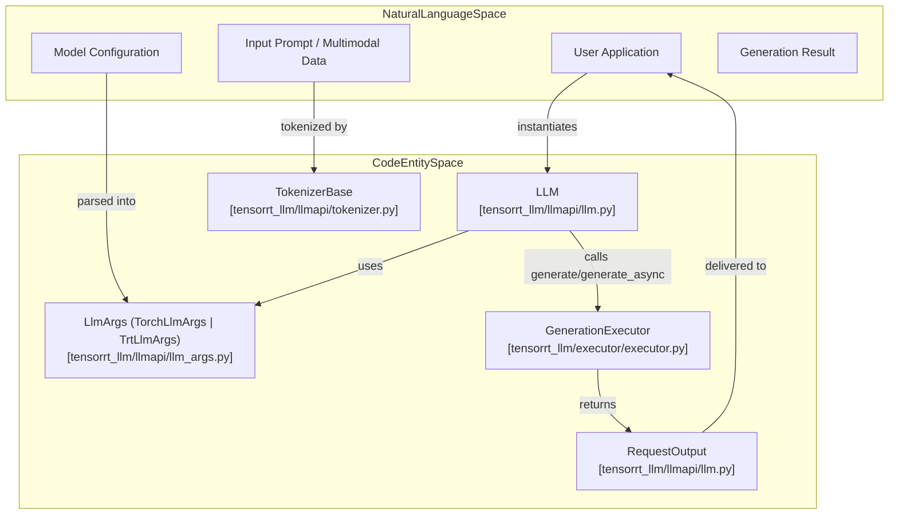
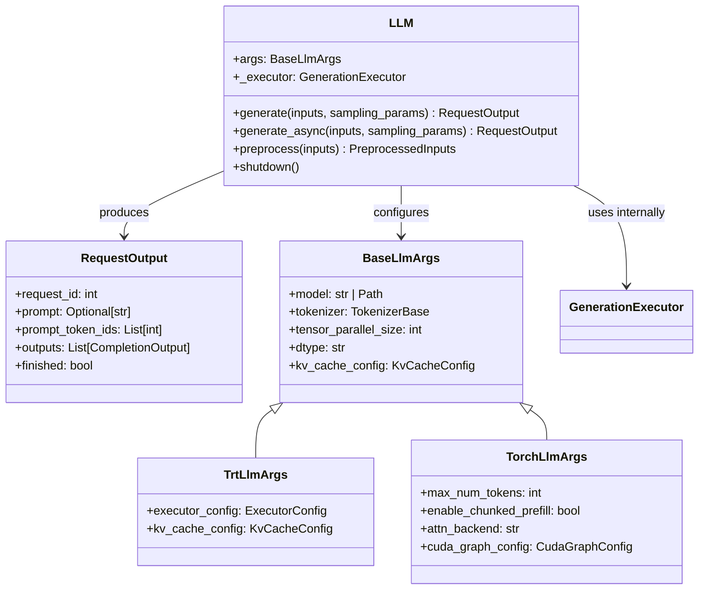
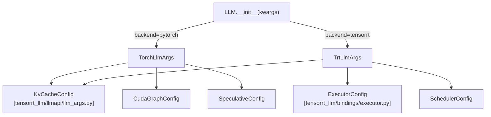

<!-- source: DeepWiki mcp.deepwiki.com · repo NVIDIA/TensorRT-LLM · page 3 LLM API and User Interface · fetched 2026-10-26 -->

# LLM API and User Interface

<details>
<summary>Relevant source files</summary>

The following files were used as context for generating this wiki page:

- [tensorrt_llm/executor/__init__.py](tensorrt_llm/executor/__init__.py)
- [tensorrt_llm/executor/base_worker.py](tensorrt_llm/executor/base_worker.py)
- [tensorrt_llm/executor/executor.py](tensorrt_llm/executor/executor.py)
- [tensorrt_llm/executor/ipc.py](tensorrt_llm/executor/ipc.py)
- [tensorrt_llm/executor/postproc_worker.py](tensorrt_llm/executor/postproc_worker.py)
- [tensorrt_llm/executor/proxy.py](tensorrt_llm/executor/proxy.py)
- [tensorrt_llm/executor/request.py](tensorrt_llm/executor/request.py)
- [tensorrt_llm/executor/result.py](tensorrt_llm/executor/result.py)
- [tensorrt_llm/executor/utils.py](tensorrt_llm/executor/utils.py)
- [tensorrt_llm/executor/worker.py](tensorrt_llm/executor/worker.py)
- [tensorrt_llm/llmapi/__init__.py](tensorrt_llm/llmapi/__init__.py)
- [tensorrt_llm/llmapi/llm.py](tensorrt_llm/llmapi/llm.py)
- [tensorrt_llm/llmapi/mgmn_leader_node.py](tensorrt_llm/llmapi/mgmn_leader_node.py)
- [tensorrt_llm/llmapi/mpi_session.py](tensorrt_llm/llmapi/mpi_session.py)
- [tensorrt_llm/llmapi/trtllm-llmapi-launch](tensorrt_llm/llmapi/trtllm-llmapi-launch)
- [tests/unittest/_torch/executor/test_router_dealer_ipc.py](tests/unittest/_torch/executor/test_router_dealer_ipc.py)
- [tests/unittest/api_stability/references_committed/llm.yaml](tests/unittest/api_stability/references_committed/llm.yaml)
- [tests/unittest/executor/test_ipc.py](tests/unittest/executor/test_ipc.py)
- [tests/unittest/executor/test_launcher_envs.py](tests/unittest/executor/test_launcher_envs.py)
- [tests/unittest/executor/test_proxy_fast_death.py](tests/unittest/executor/test_proxy_fast_death.py)
- [tests/unittest/llmapi/_run_mpi_comm_task.py](tests/unittest/llmapi/_run_mpi_comm_task.py)
- [tests/unittest/llmapi/_run_multi_llm_tasks.py](tests/unittest/llmapi/_run_multi_llm_tasks.py)
- [tests/unittest/llmapi/_run_multi_mpi_comm_tasks.py](tests/unittest/llmapi/_run_multi_mpi_comm_tasks.py)
- [tests/unittest/llmapi/lora_test_utils.py](tests/unittest/llmapi/lora_test_utils.py)
- [tests/unittest/llmapi/test_executor.py](tests/unittest/llmapi/test_executor.py)
- [tests/unittest/llmapi/test_llm.py](tests/unittest/llmapi/test_llm.py)
- [tests/unittest/llmapi/test_llm_multi_gpu_pytorch.py](tests/unittest/llmapi/test_llm_multi_gpu_pytorch.py)
- [tests/unittest/llmapi/test_llm_pytorch.py](tests/unittest/llmapi/test_llm_pytorch.py)

</details>


## Purpose and Scope

This page provides a high-level overview of the primary Python API exposed by TensorRT-LLM for Large Language Model (LLM) inference and generation. It introduces the central `LLM` class used by applications, explains its configuration system, the key generation methods, and how multi-GPU and disaggregated setups are managed.

This page acts as a parent overview. Detailed technical aspects, code usage examples, and configuration options are covered in child pages:

- For `LLM` class details, usage examples, and generation methods, see [LLM Class and Generation Methods](#3.1).
- For the Python configuration system including `TorchLlmArgs`/`TrtLlmArgs`, KV cache management, scheduling, and attention backends, see [Configuration System and LlmArgs](#3.2).
- For sampling control, beam search, logits processing, and output customization, see [SamplingParams and Generation Control](#3.3).
- For multi-GPU distributed setups, MPI session management, launching, and Ray executor usage, see [Multi-GPU Setup and MPI Sessions](#3.4).
- For disaggregated serving and specialized inference parameter management, see [Disaggregated Serving Parameters](#3.5).
- For the underlying PyTorch runtime used in `backend="pytorch"`, see [PyExecutor Runtime System](#7).
- For the C++ TensorRT based runtime engine, see [C++ Runtime and Batch Manager](#20).

Sources: [tensorrt_llm/llmapi/llm.py:70-82](), [tensorrt_llm/llmapi/llm.py:1022-1065]()

---

## Architecture Overview

The user-facing LLM API is anchored around the `LLM` class defined in `tensorrt_llm/llmapi/llm.py`. This class encapsulates model loading, configuration parsing, backend selection, and generation handling.

At initialization, `LLM` parses user-provided configuration arguments into specialized classes (`TorchLlmArgs` or `TrtLlmArgs`), chooses the runtime backend (PyTorch or TensorRT), and instantiates a `GenerationExecutor`. The executor manages all model inference and token generation logic, including multi-GPU coordination if requested.

Key components of the API are:

- `LLM`: The main interface, created by the user [tensorrt_llm/llmapi/llm.py:202-210]().
- `LlmArgs` subclasses: Configuration objects that control executor behavior, KV cache, tensor parallelism, etc [tensorrt_llm/llmapi/llm_args.py:28-30](), [tensorrt_llm/llmapi/llm_args.py:575-800]().
- `GenerationExecutor`: Abstracts runtime execution; varies by backend [tensorrt_llm/executor/executor.py:83-88]().
- `RequestOutput`: Represents results for a single generation request [tensorrt_llm/llmapi/llm.py:70-82]().
- `TokenizerBase`: Abstracts tokenization for text and multimodal inputs [tensorrt_llm/llmapi/tokenizer.py:23]().

**Diagram: Natural Language to Code Entity Mapping (Request Flow)**



Sources: [tensorrt_llm/llmapi/llm.py:70-123](), [tensorrt_llm/llmapi/llm_args.py:575-800](), [tensorrt_llm/llmapi/llm.py:1022-1180]()

---

## Public API Surface

The LLM API symbols exposed for direct user usage are exported from `tensorrt_llm/llmapi/__init__.py`. Major symbols include:

| Symbol                | Description                                                  | Source Location                                |
|-----------------------|--------------------------------------------------------------|------------------------------------------------|
| `LLM`                 | Main user-facing class for loading models and generating text| [tensorrt_llm/llmapi/llm.py:202]() |
| `RequestOutput`        | Result class containing generation outputs                   | [tensorrt_llm/llmapi/llm.py:70]() |
| `EncoderOutput`        | Output from encoder-only (classification/embedding) models  | [tensorrt_llm/llmapi/llm.py:124]() |
| `SamplingParams`       | Controls sampling strategies: temperature, beams, top-k, etc.| [tensorrt_llm/sampling_params.py:57]() |
| `KvCacheConfig`        | Configuration for KV cache sizing and reuse                  | [tensorrt_llm/llmapi/llm_args.py:9]() |
| `TorchLlmArgs`         | PyTorch backend configuration parameters                     | [tensorrt_llm/llmapi/llm_args.py:575]() |
| `TrtLlmArgs`           | TensorRT backend configuration parameters                    | [tensorrt_llm/llmapi/llm_args.py:795]() |
| `LoRARequest`          | LoRA adapter request specification for per-request control  | [tensorrt_llm/executor/request.py:45]() |
| `DisaggregatedParams`  | Parameters for disaggregated serving                          | [tensorrt_llm/disaggregated_params.py:3]() |

Sources: [tensorrt_llm/llmapi/__init__.py:1-100](), [tensorrt_llm/llmapi/llm.py:70-137]()

---

## Class Hierarchy and Relationships

The core class inheritance and relations around the LLM API involve bridging the high-level user interface with the underlying executor workers.



This hierarchy shows how `LLM` is configured by argument classes (`TrtLlmArgs` or `TorchLlmArgs`) which extend a common base `BaseLlmArgs`. `RequestOutput` encapsulates generation output results [tensorrt_llm/llmapi/llm.py:70-121]().

Sources: [tensorrt_llm/llmapi/llm.py:202-300](), [tensorrt_llm/llmapi/llm_args.py:575-800]()

---

## Backend Selection and Execution

The `LLM` constructor accepts parameters determining runtime behavior. The selection of the backend influences model loading and execution pipelines [tensorrt_llm/llmapi/llm.py:220-250]():

| Backend Value     | Configuration Args Class | Runtime Executor Implementation                     | Notes                                      |
|-------------------|--------------------------|----------------------------------------------------|--------------------------------------------|
| `"pytorch"`       | `TorchLlmArgs`           | `GenerationExecutorWorker` (Python PyTorch runtime) | Enables PyTorch-based inference and autotuning |
| `"tensorrt"` (default) | `TrtLlmArgs`          | C++ TensorRT batch manager via bindings             | High-performance GPU TensorRT engine        |

For multi-GPU, the system uses an MPI session (e.g., `MpiPoolSession`) to manage multiple executor worker processes [tensorrt_llm/llmapi/mpi_session.py:62-63](). The `GenerationExecutorProxy` handles communication between the frontend and these workers [tensorrt_llm/executor/proxy.py:99-102]().

Sources: [tensorrt_llm/llmapi/llm.py:202-350](), [tensorrt_llm/llmapi/mpi_session.py:62-63](), [tensorrt_llm/executor/proxy.py:99-102]()

---

## Configuration Overview

All parameters controlling model loading, execution, and generation are supplied via the `LLM` constructor. Configuration flows through specialized classes [tensorrt_llm/llmapi/llm_args.py:575-800]():

- `TorchLlmArgs`: Parameters controlling PyTorch backend features including chunked prefill, attention backend selection, CUDA graph usage, and LoRA integration [tensorrt_llm/llmapi/llm_args.py:575]().
- `TrtLlmArgs`: Parameters controlling TensorRT backend execution including executor config, scheduling, KV cache policies, and kernel selection [tensorrt_llm/llmapi/llm_args.py:795]().

These argument classes reference and compose smaller configuration classes such as `KvCacheConfig` [tensorrt_llm/llmapi/llm_args.py:9]() and `SchedulerConfig` [tensorrt_llm/llmapi/llm_args.py:26]().

**Diagram: Configuration Composition in LLM Constructor**



Sources: [tensorrt_llm/llmapi/llm_args.py:9-26](), [tensorrt_llm/llmapi/llm.py:202-350]()

---

## Generation Interface

Applications primarily interact with the `LLM` class using generation methods:

- **`generate` (synchronous)**: Accepts a single prompt string or a list of prompts. Internally calls `generate_async` and waits for results to complete [tensorrt_llm/llmapi/llm.py:1022-1065]().
- **`generate_async` (asynchronous and streaming capable)**: Returns a `GenerationResult` object immediately, with results delivered asynchronously or via streaming [tensorrt_llm/llmapi/llm.py:1126-1180]().
- **`preprocess`**: Performs tokenization and multimodal input preprocessing without submitting for model inference [tensorrt_llm/llmapi/llm.py:1010-1020]().

Generation inputs can include plain text prompts, token ID lists, or multimodal data. Tokenization and preprocessing are handled by the configured tokenizer (`TokenizerBase` implementations) [tensorrt_llm/llmapi/tokenizer.py:23]().

Sources: [tensorrt_llm/llmapi/llm.py:1022-1180](), [tensorrt_llm/llmapi/tokenizer.py:23]()

---

## Output Types

Output from the LLM API is modeled primarily through:

- `RequestOutput`: The main result object returned by generation calls [tensorrt_llm/llmapi/llm.py:70-121]().
- `CompletionOutput`: Represents a single generated completion sequence with text, tokens, logprobs, and metadata [tensorrt_llm/executor/result.py:105-145]().
- `EncoderOutput`: Used for encoder-only models like classification or embedding extraction, containing logits and prompt tokens [tensorrt_llm/llmapi/llm.py:124-137]().

Sources: [tensorrt_llm/llmapi/llm.py:70-137](), [tensorrt_llm/executor/result.py:105-145]()

---

## Typical Usage Pattern

The following demonstrates a typical usage of the `LLM` Python API for text generation.

**Synchronous, single prompt generation**

```python
from tensorrt_llm import LLM
from tensorrt_llm.llmapi import KvCacheConfig, SamplingParams

llm = LLM(model="path/to/model", kv_cache_config=KvCacheConfig(free_gpu_memory_fraction=0.4))
outputs = llm.generate(["Hello, world"], sampling_params=SamplingParams(max_tokens=8))

print(outputs[0].outputs[0].text)  # Print first token sequence generated
```

**Context-managed lifecycle**

```python
with LLM(model="path/to/model", tensor_parallel_size=2) as llm:
    prompts = ["Once upon a time"]
    results = llm.generate(prompts)
    for output in results:
        print(output.outputs[0].text)
```

The context manager ensures proper resource cleanup via `atexit` and internal `shutdown` logic [tensorrt_llm/llmapi/llm.py:202-350]().

Sources: [tensorrt_llm/llmapi/llm.py:202-350](), [tests/unittest/llmapi/test_llm.py:148-154]()

---

# Links to Child Pages

For detailed exploration of the components introduced here, please visit:

- **[LLM Class and Generation Methods](#3.1)** — Details of `LLM` initialization, usage, generation methods, and tokenization events.
- **[Configuration System and LlmArgs](#3.2)** — Deep dive into the Torch and TensorRT configuration parameter classes.
- **[SamplingParams and Generation Control](#3.3)** — In-depth guide to sampling parameters, beam search, logits processing, and output controls.
- **[Multi-GPU Setup and MPI Sessions](#3.4)** — Documentation of multi-GPU deployment, MPI session types, and launcher scripts.
- **[Disaggregated Serving Parameters](#3.5)** — Explanation of disaggregated inference parameters, context-generation separation, and KV cache transfer.

---

Sources Summary:  
- [`tensorrt_llm/llmapi/llm.py:70-137,202-350,1022-1180`]()  
- [`tensorrt_llm/llmapi/llm_args.py:9-30,575-800`]()  
- [`tensorrt_llm/executor/executor.py:83-88`]()  
- [`tensorrt_llm/executor/proxy.py:99-102`]()
- [`tensorrt_llm/llmapi/mpi_session.py:62-63`]()  
- [`tensorrt_llm/llmapi/tokenizer.py:64`]()  
- [`tensorrt_llm/sampling_params.py:57`]()
- [`tensorrt_llm/executor/result.py:105-145`]()

---

