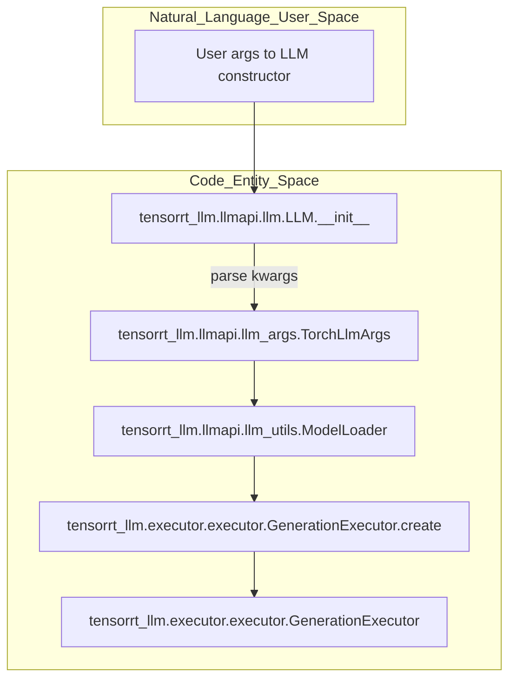
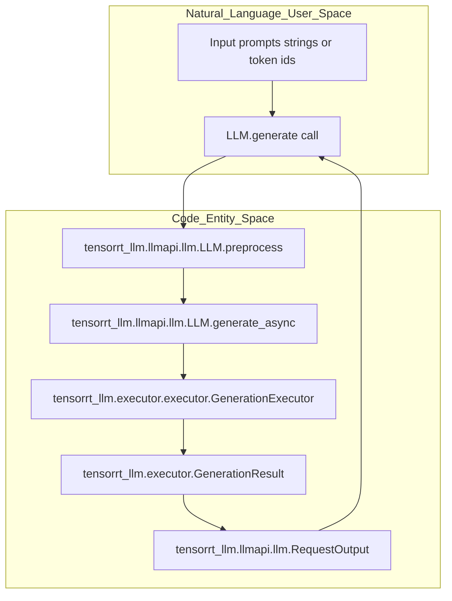

<!-- source: DeepWiki mcp.deepwiki.com · repo NVIDIA/TensorRT-LLM · page 3.1 LLM Class and Generation Methods · fetched 2026-10-26 -->

# LLM Class and Generation Methods

<details>
<summary>Relevant source files</summary>

The following files were used as context for generating this wiki page:

- [examples/llm-api/quickstart_advanced.py](examples/llm-api/quickstart_advanced.py)
- [tensorrt_llm/_torch/models/modeling_multimodal_utils.py](tensorrt_llm/_torch/models/modeling_multimodal_utils.py)
- [tensorrt_llm/_torch/models/modeling_nemotron_nano.py](tensorrt_llm/_torch/models/modeling_nemotron_nano.py)
- [tensorrt_llm/_torch/models/modeling_parakeet.py](tensorrt_llm/_torch/models/modeling_parakeet.py)
- [tensorrt_llm/_torch/models/modeling_radio.py](tensorrt_llm/_torch/models/modeling_radio.py)
- [tensorrt_llm/_torch/models/multimodal_encoder_graph.py](tensorrt_llm/_torch/models/multimodal_encoder_graph.py)
- [tensorrt_llm/executor/__init__.py](tensorrt_llm/executor/__init__.py)
- [tensorrt_llm/executor/base_worker.py](tensorrt_llm/executor/base_worker.py)
- [tensorrt_llm/executor/executor.py](tensorrt_llm/executor/executor.py)
- [tensorrt_llm/executor/ipc.py](tensorrt_llm/executor/ipc.py)
- [tensorrt_llm/executor/postproc_worker.py](tensorrt_llm/executor/postproc_worker.py)
- [tensorrt_llm/executor/proxy.py](tensorrt_llm/executor/proxy.py)
- [tensorrt_llm/executor/request.py](tensorrt_llm/executor/request.py)
- [tensorrt_llm/executor/result.py](tensorrt_llm/executor/result.py)
- [tensorrt_llm/executor/utils.py](tensorrt_llm/executor/utils.py)
- [tensorrt_llm/executor/worker.py](tensorrt_llm/executor/worker.py)
- [tensorrt_llm/inputs/__init__.py](tensorrt_llm/inputs/__init__.py)
- [tensorrt_llm/inputs/media_io.py](tensorrt_llm/inputs/media_io.py)
- [tensorrt_llm/inputs/multimodal.py](tensorrt_llm/inputs/multimodal.py)
- [tensorrt_llm/inputs/multimodal_data.py](tensorrt_llm/inputs/multimodal_data.py)
- [tensorrt_llm/inputs/registry.py](tensorrt_llm/inputs/registry.py)
- [tensorrt_llm/inputs/utils.py](tensorrt_llm/inputs/utils.py)
- [tensorrt_llm/llmapi/llm.py](tensorrt_llm/llmapi/llm.py)
- [tensorrt_llm/llmapi/mgmn_leader_node.py](tensorrt_llm/llmapi/mgmn_leader_node.py)
- [tensorrt_llm/llmapi/mpi_session.py](tensorrt_llm/llmapi/mpi_session.py)
- [tensorrt_llm/llmapi/trtllm-llmapi-launch](tensorrt_llm/llmapi/trtllm-llmapi-launch)
- [tensorrt_llm/serve/chat_utils.py](tensorrt_llm/serve/chat_utils.py)
- [tests/unittest/_torch/executor/test_router_dealer_ipc.py](tests/unittest/_torch/executor/test_router_dealer_ipc.py)
- [tests/unittest/_torch/modeling/test_modeling_nemotron_nano_v2_vl.py](tests/unittest/_torch/modeling/test_modeling_nemotron_nano_v2_vl.py)
- [tests/unittest/_torch/modeling/test_modeling_parakeet.py](tests/unittest/_torch/modeling/test_modeling_parakeet.py)
- [tests/unittest/_torch/modeling/test_modeling_radio.py](tests/unittest/_torch/modeling/test_modeling_radio.py)
- [tests/unittest/_torch/modeling/test_multimodal_encoder_graph.py](tests/unittest/_torch/modeling/test_multimodal_encoder_graph.py)
- [tests/unittest/_torch/modeling/test_nemotron_nano_preprocessing.py](tests/unittest/_torch/modeling/test_nemotron_nano_preprocessing.py)
- [tests/unittest/_torch/multimodal/test_qwen3vl_mixed_modality_encoder.py](tests/unittest/_torch/multimodal/test_qwen3vl_mixed_modality_encoder.py)
- [tests/unittest/_torch/test_utils.py](tests/unittest/_torch/test_utils.py)
- [tests/unittest/executor/test_ipc.py](tests/unittest/executor/test_ipc.py)
- [tests/unittest/executor/test_launcher_envs.py](tests/unittest/executor/test_launcher_envs.py)
- [tests/unittest/executor/test_proxy_fast_death.py](tests/unittest/executor/test_proxy_fast_death.py)
- [tests/unittest/inputs/test_video_data_hashing.py](tests/unittest/inputs/test_video_data_hashing.py)
- [tests/unittest/inputs/test_video_decode.py](tests/unittest/inputs/test_video_decode.py)
- [tests/unittest/llmapi/_run_mpi_comm_task.py](tests/unittest/llmapi/_run_mpi_comm_task.py)
- [tests/unittest/llmapi/_run_multi_llm_tasks.py](tests/unittest/llmapi/_run_multi_llm_tasks.py)
- [tests/unittest/llmapi/_run_multi_mpi_comm_tasks.py](tests/unittest/llmapi/_run_multi_mpi_comm_tasks.py)
- [tests/unittest/llmapi/apps/test_chat_utils.py](tests/unittest/llmapi/apps/test_chat_utils.py)
- [tests/unittest/llmapi/lora_test_utils.py](tests/unittest/llmapi/lora_test_utils.py)
- [tests/unittest/llmapi/test_executor.py](tests/unittest/llmapi/test_executor.py)
- [tests/unittest/llmapi/test_llm.py](tests/unittest/llmapi/test_llm.py)
- [tests/unittest/llmapi/test_llm_kv_cache_events.py](tests/unittest/llmapi/test_llm_kv_cache_events.py)
- [tests/unittest/llmapi/test_llm_multi_gpu_pytorch.py](tests/unittest/llmapi/test_llm_multi_gpu_pytorch.py)
- [tests/unittest/llmapi/test_llm_pytorch.py](tests/unittest/llmapi/test_llm_pytorch.py)

</details>


## Purpose and Scope

This page documents the `LLM` class and its core generation methods, which provide the primary Python API for text generation in TensorRT-LLM. The `LLM` class abstracts model loading, inference execution, and output handling into a simple interface for both synchronous and asynchronous generation. It supports multiple backends, including a high-performance C++ runtime and a flexible PyTorch-based execution engine (`PyExecutor`).

**Related pages:**
- For configuration parameters and validation, see [3.2 Configuration System and LlmArgs]()
- For sampling strategy control, see [3.3 SamplingParams and Generation Control]()
- For multi-GPU distribution setup, see [3.4 Multi-GPU Setup and MPI Sessions]()
- For the underlying execution orchestration, see [7 PyExecutor Runtime System]()

---

## LLM Class Overview

The `LLM` class serves as the main entry point for model inference. It supports multiple backend implementations, primarily branching between a C++ based TensorRT engine executor and a PyTorch-based execution engine.

| Backend | Code Entity | Use Case |
|---------|-------------|----------|
| **PyTorch** | `tensorrt_llm.llmapi.llm.LLM` | Development, debugging, and models without pre-built engines. [tensorrt_llm/llmapi/llm.py:150-237]() |
| **TensorRT** | `tensorrt_llm._tensorrt_engine.LLM` | Production deployments requiring maximum performance via compiled engines. [tensorrt_llm/llmapi/llm.py:182-196]() |

The class provides three primary methods for interaction:

- `__init__`: Initialize and load the model [tensorrt_llm/llmapi/llm.py:150-237]()
- `generate`: Synchronous batch generation, returning all outputs once completed [tensorrt_llm/llmapi/llm.py:793-933]()
- `generate_async`: Asynchronous generation that returns immediately with a `GenerationResult` for streaming or later retrieval [tensorrt_llm/llmapi/llm.py:946-1047]()

**Sources:** [tensorrt_llm/llmapi/llm.py:70-1047]()

---

## Class Initialization

### Constructor Signature

```python
# Initialization parameters [tensorrt_llm/llmapi/llm.py:150-161]
LLM(
    model: Union[str, Path],
    tokenizer: Optional[Union[str, Path, TokenizerBase, PreTrainedTokenizerBase]] = None,
    tokenizer_mode: Literal['auto', 'slow'] = 'auto',
    skip_tokenizer_init: bool = False,
    trust_remote_code: bool = False,
    tensor_parallel_size: int = 1,
    dtype: str = "auto",
    revision: Optional[str] = None,
    tokenizer_revision: Optional[str] = None,
    **kwargs: Any
)
```

The constructor accepts a model path or identifier and optional tokenizer configurations. Extensive backend and runtime options passed via `**kwargs` are parsed into an internal configuration class, typically `TorchLlmArgs` [tensorrt_llm/llmapi/llm.py:150-237]().

### Initialization Data Flow

The initialization involves the following transformations from user parameters to the internal executor:

Title: LLM Initialization Data Flow

**Sources:** [tensorrt_llm/llmapi/llm.py:150-237](), [tensorrt_llm/llmapi/llm_args.py:59-157](), [tensorrt_llm/llmapi/llm_utils.py:61]().

### Key Initialization Steps

1. **MPI and Distributed Handling:**  
   The constructor checks for MPI availability and creates a communication session if `tensor_parallel_size` or `pipeline_parallel_size` is greater than 1 [tensorrt_llm/llmapi/llm.py:172-178](). It uses `create_mpi_comm_session` to manage multi-GPU orchestration [tensorrt_llm/llmapi/llm.py:225-227]().
   
2. **LlmArgs Parsing:**  
   The `TorchLlmArgs` configuration class parses and validates keyword arguments. This includes setting up `KvCacheConfig`, `SchedulerConfig`, and `SpeculativeConfig` [tensorrt_llm/llmapi/llm_args.py:59-157]().

3. **Model Loading:**  
   `ModelLoader` (or `CachedModelLoader`) manages constructing the model from HuggingFace checkpoints. It handles weight transformation and model parallelism sharding [tensorrt_llm/llmapi/llm_utils.py:60-61]().

4. **Executor Creation:**  
   The `LLM` class initializes a `GenerationExecutor`. Depending on the `backend` and `orchestrator_type` (e.g., `rpc`, `ray`), it may spawn worker processes using `GenerationExecutorProxy` [tensorrt_llm/llmapi/llm.py:230-237]().

**Sources:** [tensorrt_llm/llmapi/llm.py:150-237](), [tensorrt_llm/llmapi/llm_args.py:59-157](), [tensorrt_llm/llmapi/llm_utils.py:60-61]().

---

## Generate Method (Synchronous)

### Overview

The synchronous `generate` method provides batch text generation. It is a blocking method that waits for completion before returning a list of `RequestOutput` objects [tensorrt_llm/llmapi/llm.py:793-933]().

### Synchronous Generation Flow

Title: Synchronous Generation Sequence

**Sources:** [tensorrt_llm/llmapi/llm.py:793-933](), [tensorrt_llm/llmapi/llm.py:1187-1237]().

### Features and Arguments

- **Sampling Control:** Accepts `SamplingParams` per request or per batch [tensorrt_llm/llmapi/llm.py:793-803]().
- **LoRA Support:** Integrates `LoRARequest` for dynamic adapter switching [tensorrt_llm/llmapi/llm.py:814-815]().
- **Reasoning Budget:** Supports `thinking_token_budget` via `add_thinking_budget_logits_processor` to control chain-of-thought generation [tensorrt_llm/llmapi/llm.py:63](), [tensorrt_llm/llmapi/thinking_budget.py:20]().

---

## Generate Async Method (Asynchronous)

`generate_async` is the non-blocking foundation of the API. It returns a `GenerationResult` (a future-like object) immediately [tensorrt_llm/llmapi/llm.py:946-1047]().

### Key Execution Path
1. **Preprocessing:** Raw inputs are converted to token IDs via `LLM.preprocess()` [tensorrt_llm/llmapi/llm.py:1187-1237]().
2. **Request Submission:** The executor's `enqueue` or equivalent method is called with a `GenerationRequest` [tensorrt_llm/llmapi/llm.py:1010-1025]().
3. **Result Tracking:** A `GenerationResult` is returned, which the user can poll or use for streaming [tensorrt_llm/llmapi/llm.py:1040-1047]().

**Sources:** [tensorrt_llm/llmapi/llm.py:946-1047](), [tensorrt_llm/llmapi/llm.py:1187-1237]().

---

## Preprocess Method

The `preprocess` method handles the conversion of high-level inputs into the format required by the inference engine.

```python
def preprocess(self, inputs: PromptInputs | Sequence[PromptInputs]) -> Tuple[List[List[int]], Optional[MultimodalParams]]:
```

- **Input Processing:** Uses `create_input_processor` to handle strings, `TokensPrompt`, and multimodal data [tensorrt_llm/llmapi/llm.py:1195-1200]().
- **Multimodal Handling:** If multimodal inputs are present, it computes embeddings and handles cumulative sum offsets for the encoder [tensorrt_llm/llmapi/llm.py:1210-1225](). For models like Nemotron-Nano, specific input processors handle aspect-preserving resizing for video and audio data [tensorrt_llm/_torch/models/modeling_nemotron_nano.py:74-146]().
- **Tokenizer Integration:** Uses `TokenizerBase` to ensure consistent encoding between prompt strings and model inputs [tensorrt_llm/llmapi/llm.py:1190-1205]().

**Sources:** [tensorrt_llm/llmapi/llm.py:1187-1237](), [tensorrt_llm/llmapi/tokenizer.py:23](), [tensorrt_llm/_torch/models/modeling_nemotron_nano.py:17-41]().

---

## RequestOutput Class

`RequestOutput` is the container for generation results. It inherits from `GenerationResult` and adds detokenization context [tensorrt_llm/llmapi/llm.py:70-121]().

### Key Attributes
- `request_id`: The unique ID assigned by the executor [tensorrt_llm/llmapi/llm.py:74]().
- `prompt`: The original input string [tensorrt_llm/llmapi/llm.py:75]().
- `outputs`: A list of `CompletionOutput` objects containing the generated text and tokens [tensorrt_llm/llmapi/llm.py:77]().
- `finished`: Boolean indicating if the request reached an EOS or limit [tensorrt_llm/llmapi/llm.py:80]().

**Sources:** [tensorrt_llm/llmapi/llm.py:70-121]()

---

## KV Cache Management and Events

The `LLM` class manages the KV cache through `KvCacheConfig` passed during initialization.

- **Resource Management:** Allocation is handled by the executor's `KVCacheManager` or `KVCacheManagerV2` for PyTorch backend [tensorrt_llm/llmapi/llm_args.py:64](), [examples/llm-api/quickstart_advanced.py:156-162]().
- **Retention Policies:** `KvCacheRetentionConfig` allows specifying how long blocks should be kept in memory after a request finishes to facilitate prefix caching [tensorrt_llm/llmapi/llm_utils.py:60]().
- **Event Logging:** When `log_kv_cache_events` is enabled in `LlmArgs`, the system tracks cache hits, misses, and evictions via the `await_response_thread` in the worker [tensorrt_llm/llmapi/llm_args.py:155-157](), [tensorrt_llm/executor/worker.py:77-81]().

**Sources:** [tensorrt_llm/llmapi/llm_args.py:64](), [tensorrt_llm/llmapi/llm_utils.py:60](), [tensorrt_llm/executor/worker.py:77-81]().

---

## Basic Usage Patterns

### Simple Synchronous Generation
```python
from tensorrt_llm import LLM, SamplingParams

llm = LLM(model="llama-models-v2/TinyLlama-1.1B-Chat-v1.0")
outputs = llm.generate(
    ["A B C"],
    sampling_params=SamplingParams(max_tokens=8),
)
for output in outputs:
    print(output.outputs[0].text)
```

### Asynchronous Streaming
```python
# Streaming usage pattern [tensorrt_llm/llmapi/llm.py:864-870]
result = llm.generate_async(
    "The future of AI is",
    sampling_params=SamplingParams(max_tokens=32),
    streaming=True,
)

for partial in result:
    print(partial.outputs[0].text_diff, end="", flush=True)
```

**Sources:** [tensorrt_llm/llmapi/llm.py:793-1047](), [examples/llm-api/quickstart_advanced.py:29-33](), [tests/unittest/llmapi/test_llm.py:147-153]().

---

