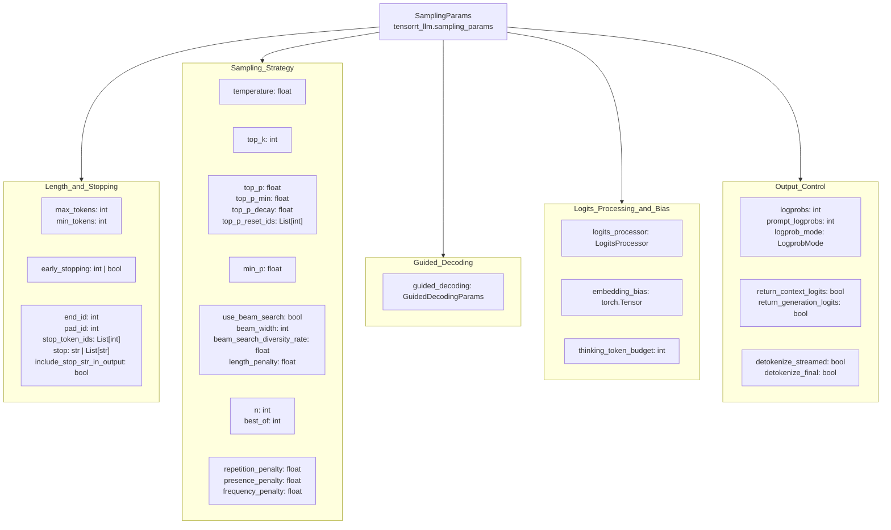
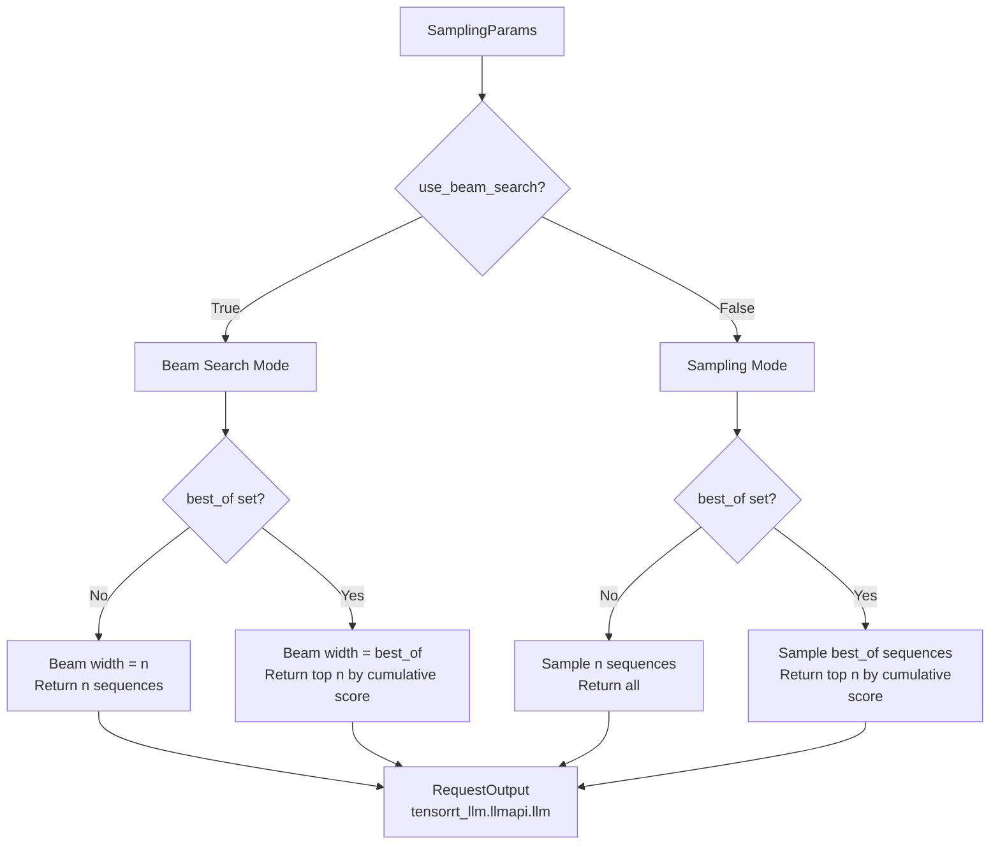
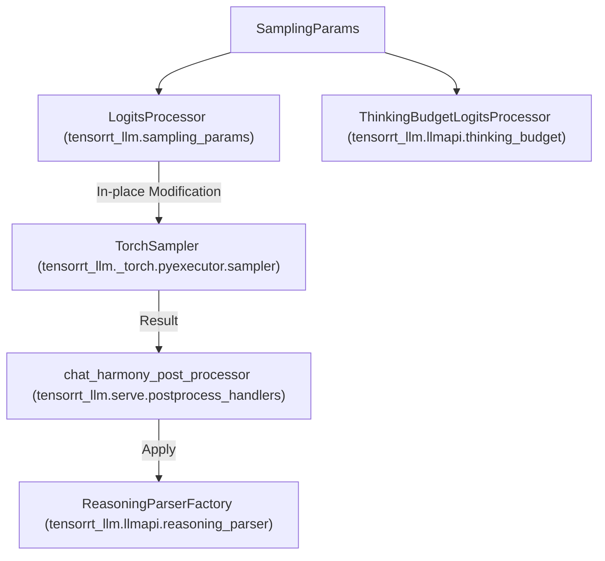

<!-- source: DeepWiki mcp.deepwiki.com · repo NVIDIA/TensorRT-LLM · page 3.3 SamplingParams and Generation Control · fetched 2026-10-26 -->

# SamplingParams and Generation Control

<details>
<summary>Relevant source files</summary>

The following files were used as context for generating this wiki page:

- [docs/source/features/sampling.md](docs/source/features/sampling.md)
- [tensorrt_llm/_torch/pyexecutor/sampler/__init__.py](tensorrt_llm/_torch/pyexecutor/sampler/__init__.py)
- [tensorrt_llm/_torch/pyexecutor/sampler/beam_search.py](tensorrt_llm/_torch/pyexecutor/sampler/beam_search.py)
- [tensorrt_llm/_torch/pyexecutor/sampler/logprobs.py](tensorrt_llm/_torch/pyexecutor/sampler/logprobs.py)
- [tensorrt_llm/_torch/pyexecutor/sampler/ops/flashinfer.py](tensorrt_llm/_torch/pyexecutor/sampler/ops/flashinfer.py)
- [tensorrt_llm/_torch/pyexecutor/sampler/ops/vanilla.py](tensorrt_llm/_torch/pyexecutor/sampler/ops/vanilla.py)
- [tensorrt_llm/_torch/pyexecutor/sampler/penalties.py](tensorrt_llm/_torch/pyexecutor/sampler/penalties.py)
- [tensorrt_llm/_torch/pyexecutor/sampler/sampler.py](tensorrt_llm/_torch/pyexecutor/sampler/sampler.py)
- [tensorrt_llm/_torch/pyexecutor/sampler/sampler_common.py](tensorrt_llm/_torch/pyexecutor/sampler/sampler_common.py)
- [tensorrt_llm/_torch/pyexecutor/sampler/sampler_features.py](tensorrt_llm/_torch/pyexecutor/sampler/sampler_features.py)
- [tensorrt_llm/_torch/pyexecutor/sampler/sampler_strategy.py](tensorrt_llm/_torch/pyexecutor/sampler/sampler_strategy.py)
- [tensorrt_llm/_torch/pyexecutor/sampler/seed_manager.py](tensorrt_llm/_torch/pyexecutor/sampler/seed_manager.py)
- [tensorrt_llm/_torch/pyexecutor/sampler/top_p_decay.py](tensorrt_llm/_torch/pyexecutor/sampler/top_p_decay.py)
- [tensorrt_llm/_torch/speculative/spec_sampler_base.py](tensorrt_llm/_torch/speculative/spec_sampler_base.py)
- [tensorrt_llm/llmapi/reasoning_parser.py](tensorrt_llm/llmapi/reasoning_parser.py)
- [tensorrt_llm/llmapi/thinking_budget.py](tensorrt_llm/llmapi/thinking_budget.py)
- [tensorrt_llm/sampling_params.py](tensorrt_llm/sampling_params.py)
- [tensorrt_llm/serve/harmony_adapter.py](tensorrt_llm/serve/harmony_adapter.py)
- [tensorrt_llm/serve/openai_protocol.py](tensorrt_llm/serve/openai_protocol.py)
- [tensorrt_llm/serve/openai_server.py](tensorrt_llm/serve/openai_server.py)
- [tensorrt_llm/serve/postprocess_handlers.py](tensorrt_llm/serve/postprocess_handlers.py)
- [tensorrt_llm/serve/responses_utils.py](tensorrt_llm/serve/responses_utils.py)
- [tensorrt_llm/tokenizer/__init__.py](tensorrt_llm/tokenizer/__init__.py)
- [tensorrt_llm/tokenizer/tokenizer.py](tensorrt_llm/tokenizer/tokenizer.py)
- [tests/unittest/_torch/executor/test_resource_manager.py](tests/unittest/_torch/executor/test_resource_manager.py)
- [tests/unittest/_torch/sampler/test_beam_search.py](tests/unittest/_torch/sampler/test_beam_search.py)
- [tests/unittest/_torch/sampler/test_beam_search_util.py](tests/unittest/_torch/sampler/test_beam_search_util.py)
- [tests/unittest/_torch/sampler/test_logits_logprobs.py](tests/unittest/_torch/sampler/test_logits_logprobs.py)
- [tests/unittest/_torch/sampler/test_penalties.py](tests/unittest/_torch/sampler/test_penalties.py)
- [tests/unittest/_torch/sampler/test_penalties_e2e.py](tests/unittest/_torch/sampler/test_penalties_e2e.py)
- [tests/unittest/_torch/sampler/test_torch_sampler.py](tests/unittest/_torch/sampler/test_torch_sampler.py)
- [tests/unittest/llmapi/apps/_test_openai_chat.py](tests/unittest/llmapi/apps/_test_openai_chat.py)
- [tests/unittest/llmapi/apps/_test_openai_chat_guided_decoding.py](tests/unittest/llmapi/apps/_test_openai_chat_guided_decoding.py)
- [tests/unittest/llmapi/apps/_test_openai_chat_harmony.py](tests/unittest/llmapi/apps/_test_openai_chat_harmony.py)
- [tests/unittest/llmapi/apps/_test_openai_chat_harmony_perf_metrics.py](tests/unittest/llmapi/apps/_test_openai_chat_harmony_perf_metrics.py)
- [tests/unittest/llmapi/apps/_test_openai_completions.py](tests/unittest/llmapi/apps/_test_openai_completions.py)
- [tests/unittest/llmapi/apps/_test_openai_reasoning.py](tests/unittest/llmapi/apps/_test_openai_reasoning.py)
- [tests/unittest/llmapi/apps/_test_openai_responses.py](tests/unittest/llmapi/apps/_test_openai_responses.py)
- [tests/unittest/llmapi/apps/test_harmony_channel_validation.py](tests/unittest/llmapi/apps/test_harmony_channel_validation.py)
- [tests/unittest/llmapi/apps/test_harmony_parsing.py](tests/unittest/llmapi/apps/test_harmony_parsing.py)
- [tests/unittest/llmapi/test_reasoning_parser.py](tests/unittest/llmapi/test_reasoning_parser.py)
- [tests/unittest/llmapi/test_sampling_params.py](tests/unittest/llmapi/test_sampling_params.py)

</details>


This page documents the `SamplingParams` class and related generation control mechanisms in TensorRT-LLM. `SamplingParams` encapsulates parameters that govern text generation, such as sampling strategy configuration, stopping criteria, beam search options, guided decoding constraints, logits processing hooks, and output control. This configuration is passed to the `LLM.generate()` and `LLM.generate_async()` API methods.

For details on scheduling and resource management parameters that complement these generation controls, see [3.2 Configuration System and LlmArgs](). For the overarching usage of generation APIs, see [3.1 LLM Class and Generation Methods]().

---

## Overview and Purpose

`SamplingParams` is a comprehensive dataclass that captures configuration for text generation requests. Its fields cover:

- **Length and Stopping Controls:** Maximum and minimum generated tokens, end token IDs, stop strings, early stopping.  
- **Sampling Strategies:** Temperature, top-k, top-p, min-p sampling, and beam search configuration including beam widths and diversity.  
- **Multiple Outputs:** Parameters to generate multiple candidate sequences and select the best among them.  
- **Guided Decoding:** Enforce constraints on output format, e.g., JSON schemas, regex, grammars.  
- **Logits Processing:** Custom user callbacks to modify logits before sampling, embedding bias tensors, and handling of reasoning token budgets.  
- **Output Controls:** Requests for log probabilities, raw logits, and format options.

This class is the key data structure passed at generation time to precisely tune the behavior of the inference sampler.

Sources: [tensorrt_llm/sampling_params.py:171-280](), [tensorrt_llm/llmapi/llm.py:57-57]()

---

## SamplingParams Class Structure

Below is an annotated diagram outlining the primary parameter groups inside the `SamplingParams` class and their corresponding code elements. This provides an architectural view of generation control parameters and how they relate semantically.

### SamplingParams Grouping


Sources: [tensorrt_llm/sampling_params.py:171-280]()

---

## Basic Generation Control

### Max Tokens and Stopping Criteria

- **Max Tokens (`max_tokens`)**: The upper bound on the number of tokens generated (default 32) [tensorrt_llm/sampling_params.py:173-173]().  
- **Min Tokens (`min_tokens`)**: Minimum tokens to generate before enforcing stopping conditions [tensorrt_llm/sampling_params.py:176-176]().  
- **Stopping Conditions**:  
  - `end_id`: Specifies token ID for the end of generation [tensorrt_llm/sampling_params.py:179-179]().  
  - `pad_id`: Token padding ID [tensorrt_llm/sampling_params.py:182-182]().  
  - `stop_token_ids`: List of token IDs considered as stop signals [tensorrt_llm/sampling_params.py:185-185]().  
  - `stop`: String or list of stop strings to end generation early [tensorrt_llm/sampling_params.py:202-205]().  
  - `include_stop_str_in_output`: Boolean flag whether to include the stop string in the output [tensorrt_llm/sampling_params.py:208-208]().

Sources: [tensorrt_llm/sampling_params.py:172-208]()

### Early Stopping for Beam Search

`early_stopping` controls whether beam search terminates early:

- If `True`, the generation halts as soon as `beam_width` finished candidates are available [tensorrt_llm/sampling_params.py:243-243]().  
- If an integer, the generation stops when that many finished beams are reached.  
- The `openai_protocol.py` module translates HF-style tri-states (`True`, `False`, `"never"`) into engine-specific integer encodings [tensorrt_llm/serve/openai_protocol.py:74-86]().

Sources: [tensorrt_llm/sampling_params.py:243-243](), [tensorrt_llm/serve/openai_protocol.py:74-86]()

---

## Sampling Strategies and Implementation

### Strategy Resolution Logic

The generation configuration determines the sampling strategy based on the following precedence:

1. **Greedy**: Applied if `temperature=0`, `top_k=1`, or `top_p=0` [tensorrt_llm/sampling_params.py:226-231]().  
2. **Beam Search**: Enabled if `use_beam_search=True` [tensorrt_llm/sampling_params.py:241-241]().  
3. **Top-K / Top-P / Min-P**: For non-greedy sampling, the relevant probability thresholds apply [tensorrt_llm/sampling_params.py:231-239]().

In the PyTorch runtime (`TorchSampler`), requests are grouped by strategy (e.g., `GREEDY`, `TopK`, `TopP`, `MinP`, `BeamSearch`) to enable efficient batched kernels [tensorrt_llm/_torch/pyexecutor/sampler/sampler_strategy.py:61-76]().

Sources: [tensorrt_llm/sampling_params.py:226-241](), [tensorrt_llm/_torch/pyexecutor/sampler/sampler_strategy.py:71-76](), [docs/source/features/sampling.md:121-168]()

---

## Beam Search and Multi-Output Generation

`SamplingParams` supports complex output modalities:

| Mode        | n (outputs)    | best_of (sample count) | Semantics                                             |
|-------------|----------------|-----------------------|-------------------------------------------------------|
| Sampling    | default 1      | None                  | Sample `n` sequences and return all                   |
| Sampling    | >1             | `best_of` specified   | Sample `best_of`, return top `n` by cumulative score  |
| Beam Search | `n`            | None                  | Beam width = `n`, directly return `n` final beams     |
| Beam Search | `n`            | `best_of` specified   | Beam width = `best_of`, return top `n` sequences      |

Beam search is handled by the `BeamSearchHandler` in the PyTorch runtime, which manages beam history and candidate finalization [tensorrt_llm/_torch/pyexecutor/sampler/sampler.py:94-94]().

Sources: [tensorrt_llm/sampling_params.py:190-195](), [tensorrt_llm/_torch/pyexecutor/sampler/beam_search.py:42-43](), [tests/unittest/_torch/sampler/test_beam_search.py:42-46]()

### Output Selection Flow


Sources: [tensorrt_llm/sampling_params.py:190-195](), [tensorrt_llm/llmapi/llm.py:70-82]()

---

## Guided Decoding

Guided decoding constrains generation output to follow specific formats. `SamplingParams` accepts a `guided_decoding` field of type `GuidedDecodingParams` [tensorrt_llm/sampling_params.py:70-86](), supporting exactly one of:

- **JSON**: JSON schema or Pydantic model describing allowable generated text structure [tensorrt_llm/sampling_params.py:81-81]().  
- **Regex**: Regular expression patterns the output must match [tensorrt_llm/sampling_params.py:82-82]().  
- **Grammar**: Extended Backus–Naur Form (EBNF) style grammar constraints [tensorrt_llm/sampling_params.py:83-83]().  
- **json_object**: Boolean flag for any valid JSON output [tensorrt_llm/sampling_params.py:84-84]().  
- **structural_tag**: Structural tag used by `xgrammar` backend [tensorrt_llm/sampling_params.py:85-85]().

Sources: [tensorrt_llm/sampling_params.py:70-93]()

---

## Logits Processing and Reasoning Control

### LogitsProcessor Interface

`SamplingParams` supports custom logits processors to alter the output logits tensor just before sampling [tensorrt_llm/sampling_params.py:122-152]().

- Users subclass `LogitsProcessor` or provide any callable with the same interface.  
- The key method is `__call__(req_id, logits, token_ids, stream_ptr=None, client_id=None)` [tensorrt_llm/sampling_params.py:132-150](). It modifies logits in-place.

Sources: [tensorrt_llm/sampling_params.py:122-152]()

### Thinking Token Budget and Reasoning Parsers

For models that utilize reasoning (e.g., DeepSeek-R1, Nemotron), TensorRT-LLM provides specialized controls:

- **Thinking Budget**: `thinking_token_budget` limits tokens in the reasoning phase [tensorrt_llm/sampling_params.py:45-55](). It is implemented via `add_thinking_budget_logits_processor` [tensorrt_llm/llmapi/thinking_budget.py:23-26]().
- **Reasoning Parsers**: The `ReasoningParserFactory` creates parsers (e.g., `DeepSeekR1ReasoningParser`) that split model output into `content` and `reasoning_content` based on markers like `` [tensorrt_llm/llmapi/reasoning_parser.py:68-85]().

Sources: [tensorrt_llm/sampling_params.py:45-55](), [tensorrt_llm/llmapi/thinking_budget.py:23-52](), [tensorrt_llm/llmapi/reasoning_parser.py:26-30](), [tensorrt_llm/serve/postprocess_handlers.py:158-164]()

---

## Diagrams Bridging Natural Language Concepts to Code Entities

### Diagram 1: Generation Control to Code Entities

```mermaid
graph TB
    NL_SamplingParams["SamplingParams (Natural Language Generation Control)"]
    Code_SamplingParams["SamplingParams (tensorrt_llm.sampling_params)"]
    LLM_API["LLM.generate() (tensorrt_llm.llmapi.llm)"]
    OpenAI_Server["OpenAIServer (tensorrt_llm.serve.openai_server)"]
    Protocol["ChatCompletionRequest (tensorrt_llm.serve.openai_protocol)"]

    NL_SamplingParams --> Code_SamplingParams
    OpenAI_Server --> Protocol
    Protocol -->|to_llm_conversation_params()| Code_SamplingParams
    Code_SamplingParams --> LLM_API
```

Sources: [tensorrt_llm/sampling_params.py:171-280](), [tensorrt_llm/serve/openai_server.py:51-51](), [tensorrt_llm/serve/openai_protocol.py:58-59]()

---

### Diagram 2: Logits Processing and Post-Processing Pipeline



Sources: [tensorrt_llm/sampling_params.py:122-152](), [tensorrt_llm/llmapi/thinking_budget.py:23-52](), [tensorrt_llm/_torch/pyexecutor/sampler/sampler.py:22-27](), [tensorrt_llm/serve/postprocess_handlers.py:91-95]()

---

