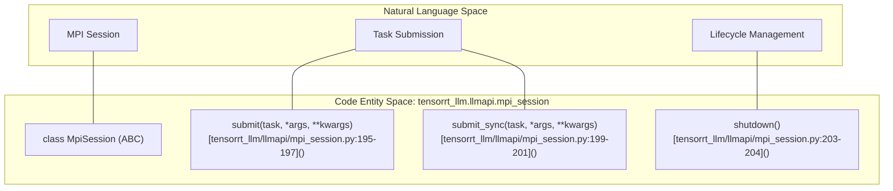
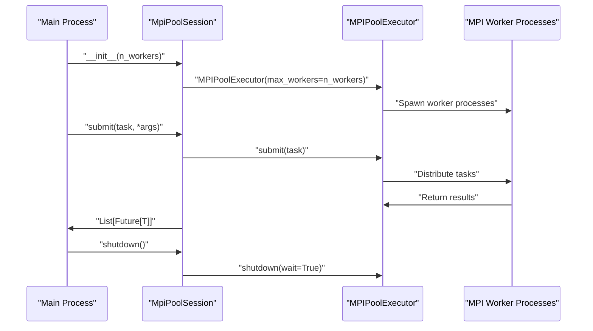
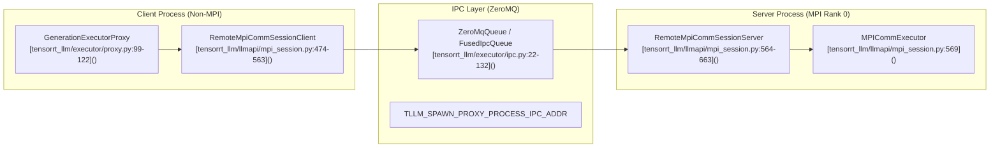
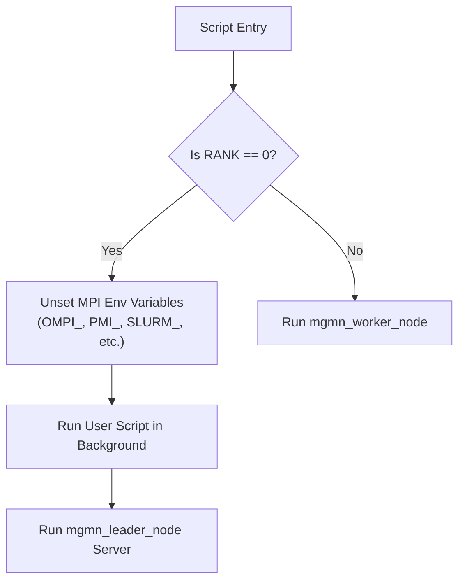
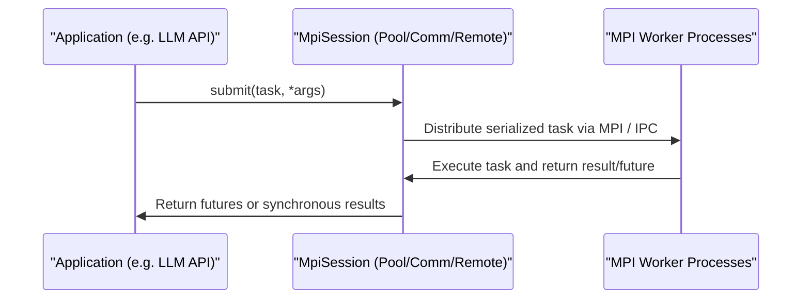

<!-- source: DeepWiki mcp.deepwiki.com · repo NVIDIA/TensorRT-LLM · page 3.4 Multi-GPU Setup and MPI Sessions · fetched 2026-10-26 -->

# Multi-GPU Setup and MPI Sessions

Relevant source files

The following files were used as context for generating this wiki page:

- [examples/llm-api/llm_logits_processor.py](examples/llm-api/llm_logits_processor.py)
- [tensorrt_llm/_bootstrap.py](tensorrt_llm/_bootstrap.py)
- [tensorrt_llm/_common.py](tensorrt_llm/_common.py)
- [tensorrt_llm/_ipc_utils.py](tensorrt_llm/_ipc_utils.py)
- [tensorrt_llm/_ray_utils.py](tensorrt_llm/_ray_utils.py)
- [tensorrt_llm/_torch/async_llm.py](tensorrt_llm/_torch/async_llm.py)
- [tensorrt_llm/_torch/auto_deploy/distributed/common.py](tensorrt_llm/_torch/auto_deploy/distributed/common.py)
- [tensorrt_llm/_torch/models/checkpoints/hf/qwen3_next_weight_mapper.py](tensorrt_llm/_torch/models/checkpoints/hf/qwen3_next_weight_mapper.py)
- [tensorrt_llm/executor/__init__.py](tensorrt_llm/executor/__init__.py)
- [tensorrt_llm/executor/base_worker.py](tensorrt_llm/executor/base_worker.py)
- [tensorrt_llm/executor/executor.py](tensorrt_llm/executor/executor.py)
- [tensorrt_llm/executor/ipc.py](tensorrt_llm/executor/ipc.py)
- [tensorrt_llm/executor/postproc_worker.py](tensorrt_llm/executor/postproc_worker.py)
- [tensorrt_llm/executor/proxy.py](tensorrt_llm/executor/proxy.py)
- [tensorrt_llm/executor/ray_executor.py](tensorrt_llm/executor/ray_executor.py)
- [tensorrt_llm/executor/ray_gpu_worker.py](tensorrt_llm/executor/ray_gpu_worker.py)
- [tensorrt_llm/executor/request.py](tensorrt_llm/executor/request.py)
- [tensorrt_llm/executor/result.py](tensorrt_llm/executor/result.py)
- [tensorrt_llm/executor/utils.py](tensorrt_llm/executor/utils.py)
- [tensorrt_llm/executor/worker.py](tensorrt_llm/executor/worker.py)
- [tensorrt_llm/llmapi/llm.py](tensorrt_llm/llmapi/llm.py)
- [tensorrt_llm/llmapi/mgmn_leader_node.py](tensorrt_llm/llmapi/mgmn_leader_node.py)
- [tensorrt_llm/llmapi/mpi_session.py](tensorrt_llm/llmapi/mpi_session.py)
- [tensorrt_llm/llmapi/rlhf_utils.py](tensorrt_llm/llmapi/rlhf_utils.py)
- [tensorrt_llm/llmapi/trtllm-llmapi-launch](tensorrt_llm/llmapi/trtllm-llmapi-launch)
- [tensorrt_llm/llmapi/utils.py](tensorrt_llm/llmapi/utils.py)
- [tensorrt_llm/ray_stub.py](tensorrt_llm/ray_stub.py)
- [tensorrt_llm/serialization.py](tensorrt_llm/serialization.py)
- [tests/conftest.py](tests/conftest.py)
- [tests/integration/defs/kv_cache/test_kv_cache_v2_scheduler.py](tests/integration/defs/kv_cache/test_kv_cache_v2_scheduler.py)
- [tests/test_common/_session_utils.py](tests/test_common/_session_utils.py)
- [tests/test_common/grouped_test_utils.py](tests/test_common/grouped_test_utils.py)
- [tests/test_common/session_prefetcher.py](tests/test_common/session_prefetcher.py)
- [tests/test_common/session_prefetcher_hooks.py](tests/test_common/session_prefetcher_hooks.py)
- [tests/test_common/session_reuse.py](tests/test_common/session_reuse.py)
- [tests/test_common/session_reuse_hooks.py](tests/test_common/session_reuse_hooks.py)
- [tests/unittest/_torch/executor/test_router_dealer_ipc.py](tests/unittest/_torch/executor/test_router_dealer_ipc.py)
- [tests/unittest/_torch/ray_orchestrator/conftest.py](tests/unittest/_torch/ray_orchestrator/conftest.py)
- [tests/unittest/_torch/ray_orchestrator/multi_gpu/test_accuracy_with_allreduce_strategy.py](tests/unittest/_torch/ray_orchestrator/multi_gpu/test_accuracy_with_allreduce_strategy.py)
- [tests/unittest/_torch/ray_orchestrator/multi_gpu/test_llm_update_weights_multi_gpu.py](tests/unittest/_torch/ray_orchestrator/multi_gpu/test_llm_update_weights_multi_gpu.py)
- [tests/unittest/_torch/ray_orchestrator/multi_gpu/test_ops.py](tests/unittest/_torch/ray_orchestrator/multi_gpu/test_ops.py)
- [tests/unittest/_torch/ray_orchestrator/single_gpu/test_llm_update_weights.py](tests/unittest/_torch/ray_orchestrator/single_gpu/test_llm_update_weights.py)
- [tests/unittest/auto_deploy/multigpu/custom_ops/test_multi_stream_moe_trailing_allreduce.py](tests/unittest/auto_deploy/multigpu/custom_ops/test_multi_stream_moe_trailing_allreduce.py)
- [tests/unittest/auto_deploy/multigpu/transformations/library/test_allreduce_residual_rmsnorm_fusion.py](tests/unittest/auto_deploy/multigpu/transformations/library/test_allreduce_residual_rmsnorm_fusion.py)
- [tests/unittest/executor/test_ipc.py](tests/unittest/executor/test_ipc.py)
- [tests/unittest/executor/test_launcher_envs.py](tests/unittest/executor/test_launcher_envs.py)
- [tests/unittest/executor/test_proxy_fast_death.py](tests/unittest/executor/test_proxy_fast_death.py)
- [tests/unittest/executor/test_ray_stub.py](tests/unittest/executor/test_ray_stub.py)
- [tests/unittest/executor/test_shim_ray.py](tests/unittest/executor/test_shim_ray.py)
- [tests/unittest/llmapi/_run_mpi_comm_task.py](tests/unittest/llmapi/_run_mpi_comm_task.py)
- [tests/unittest/llmapi/_run_multi_llm_tasks.py](tests/unittest/llmapi/_run_multi_llm_tasks.py)
- [tests/unittest/llmapi/_run_multi_mpi_comm_tasks.py](tests/unittest/llmapi/_run_multi_mpi_comm_tasks.py)
- [tests/unittest/llmapi/_test_remote_mpi_session.sh](tests/unittest/llmapi/_test_remote_mpi_session.sh)
- [tests/unittest/llmapi/lora_test_utils.py](tests/unittest/llmapi/lora_test_utils.py)
- [tests/unittest/llmapi/test_async_llm.py](tests/unittest/llmapi/test_async_llm.py)
- [tests/unittest/llmapi/test_executor.py](tests/unittest/llmapi/test_executor.py)
- [tests/unittest/llmapi/test_llm.py](tests/unittest/llmapi/test_llm.py)
- [tests/unittest/llmapi/test_llm_multi_gpu_pytorch.py](tests/unittest/llmapi/test_llm_multi_gpu_pytorch.py)
- [tests/unittest/llmapi/test_llm_pytorch.py](tests/unittest/llmapi/test_llm_pytorch.py)
- [tests/unittest/llmapi/test_mpi_session.py](tests/unittest/llmapi/test_mpi_session.py)
- [tests/unittest/llmapi/test_serialization.py](tests/unittest/llmapi/test_serialization.py)
- [tests/unittest/llmapi/test_session_prefetcher.py](tests/unittest/llmapi/test_session_prefetcher.py)
- [tests/unittest/llmapi/test_session_reuse.py](tests/unittest/llmapi/test_session_reuse.py)

This document details the distributed execution infrastructure within TensorRT-LLM, emphasizing multi-GPU execution management through MPI sessions and Ray orchestration. It covers key abstractions such as the `MpiSession` interface, its multiple implementation variants, the `trtllm-llmapi-launch` script facilitating managed MPI environments, and the `RayExecutor` enabling a Ray-based multi-GPU orchestration approach.

TensorRT-LLM employs these mechanisms to support scalable inference across single-node multi-GPU and multi-node clusters, providing flexible environments including direct MPI launches and managed orchestration with Ray.

---

## MpiSession Abstraction

The `MpiSession` abstract base class defines a uniform interface for submitting callable tasks to distributed worker processes and managing the session lifecycle. It acts as a polymorphic interface for both spawned MPI pools and externally coordinated MPI environments. [tensorrt_llm/llmapi/mpi_session.py:192-205]()

### Interface and Key Methods

The core interface methods are:

- `submit(task: Callable[..., T], *args, **kwargs) -> List[Future[T]]`: Submits a callable `task` to all worker processes asynchronously, returning futures. [tensorrt_llm/llmapi/mpi_session.py:195-197]()
- `submit_sync(task: Callable[..., T], *args, **kwargs) -> List[T]`: Submits `task` synchronously, blocking until all results are available. [tensorrt_llm/llmapi/mpi_session.py:199-201]()
- `shutdown()`: Gracefully shuts down the session. [tensorrt_llm/llmapi/mpi_session.py:203-204]()

**Code Entity Association:**

**Sources:** [tensorrt_llm/llmapi/mpi_session.py:192-205]()

### Implementation Variants

TensorRT-LLM supports several `MpiSession` implementations for different deployment scenarios:

| Implementation       | Class Name                  | Mechanism                                  | Use Case                                         |
|----------------------|-----------------------------|--------------------------------------------|-------------------------------------------------|
| **Pool-based MPI**    | `MpiPoolSession`            | Spawns workers via `mpi4py.futures.MPIPoolExecutor` | Simple single-node local multi-GPU setups        |
| **Comm-based MPI**    | `MpiCommSession`            | Uses existing `MPI_COMM_WORLD`              | Multi-node clusters launched via `mpirun`        |
| **Remote Client**     | `RemoteMpiCommSessionClient`| Client connects via ZeroMQ IPC to a remote server | Proxy-worker IPC solutions with task multiplexing|
| **Process Pool Exec** | `ProcessPoolExecutorSession`| Uses `concurrent.futures.ProcessPoolExecutor` | Single-GPU fallback with exception recovery      |

**Sources:** [tensorrt_llm/llmapi/mpi_session.py:208-260](), [tensorrt_llm/executor/utils.py:158-183]()

---

## MpiPoolSession: Pool-Based MPI Worker Spawning

The `MpiPoolSession` concrete class spawns multiple MPI workers using `MPIPoolExecutor` (provided by `mpi4py`). This approach encapsulates the MPI multiprocess launch and starts worker processes locally. [tensorrt_llm/llmapi/mpi_session.py:245-248]()

### Lifecycle Overview

### Key Implementation Notes

- The constructor creates an `MPIPoolExecutor` with the specified number of workers. [tensorrt_llm/llmapi/mpi_session.py:249-252]()
- `submit` and `submit_sync` delegate to the executor, returning futures or results synchronously. [tensorrt_llm/llmapi/mpi_session.py:254-260]()
- Shutdown behavior calls the executor's shutdown method to clean up worker processes gracefully. [tensorrt_llm/llmapi/mpi_session.py:262-264]()

**Sources:** [tensorrt_llm/llmapi/mpi_session.py:245-264]()

---

## RemoteMpiCommSession: IPC and Proxy-Worker Architecture

`RemoteMpiCommSessionClient` allows a non-MPI main process to interact with MPI worker processes launched independently, communicating via ZeroMQ IPC. This is part of the proxy-worker architecture for situations where `mpirun`-launched processes coordinate with a user script. [tensorrt_llm/llmapi/mpi_session.py:474-563]()

### Architecture Overview

- The client (`RemoteMpiCommSessionClient`) sends serialized tasks over a ZeroMQ socket to the server process. [tensorrt_llm/llmapi/mpi_session.py:512-519]()
- The server receives tasks and submits them to MPI workers managed by `MPICommExecutor`. [tensorrt_llm/llmapi/mpi_session.py:607-622]()
- Communication channels include request, response, and error queues secured by an HMAC key. [tensorrt_llm/executor/utils.py:119-121]()
- This mechanism enables task multiplexing over a single MPI communicator without spawning MPI processes within the user script. [tensorrt_llm/executor/proxy.py:128-152]()

**Sources:** [tensorrt_llm/llmapi/mpi_session.py:474-663](), [tensorrt_llm/executor/proxy.py:99-163](), [tensorrt_llm/executor/utils.py:109-127]()

---

## trtllm-llmapi-launch Script

The `trtllm-llmapi-launch` is a shell script wrapper that orchestrates a multi-GPU MPI launch scenario. It uniquely supports running a user script while managing MPI environment variables and background MPI server processes. [tensorrt_llm/llmapi/trtllm-llmapi-launch:1-138]()

### Script Flow Overview

- On rank 0, the script unsets environment variables related to MPI (e.g., `OMPI_`, `PMIX_`, `SLURM_`) to avoid conflicts in the user script. [tensorrt_llm/llmapi/trtllm-llmapi-launch:66-80]()
- The user script is started in a background subshell with these variables cleared. [tensorrt_llm/llmapi/trtllm-llmapi-launch:71-101]()
- The script then runs `mgmn_leader_node`, which coordinates the MPI server side to manage worker nodes. [tensorrt_llm/llmapi/trtllm-llmapi-launch:110-112]()
- Worker ranks launch `mgmn_worker_node` for communication and task execution within the MPI session. [tensorrt_llm/llmapi/trtllm-llmapi-launch:132-133]()

**Sources:** [tensorrt_llm/llmapi/trtllm-llmapi-launch:1-138]()

---

## RayExecutor for Multi-GPU Orchestration

The `RayExecutor` enables multi-GPU distributed LLM inference without requiring direct MPI usage in the user process. It orchestrates distributed resources by managing remote workers as Ray actors. [tensorrt_llm/executor/ray_executor.py:15-37]()

### Key Components

- **Ray Compatibility Shim**: The `RayExecutor` provides a unified interface for Ray-based deployments. [tensorrt_llm/executor/ray_executor.py:15-37]()
- **Worker Architecture**: It utilizes `RayGPUWorker` to manage individual GPU instances and actor lifecycles. [tensorrt_llm/executor/ray_gpu_worker.py:38]()
- **Distributed Environment**: Ray workers configure process groups to facilitate tensor parallelism and other distributed operations. [tensorrt_llm/executor/worker.py:142-145]()

**Sources:** [tensorrt_llm/executor/ray_executor.py:15-37](), [tensorrt_llm/executor/ray_gpu_worker.py:38](), [tensorrt_llm/executor/worker.py:142-145]()

---

## Summary Table: Distributed Execution Components

| Subsystem                     | Implementation                      | Description                                                         | Key Files and Lines                      |
|-------------------------------|-----------------------------------|---------------------------------------------------------------------|-----------------------------------------|
| MPI Session Interface          | `MpiSession` (ABC)                | Abstract base class for MPI-based distributed task sessions          | [tensorrt_llm/llmapi/mpi_session.py:192-205]() |
| Pool-based MPI Execution       | `MpiPoolSession`                  | Local MPI worker pool with `MPIPoolExecutor`                        | [tensorrt_llm/llmapi/mpi_session.py:245-264]() |
| MPI Communicator Session       | `MpiCommSession`                  | Binds to external MPI_COMM_WORLD for cluster multi-node setups      | [tensorrt_llm/llmapi/mpi_session.py:266-347]() |
| Remote MPI Client              | `RemoteMpiCommSessionClient`      | ZeroMQ IPC communication with MPI rank 0 server process             | [tensorrt_llm/llmapi/mpi_session.py:474-563]() |
| Ray Worker Wrapper Actor       | `RayWorkerWrapper`                | Ray remote actor wrapping the actual GPU worker                      | [tensorrt_llm/executor/ray_gpu_worker.py:38]() |
| Multi-GPU Launch Script        | `trtllm-llmapi-launch` shell script | Manages MPI variables and launches user command in multi-GPU setups | [tensorrt_llm/llmapi/trtllm-llmapi-launch:1-138]() |

---

## Distributed Data Flow and IPC

Distributed execution relies on robust IPC mechanisms for coordination between the `GenerationExecutorProxy` and `GenerationExecutorWorker`. [tensorrt_llm/executor/proxy.py:99-122](), [tensorrt_llm/executor/worker.py:37-61]()

### IPC Mechanisms
- **ZeroMqQueue**: A wrapper around ZeroMQ sockets supporting multiple communication patterns. [tensorrt_llm/executor/postproc_worker.py:109-120]()
- **HMAC Security**: IPC communication requires HMAC encryption for secure serialization. [tensorrt_llm/executor/utils.py:92-101]()
- **FusedIpcQueue**: A specialized queue for inter-process communication between proxy and workers. [tensorrt_llm/executor/worker.py:23]()

### MPI Session Task Flow

**Sources:** [tensorrt_llm/executor/proxy.py:99-163](), [tensorrt_llm/executor/worker.py:37-159](), [tensorrt_llm/llmapi/mpi_session.py:192-205]()

---

## Summary

TensorRT-LLM's multi-GPU distributed execution is built upon a layered MPI session abstraction complemented by a Ray-based orchestration alternative. The `MpiSession` interface unifies different session management strategies including pool spawning (`MpiPoolSession`), communication-based multi-node coordination (`MpiCommSession`), and remote IPC via ZeroMQ (`RemoteMpiCommSessionClient`). The `trtllm-llmapi-launch` script facilitates managing MPI environment conflicts while standardizing multi-GPU launches.

Together, these components form the foundation for TensorRT-LLM's scalable, multi-GPU inference capabilities with flexible environments ranging from local MPI pools to managed Ray clusters.

---

# Sources

- [tensorrt_llm/llmapi/mpi_session.py:192-264, 474-663]()
- [tensorrt_llm/llmapi/trtllm-llmapi-launch:1-138]()
- [tensorrt_llm/executor/ray_executor.py:15-37]()
- [tensorrt_llm/executor/ray_gpu_worker.py:38]()
- [tensorrt_llm/executor/proxy.py:99-163]()
- [tensorrt_llm/executor/worker.py:37-159]()
- [tensorrt_llm/executor/utils.py:109-127]()
- [tensorrt_llm/executor/postproc_worker.py:109-120]()

---

