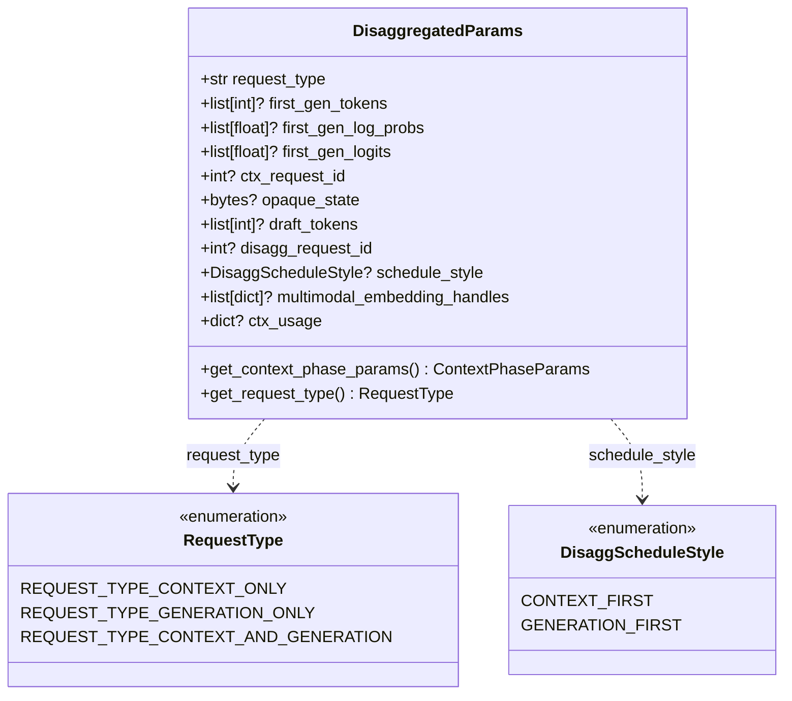
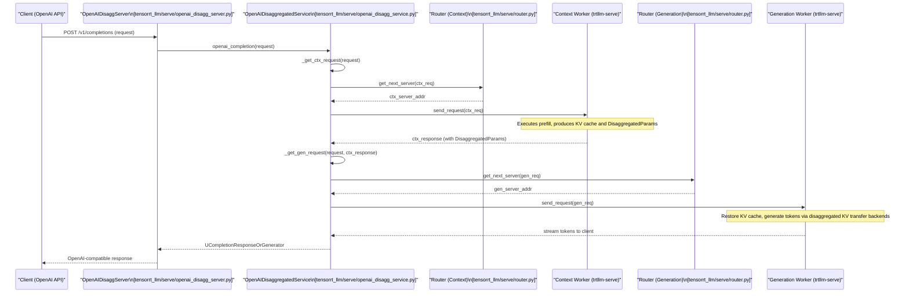
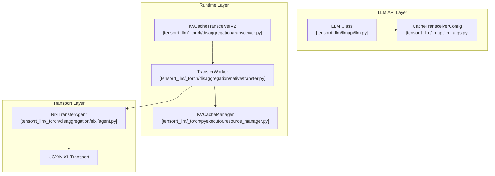
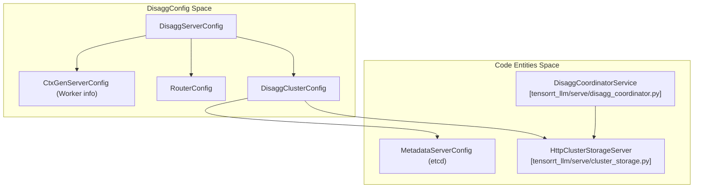

<!-- source: DeepWiki mcp.deepwiki.com · repo NVIDIA/TensorRT-LLM · page 3.5 Disaggregated Serving Parameters · fetched 2026-10-26 -->

# Disaggregated Serving Parameters

Relevant source files

The following files were used as context for generating this wiki page:

- [tensorrt_llm/_torch/disaggregation/base/agent.py](tensorrt_llm/_torch/disaggregation/base/agent.py)
- [tensorrt_llm/_torch/disaggregation/base/transfer.py](tensorrt_llm/_torch/disaggregation/base/transfer.py)
- [tensorrt_llm/_torch/disaggregation/native/bounce/impl.py](tensorrt_llm/_torch/disaggregation/native/bounce/impl.py)
- [tensorrt_llm/_torch/disaggregation/native/mixers/attention/peer.py](tensorrt_llm/_torch/disaggregation/native/mixers/attention/peer.py)
- [tensorrt_llm/_torch/disaggregation/native/mixers/ssm/peer.py](tensorrt_llm/_torch/disaggregation/native/mixers/ssm/peer.py)
- [tensorrt_llm/_torch/disaggregation/native/peer.py](tensorrt_llm/_torch/disaggregation/native/peer.py)
- [tensorrt_llm/_torch/disaggregation/native/transfer.py](tensorrt_llm/_torch/disaggregation/native/transfer.py)
- [tensorrt_llm/_torch/disaggregation/resource/cache_reuse.py](tensorrt_llm/_torch/disaggregation/resource/cache_reuse.py)
- [tensorrt_llm/_torch/disaggregation/resource/kv_extractor.py](tensorrt_llm/_torch/disaggregation/resource/kv_extractor.py)
- [tensorrt_llm/_torch/disaggregation/resource/page.py](tensorrt_llm/_torch/disaggregation/resource/page.py)
- [tensorrt_llm/_torch/disaggregation/resource/utils.py](tensorrt_llm/_torch/disaggregation/resource/utils.py)
- [tensorrt_llm/_torch/disaggregation/transceiver.py](tensorrt_llm/_torch/disaggregation/transceiver.py)
- [tensorrt_llm/disaggregated_params.py](tensorrt_llm/disaggregated_params.py)
- [tensorrt_llm/llmapi/disagg_utils.py](tensorrt_llm/llmapi/disagg_utils.py)
- [tensorrt_llm/serve/chat_tokenization.py](tensorrt_llm/serve/chat_tokenization.py)
- [tensorrt_llm/serve/conversation_id.py](tensorrt_llm/serve/conversation_id.py)
- [tensorrt_llm/serve/openai_client.py](tensorrt_llm/serve/openai_client.py)
- [tensorrt_llm/serve/openai_disagg_server.py](tensorrt_llm/serve/openai_disagg_server.py)
- [tensorrt_llm/serve/openai_disagg_service.py](tensorrt_llm/serve/openai_disagg_service.py)
- [tensorrt_llm/serve/perf_metrics.py](tensorrt_llm/serve/perf_metrics.py)
- [tensorrt_llm/serve/router.py](tensorrt_llm/serve/router.py)
- [tensorrt_llm/serve/router_utils.py](tensorrt_llm/serve/router_utils.py)
- [tests/integration/defs/disaggregated/test_ad_disagg.py](tests/integration/defs/disaggregated/test_ad_disagg.py)
- [tests/integration/defs/disaggregated/test_ad_disagg_trtllm_serve.py](tests/integration/defs/disaggregated/test_ad_disagg_trtllm_serve.py)
- [tests/integration/defs/disaggregated/test_disaggregated_etcd.py](tests/integration/defs/disaggregated/test_disaggregated_etcd.py)
- [tests/integration/defs/disaggregated/test_disaggregated_single_gpu.py](tests/integration/defs/disaggregated/test_disaggregated_single_gpu.py)
- [tests/integration/defs/disaggregated/test_workers.py](tests/integration/defs/disaggregated/test_workers.py)
- [tests/unittest/disaggregated/test_bounce.py](tests/unittest/disaggregated/test_bounce.py)
- [tests/unittest/disaggregated/test_cache_reuse_adapter.py](tests/unittest/disaggregated/test_cache_reuse_adapter.py)
- [tests/unittest/disaggregated/test_cache_transceiver_single_process.py](tests/unittest/disaggregated/test_cache_transceiver_single_process.py)
- [tests/unittest/disaggregated/test_coordinator_worker.py](tests/unittest/disaggregated/test_coordinator_worker.py)
- [tests/unittest/disaggregated/test_disagg_internal_auth.py](tests/unittest/disaggregated/test_disagg_internal_auth.py)
- [tests/unittest/disaggregated/test_disagg_openai_client.py](tests/unittest/disaggregated/test_disagg_openai_client.py)
- [tests/unittest/disaggregated/test_disagg_utils.py](tests/unittest/disaggregated/test_disagg_utils.py)
- [tests/unittest/disaggregated/test_disaggregated_params.py](tests/unittest/disaggregated/test_disaggregated_params.py)
- [tests/unittest/disaggregated/test_extractor.py](tests/unittest/disaggregated/test_extractor.py)
- [tests/unittest/disaggregated/test_kda_mamba_transfer.py](tests/unittest/disaggregated/test_kda_mamba_transfer.py)
- [tests/unittest/disaggregated/test_kv_transfer.py](tests/unittest/disaggregated/test_kv_transfer.py)
- [tests/unittest/disaggregated/test_kv_transfer_mp.py](tests/unittest/disaggregated/test_kv_transfer_mp.py)
- [tests/unittest/disaggregated/test_mamba_transfer.py](tests/unittest/disaggregated/test_mamba_transfer.py)
- [tests/unittest/disaggregated/test_openai_disagg_server.py](tests/unittest/disaggregated/test_openai_disagg_server.py)
- [tests/unittest/disaggregated/test_openai_disagg_service.py](tests/unittest/disaggregated/test_openai_disagg_service.py)
- [tests/unittest/disaggregated/test_peer.py](tests/unittest/disaggregated/test_peer.py)
- [tests/unittest/disaggregated/test_py_cache_transceiver_mp.py](tests/unittest/disaggregated/test_py_cache_transceiver_mp.py)
- [tests/unittest/disaggregated/test_router.py](tests/unittest/disaggregated/test_router.py)

This document describes the disaggregated serving parameters system in TensorRT-LLM, which enables separation of the prefill (context) and decode (generation) phases of inference into different server instances. This architecture allows independent scaling and optimization of each phase on specialized hardware.

For information about the disaggregated serving infrastructure and server architecture, see [Disaggregated Serving Architecture](#15.2). For general serving parameters and configuration, see [SamplingParams and Generation Control](#3.3).

## Purpose and Scope

Disaggregated serving splits LLM inference into two stages with distinct compute characteristics:

- **Context Phase (Prefill)**: Computes the KV cache for prompt tokens. This phase is typically compute-bound and benefits from high tensor parallelism.
- **Generation Phase (Decode)**: Generates tokens one by one using cached KV values. This phase is often memory bandwidth-bound and favors different parallelism techniques.

The system facilitates KV cache transfer and state handoff between these two phases via specialized protocols and backends such as NIXL and UCX, allowing seamless end-to-end inference across distinct server roles.

---

## DisaggregatedParams Class

The central data structure for disaggregated serving is the `DisaggregatedParams` class defined in `tensorrt_llm/disaggregated_params.py`. It encapsulates metadata needed for coordinating the two-phase inference and KV cache management.

### Class Structure

Sources: [tensorrt_llm/disaggregated_params.py:31-77](), [tensorrt_llm/disaggregated_params.py:78-92](), [tensorrt_llm/disaggregated_params.py:94-105]()

### Key Fields and Purpose

| Field                      | Type                  | Purpose                                                                                                                             |
|----------------------------|-----------------------|-------------------------------------------------------------------------------------------------------------------------------------|
| `request_type`             | `str`                 | Indicates phase of the request: `"context_only"`, `"generation_only"`, or `"context_and_generation"`.                               |
| `disagg_request_id`        | `Optional[int]`       | A globally unique snowflake-style ID to track requests across context and generation phases.                                        |
| `first_gen_tokens`         | `Optional[List[int]]` | The initial tokens generated during prefill, passed to generation worker to avoid redundant decoding.                               |
| `opaque_state`             | `Optional[bytes]`     | Optional arbitrary state blob exchanged between workers for coordination.                                                           |
| `ctx_info_endpoint`        | `Optional[str]`       | Endpoint for the generation worker to query KV cache metadata from its paired context worker.                                        |
| `ctx_usage`                | `Optional[Dict]`      | Usage accounting data (prompt tokens, cached tokens) preserved on the generation side for transparency and billing.                 |
| `multimodal_embedding_handles`| `List[Dict]`       | CUDA IPC handles for multimodal embeddings produced by a Vision Encoder (E-P Disaggregation).                                        |

The method `get_context_phase_params()` converts this object into the `tllme.ContextPhaseParams` structure required by the C++ executor bindings. [tensorrt_llm/disaggregated_params.py:78-92]()

Sources: [tensorrt_llm/disaggregated_params.py:53-77](), [tensorrt_llm/disaggregated_params.py:78-92]()

---

## Request Workflow and Service Layer

Disaggregated serving is implemented chiefly by the `OpenAIDisaggregatedService` class located in `tensorrt_llm/serve/openai_disagg_service.py`. It orchestrates request dispatch and phases execution across context and generation workers.

### Disaggregated Request Flow (Context-First Scheduling)

Sources: [tensorrt_llm/serve/openai_disagg_service.py:113-160](), [tensorrt_llm/serve/openai_disagg_server.py:139-168](), [tensorrt_llm/serve/openai_client.py:178-200]()

### Scheduling Styles

The service supports two inference scheduling styles, configured by the `schedule_style` parameter:

1. **Context First (default)**:  
   The context worker precomputes the KV cache and returns a response containing `DisaggregatedParams` metadata. The generation worker is then selected and invoked with these parameters to resume generation. [tensorrt_llm/serve/openai_disagg_service.py:78-82]()

2. **Generation First**:  
   A generation worker is pre-selected before context computation. The context worker is then instructed to perform prefill and directly transfer KV cache to the generation worker. [tensorrt_llm/serve/openai_disagg_service.py:70-76]()

Sources: [tensorrt_llm/serve/openai_disagg_service.py:70-82](), [tensorrt_llm/llmapi/disagg_utils.py:144-145]()

---

## KV Cache Transfer Configuration

The transfer of KV cache between context and generation workers is managed by the `KvCacheTransceiverV2` and `TransferWorker` classes. These entities use high-performance communication backends like NIXL or UCX to move cache blocks across the network or PCIe.

### KV Cache Transceiver Architecture

Sources: [tensorrt_llm/_torch/disaggregation/transceiver.py:76-134](), [tensorrt_llm/_torch/disaggregation/native/transfer.py:117-136](), [tests/integration/defs/disaggregated/test_disaggregated_single_gpu.py:139-145]()

### Configuration Parameters

KV cache transfer behavior is controlled via `CacheTransceiverConfig`:

- `kv_transfer_timeout_ms`: The total time allowed for a KV transfer operation before failure. [tensorrt_llm/_torch/disaggregation/transceiver.py:87-89]()
- `kv_cache_bounce_size_mb`: Size of the intermediate CPU buffer used for "bouncing" transfers when direct P2P is unavailable or inefficient. [tensorrt_llm/_torch/disaggregation/transceiver.py:132]()
- `kv_transfer_sender_future_timeout_ms`: Timeout for the sender to wait for a receiver future to become available. [tensorrt_llm/_torch/disaggregation/transceiver.py:91-93]()

Sources: [tensorrt_llm/_torch/disaggregation/transceiver.py:82-100](), [tensorrt_llm/llmapi/llm_args.py:59]()

---

## Routing and KV Cache Affinity

Specialized routers are used to distribute requests to context and generation workers while optimizing cache affinity and load balancing.

### Router Types

| Router Class         | Purpose                              | Description                                                                                                    |
|----------------------|------------------------------------|---------------------------------------------------------------------------------------------------------------|
| `RoundRobinRouter`   | Simple load distribution            | Cycles requests evenly among available servers.                                                              |
| `LoadBalancingRouter` | Least loaded server selection       | Chooses server with the fewest active requests or tokens to balance load.                                      |
| `KvCacheAwareRouter` | Cache affinity routing              | Selects servers with the highest KV cache prefix match to maximize reuse and minimize data transfers.          |
| `ConversationRouter` | Sticky session routing              | Routes based on conversation or session identifiers to maintain context affinity in multi-turn conversations. |
| `CoordinatorDelegatingRouter` | Remote placement | Forwards placement decisions to a central coordinator service (e.g. in multi-worker fleet). |

Sources: [tensorrt_llm/serve/router.py:30-35](), [tensorrt_llm/serve/router.py:51-55](), [tensorrt_llm/serve/router.py:37-38]()

### KV Cache Event Tracking

The `KvCacheAwareServerState` class tracks cache block ownership by periodically polling `/kv_cache_events` from workers. Events reflect block creation, storage, and removal and update internal block tables accordingly. [tensorrt_llm/serve/router.py:158-177]()

This enables routers to select servers best matching the request's KV cache needs, optimizing for cache hits and reducing transfer overhead.

Sources: [tensorrt_llm/serve/router.py:100-177]()

---

## Cluster and Metadata Configuration

In a disaggregated serving environment, discovery and registration of context and generation worker instances are critical. TensorRT-LLM uses a metadata server and cluster storage abstractions for this purpose.

### Configuration Entities

Sources: [tensorrt_llm/llmapi/disagg_utils.py:128-168](), [tensorrt_llm/serve/openai_disagg_server.py:140-158]()

### DisaggClusterConfig Overview

The `DisaggClusterConfig` specifies cluster-wide parameters such as:

- `cluster_uri`: URI of the cluster storage service (e.g., HTTP or Redis API endpoint). [tensorrt_llm/llmapi/disagg_utils.py:120]()
- `cluster_name`: Optional namespace for the cluster. [tensorrt_llm/llmapi/disagg_utils.py:121]()
- `minimal_instances`: Minimum required counts for context and generation servers. [tensorrt_llm/llmapi/disagg_utils.py:122]()
- `heartbeat_interval_sec`: Frequency at which workers send liveness heartbeats (default 5 seconds). [tensorrt_llm/llmapi/disagg_utils.py:123]()
- `inactive_timeout_sec`: Worker timeout after which it is considered inactive (default 10 seconds). [tensorrt_llm/llmapi/disagg_utils.py:124]()

Sources: [tensorrt_llm/llmapi/disagg_utils.py:119-125](), [tensorrt_llm/serve/openai_disagg_server.py:140-152]()

---

# Summary

Disaggregated serving parameters provide the foundational data types, configuration structs, and API mechanisms to enable efficient two-phase distributed LLM inference with separated context and generation workloads. Key components revolve around:

- The `DisaggregatedParams` class linking context and generation requests.
- The `OpenAIDisaggregatedService` orchestrating request dispatch and phase handoff.
- The `KvCacheTransceiverV2` and `TransferWorker` managing high-performance KV cache movement.
- KV cache-aware routers optimizing resource usage and data locality.
- Metadata cluster storage integration for worker discovery, liveness, and scaling.

Sources:
- [tensorrt_llm/disaggregated_params.py:16-127]()
- [tensorrt_llm/serve/openai_disagg_service.py:44-160]()
- [tensorrt_llm/serve/openai_disagg_server.py:139-168]()
- [tensorrt_llm/serve/router.py:58-177]()
- [tensorrt_llm/llmapi/disagg_utils.py:77-168]()
- [tensorrt_llm/_torch/disaggregation/transceiver.py:76-145]()
- [tensorrt_llm/_torch/disaggregation/native/transfer.py:117-205]()

---

