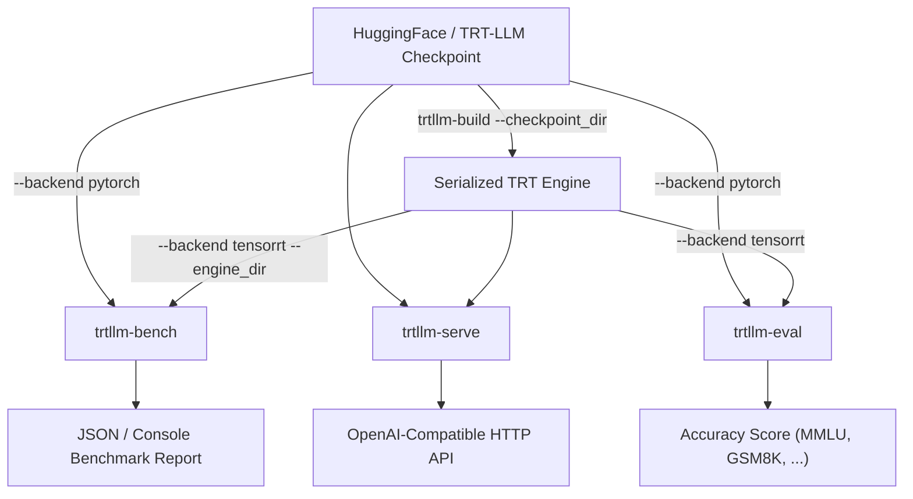
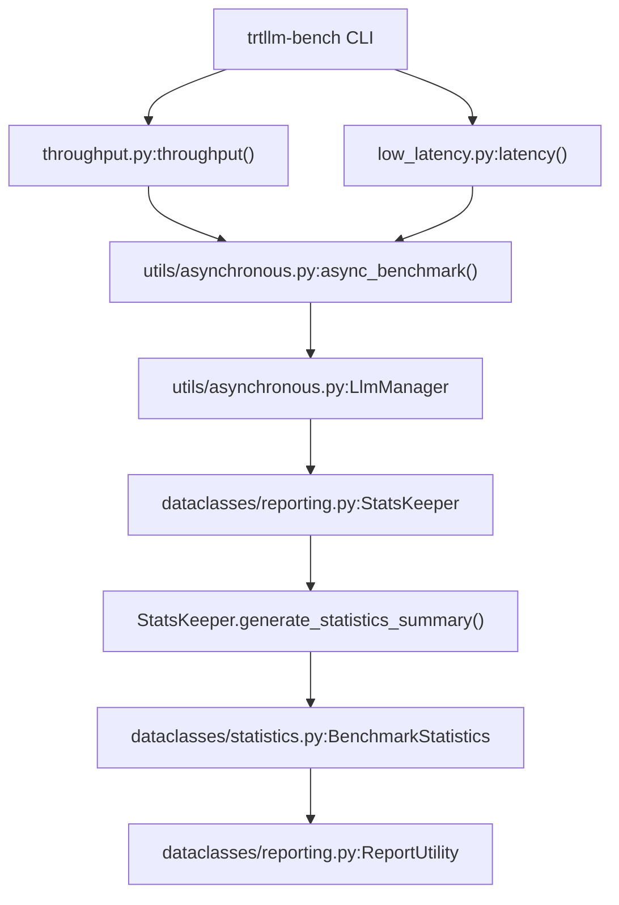
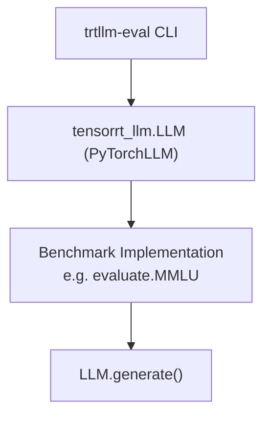

<!-- source: DeepWiki mcp.deepwiki.com · repo NVIDIA/TensorRT-LLM · page 4 Command-Line Tools · fetched 2026-10-26 -->

# Command-Line Tools

Relevant source files

The following files were used as context for generating this wiki page:

- [docs/source/commands/trtllm-bench.rst](docs/source/commands/trtllm-bench.rst)
- [docs/source/developer-guide/perf-benchmarking.md](docs/source/developer-guide/perf-benchmarking.md)
- [docs/source/developer-guide/perf-overview.md](docs/source/developer-guide/perf-overview.md)
- [docs/source/examples/kvcacheconfig.md](docs/source/examples/kvcacheconfig.md)
- [docs/source/examples/kvcacheretentionconfig.md](docs/source/examples/kvcacheretentionconfig.md)
- [docs/source/features/auto_deploy/advanced/expert_configurations.md](docs/source/features/auto_deploy/advanced/expert_configurations.md)
- [docs/source/features/auto_deploy/support_matrix.md](docs/source/features/auto_deploy/support_matrix.md)
- [docs/source/features/long-sequence.md](docs/source/features/long-sequence.md)
- [docs/source/features/quantization.md](docs/source/features/quantization.md)
- [docs/source/legacy/performance/perf-benchmarking.md](docs/source/legacy/performance/perf-benchmarking.md)
- [docs/source/overview.md](docs/source/overview.md)
- [docs/source/supported-hardware.md](docs/source/supported-hardware.md)
- [examples/sparse_attention/RocketKV.md](examples/sparse_attention/RocketKV.md)
- [tensorrt_llm/bench/benchmark/low_latency.py](tensorrt_llm/bench/benchmark/low_latency.py)
- [tensorrt_llm/bench/benchmark/throughput.py](tensorrt_llm/bench/benchmark/throughput.py)
- [tensorrt_llm/bench/benchmark/utils/asynchronous.py](tensorrt_llm/bench/benchmark/utils/asynchronous.py)
- [tensorrt_llm/bench/benchmark/utils/general.py](tensorrt_llm/bench/benchmark/utils/general.py)
- [tensorrt_llm/bench/dataclasses/configuration.py](tensorrt_llm/bench/dataclasses/configuration.py)
- [tensorrt_llm/bench/dataclasses/general.py](tensorrt_llm/bench/dataclasses/general.py)
- [tensorrt_llm/bench/dataclasses/reporting.py](tensorrt_llm/bench/dataclasses/reporting.py)
- [tensorrt_llm/bench/dataclasses/statistics.py](tensorrt_llm/bench/dataclasses/statistics.py)
- [tensorrt_llm/bench/utils/data.py](tensorrt_llm/bench/utils/data.py)
- [tensorrt_llm/commands/bench.py](tensorrt_llm/commands/bench.py)
- [tensorrt_llm/commands/eval.py](tensorrt_llm/commands/eval.py)
- [tensorrt_llm/evaluate/__init__.py](tensorrt_llm/evaluate/__init__.py)
- [tensorrt_llm/evaluate/longbench_v2.py](tensorrt_llm/evaluate/longbench_v2.py)
- [tensorrt_llm/serve/scripts/time_breakdown/images/perf_metrics_timepoints.png](tensorrt_llm/serve/scripts/time_breakdown/images/perf_metrics_timepoints.png)
- [tests/integration/defs/accuracy/references/longbench_v2.yaml](tests/integration/defs/accuracy/references/longbench_v2.yaml)

This page provides an overview of the primary command-line tools included in TensorRT-LLM: `trtllm-build`, `trtllm-bench`, `trtllm-serve`, and `trtllm-eval`. Each tool covers a distinct stage of the LLM deployment lifecycle, from engine compilation through benchmarking, serving, and evaluation.

For details on the Python `LLM` API used under the hood by these tools, see [LLM API and User Interface](#3). For the underlying serving infrastructure, see [Serving Infrastructure](#15).

---

## Tool Roles at a Glance

| Tool | Role | Primary Input | Primary Output |
|---|---|---|---|
| `trtllm-build` | Compile TensorRT engine from checkpoint | HF/TRT-LLM checkpoint | Serialized TRT engine directory |
| `trtllm-bench` | Throughput and latency benchmarking | Dataset + checkpoint or engine | Console/JSON performance report |
| `trtllm-serve` | OpenAI-compatible HTTP inference server | Checkpoint or engine | HTTP API at `/v1/...` endpoints |
| `trtllm-eval` | Accuracy evaluation on standard benchmarks | Checkpoint or engine | Accuracy scores (MMLU, GSM8K, etc.) |

---

## Workflow Overview

**Diagram: CLI Tool Relationships and Data Flow**

Sources: [tensorrt_llm/bench/benchmark/throughput.py:52-68](), [tensorrt_llm/bench/benchmark/low_latency.py:51-76](), [tensorrt_llm/commands/eval.py:49-73]()

---

## trtllm-build

`trtllm-build` compiles TRT-LLM checkpoint directories into serialized TensorRT engine files. It is used exclusively with the TensorRT (C++) backend. Engines produced by `trtllm-build` are required when `trtllm-bench` or `trtllm-serve` is run with `--backend tensorrt`.

Key build options include `--checkpoint_dir`, `--output_dir`, and various plugin flags defined in the engine's `build_config` [tensorrt_llm/bench/benchmark/utils/general.py:48-53]().

Sources: [tensorrt_llm/bench/benchmark/utils/general.py:48-53]()

---

## trtllm-bench

`trtllm-bench` is the primary benchmarking tool for measuring performance. It supports multiple backends and provides detailed metrics for both LLM and Multimodal models. For detailed documentation, see [trtllm-bench: Benchmarking Tool](#4.2).

### Subcommands

| Subcommand | Purpose | Default Concurrency |
|---|---|---|
| `throughput` | Max-throughput measurement [tensorrt_llm/bench/benchmark/throughput.py:52]() | Unlimited (all requests submitted simultaneously) |
| `latency` | Min-latency measurement [tensorrt_llm/bench/benchmark/low_latency.py:51]() | 1 request at a time |

### Key Options
- **Backends**: `pytorch` (default), `_autodeploy` [tensorrt_llm/bench/benchmark/utils/general.py:27-27]().
- **Dataset**: Path to a dataset file for parsing [tensorrt_llm/bench/benchmark/throughput.py:128-135]().
- **Parallelism**: Supports `--tp`, `--pp`, and `--ep` (expert parallelism) via `mapping` dictionary [tensorrt_llm/bench/benchmark/utils/general.py:106-113]().

**Diagram: trtllm-bench Code Architecture**

Sources: [tensorrt_llm/bench/benchmark/throughput.py:52-52](), [tensorrt_llm/bench/dataclasses/reporting.py:40-83](), [tensorrt_llm/bench/benchmark/low_latency.py:51-51](), [tensorrt_llm/bench/benchmark/utils/general.py:106-113](), [tensorrt_llm/bench/benchmark/utils/asynchronous.py:38-48]()

---

## trtllm-serve

`trtllm-serve` launches an inference server providing OpenAI-compatible endpoints. For detailed documentation, see [trtllm-serve: Inference Server](#4.1).

### Features
- **OpenAI Compatibility**: Launches an `OpenAIServer` compatible with standard chat (`/v1/chat/completions`) and completion (`/v1/completions`) protocols [docs/source/developer-guide/perf-benchmarking.md:19-22]().
- **Visual Generation**: Supports diffusion-based models (e.g., FLUX, Wan, LTX2) for image and video generation [docs/source/overview.md:30-30]().
- **Multimodal Serving**: Supports vision-language models like Qwen2-VL, handling images, videos, and audio inputs [tensorrt_llm/bench/utils/data.py:153-155]().
- **Disaggregated Serving**: Supports separate context and generation phases across different GPUs [docs/source/overview.md:53-53]().

### Configuration
The server can be configured via YAML files or explicit CLI flags. Parameters like `kv_cache_config` and `enable_chunked_prefill` are passed to the underlying `LLM` engine via `RuntimeConfig` [tensorrt_llm/bench/dataclasses/configuration.py:44-75]().

Sources: [docs/source/developer-guide/perf-benchmarking.md:19-24](), [docs/source/overview.md:30-53](), [tensorrt_llm/bench/dataclasses/configuration.py:44-75]()

---

## trtllm-eval

`trtllm-eval` is a tool for evaluating the accuracy of models on standard benchmarks.

### Supported Benchmarks
- **MMLU / MMMU**: Massive Multitask Language Understanding (Text and Multimodal) [tensorrt_llm/commands/eval.py:22-26]().
- **GSM8K**: Grade-school math reasoning [tensorrt_llm/commands/eval.py:22-22]().
- **LongBench**: Long-context understanding [tensorrt_llm/commands/eval.py:25-25]().
- **AIME**: Mathematical competition benchmarks [tensorrt_llm/commands/eval.py:22-22]().

**Diagram: trtllm-eval Execution Flow**

Sources: [tensorrt_llm/commands/eval.py:21-30](), [tensorrt_llm/commands/eval.py:49-142]()

---

## Entry Point Registration

The command implementations are registered as entry points in the package and live under `tensorrt_llm/commands/` and `tensorrt_llm/bench/`.

| Command | Implementation |
|---|---|
| `trtllm-bench` | `tensorrt_llm/bench/benchmark/throughput.py` [tensorrt_llm/bench/benchmark/throughput.py:52-52]() |
| `trtllm-serve` | `tensorrt_llm/commands/serve.py` (via `trtllm-serve` entry point) |
| `trtllm-eval` | `tensorrt_llm/commands/eval.py` [tensorrt_llm/commands/eval.py:49-49]() |

Sources: [tensorrt_llm/bench/benchmark/throughput.py:52-52](), [tensorrt_llm/commands/eval.py:49-49]()

---

