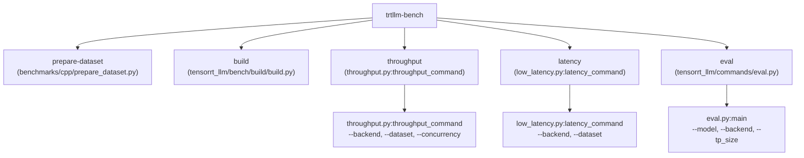
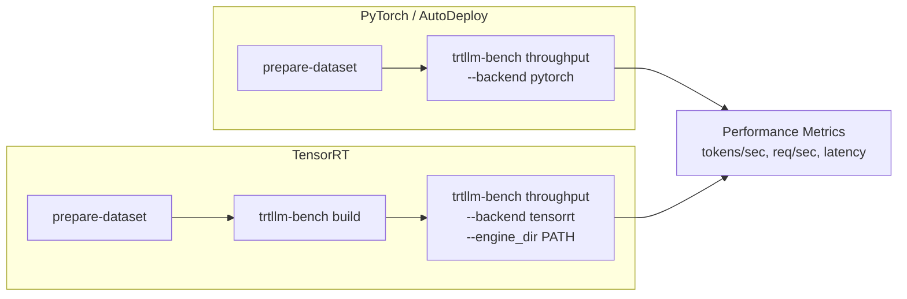
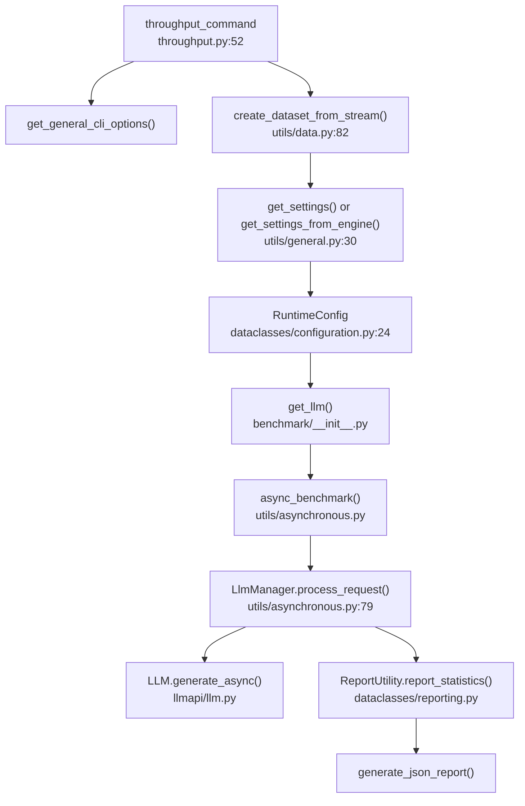
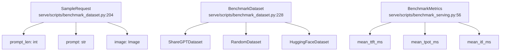

<!-- source: DeepWiki mcp.deepwiki.com · repo NVIDIA/TensorRT-LLM · page 4.2 trtllm-bench: Benchmarking Tool · fetched 2026-10-26 -->

# trtllm-bench: Benchmarking Tool

Relevant source files

The following files were used as context for generating this wiki page:

- [docs/source/commands/trtllm-bench.rst](docs/source/commands/trtllm-bench.rst)
- [docs/source/developer-guide/perf-benchmarking.md](docs/source/developer-guide/perf-benchmarking.md)
- [docs/source/developer-guide/perf-overview.md](docs/source/developer-guide/perf-overview.md)
- [docs/source/examples/kvcacheconfig.md](docs/source/examples/kvcacheconfig.md)
- [docs/source/examples/kvcacheretentionconfig.md](docs/source/examples/kvcacheretentionconfig.md)
- [docs/source/features/auto_deploy/advanced/expert_configurations.md](docs/source/features/auto_deploy/advanced/expert_configurations.md)
- [docs/source/features/auto_deploy/support_matrix.md](docs/source/features/auto_deploy/support_matrix.md)
- [docs/source/features/long-sequence.md](docs/source/features/long-sequence.md)
- [docs/source/features/quantization.md](docs/source/features/quantization.md)
- [docs/source/legacy/performance/perf-benchmarking.md](docs/source/legacy/performance/perf-benchmarking.md)
- [docs/source/overview.md](docs/source/overview.md)
- [docs/source/supported-hardware.md](docs/source/supported-hardware.md)
- [examples/sparse_attention/RocketKV.md](examples/sparse_attention/RocketKV.md)
- [tensorrt_llm/bench/benchmark/low_latency.py](tensorrt_llm/bench/benchmark/low_latency.py)
- [tensorrt_llm/bench/benchmark/throughput.py](tensorrt_llm/bench/benchmark/throughput.py)
- [tensorrt_llm/bench/benchmark/utils/asynchronous.py](tensorrt_llm/bench/benchmark/utils/asynchronous.py)
- [tensorrt_llm/bench/benchmark/utils/general.py](tensorrt_llm/bench/benchmark/utils/general.py)
- [tensorrt_llm/bench/dataclasses/configuration.py](tensorrt_llm/bench/dataclasses/configuration.py)
- [tensorrt_llm/bench/dataclasses/general.py](tensorrt_llm/bench/dataclasses/general.py)
- [tensorrt_llm/bench/dataclasses/reporting.py](tensorrt_llm/bench/dataclasses/reporting.py)
- [tensorrt_llm/bench/dataclasses/statistics.py](tensorrt_llm/bench/dataclasses/statistics.py)
- [tensorrt_llm/bench/utils/data.py](tensorrt_llm/bench/utils/data.py)
- [tensorrt_llm/commands/bench.py](tensorrt_llm/commands/bench.py)
- [tensorrt_llm/commands/eval.py](tensorrt_llm/commands/eval.py)
- [tensorrt_llm/evaluate/__init__.py](tensorrt_llm/evaluate/__init__.py)
- [tensorrt_llm/evaluate/longbench_v2.py](tensorrt_llm/evaluate/longbench_v2.py)
- [tensorrt_llm/serve/scripts/__init__.py](tensorrt_llm/serve/scripts/__init__.py)
- [tensorrt_llm/serve/scripts/backend_request_func.py](tensorrt_llm/serve/scripts/backend_request_func.py)
- [tensorrt_llm/serve/scripts/benchmark_dataset.py](tensorrt_llm/serve/scripts/benchmark_dataset.py)
- [tensorrt_llm/serve/scripts/benchmark_serving.py](tensorrt_llm/serve/scripts/benchmark_serving.py)
- [tensorrt_llm/serve/scripts/benchmark_utils.py](tensorrt_llm/serve/scripts/benchmark_utils.py)
- [tensorrt_llm/serve/scripts/time_breakdown/README.md](tensorrt_llm/serve/scripts/time_breakdown/README.md)
- [tensorrt_llm/serve/scripts/time_breakdown/images/perf_metrics_timepoints.png](tensorrt_llm/serve/scripts/time_breakdown/images/perf_metrics_timepoints.png)
- [tensorrt_llm/serve/scripts/time_breakdown/images/request_time_breakdown_example.png](tensorrt_llm/serve/scripts/time_breakdown/images/request_time_breakdown_example.png)
- [tensorrt_llm/serve/scripts/time_breakdown/time_breakdown.py](tensorrt_llm/serve/scripts/time_breakdown/time_breakdown.py)
- [tests/integration/defs/accuracy/references/longbench_v2.yaml](tests/integration/defs/accuracy/references/longbench_v2.yaml)
- [tests/unittest/others/test_time_breakdown.py](tests/unittest/others/test_time_breakdown.py)

## Purpose and Scope

`trtllm-bench` is a command-line benchmarking tool for measuring inference performance of TensorRT-LLM models. It provides end-to-end performance measurement capabilities including dataset generation, engine building, and throughput/latency testing across `pytorch`, `_autodeploy`, and `tensorrt` backends [tensorrt_llm/bench/benchmark/utils/general.py:25-28]().

The tool is designed to simplify the reproduction of performance numbers and supports advanced features like speculative decoding, multi-modal models (VLM), and LoRA adapters. It integrates directly with the high-level `LLM` API to provide a unified benchmarking interface across different runtimes [tensorrt_llm/bench/benchmark/utils/asynchronous.py:29-31]().

Sources: [tensorrt_llm/bench/benchmark/utils/general.py:25-28](), [tensorrt_llm/bench/benchmark/utils/asynchronous.py:29-31](), [docs/source/developer-guide/perf-benchmarking.md:12-18]()

## Command Structure and Workflow

The tool follows a multi-stage workflow: dataset preparation, engine building, and performance measurement via the `throughput` or `latency` commands.

**trtllm-bench subcommand flow:**

**Typical workflow by backend:**

Sources: [tensorrt_llm/bench/benchmark/throughput.py:52-68](), [tensorrt_llm/bench/benchmark/low_latency.py:51-76](), [tensorrt_llm/commands/eval.py:49-150](), [docs/source/developer-guide/perf-benchmarking.md:88-112]()

## Internal Execution Architecture

The subcommands utilize a shared execution pipeline that leverages the high-level `LLM` API. The `LlmManager` class coordinates request submission and result collection [tensorrt_llm/bench/benchmark/utils/asynchronous.py:38-48]().

**Execution pipeline for `throughput_command`:**

The `LlmManager` handles both single-turn and multi-turn requests. For multi-turn benchmarks, it ensures conversation history is maintained by sequentially applying chat templates and appending model responses to the message list before the next turn [tensorrt_llm/bench/benchmark/utils/asynchronous.py:138-161]().

Sources: [tensorrt_llm/bench/benchmark/throughput.py:52-106](), [tensorrt_llm/bench/benchmark/low_latency.py:51-188](), [tensorrt_llm/bench/benchmark/utils/asynchronous.py:38-137](), [tensorrt_llm/bench/benchmark/utils/asynchronous.py:138-161](), [tensorrt_llm/bench/dataclasses/reporting.py:81-97]()

## Dataset Preparation and Serving Benchmarking

The tool supports various dataset sources and sampling strategies. For serving-specific benchmarks, `benchmark_serving.py` simulates client-side behavior against a running server [tensorrt_llm/serve/scripts/benchmark_serving.py:4-18]().

**Dataset and Request Entities:**

For multimodal models, `trtllm-bench` uses `update_metadata_for_multimodal` to handle media paths provided in the dataset [tensorrt_llm/bench/utils/data.py:153-156](). The `InferenceRequest` dataclass captures the specific parameters for each benchmark entry in the Python API flow [tensorrt_llm/bench/dataclasses/general.py:17-19]().

Sources: [tensorrt_llm/serve/scripts/benchmark_serving.py:4-96](), [tensorrt_llm/serve/scripts/benchmark_dataset.py:204-228](), [tensorrt_llm/bench/utils/data.py:82-166](), [tensorrt_llm/bench/dataclasses/general.py:17-19]()

## Engine Building and Runtime Configuration

For the `tensorrt` backend, `get_settings_from_engine` extracts metadata such as `max_batch_size`, `max_num_tokens`, and speculative decoding modes from the `config.json` file within the engine directory [tensorrt_llm/bench/benchmark/utils/general.py:30-67]().

For the `pytorch` backend, `get_settings` determines runtime parameters. If `max_batch_size` or `max_num_tokens` are not provided, it uses heuristics via `get_benchmark_engine_settings` based on average input/output lengths (ISL/OSL) and the KV cache memory fraction [tensorrt_llm/bench/benchmark/utils/general.py:115-152]().

**Backend Configuration Mapping:**
The `RuntimeConfig` class maps these settings to the `LLM` API arguments, including parallelism sizes, chunked prefill settings, and performance knobs like CUDA graphs [tensorrt_llm/bench/dataclasses/configuration.py:41-110]().

Sources: [tensorrt_llm/bench/benchmark/utils/general.py:30-186](), [tensorrt_llm/bench/dataclasses/configuration.py:41-110](), [tensorrt_llm/bench/dataclasses/configuration.py:172-182]()

## Throughput Benchmarking

The `throughput` subcommand measures sustained performance. It allows for fine-grained control over the workload via concurrency limits or request capping [tensorrt_llm/bench/benchmark/throughput.py:189-202]().

### Key Metrics for Throughput

| Metric | Definition | Source |
|---|---|---|
| **Output Token Throughput** | Total generated tokens per second | [tensorrt_llm/bench/dataclasses/statistics.py:82-86]() |
| **Generation Throughput** | Tokens generated per second during generation phase | [tensorrt_llm/bench/dataclasses/statistics.py:89-90]() |
| **Batch Full Throughput** | Estimated throughput while active requests fill a batch | [tensorrt_llm/bench/dataclasses/reporting.py:103-152]() |

Sources: [tensorrt_llm/bench/benchmark/throughput.py:52-291](), [tensorrt_llm/bench/dataclasses/reporting.py:103-152](), [tensorrt_llm/bench/dataclasses/statistics.py:82-90]()

## Metrics and Reporting

The `StatsKeeper` class accumulates `PerfItemTuple` objects (containing timestamps and token counts) into `RequestRecord` entries to generate a comprehensive `BenchmarkStatistics` summary [tensorrt_llm/bench/dataclasses/reporting.py:41-97](), [tensorrt_llm/bench/dataclasses/reporting.py:154-208]().

### `RequestRecord` Latency Metrics

`RequestRecord` computes key latency metrics for each request [tensorrt_llm/bench/dataclasses/statistics.py:54-80]():
- **TTFT (Time to First Token):** Time from request submission to the first generated token [tensorrt_llm/bench/dataclasses/statistics.py:61-63]().
- **Inter-Token Latency:** Average time delay between individual tokens during the generation phase [tensorrt_llm/bench/dataclasses/statistics.py:66-72]().
- **End-to-to-End Latency:** Total time from submission to final response [tensorrt_llm/bench/dataclasses/statistics.py:75-79]().

### Speculative Decoding Metrics
If speculative decoding is enabled (e.g., Medusa), the tool tracks `acceptance_length` (average tokens per decoding iteration) and acceptance rates [tensorrt_llm/bench/dataclasses/reporting.py:178-183](), [tensorrt_llm/bench/dataclasses/configuration.py:18-21]().

Sources: [tensorrt_llm/bench/dataclasses/reporting.py:41-208](), [tensorrt_llm/bench/dataclasses/statistics.py:8-134](), [tensorrt_llm/bench/dataclasses/statistics.py:151-168]()

## Latency Measurement Mode

The `latency` command is optimized for measuring minimum response times. It typically runs with a low concurrency (default 1) to avoid queuing delays and focuses on end-to-end latency and TTFT [tensorrt_llm/bench/benchmark/low_latency.py:181-186](). It supports the same backends (`pytorch`, `_autodeploy`) and reporting options as the throughput command [tensorrt_llm/bench/benchmark/low_latency.py:73-76]().

Sources: [tensorrt_llm/bench/benchmark/low_latency.py:51-210](), [tensorrt_llm/bench/benchmark/utils/asynchronous.py:92-136]()

## Serving and API Benchmarking

For online serving scenarios, `benchmark_serving.py` provides a client simulation that sends requests to an OpenAI-compatible endpoint [tensorrt_llm/serve/scripts/benchmark_serving.py:18-24]().

### Backend Request Functions
The benchmarking tool supports multiple backend types through specific request functions:
- `async_request_trt_llm`: For native TensorRT-LLM `generate_stream` endpoints [tensorrt_llm/serve/scripts/backend_request_func.py:73-83]().
- `async_request_openai_completions`: For OpenAI-compatible completion endpoints [tensorrt_llm/serve/scripts/backend_request_func.py:165-175]().
- `async_request_openai_chat`: For OpenAI-compatible chat completion endpoints [tensorrt_llm/serve/scripts/backend_request_func.py:255-265]().

Sources: [tensorrt_llm/serve/scripts/benchmark_serving.py:4-149](), [tensorrt_llm/serve/scripts/backend_request_func.py:73-265]()

## C++ Benchmark Utilities

Beyond the Python-based `trtllm-bench`, the codebase includes low-level C++ utilities for specialized performance testing.

### gptManagerBenchmark
A C++ utility designed to benchmark the `GptManager` (or `Executor` API) directly. It measures the throughput and latency of the C++ runtime without Python overhead, focusing on inflight batching efficiency and scheduler performance.

### disaggServerBenchmark
A C++ utility specifically for testing **disaggregated serving** architectures. It simulates the separation of context (prefill) and generation (decode) phases across different server instances, measuring the efficiency of KV cache transfers and the impact of network latency on end-to-end performance in a distributed disaggregated environment.

Sources: [tensorrt_llm/bench/dataclasses/reporting.py:103-152](), [tensorrt_llm/bench/benchmark/throughput.py:52-68]()

---

