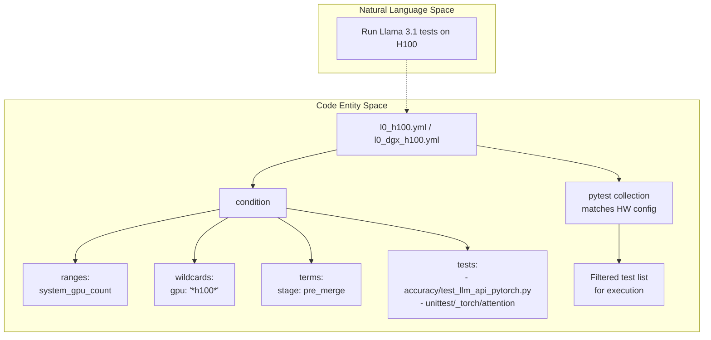
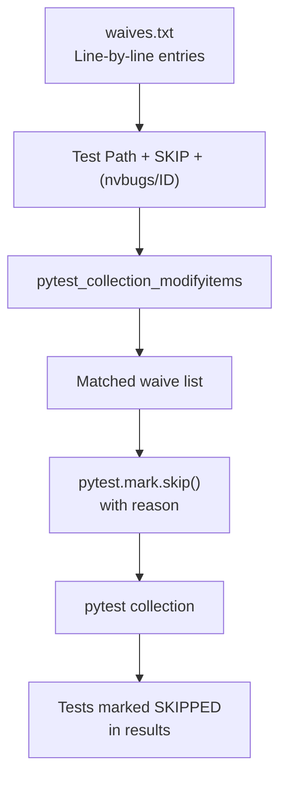

<!-- source: DeepWiki mcp.deepwiki.com · repo NVIDIA/TensorRT-LLM · page 5 Testing Infrastructure · fetched 2026-10-26 -->

# Testing Infrastructure

Relevant source files

The following files were used as context for generating this wiki page:

- [tests/integration/defs/.test_durations](tests/integration/defs/.test_durations)
- [tests/integration/defs/accuracy/references/cnn_dailymail.yaml](tests/integration/defs/accuracy/references/cnn_dailymail.yaml)
- [tests/integration/defs/accuracy/references/gsm8k.yaml](tests/integration/defs/accuracy/references/gsm8k.yaml)
- [tests/integration/defs/accuracy/references/mmlu.yaml](tests/integration/defs/accuracy/references/mmlu.yaml)
- [tests/integration/defs/accuracy/test_disaggregated_serving.py](tests/integration/defs/accuracy/test_disaggregated_serving.py)
- [tests/integration/defs/accuracy/test_llm_api_autodeploy.py](tests/integration/defs/accuracy/test_llm_api_autodeploy.py)
- [tests/integration/defs/accuracy/test_llm_api_pytorch.py](tests/integration/defs/accuracy/test_llm_api_pytorch.py)
- [tests/integration/defs/common.py](tests/integration/defs/common.py)
- [tests/integration/defs/conftest.py](tests/integration/defs/conftest.py)
- [tests/integration/defs/disaggregated/test_disaggregated.py](tests/integration/defs/disaggregated/test_disaggregated.py)
- [tests/integration/defs/examples/test_gpt.py](tests/integration/defs/examples/test_gpt.py)
- [tests/integration/defs/pytest.ini](tests/integration/defs/pytest.ini)
- [tests/integration/defs/test_e2e.py](tests/integration/defs/test_e2e.py)
- [tests/integration/defs/test_unittests.py](tests/integration/defs/test_unittests.py)
- [tests/integration/defs/trt_test_alternative.py](tests/integration/defs/trt_test_alternative.py)
- [tests/integration/defs/utils/__init__.py](tests/integration/defs/utils/__init__.py)
- [tests/integration/defs/utils/timeout_manager.py](tests/integration/defs/utils/timeout_manager.py)
- [tests/integration/test_lists/qa/llm_function_core.txt](tests/integration/test_lists/qa/llm_function_core.txt)
- [tests/integration/test_lists/qa/llm_function_multinode.txt](tests/integration/test_lists/qa/llm_function_multinode.txt)
- [tests/integration/test_lists/qa/llm_function_rtx6k.txt](tests/integration/test_lists/qa/llm_function_rtx6k.txt)
- [tests/integration/test_lists/test-db/l0_a10.yml](tests/integration/test_lists/test-db/l0_a10.yml)
- [tests/integration/test_lists/test-db/l0_b200.yml](tests/integration/test_lists/test-db/l0_b200.yml)
- [tests/integration/test_lists/test-db/l0_dgx_b200.yml](tests/integration/test_lists/test-db/l0_dgx_b200.yml)
- [tests/integration/test_lists/test-db/l0_dgx_b300.yml](tests/integration/test_lists/test-db/l0_dgx_b300.yml)
- [tests/integration/test_lists/test-db/l0_dgx_h100.yml](tests/integration/test_lists/test-db/l0_dgx_h100.yml)
- [tests/integration/test_lists/test-db/l0_dgx_h200.yml](tests/integration/test_lists/test-db/l0_dgx_h200.yml)
- [tests/integration/test_lists/test-db/l0_gb200_multi_gpus.yml](tests/integration/test_lists/test-db/l0_gb200_multi_gpus.yml)
- [tests/integration/test_lists/test-db/l0_h100.yml](tests/integration/test_lists/test-db/l0_h100.yml)
- [tests/integration/test_lists/test-db/l0_rtx_pro_6000.yml](tests/integration/test_lists/test-db/l0_rtx_pro_6000.yml)
- [tests/integration/test_lists/waives.txt](tests/integration/test_lists/waives.txt)
- [tests/test_common/s3_output.py](tests/test_common/s3_output.py)
- [tests/test_common/s3_output_hooks.py](tests/test_common/s3_output_hooks.py)
- [tests/unittest/conftest.py](tests/unittest/conftest.py)
- [tests/unittest/pytest.ini](tests/unittest/pytest.ini)
- [tests/unittest/test_s3_output.py](tests/unittest/test_s3_output.py)
- [tests/unittest/tools/test_test_to_stage_mapping.py](tests/unittest/tools/test_test_to_stage_mapping.py)
- [tests/unittest/tools/test_unittest_culprits.py](tests/unittest/tools/test_unittest_culprits.py)

## Purpose and Scope

This document describes the comprehensive testing infrastructure of TensorRT-LLM, which validates code quality, accuracy, and performance across multiple GPU platforms and configurations. The testing system encompasses test organization, execution orchestration, result management, and quality tracking.

For details on the specific testing sub-systems, see:
- [Test Framework Overview and Architecture](#5.1) — Overall test organization and execution flow.
- [Accuracy Testing Framework](#5.2) — Accuracy tests against benchmarks like MMLU and GSM8K.
- [Performance Testing Framework](#5.3) — Performance test execution and metric collection.
- [Test Configuration and Test Database](#5.4) — YAML-based test selection and hardware conditions.
- [Test Waives and Known Issues](#5.5) — The `waives.txt` system for tracking known failures.

## Test Organization and Selection

### Test Database System

The testing infrastructure uses YAML-based test databases to organize and select tests based on hardware capabilities and testing stages. Test databases are stored in `tests/integration/test_lists/test-db/` and define which tests run on specific GPU types.

**Test Database Structure**

Each test database entry defines conditions such as `system_gpu_count` ranges [tests/integration/test_lists/test-db/l0_h100.yml:5-7](), GPU name `wildcards` (e.g., `*h100*`, `*b200*`) [tests/integration/test_lists/test-db/l0_h100.yml:9-10](), [tests/integration/test_lists/test-db/l0_b200.yml:9-11](), and stage `terms` like `pre_merge` [tests/integration/test_lists/test-db/l0_h100.yml:13](). Hardware-specific lists exist for platforms including H100 [tests/integration/test_lists/test-db/l0_h100.yml:2](), B200 [tests/integration/test_lists/test-db/l0_b200.yml:2](), A10 [tests/integration/test_lists/test-db/l0_a10.yml:2](), and DGX H100 [tests/integration/test_lists/test-db/l0_dgx_h100.yml:2](). The system also supports Blackwell-specific configurations like `l0_dgx_b200.yml` [tests/integration/test_lists/test-db/l0_dgx_b200.yml:2]().

**Sources:** [tests/integration/test_lists/test-db/l0_h100.yml:1-16](), [tests/integration/test_lists/test-db/l0_b200.yml:1-16](), [tests/integration/test_lists/test-db/l0_dgx_b200.yml:1-17](), [tests/integration/test_lists/test-db/l0_a10.yml:1-15]()

### Waiver System

The waiver system tracks known issues and temporarily skips failing tests. The waiver list is stored in `tests/integration/test_lists/waives.txt` [tests/integration/test_lists/waives.txt:1-10]().

**Waiver Processing Flow**

Waivers are applied per test case and include a reference to an internal bug tracker (e.g., `https://nvbugs/6619883`) [tests/integration/test_lists/waives.txt:1](). This allows the CI to continue running while tracking specific regressions in features like `disaggregated_serving` [tests/integration/test_lists/waives.txt:1-15]() or `llm_api_pytorch` [tests/integration/test_lists/waives.txt:20-47]().

**Sources:** [tests/integration/test_lists/waives.txt:1-50](), [tests/integration/test_lists/qa/llm_function_core.txt:1-10]()

## Test Types and Frameworks

### Accuracy Testing Infrastructure

Accuracy testing validates model outputs against established benchmarks. The `LlmapiAccuracyTestHarness` [tests/integration/defs/accuracy/test_llm_api_pytorch.py:51]() provides a standardized interface for running tasks like `GSM8K` [tests/integration/defs/accuracy/test_llm_api_pytorch.py:50](), `MMLU` [tests/integration/defs/accuracy/test_llm_api_pytorch.py:50](), `CnnDailymail` [tests/integration/defs/accuracy/test_llm_api_pytorch.py:50](), and `LongBench` [tests/integration/defs/accuracy/test_llm_api_pytorch.py:52]().

Reference accuracy values are stored in YAML files, such as `tests/integration/defs/accuracy/references/gsm8k.yaml`, which record expected percentages for different models and quantization algorithms like `FP8`, `NVFP4`, or `FP8_BLOCK_SCALES` [tests/integration/defs/accuracy/references/gsm8k.yaml:23-31](), [tests/integration/defs/accuracy/references/gsm8k.yaml:66-70](). These references include specific targets for models like `DeepSeek-V4-Flash` [tests/integration/defs/accuracy/references/gsm8k.yaml:138-147]() and `Llama-3.1-8B-Instruct` [tests/integration/defs/accuracy/references/gsm8k.yaml:1-10]().

**Sources:** [tests/integration/defs/accuracy/test_llm_api_pytorch.py:44-55](), [tests/integration/defs/accuracy/test_disaggregated_serving.py:45-47](), [tests/integration/defs/accuracy/references/gsm8k.yaml:1-200]()

### Disaggregated and Distributed Testing

The infrastructure includes specialized setups for testing multi-GPU and disaggregated serving configurations. The `launch_disaggregated_llm` context manager [tests/integration/defs/accuracy/test_disaggregated_serving.py:194-200]() orchestrates the lifecycle of context workers, generation workers, and the disaggregated server.

For distributed testing, the framework utilizes `mpirun` and the `trtllm-llmapi-launch` script [tests/integration/defs/test_e2e.py:132]() to manage `tensor_parallel_size` and `pipeline_parallel_size` [tests/integration/defs/accuracy/test_llm_api_pytorch.py:123-125](). The `get_ucx_tls` utility selects appropriate UCX transports based on GPU architecture, such as excluding `cuda_ipc` on pre-Hopper [tests/integration/defs/disaggregated/test_disaggregated.py:70-88]().

**Sources:** [tests/integration/defs/accuracy/test_disaggregated_serving.py:113-142](), [tests/integration/defs/test_e2e.py:92-134](), [tests/integration/defs/disaggregated/test_disaggregated.py:70-98]()

## Execution and Reporting

### Process Management and Diagnostic Logging

To handle complex server-worker architectures, the infrastructure provides tools like `ProcessWrapper` [tests/integration/defs/disaggregated/test_disaggregated.py:40]() and `scan_logs_for_fatal_errors` [tests/integration/defs/disaggregated/test_disaggregated.py:123-146](). The framework scans logs for specific fatal patterns such as "Hang detected on rank" or "out of memory" [tests/integration/defs/disaggregated/test_disaggregated.py:117-120](). For deeper debugging, `print_first_fatal_log_context` provides context around the first occurrence of a fatal error to bypass post-crash shutdown spam [tests/integration/defs/disaggregated/test_disaggregated.py:149-157]().

### End-to-End Benchmarking

The `BenchRunner` class in `test_e2e.py` automates the benchmarking workflow, including dataset preparation via `trtllm-bench prepare-dataset` [tests/integration/defs/test_e2e.py:153-176]() and throughput measurement [tests/integration/defs/test_e2e.py:178-188](). It supports various parameters including `concurrency`, `num_requests`, and `streaming` [tests/integration/defs/test_e2e.py:103-123]().

**Sources:** [tests/integration/defs/disaggregated/test_disaggregated.py:101-146](), [tests/integration/defs/test_e2e.py:92-188]()

---

