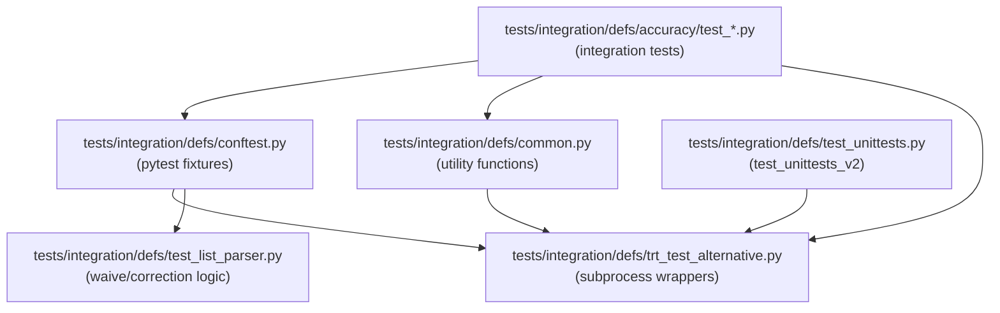
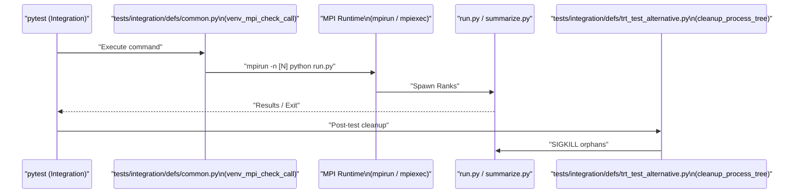

<!-- source: DeepWiki mcp.deepwiki.com · repo NVIDIA/TensorRT-LLM · page 5.1 Test Framework Overview and Architecture · fetched 2026-10-26 -->

# Test Framework Overview and Architecture

<details>
<summary>Relevant source files</summary>

The following files were used as context for generating this wiki page:

- [.pre-commit-config.yaml](.pre-commit-config.yaml)
- [cpp/include/tensorrt_llm/runtime/iTensor.h](cpp/include/tensorrt_llm/runtime/iTensor.h)
- [examples/llm-api/llm_multilora.py](examples/llm-api/llm_multilora.py)
- [examples/llm-api/llm_runtime.py](examples/llm-api/llm_runtime.py)
- [examples/llm-api/llm_sampling.py](examples/llm-api/llm_sampling.py)
- [examples/llm-api/llm_speculative_decoding.py](examples/llm-api/llm_speculative_decoding.py)
- [examples/llm-api/quickstart_example.py](examples/llm-api/quickstart_example.py)
- [legacy-files.txt](legacy-files.txt)
- [pyproject.toml](pyproject.toml)
- [ruff-legacy.toml](ruff-legacy.toml)
- [scripts/check_test_list.py](scripts/check_test_list.py)
- [tests/README.md](tests/README.md)
- [tests/integration/README.md](tests/integration/README.md)
- [tests/integration/defs/common.py](tests/integration/defs/common.py)
- [tests/integration/defs/conftest.py](tests/integration/defs/conftest.py)
- [tests/integration/defs/examples/test_gpt.py](tests/integration/defs/examples/test_gpt.py)
- [tests/integration/defs/llmapi/test_llm_examples.py](tests/integration/defs/llmapi/test_llm_examples.py)
- [tests/integration/defs/pytest.ini](tests/integration/defs/pytest.ini)
- [tests/integration/defs/test_list_parser.py](tests/integration/defs/test_list_parser.py)
- [tests/integration/defs/test_unittests.py](tests/integration/defs/test_unittests.py)
- [tests/integration/defs/triton_server/test_list_parser.py](tests/integration/defs/triton_server/test_list_parser.py)
- [tests/integration/defs/trt_test_alternative.py](tests/integration/defs/trt_test_alternative.py)
- [tests/integration/defs/utils/__init__.py](tests/integration/defs/utils/__init__.py)
- [tests/integration/defs/utils/timeout_manager.py](tests/integration/defs/utils/timeout_manager.py)
- [tests/integration/test_lists/test-db/l0_gb202.yml](tests/integration/test_lists/test-db/l0_gb202.yml)
- [tests/integration/test_lists/test-db/l0_gb203.yml](tests/integration/test_lists/test-db/l0_gb203.yml)
- [tests/integration/test_lists/test-db/l0_sanity_check.yml](tests/integration/test_lists/test-db/l0_sanity_check.yml)
- [tests/test_common/s3_output.py](tests/test_common/s3_output.py)
- [tests/test_common/s3_output_hooks.py](tests/test_common/s3_output_hooks.py)
- [tests/unittest/conftest.py](tests/unittest/conftest.py)
- [tests/unittest/pytest.ini](tests/unittest/pytest.ini)
- [tests/unittest/scripts/test_check_test_list.py](tests/unittest/scripts/test_check_test_list.py)
- [tests/unittest/test_s3_output.py](tests/unittest/test_s3_output.py)
- [tests/unittest/tools/test_test_to_stage_mapping.py](tests/unittest/tools/test_test_to_stage_mapping.py)
- [tests/unittest/tools/test_unittest_culprits.py](tests/unittest/tools/test_unittest_culprits.py)

</details>


This page covers the integration test framework structure for TensorRT-LLM, specifically the shared infrastructure in `tests/integration/defs/` and `tests/unittest/` that all tests depend on. This includes the pytest fixture system, common utility functions, subprocess management, and how tests are organized.

For hardware-specific test selection and sharding, see **Section 5.4 Test Configuration and Test Database**. For accuracy test harnesses, see **Section 5.2 Accuracy Testing Framework**. For waive tracking, see **Section 5.5 Test Waives and Known Issues**.

---

## Directory Structure

Integration tests are located under `tests/integration/defs/`. The `defs/` package provides shared infrastructure; individual test modules live under `defs/accuracy/`, `defs/llmapi/`, and similar subdirectories. Unit tests are located in `tests/unittest/`.

```
tests/
├── integration/
│   ├── defs/
│   │   ├── conftest.py             # Session/module/function-scoped pytest fixtures
│   │   ├── common.py               # Shared utility functions (venv_check_call, parse_mpi_cmd, etc.)
│   │   ├── trt_test_alternative.py # Subprocess wrappers with process-tree cleanup
│   │   ├── test_list_parser.py     # Waive and correction list parsing
│   │   ├── test_unittests.py       # Bridge for running unit tests as integration tests
│   │   ├── agg_unit_mem_df.csv     # Parallelization config for unit tests
│   │   └── utils/
│   │       └── periodic_junit.py   # Streaming JUnit XML output
│   └── test_lists/                 # Test selection databases and waives
│       ├── test-db/                # Hardware-specific YAML test lists (e.g., l0_sanity_check.yml)
│       └── waives.txt              # Global skip list for known issues
└── unittest/
    ├── conftest.py                 # Unit test specific fixtures and hooks
    └── pytest.ini                  # Pytest configuration for unittests
```

Sources: [tests/integration/defs/conftest.py:116-126](), [tests/unittest/conftest.py:35-41](), [tests/integration/defs/common.py:35-37](), [tests/README.md:36-40](), [tests/unittest/pytest.ini:1-13](), [tests/integration/test_lists/test-db/l0_sanity_check.yml:1-30]()

---

## Core Component Relationships

The framework bridges high-level test definitions to the underlying C++/Python runtime using a combination of decorators, subprocess wrappers, and hardware detection logic.

**Diagram: Integration Test Framework Components**



Sources: [tests/integration/defs/conftest.py:42-62](), [tests/integration/defs/common.py:35-37](), [tests/integration/defs/test_unittests.py:66-160](), [tests/integration/defs/test_list_parser.py:21-23]()

---

## Fixture System and Environment

### Path Resolution and Model Fixtures
`conftest.py` provides path resolution for models and datasets. The `llm_models_root()` function resolves the path to model weights by checking the `LLM_MODELS_ROOT` environment variable or falling back to standard scratch paths [tests/integration/defs/conftest.py:99-113]().

| Fixture / Function | Scope | Description |
|---|---|---|
| `llm_root` | session | Path to TRT-LLM repo root [tests/unittest/conftest.py:35-35](). |
| `llm_venv` | session | A virtual environment runner for executing CLI tools [tests/integration/defs/common.py:39-46](). |
| `llm_models_root()` | N/A | Returns root directory for model checkpoints [tests/integration/defs/conftest.py:99-113](). |
| `cached_in_llm_models_root` | decorator | Decorator to enforce use of cached NFS data in CI [tests/integration/defs/conftest.py:128-169](). |

Sources: [tests/integration/defs/conftest.py:99-169](), [tests/integration/defs/common.py:39-46](), [tests/integration/defs/common.py:58-64]()

### Resource and Memory Management
The framework includes hooks to manage GPU memory and prevent resource leaks during long test sessions.

- **`pytest_runtest_protocol`**: In `tests/unittest/conftest.py`, this hook triggers `gc.collect()` and `torch.cuda.empty_cache()` if memory usage (reserved + allocated) exceeds 90% of the available worker quota [tests/unittest/conftest.py:106-135]().
- **Thread Leak Tracking**: `pytest.ini` configures `threadleak = True` but excludes legitimate long-lived threads like `session-prefetch-*` or `rpc_client_loop` [tests/unittest/pytest.ini:6-13](), [tests/integration/defs/pytest.ini:5-10]().
- **Signal Handling**: `pytest_configure` in `tests/unittest/conftest.py` sets up `SIGALRM` to trigger `dump_threads`, which calls `print_all_stacks()` for debugging hangs [tests/unittest/conftest.py:53-65]().

Sources: [tests/unittest/conftest.py:106-135](), [tests/unittest/pytest.ini:6-13](), [tests/unittest/conftest.py:53-65]()

---

## Unit Test Bridge

TensorRT-LLM uses a specialized bridge to run unit tests as part of the integration pipeline. This allows for parallel execution and hardware-specific targeting of unit tests.

- **`test_unittests_v2`**: The primary entry point in `tests/integration/defs/test_unittests.py` that spawns a `pytest` subprocess for specific unit test files [tests/integration/defs/test_unittests.py:66-160]().
- **Parallelization**: It uses a lookup table (loaded via `pd.read_csv` on `agg_unit_mem_df.csv`) to determine the optimal `num_workers` for parallel execution on a given GPU based on memory consumption [tests/integration/defs/test_unittests.py:188-210]().
- **Periodic JUnit**: The `PeriodicJUnitXML` class (registered in `pytest_configure`) streams results to XML files at set intervals, preventing loss of data if a test process hangs [tests/unittest/conftest.py:75-104]().
- **Failure Attribution**: The `_fail_unittests` function identifies specific "culprit" tests from JUnit reports and `unfinished_test.txt` when a fatal error (like OOM) occurs [tests/integration/defs/test_unittests.py:118-162]().
- **S3 Log Upload**: The framework supports uploading test logs and artifacts to S3 buckets via `test_common.s3_output`. This is used to capture output from long-running tests or parallel unit test workers [tests/integration/defs/test_unittests.py:182-195]().

Sources: [tests/integration/defs/test_unittests.py:66-160](), [tests/unittest/conftest.py:75-104](), [tests/integration/defs/test_unittests.py:118-162](), [tests/integration/defs/test_unittests.py:182-195](), [tests/integration/defs/test_unittests.py:188-210]()

---

## Subprocess and MPI Management

Many tests require executing external commands or running distributed inference via MPI. The framework provides specialized wrappers to ensure process tree cleanup.

- **`venv_check_call`**: Executes a command within the test's virtual environment, ensuring the correct `cwd` is used [tests/integration/defs/common.py:39-46]().
- **`venv_mpi_check_call`**: A wrapper for running Python scripts with `mpirun` or `mpiexec`. It merges MPI arguments with the Python command [tests/integration/defs/common.py:67-84]().
- **`parse_mpi_cmd`**: Adjusts MPI command flags for platform compatibility (e.g., handling Windows `mpiexec` differences) [tests/integration/defs/common.py:107-121]().
- **`cleanup_process_tree`**: In `trt_test_alternative.py`, this function builds a process tree using `psutil` and sends `SIGKILL` to all descendants (including Ray or Torch Inductor workers) to prevent orphan processes [tests/integration/defs/trt_test_alternative.py:151-213]().
- **Redaction**: Subprocess invocation logs are passed through `redact_env` and `redact_args` to mask sensitive values like API keys or passwords [tests/integration/defs/trt_test_alternative.py:30-70]().

**Diagram: Integration Test Execution Flow**



Sources: [tests/integration/defs/common.py:39-104](), [tests/integration/defs/trt_test_alternative.py:151-213](), [tests/integration/defs/common.py:67-84](), [tests/integration/defs/trt_test_alternative.py:30-70]()

---

## Test Selection and Static Validation

The framework includes tools to ensure test lists are accurate and synchronized with the source code.

- **`check_test_list.py`**: A utility script that performs AST-based validation of test list entries. It checks that the file paths, class names, and function names listed in `.yml` or `.txt` files actually exist in the codebase [scripts/check_test_list.py:48-85]().
- **Parametrize Validation**: The script parses `pytest.mark.parametrize` and `parametrize_with_ids` calls in the source code to verify that specific parameter IDs (e.g., `[bs1-fp16]`) used in test lists are valid [scripts/check_test_list.py:108-152]().
- **Mako Preprocessing**: Test lists can use Mako templates to conditionally include tests based on environment variables like `test_prefix` or hardware properties [tests/integration/defs/test_list_parser.py:34-75]().
- **`test_to_stage_mapping.py`**: A script used to map individual tests to the Jenkins stages that execute them, facilitating targeted CI runs via `StageQuery` which parses the Jenkins Groovy pipeline and the test database [tests/unittest/tools/test_test_to_stage_mapping.py:17-31]().
- **Hardware-Specific YAMLs**: The `tests/integration/test_lists/test-db/` directory contains GPU-specific configurations (e.g., `l0_gb202.yml`, `l0_gb203.yml`) that define which tests run on specific architectures [tests/integration/test_lists/test-db/l0_sanity_check.yml:1-20]().

Sources: [scripts/check_test_list.py:48-152](), [tests/integration/defs/test_list_parser.py:34-75](), [tests/unittest/tools/test_test_to_stage_mapping.py:17-31](), [tests/integration/test_lists/test-db/l0_sanity_check.yml:1-20]()

---

