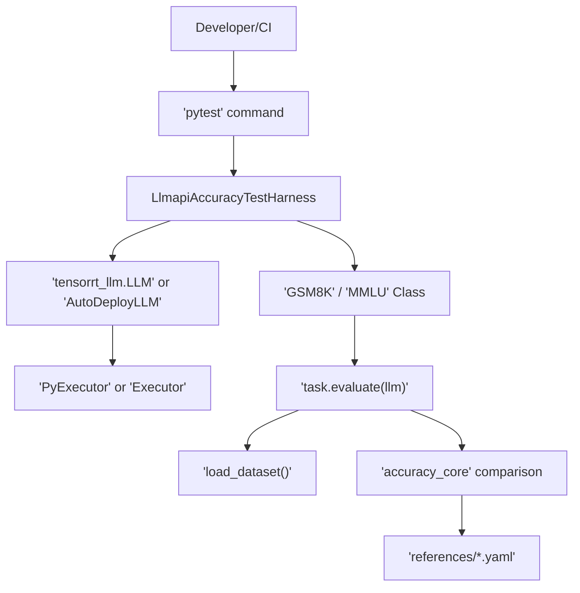

<!-- source: DeepWiki mcp.deepwiki.com · repo NVIDIA/TensorRT-LLM · page 5.2 Accuracy Testing Framework · fetched 2026-10-26 -->

# Accuracy Testing Framework

<details>
<summary>Relevant source files</summary>

The following files were used as context for generating this wiki page:

- [docs/source/models/supported-models.md](docs/source/models/supported-models.md)
- [examples/llm-api/llm_sparse_attention.py](examples/llm-api/llm_sparse_attention.py)
- [examples/longbench/eval_longbench_v1.py](examples/longbench/eval_longbench_v1.py)
- [examples/longbench/requirements.txt](examples/longbench/requirements.txt)
- [examples/models/core/multimodal/qwen_image_bench_eval.py](examples/models/core/multimodal/qwen_image_bench_eval.py)
- [requirements-dev.txt](requirements-dev.txt)
- [security_scanning/examples/longbench/poetry.lock](security_scanning/examples/longbench/poetry.lock)
- [security_scanning/examples/longbench/pyproject.toml](security_scanning/examples/longbench/pyproject.toml)
- [tensorrt_llm/_torch/models/__init__.py](tensorrt_llm/_torch/models/__init__.py)
- [tensorrt_llm/_torch/models/checkpoints/hf/qwen3_5_weight_mapper.py](tensorrt_llm/_torch/models/checkpoints/hf/qwen3_5_weight_mapper.py)
- [tensorrt_llm/_torch/models/modeling_qwen3_5.py](tensorrt_llm/_torch/models/modeling_qwen3_5.py)
- [tensorrt_llm/_torch/models/modeling_qwen3_next.py](tensorrt_llm/_torch/models/modeling_qwen3_next.py)
- [tensorrt_llm/_torch/models/modeling_qwen3vl.py](tensorrt_llm/_torch/models/modeling_qwen3vl.py)
- [tensorrt_llm/_torch/pyexecutor/config_utils.py](tensorrt_llm/_torch/pyexecutor/config_utils.py)
- [tensorrt_llm/_torch/pyexecutor/grammar_matcher.py](tensorrt_llm/_torch/pyexecutor/grammar_matcher.py)
- [tensorrt_llm/_torch/pyexecutor/guided_decoder.py](tensorrt_llm/_torch/pyexecutor/guided_decoder.py)
- [tensorrt_llm/evaluate/cnn_dailymail.py](tensorrt_llm/evaluate/cnn_dailymail.py)
- [tensorrt_llm/evaluate/interface.py](tensorrt_llm/evaluate/interface.py)
- [tensorrt_llm/evaluate/json_mode_eval.py](tensorrt_llm/evaluate/json_mode_eval.py)
- [tensorrt_llm/evaluate/lm_eval.py](tensorrt_llm/evaluate/lm_eval.py)
- [tensorrt_llm/evaluate/mmlu.py](tensorrt_llm/evaluate/mmlu.py)
- [tests/integration/defs/.test_durations](tests/integration/defs/.test_durations)
- [tests/integration/defs/accuracy/accuracy_core.py](tests/integration/defs/accuracy/accuracy_core.py)
- [tests/integration/defs/accuracy/references/cnn_dailymail.yaml](tests/integration/defs/accuracy/references/cnn_dailymail.yaml)
- [tests/integration/defs/accuracy/references/gsm8k.yaml](tests/integration/defs/accuracy/references/gsm8k.yaml)
- [tests/integration/defs/accuracy/references/mmlu.yaml](tests/integration/defs/accuracy/references/mmlu.yaml)
- [tests/integration/defs/accuracy/references/mmmu.yaml](tests/integration/defs/accuracy/references/mmmu.yaml)
- [tests/integration/defs/accuracy/test_cli_flow.py](tests/integration/defs/accuracy/test_cli_flow.py)
- [tests/integration/defs/accuracy/test_disaggregated_serving.py](tests/integration/defs/accuracy/test_disaggregated_serving.py)
- [tests/integration/defs/accuracy/test_llm_api_autodeploy.py](tests/integration/defs/accuracy/test_llm_api_autodeploy.py)
- [tests/integration/defs/accuracy/test_llm_api_pytorch.py](tests/integration/defs/accuracy/test_llm_api_pytorch.py)
- [tests/integration/defs/accuracy/test_llm_api_pytorch_multimodal.py](tests/integration/defs/accuracy/test_llm_api_pytorch_multimodal.py)
- [tests/integration/defs/disaggregated/test_disaggregated.py](tests/integration/defs/disaggregated/test_disaggregated.py)
- [tests/integration/defs/test_e2e.py](tests/integration/defs/test_e2e.py)
- [tests/integration/test_lists/qa/llm_function_core.txt](tests/integration/test_lists/qa/llm_function_core.txt)
- [tests/integration/test_lists/qa/llm_function_multinode.txt](tests/integration/test_lists/qa/llm_function_multinode.txt)
- [tests/integration/test_lists/qa/llm_function_rtx6k.txt](tests/integration/test_lists/qa/llm_function_rtx6k.txt)
- [tests/integration/test_lists/test-db/l0_a10.yml](tests/integration/test_lists/test-db/l0_a10.yml)
- [tests/integration/test_lists/test-db/l0_a30.yml](tests/integration/test_lists/test-db/l0_a30.yml)
- [tests/integration/test_lists/test-db/l0_b200.yml](tests/integration/test_lists/test-db/l0_b200.yml)
- [tests/integration/test_lists/test-db/l0_dgx_b200.yml](tests/integration/test_lists/test-db/l0_dgx_b200.yml)
- [tests/integration/test_lists/test-db/l0_dgx_b300.yml](tests/integration/test_lists/test-db/l0_dgx_b300.yml)
- [tests/integration/test_lists/test-db/l0_dgx_h100.yml](tests/integration/test_lists/test-db/l0_dgx_h100.yml)
- [tests/integration/test_lists/test-db/l0_dgx_h200.yml](tests/integration/test_lists/test-db/l0_dgx_h200.yml)
- [tests/integration/test_lists/test-db/l0_gb200_multi_gpus.yml](tests/integration/test_lists/test-db/l0_gb200_multi_gpus.yml)
- [tests/integration/test_lists/test-db/l0_h100.yml](tests/integration/test_lists/test-db/l0_h100.yml)
- [tests/integration/test_lists/test-db/l0_l40s.yml](tests/integration/test_lists/test-db/l0_l40s.yml)
- [tests/integration/test_lists/test-db/l0_rtx_pro_6000.yml](tests/integration/test_lists/test-db/l0_rtx_pro_6000.yml)
- [tests/integration/test_lists/waives.txt](tests/integration/test_lists/waives.txt)
- [tests/unittest/_torch/modeling/test_modeling_multimodal.py](tests/unittest/_torch/modeling/test_modeling_multimodal.py)
- [tests/unittest/_torch/modeling/test_modeling_qwen2_5vl.py](tests/unittest/_torch/modeling/test_modeling_qwen2_5vl.py)
- [tests/unittest/_torch/modeling/test_modeling_qwen3_5_vl_moe.py](tests/unittest/_torch/modeling/test_modeling_qwen3_5_vl_moe.py)
- [tests/unittest/_torch/modeling/test_modeling_qwen3vl.py](tests/unittest/_torch/modeling/test_modeling_qwen3vl.py)
- [tests/unittest/_torch/modeling/test_qwen_image_bench_e2e.py](tests/unittest/_torch/modeling/test_qwen_image_bench_e2e.py)
- [tests/unittest/_torch/modeling/test_qwen_image_bench_modeling.py](tests/unittest/_torch/modeling/test_qwen_image_bench_modeling.py)
- [tests/unittest/_torch/multimodal/golden/generate_qwen_image_bench_cat_piano_golden.py](tests/unittest/_torch/multimodal/golden/generate_qwen_image_bench_cat_piano_golden.py)
- [tests/unittest/_torch/multimodal/golden/qwen_image_bench_cat_piano_alignment.json](tests/unittest/_torch/multimodal/golden/qwen_image_bench_cat_piano_alignment.json)
- [tests/unittest/llmapi/apps/_test_openai_misc.py](tests/unittest/llmapi/apps/_test_openai_misc.py)
- [tests/unittest/others/test_lm_eval.py](tests/unittest/others/test_lm_eval.py)

</details>


The Accuracy Testing Framework validates that TensorRT-LLM produces correct outputs across different models, quantization methods, parallelism configurations, and hardware platforms. It runs benchmark tasks (MMLU, GSM8K, CNN/DailyMail, MMMU, LongBench, etc.) and compares generated outputs against reference accuracy values, ensuring that optimizations and code changes do not degrade model quality.

For information about performance testing and benchmarking throughput/latency, see [Performance Benchmarking](#17). For integration testing of multi-GPU configurations, see [Test Framework Overview and Architecture](#5.1).

## Architecture Overview

The framework consists of test harness classes, task evaluators, reference data files, and a test database that organizes tests by hardware platform and configuration.

### System Architecture and Code Entities
The following diagram maps the logical testing components to their corresponding implementations in the codebase.

**Accuracy Testing Component Mapping**

```mermaid
graph TB
    subgraph "Test Organization"
        TestClasses["Test Classes<br/>(TestLlama3_1_8B, etc.)"]
        TestHarness["LlmapiAccuracyTestHarness<br/>(Base class)"]
        TestClasses -.inherits.-> TestHarness
    end
    
    subgraph "Task Evaluation (accuracy_core.py)"
        TaskEvaluators["Task Evaluators"]
        MMLU["MMLU<br/>Multiple choice"]
        GSM8K["GSM8K<br/>Math word problems"]
        CnnDailymail["CnnDailymail<br/>Summarization"]
        GPQADiamond["GPQADiamond<br/>Graduate-level Q&A"]
        JsonModeEval["JsonModeEval<br/>Structured output"]
        LongBench["LongBenchV1/V2<br/>Long context"]
        MMMU["MMMU<br/>Multimodal benchmark"]
        
        TaskEvaluators --> MMLU
        TaskEvaluators --> GSM8K
        TaskEvaluators --> CnnDailymail
        TaskEvaluators --> GPQADiamond
        TaskEvaluators --> JsonModeEval
        TaskEvaluators --> LongBench
        TaskEvaluators --> MMMU
    end
    
    subgraph "Reference Data (references/*.yaml)"
        ReferenceFiles["Reference YAML Files"]
        MMLURef["mmlu.yaml"]
        GSM8KRef["gsm8k.yaml"]
        CnnRef["cnn_dailymail.yaml"]
        MMMURef["mmmu.yaml"]
        
        ReferenceFiles --> MMLURef
        ReferenceFiles --> GSM8KRef
        ReferenceFiles --> CnnRef
        ReferenceFiles --> MMMURef
    end
    
    subgraph "Test Configuration"
        TestDB["Test Database<br/>(l0_h100.yml, l0_b200.yml)"]
        TestLists["Test Lists<br/>(llm_function_core.txt)"]
        Waives["waives.txt<br/>(Known skips)"]
    end
    
    subgraph "Execution Backends"
        PyTorchTests["test_llm_api_pytorch.py"]
        AutoDeployTests["test_llm_api_autodeploy.py"]
        TRTTests["test_llm_api.py"]
        CLITests["test_cli_flow.py"]
        DisaggTests["test_disaggregated_serving.py"]
        MultimodalTests["test_llm_api_pytorch_multimodal.py"]
    end
    
    TestClasses --> TaskEvaluators
    TaskEvaluators --> ReferenceFiles
    TestDB --> TestClasses
    TestLists --> TestClasses
    
    TestClasses --> PyTorchTests
    TestClasses --> AutoDeployTests
    TestClasses --> TRTTests
    TestClasses --> CLITests
    TestClasses --> DisaggTests
    TestClasses --> MultimodalTests
```

**Sources**: [tests/integration/defs/accuracy/test_llm_api_pytorch.py:50-52](), [tests/integration/test_lists/test-db/l0_h100.yml:14-16](), [tests/integration/defs/accuracy/test_disaggregated_serving.py:46-47]()

## Core Components

### LlmapiAccuracyTestHarness

`LlmapiAccuracyTestHarness` is the base class for all model-specific accuracy test classes. Each model test class inherits from this harness and defines `MODEL_NAME` and `MODEL_PATH` attributes.

**Key Attributes**:
- `MODEL_NAME`: HuggingFace model identifier (e.g., `"meta-llama/Llama-3.1-8B"`) [tests/integration/defs/accuracy/test_llm_api_pytorch.py:169-169]()
- `MODEL_PATH`: Local path to model weights, often retrieved via `llm_models_root()` [tests/integration/defs/accuracy/test_llm_api_pytorch.py:170-170]()

**Example Test Class Structure**:
```python
class TestLlama3_1_8B(LlmapiAccuracyTestHarness):
    MODEL_NAME = "meta-llama/Llama-3.1-8B"
    MODEL_PATH = f"{llm_models_root()}/llama-3.1-model/Meta-Llama-3.1-8B"

    @pytest.mark.skip_less_device_memory(32000)
    def test_auto_dtype(self):
        with LLM(self.MODEL_PATH) as llm:
            task = CnnDailymail(self.MODEL_NAME)
            task.evaluate(llm)
            task = MMLU(self.MODEL_NAME)
            task.evaluate(llm)
```
[tests/integration/defs/accuracy/test_llm_api_pytorch.py:168-174]()

### Task Evaluators

Task evaluators implement benchmark-specific evaluation logic. Each evaluator class corresponds to a specific benchmark dataset defined in `accuracy_core.py`.

| Evaluator | Benchmark | Purpose | Reference File |
|-----------|-----------|---------|----------------|
| `MMLU` | MMLU | Multiple-choice questions across 57 subjects | `mmlu.yaml` |
| `GSM8K` | GSM8K | Grade school math word problems | `gsm8k.yaml` |
| `CnnDailymail` | CNN/DailyMail | Text summarization task | `cnn_dailymail.yaml` |
| `GPQADiamond` | GPQA Diamond | Graduate-level science Q&A | N/A |
| `JsonModeEval` | JsonModeEval | Structured output validation | N/A |
| `LongBenchV1/V2` | LongBench | Long context understanding | N/A |

**Sources**: [tests/integration/defs/accuracy/test_llm_api_pytorch.py:50-52](), [tests/integration/defs/accuracy/test_disaggregated_serving.py:46-47]()

### Reference Data Management

Reference accuracy values are stored in YAML files organized by model and configuration. The framework matches the test configuration (quantization, speculative decoding, etc.) against reference entries to find the expected accuracy.

**YAML Structure Example** (from `gsm8k.yaml`):
```yaml
meta-llama/Llama-3.1-8B-Instruct:
  - accuracy: 74.20
  - spec_dec_algo: NGram
    accuracy: 74.20
  - quant_algo: FP8
    accuracy: 74.30
```
[tests/integration/defs/accuracy/references/gsm8k.yaml:1-24]()

## Test Execution Flow

### Natural Language to Code Entity Mapping
This diagram illustrates the flow from a high-level test request to the specific code entities involved in execution.

**Execution Flow and Logic Mapping**


**Execution Steps**:
1. **Initialization**: The test method initializes an `LLM` instance with specific flags (e.g., `tensor_parallel_size`, `quant_config`). [tests/integration/defs/accuracy/test_llm_api_pytorch.py:151-159]()
2. **Task Creation**: A task object (e.g., `GSM8K`) is created with the model name. [tests/integration/defs/accuracy/test_llm_api_pytorch.py:164-164]()
3. **Evaluation**: `task.evaluate(llm)` is called, which triggers inference on the benchmark dataset and compares results against reference YAML values. [tests/integration/defs/accuracy/test_llm_api_pytorch.py:165-165]()

**Sources**: [tests/integration/defs/accuracy/test_llm_api_pytorch.py:151-165](), [tests/integration/defs/accuracy/test_disaggregated_serving.py:173-185]()

## Specialized Testing Modes

### Disaggregated Serving Accuracy
Tests the accuracy when prefill (context) and decode (generation) are separated across different nodes or GPUs. It uses a `launch_disaggregated_llm` context manager to orchestrate the cluster setup.

**Key Components**:
- `launch_disaggregated_llm`: Context manager to spin up context and generation servers, using HTTP service discovery at `cluster_uri`. [tests/integration/defs/accuracy/test_disaggregated_serving.py:193-196]()
- `run_accuracy_test`: Orchestrates evaluation across the disaggregated setup using a `DuckLLM` wrapper that provides `generate_async` capabilities. [tests/integration/defs/accuracy/test_disaggregated_serving.py:163-171]()
- `DuckLLM`: A namedtuple providing `args`, `tokenizer`, and `generate_async` to allow accuracy tasks to interact with disaggregated endpoints as if they were a local `LLM` instance. [tests/integration/defs/accuracy/test_disaggregated_serving.py:66-66]()

**Sources**: [tests/integration/defs/accuracy/test_disaggregated_serving.py:66-196]()

### Multi-GPU Accuracy
Uses `MPIPoolExecutor` and specialized patching to manage distributed execution for Tensor Parallel (TP) and Pipeline Parallel (PP) tests. 

**Implementation Details**:
- `patch_mpi_pool_session_for_env`: Patches `MpiPoolSession._start_mpi_pool` to propagate environment variables to MPI child processes using `env` parameters to avoid segfaults during cleanup. [tests/integration/defs/accuracy/test_llm_api_pytorch.py:57-78]()
- `_run_multinode_accuracy`: Orchestrates accuracy tasks (MMLU, GSM8K) with specified `tp_size`, `pp_size`, and `ep_size`. [tests/integration/defs/accuracy/test_llm_api_pytorch.py:124-166]()

**Sources**: [tests/integration/defs/accuracy/test_llm_api_pytorch.py:57-166]()

### AutoDeploy Accuracy Testing
AutoDeploy models are validated using graph transformation logic. This path tests the automated graph transformation and sharding logic. [tests/integration/defs/accuracy/test_llm_api_autodeploy.py:1-18]()

**Sources**: [tests/integration/defs/accuracy/test_llm_api_autodeploy.py:1-18]()

## Test Configuration and Database

### Test Database (test-db)
The framework uses YAML-based databases to define which tests run on specific hardware. These files use `condition` blocks to match GPU types and counts.

| Database File | GPU Type | GPU Count | Orchestrator |
|---------------|----------|-----------|--------------|
| `l0_h100.yml` | H100 | 1 | `mpi` [tests/integration/test_lists/test-db/l0_h100.yml:3-15]() |
| `l0_dgx_h100.yml` | H100 | 2, 4 | `mpi` [tests/integration/test_lists/test-db/l0_dgx_h100.yml:3-16]() |
| `l0_b200.yml` | B200 | 1 | `pytorch` [tests/integration/test_lists/test-db/l0_b200.yml:3-15]() |
| `l0_dgx_b200.yml` | B200 | 2, 4 | `mpi` / `ray` [tests/integration/test_lists/test-db/l0_dgx_b200.yml:3-16]() |

**Sources**: [tests/integration/test_lists/test-db/l0_h100.yml:1-15](), [tests/integration/test_lists/test-db/l0_dgx_h100.yml:1-16](), [tests/integration/test_lists/test-db/l0_b200.yml:1-15](), [tests/integration/test_lists/test-db/l0_dgx_b200.yml:1-16]()

### Test Waives
Known issues, timeouts, or unsupported hardware/software combinations are tracked in `waives.txt`. The CI system filters tests based on these entries.

**Example Waive Entry**:
`accuracy/test_disaggregated_serving.py::TestLlama3_1_8BInstruct::test_ngram SKIP (https://nvbugs/6245651)` [tests/integration/test_lists/waives.txt:7-7]()

**Sources**: [tests/integration/test_lists/waives.txt:1-50]()

### Core Function Lists
Curated lists of tests are maintained for QA verification:
- `llm_function_core.txt`: Essential accuracy tests for Llama 3.1, DeepSeek-V3, DeepSeek-R1, and GPT-OSS models, covering disaggregated serving, guided decoding, and NVFP4. [tests/integration/test_lists/qa/llm_function_core.txt:1-75]()

**Sources**: [tests/integration/test_lists/qa/llm_function_core.txt:1-75]()

---

