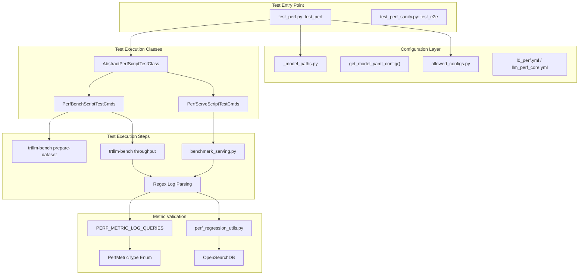
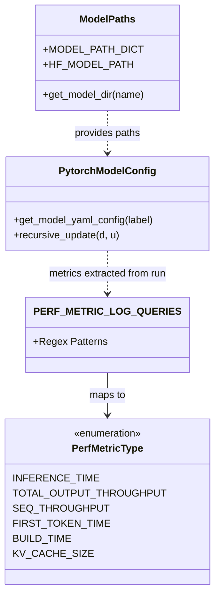
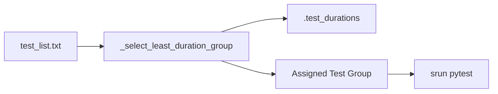

<!-- source: DeepWiki mcp.deepwiki.com · repo NVIDIA/TensorRT-LLM · page 5.3 Performance Testing Framework · fetched 2026-10-26 -->

# Performance Testing Framework

Relevant source files

The following files were used as context for generating this wiki page:

- [examples/disaggregated/slurm/cache_transceiver_test/run_cache_transceiver_test.py](examples/disaggregated/slurm/cache_transceiver_test/run_cache_transceiver_test.py)
- [jenkins/scripts/perf/cluster_env.py](jenkins/scripts/perf/cluster_env.py)
- [jenkins/scripts/perf/disaggregated/slurm_ct_precheck_gate.sh](jenkins/scripts/perf/disaggregated/slurm_ct_precheck_gate.sh)
- [jenkins/scripts/perf/disaggregated/slurm_launch_draft.sh](jenkins/scripts/perf/disaggregated/slurm_launch_draft.sh)
- [jenkins/scripts/perf/local/submit.py](jenkins/scripts/perf/local/submit.py)
- [jenkins/scripts/perf/submit.py](jenkins/scripts/perf/submit.py)
- [tensorrt_llm/bench/benchmark/__init__.py](tensorrt_llm/bench/benchmark/__init__.py)
- [tests/integration/defs/examples/serve/test_configs/Nemotron3_Nano_Omni_30B_NVFP4.yml](tests/integration/defs/examples/serve/test_configs/Nemotron3_Nano_Omni_30B_NVFP4.yml)
- [tests/integration/defs/examples/serve/test_configs/Qwen3-30B-A3B-FP8.yml](tests/integration/defs/examples/serve/test_configs/Qwen3-30B-A3B-FP8.yml)
- [tests/integration/defs/examples/serve/test_serve.py](tests/integration/defs/examples/serve/test_serve.py)
- [tests/integration/defs/perf/README.md](tests/integration/defs/perf/README.md)
- [tests/integration/defs/perf/_model_paths.py](tests/integration/defs/perf/_model_paths.py)
- [tests/integration/defs/perf/base_perf_pytorch.csv](tests/integration/defs/perf/base_perf_pytorch.csv)
- [tests/integration/defs/perf/open_search_db_utils.py](tests/integration/defs/perf/open_search_db_utils.py)
- [tests/integration/defs/perf/pytorch_model_config.py](tests/integration/defs/perf/pytorch_model_config.py)
- [tests/integration/defs/perf/sanity_perf_check.py](tests/integration/defs/perf/sanity_perf_check.py)
- [tests/integration/defs/perf/test_perf.py](tests/integration/defs/perf/test_perf.py)
- [tests/integration/defs/perf/test_perf_sanity.py](tests/integration/defs/perf/test_perf_sanity.py)
- [tests/integration/defs/perf/utils.py](tests/integration/defs/perf/utils.py)
- [tests/integration/test_lists/qa/README.md](tests/integration/test_lists/qa/README.md)
- [tests/integration/test_lists/qa/llm_perf_core.yml](tests/integration/test_lists/qa/llm_perf_core.yml)
- [tests/integration/test_lists/qa/llm_perf_multinode.yml](tests/integration/test_lists/qa/llm_perf_multinode.yml)
- [tests/integration/test_lists/qa/llm_spark_core.txt](tests/integration/test_lists/qa/llm_spark_core.txt)
- [tests/integration/test_lists/qa/llm_spark_func.yml](tests/integration/test_lists/qa/llm_spark_func.yml)
- [tests/integration/test_lists/qa/llm_spark_perf.yml](tests/integration/test_lists/qa/llm_spark_perf.yml)
- [tests/integration/test_lists/test-db/l0_gb200_multi_gpus_perf_sanity.yml](tests/integration/test_lists/test-db/l0_gb200_multi_gpus_perf_sanity.yml)
- [tests/integration/test_lists/test-db/l0_perf.yml](tests/integration/test_lists/test-db/l0_perf.yml)
- [tests/scripts/perf-sanity/aggregated/super_ad_blackwell.yaml](tests/scripts/perf-sanity/aggregated/super_ad_blackwell.yaml)
- [tests/scripts/perf-sanity/cache_transceiver_precheck/README.md](tests/scripts/perf-sanity/cache_transceiver_precheck/README.md)
- [tests/scripts/perf-sanity/cache_transceiver_precheck/precheck_config.py](tests/scripts/perf-sanity/cache_transceiver_precheck/precheck_config.py)
- [tests/scripts/perf-sanity/cache_transceiver_precheck/run_precheck.py](tests/scripts/perf-sanity/cache_transceiver_precheck/run_precheck.py)
- [tests/scripts/perf/disaggregated/gb300_kimi-k3-fp4_8k1k_con512_ctx1_dep16_gen1_dep16_eplb0_mtp0_ccb-NIXL.yaml](tests/scripts/perf/disaggregated/gb300_kimi-k3-fp4_8k1k_con512_ctx1_dep16_gen1_dep16_eplb0_mtp0_ccb-NIXL.yaml)
- [tests/unittest/others/test_cache_transceiver_precheck_config.py](tests/unittest/others/test_cache_transceiver_precheck_config.py)
- [tests/unittest/others/test_cache_transceiver_precheck_run.py](tests/unittest/others/test_cache_transceiver_precheck_run.py)
- [tests/unittest/scripts/test_cluster_env.py](tests/unittest/scripts/test_cluster_env.py)
- [tests/unittest/scripts/test_perf_sanity_helpers.py](tests/unittest/scripts/test_perf_sanity_helpers.py)
- [tests/unittest/scripts/test_perf_submit.py](tests/unittest/scripts/test_perf_submit.py)

## Purpose and Scope

The Performance Testing Framework provides comprehensive performance validation for TensorRT-LLM across different models, backends, quantization schemes, and hardware configurations. This framework executes throughput and latency benchmarks using `trtllm-bench` and the `benchmark_serving.py` utility, parses performance metrics from execution logs, and validates results against regression thresholds. It supports single-node, multi-node aggregated, and multi-node disaggregated architectures.

For accuracy testing, see [Accuracy Testing Framework](5.2). For general test infrastructure and CI/CD integration, see [Test Framework Overview and Architecture](5.1) and [Jenkins Pipeline Architecture](6.1).

**Sources:** [tests/integration/defs/perf/test_perf.py:15-17](), [tests/integration/defs/perf/utils.py:88-119]()

## Framework Architecture

The performance testing framework consists of several interconnected components that handle test configuration, execution, metric collection, and validation.

Title: "Performance Testing Architecture"

**Sources:** [tests/integration/defs/perf/test_perf.py:32-39](), [tests/integration/defs/perf/utils.py:88-119](), [tests/integration/defs/perf/test_perf_sanity.py:151-169](), [tests/integration/defs/perf/open_search_db_utils.py:18-20]()

## Test Configuration System

### Model Configuration and Paths
The framework centralizes model locations in `_model_paths.py`, mapping internal model names to local filesystem paths or HuggingFace identifiers [tests/integration/defs/perf/_model_paths.py:18-116](). It also maintains sets of models requiring special handling, such as `TRUST_REMOTE_CODE_MODELS` [tests/integration/defs/perf/test_perf.py:57-72]() or `SPEC_DEC_MODELS` for speculative decoding [tests/integration/defs/perf/test_perf.py:95-101]().

### Backend Configuration
For the PyTorch backend, `get_model_yaml_config` in `pytorch_model_config.py` provides specialized configurations based on model labels:
*   **DeepSeek Support:** Supports MTP speculative decoding with `decoding_type: 'MTP'` [tests/integration/defs/perf/pytorch_model_config.py:173-176]() and DSpark speculative decoding [tests/integration/defs/perf/pytorch_model_config.py:134-142]().
*   **Blackwell Optimizations:** For SM100+ hardware, models like `deepseek_v3_lite_fp8` are configured to use the `DEEPGEMM` MoE backend to avoid compatibility issues with default CUTLASS runners [tests/integration/defs/perf/pytorch_model_config.py:22-31]().
*   **Chunked Prefill:** Enabled for high-throughput scenarios to optimize attention computation [tests/integration/defs/perf/pytorch_model_config.py:102-102](), [tests/integration/defs/perf/pytorch_model_config.py:202-202]().
*   **Attention DP:** Enabled for specific models like `deepseek_r1` to optimize distributed attention [tests/integration/defs/perf/pytorch_model_config.py:87-91]().

Title: "Configuration and Metric Entity Space"

**Sources:** [tests/integration/defs/perf/pytorch_model_config.py:55-190](), [tests/integration/defs/perf/_model_paths.py:18-116](), [tests/integration/defs/perf/utils.py:88-119]()

## Test Execution Flow

### Process Monitoring and Health
The framework uses a robust execution utility `_run_command_with_captured_output` in `utils.py` to monitor process health. It includes a stall detector that kills processes if no output is produced for a set timeout (`_STALL_TIMEOUT` = 1800s), or if fatal patterns like "Segmentation fault" or "RuntimeError: [TensorRT-LLM][ERROR]" are detected [tests/integration/defs/perf/utils.py:152-162](), [tests/integration/defs/perf/utils.py:165-188]().

### Serving Performance (test_perf_sanity.py)
Sanity tests validate end-to-end serving performance by:
1.  Cloning the `bench_serving` repository using a file lock to prevent race conditions [tests/integration/defs/perf/test_perf_sanity.py:61-97]().
2.  Launching the inference server (aggregated or disaggregated).
3.  Executing `benchmark_serving.py` against the server endpoints.
4.  Parsing metrics like `mean_ttft`, `p99_itl`, and `token_throughput` [tests/integration/defs/perf/test_perf_sanity.py:152-169]().

### Server Health and Readiness
For serving tests, the framework implements health checks to ensure the server endpoint is functional before benchmarking begins. It uses `wait_for_endpoint_ready` from `test_common.http_utils` [tests/integration/defs/perf/test_perf_sanity.py:32-32](). Timeouts are configurable based on serving mode (e.g., `DISAGG_SERVER_READY_TIMEOUT` = 3600s) [tests/integration/defs/perf/test_perf_sanity.py:108-108]().

**Sources:** [tests/integration/defs/perf/utils.py:152-188](), [tests/integration/defs/perf/test_perf_sanity.py:61-169]()

## Performance Metrics and Regression Detection

### Metric Collection
The framework tracks performance metrics extracted from benchmark logs using regex patterns defined in `PERF_METRIC_LOG_QUERIES` [tests/integration/defs/perf/test_perf.py:163-194]().

| Metric Key | Description | Source |
|------------|-------------|--------|
| `INFERENCE_TIME` | Total latency for inference requests | [tests/integration/defs/perf/test_perf.py:166-167]() |
| `FIRST_TOKEN_TIME` | Avg Time To First Token (TTFT) | [tests/integration/defs/perf/test_perf.py:168-169]() |
| `SEQ_THROUGHPUT` | Request throughput (seq/sec) | [tests/integration/defs/perf/test_perf.py:172-173]() |
| `TOTAL_OUTPUT_THROUGHPUT` | Output token throughput (token/sec) | [tests/integration/defs/perf/test_perf.py:174-177]() |
| `KV_CACHE_SIZE` | Memory allocated for paged KV cache | [tests/integration/defs/perf/test_perf.py:192-193]() |
| `BUILD_TIME` | Time taken to generate the TRT engine | [tests/integration/defs/perf/test_perf.py:164-165]() |

### Regression Detection and OpenSearch
Test results are processed and uploaded to an OpenSearch database via `open_search_db_utils.py`. The system:
1.  Queries historical post-merge data for matching configurations [tests/integration/defs/perf/open_search_db_utils.py:47-56]().
2.  Calculates baselines and thresholds based on the most recent entries that contain valid baseline data [tests/integration/defs/perf/open_search_db_utils.py:95-116]().
3.  Uploads new results with metadata including GPU type and boolean flags for backward compatibility [tests/integration/defs/perf/open_search_db_utils.py:148-176]().

**Sources:** [tests/integration/defs/perf/test_perf.py:163-194](), [tests/integration/defs/perf/open_search_db_utils.py:47-176]()

## Disaggregated Performance Testing

Disaggregated testing separates the Context (prefill) and Generation (decode) phases across different nodes.

### CI Submission Logic
The `submit.py` script generates SLURM launch scripts for multi-node tests. It supports `aggregated`, `disaggregated`, and `ctx_only` modes [jenkins/scripts/perf/submit.py:22-30](). It uses `pytest-split` to balance test durations across multi-node allocations [jenkins/scripts/perf/submit.py:146-185](). The local submission variant also validates benchmark concurrency settings, ensuring they are positive integers [jenkins/scripts/perf/local/submit.py:30-32]().

Title: "Disaggregated Test Submission Flow"

**Sources:** [jenkins/scripts/perf/submit.py:17-47](), [jenkins/scripts/perf/submit.py:146-185](), [jenkins/scripts/perf/local/submit.py:30-32]()

## Test Lists and Hardware Conditions

Tests are organized into core, spark, and sanity lists, executed based on hardware capabilities defined in YAML files.

*   **Core Performance:** Comprehensive tests for models like `qwen3.5_9b` and `nemotron_nano_12b_v2`. These validate both minimum latency and maximum throughput [tests/integration/test_lists/qa/llm_perf_core.yml:29-37](), [tests/integration/test_lists/qa/llm_perf_core.yml:71-79]().
*   **Spark Performance:** Single-GPU rapid smoke tests (1 req, 1 concurrency) for a wide variety of models including `llama_v3.3_70b_instruct_fp4` and `gemma_3` [tests/integration/test_lists/qa/llm_spark_perf.yml:12-60]().
*   **Hardware Conditions:** Filtering is applied using `supports_fp8`, `system_gpu_count`, `compute_capability`, and `gpu_memory` ranges [tests/integration/test_lists/qa/llm_perf_core.yml:22-27](), [tests/integration/test_lists/qa/llm_perf_core.yml:57-65]().

**Sources:** [tests/integration/test_lists/qa/llm_perf_core.yml:22-113](), [tests/integration/test_lists/qa/llm_spark_perf.yml:6-60](), [tests/integration/test_lists/test-db/l0_perf.yml:3-16]()

---

