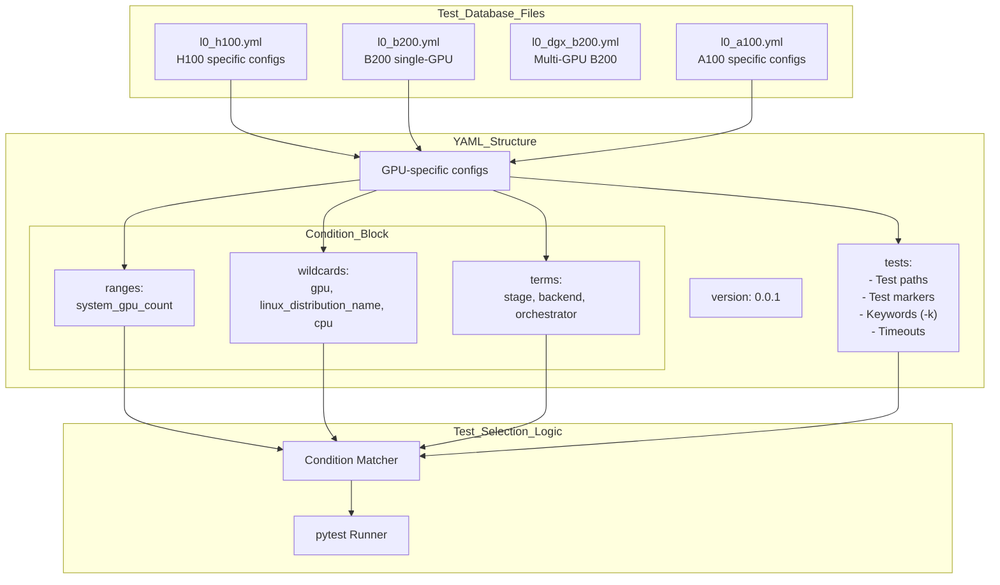
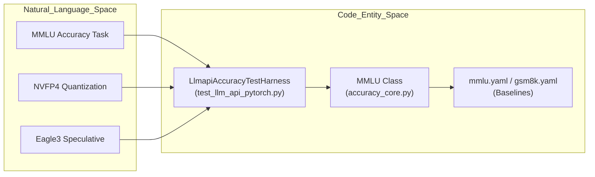

<!-- source: DeepWiki mcp.deepwiki.com · repo NVIDIA/TensorRT-LLM · page 5.4 Test Configuration and Test Database · fetched 2026-10-26 -->

# Test Configuration and Test Database

<details>
<summary>Relevant source files</summary>

The following files were used as context for generating this wiki page:

- [cpp/tensorrt_llm/kernels/noAuxTcKernels.cu](cpp/tensorrt_llm/kernels/noAuxTcKernels.cu)
- [cpp/tensorrt_llm/kernels/noAuxTcKernels.h](cpp/tensorrt_llm/kernels/noAuxTcKernels.h)
- [cpp/tensorrt_llm/thop/noAuxTcOp.cpp](cpp/tensorrt_llm/thop/noAuxTcOp.cpp)
- [tensorrt_llm/_torch/models/modeling_kimi_linear.py](tensorrt_llm/_torch/models/modeling_kimi_linear.py)
- [tensorrt_llm/_torch/modules/situ.py](tensorrt_llm/_torch/modules/situ.py)
- [tests/integration/defs/.test_durations](tests/integration/defs/.test_durations)
- [tests/integration/defs/accuracy/references/cnn_dailymail.yaml](tests/integration/defs/accuracy/references/cnn_dailymail.yaml)
- [tests/integration/defs/accuracy/references/gsm8k.yaml](tests/integration/defs/accuracy/references/gsm8k.yaml)
- [tests/integration/defs/accuracy/references/mmlu.yaml](tests/integration/defs/accuracy/references/mmlu.yaml)
- [tests/integration/defs/accuracy/test_disaggregated_serving.py](tests/integration/defs/accuracy/test_disaggregated_serving.py)
- [tests/integration/defs/accuracy/test_llm_api_autodeploy.py](tests/integration/defs/accuracy/test_llm_api_autodeploy.py)
- [tests/integration/defs/accuracy/test_llm_api_pytorch.py](tests/integration/defs/accuracy/test_llm_api_pytorch.py)
- [tests/integration/defs/disaggregated/test_disaggregated.py](tests/integration/defs/disaggregated/test_disaggregated.py)
- [tests/integration/defs/test_e2e.py](tests/integration/defs/test_e2e.py)
- [tests/integration/test_lists/qa/llm_function_core.txt](tests/integration/test_lists/qa/llm_function_core.txt)
- [tests/integration/test_lists/qa/llm_function_multinode.txt](tests/integration/test_lists/qa/llm_function_multinode.txt)
- [tests/integration/test_lists/qa/llm_function_rtx6k.txt](tests/integration/test_lists/qa/llm_function_rtx6k.txt)
- [tests/integration/test_lists/test-db/l0_a10.yml](tests/integration/test_lists/test-db/l0_a10.yml)
- [tests/integration/test_lists/test-db/l0_b200.yml](tests/integration/test_lists/test-db/l0_b200.yml)
- [tests/integration/test_lists/test-db/l0_b300.yml](tests/integration/test_lists/test-db/l0_b300.yml)
- [tests/integration/test_lists/test-db/l0_cpu.yml](tests/integration/test_lists/test-db/l0_cpu.yml)
- [tests/integration/test_lists/test-db/l0_dgx_b200.yml](tests/integration/test_lists/test-db/l0_dgx_b200.yml)
- [tests/integration/test_lists/test-db/l0_dgx_b300.yml](tests/integration/test_lists/test-db/l0_dgx_b300.yml)
- [tests/integration/test_lists/test-db/l0_dgx_h100.yml](tests/integration/test_lists/test-db/l0_dgx_h100.yml)
- [tests/integration/test_lists/test-db/l0_dgx_h200.yml](tests/integration/test_lists/test-db/l0_dgx_h200.yml)
- [tests/integration/test_lists/test-db/l0_gb200_multi_gpus.yml](tests/integration/test_lists/test-db/l0_gb200_multi_gpus.yml)
- [tests/integration/test_lists/test-db/l0_gb300.yml](tests/integration/test_lists/test-db/l0_gb300.yml)
- [tests/integration/test_lists/test-db/l0_gb300_multi_gpus.yml](tests/integration/test_lists/test-db/l0_gb300_multi_gpus.yml)
- [tests/integration/test_lists/test-db/l0_h100.yml](tests/integration/test_lists/test-db/l0_h100.yml)
- [tests/integration/test_lists/test-db/l0_rtx_pro_6000.yml](tests/integration/test_lists/test-db/l0_rtx_pro_6000.yml)
- [tests/integration/test_lists/waives.txt](tests/integration/test_lists/waives.txt)
- [tests/unittest/_torch/modules/kimi_kda/test_kda_decode_op.py](tests/unittest/_torch/modules/kimi_kda/test_kda_decode_op.py)
- [tests/unittest/_torch/modules/moe/kimi_k3_ref_moe/_moe_kernels.py](tests/unittest/_torch/modules/moe/kimi_k3_ref_moe/_moe_kernels.py)
- [tests/unittest/_torch/modules/moe/kimi_k3_ref_moe/_mxfp4.py](tests/unittest/_torch/modules/moe/kimi_k3_ref_moe/_mxfp4.py)
- [tests/unittest/_torch/modules/moe/kimi_k3_ref_moe/kimi_k3_mlp_test_utils.py](tests/unittest/_torch/modules/moe/kimi_k3_ref_moe/kimi_k3_mlp_test_utils.py)
- [tests/unittest/_torch/modules/moe/kimi_k3_ref_moe/kimi_k3_moe_block.py](tests/unittest/_torch/modules/moe/kimi_k3_ref_moe/kimi_k3_moe_block.py)
- [tests/unittest/_torch/modules/moe/test_kimi_k3_mlp.py](tests/unittest/_torch/modules/moe/test_kimi_k3_mlp.py)
- [tests/unittest/_torch/modules/moe/test_kimi_k3_moe_gate.py](tests/unittest/_torch/modules/moe/test_kimi_k3_moe_gate.py)
- [tests/unittest/_torch/modules/moe/test_kimi_k3_situ_and_mul.py](tests/unittest/_torch/modules/moe/test_kimi_k3_situ_and_mul.py)
- [tests/unittest/_torch/modules/moe/test_kimi_k3_situ_moe.py](tests/unittest/_torch/modules/moe/test_kimi_k3_situ_moe.py)
- [tests/unittest/_torch/visual_gen/kernels/parallel/test_fused_dit_gate_resid_norm_shift_scale.py](tests/unittest/_torch/visual_gen/kernels/parallel/test_fused_dit_gate_resid_norm_shift_scale.py)
- [tests/unittest/_torch/visual_gen/kernels/parallel/test_fused_dit_layernorm_shift_scale.py](tests/unittest/_torch/visual_gen/kernels/parallel/test_fused_dit_layernorm_shift_scale.py)
- [tests/unittest/_torch/visual_gen/kernels/parallel_hw_agnostic/test_fused_dit_qk_norm_rope.py](tests/unittest/_torch/visual_gen/kernels/parallel_hw_agnostic/test_fused_dit_qk_norm_rope.py)
- [tests/unittest/_torch/visual_gen/kernels/parallel_hw_agnostic/test_fused_dit_split_norm.py](tests/unittest/_torch/visual_gen/kernels/parallel_hw_agnostic/test_fused_dit_split_norm.py)
- [tests/unittest/_torch/visual_gen/kernels/parallel_hw_agnostic/test_fused_dit_split_qk_norm_rope.py](tests/unittest/_torch/visual_gen/kernels/parallel_hw_agnostic/test_fused_dit_split_qk_norm_rope.py)

</details>


## Purpose and Scope

This document describes TensorRT-LLM's test configuration and test database system, which controls which tests run on which hardware configurations. The system uses YAML-based configuration files to define test conditions, accuracy thresholds, and test selections based on GPU type, GPU count, pipeline stage, and execution backend.

For information about the test execution infrastructure and CI/CD pipeline, see **Jenkins Pipeline Architecture (6.1)**. For details on test frameworks and test execution, see **Test Framework Overview and Architecture (5.1)**. For the waives system that tracks known issues, see **Test Waives and Known Issues (5.5)**.

## Test Database Architecture

The test database is a collection of YAML files that define which tests should run under specific hardware and software conditions. Each YAML file represents a test configuration for a particular GPU family or cluster type.

### YAML File Structure

The following diagram illustrates how the YAML configuration files bridge hardware requirements to specific test execution commands.

**Test Configuration Data Flow**

**Sources:** [tests/integration/test_lists/test-db/l0_h100.yml:1-15](), [tests/integration/test_lists/test-db/l0_b200.yml:1-16]()

### Condition-Based Test Selection

Each test configuration contains one or more condition blocks that specify when tests should run. The condition system uses three types of filters:

#### Ranges
Numeric range constraints for hardware attributes, typically used to shard tests by node size.
```yaml
ranges:
  system_gpu_count:
    gte: 4  # Greater than or equal
    lte: 4  # Less than or equal
```
**Sources:** [tests/integration/test_lists/test-db/l0_dgx_b200.yml:28-31](), [tests/integration/test_lists/test-db/l0_dgx_h100.yml:71-74]()

#### Wildcards
Pattern matching for string attributes like GPU architecture or CPU type.
```yaml
wildcards:
  gpu:
    - '*h100*'
  linux_distribution_name: ubuntu*
  cpu: x86_64
```
**Sources:** [tests/integration/test_lists/test-db/l0_h100.yml:8-11](), [tests/integration/test_lists/test-db/l0_dgx_b200.yml:8-12]()

#### Terms
Exact match constraints for execution context and orchestration.
```yaml
terms:
  stage: pre_merge          # pre_merge or post_merge
  backend: pytorch          # pytorch, cpp, tensorrt
  orchestrator: mpi         # mpi or ray
```
**Sources:** [tests/integration/test_lists/test-db/l0_h100.yml:12-15](), [tests/integration/test_lists/test-db/l0_dgx_b200.yml:13-16]()

### Test Path Specifications

Test entries support several formats for granular execution:

| Format | Example | Description |
|--------|---------|-------------|
| **Specific Test** | `accuracy/test_llm_api_pytorch.py::TestLlama3_1_8B::test_nvfp4` | Executes a single test method [tests/integration/test_lists/test-db/l0_b200.yml:20-20](). |
| **Parameterized** | `accuracy/test_llm_api_pytorch.py::TestLlama3_1_8BInstruct::test_fp8[...]` | Executes a specific parameterization [tests/integration/test_lists/test-db/l0_dgx_h100.yml:93-98](). |
| **Keyword Filter** | `unittest/_torch/modeling -k "modeling_llama"` | Pytest `-k` filter for matching names [tests/integration/test_lists/test-db/l0_h100.yml:69-69](). |
| **Marker Filter** | `unittest/llmapi/test_llm_multi_gpu_pytorch.py -m "gpu4"` | Pytest `-m` filter for markers [tests/integration/test_lists/test-db/l0_dgx_b200.yml:118-118](). |
| **Timeout** | `...::test_nvfp4_4gpu_mtp_ar TIMEOUT (60)` | Custom timeout in minutes for long-running tests [tests/integration/test_lists/test-db/l0_dgx_b200.yml:42-42](). |

**Sources:** [tests/integration/test_lists/test-db/l0_h100.yml:18-126](), [tests/integration/test_lists/test-db/l0_dgx_h100.yml:18-116](), [tests/integration/test_lists/test-db/l0_b200.yml:17-72]()

## Test Database Files by GPU Type

### Single-GPU Configurations
Configurations for single-GPU environments focus on functional correctness of core components and specific quantization kernels.

*   **`l0_h100.yml`**: Focuses on Hopper-specific features like MLA Helix, MoE routing, and Eagle3 speculative decoding [tests/integration/test_lists/test-db/l0_h100.yml:26-58](). It also includes disaggregated serving unit tests for cache transceivers [tests/integration/test_lists/test-db/l0_h100.yml:89-112]().
*   **`l0_b200.yml`**: Targets Blackwell architectures, emphasizing NVFP4 (FP4) quantization, block-scale FP8, and DeepSeek-V3-Lite support [tests/integration/test_lists/test-db/l0_b200.yml:20-47]().
*   **`l0_a10.yml`**: Covers tests for smaller GPUs, including single-GPU disaggregated serving and multimodal input processing [tests/integration/test_lists/test-db/l0_a10.yml:59-105]().

### Multi-GPU Configurations
Multi-GPU configurations focus on distributed features like Tensor Parallelism (TP), Pipeline Parallelism (PP), and Expert Parallelism (EP).

*   **`l0_dgx_h100.yml`**: Covers disaggregated serving accuracy (Llama 3.1, Qwen 3) and multi-GPU PyTorch LLM API tests using MPI [tests/integration/test_lists/test-db/l0_dgx_h100.yml:30-52]().
*   **`l0_dgx_b200.yml`**: Validates MoE backends (CUTLASS, TRTLLM, DEEPGEMM, CUTEDSL) across multiple GPUs, including Expert Parallel Load Balancing (EPLB) and Blackwell-specific DSA FP4 indexers [tests/integration/test_lists/test-db/l0_dgx_b200.yml:82-103]().

**Sources:** [tests/integration/test_lists/test-db/l0_h100.yml:1-126](), [tests/integration/test_lists/test-db/l0_dgx_h100.yml:1-116](), [tests/integration/test_lists/test-db/l0_dgx_b200.yml:1-125](), [tests/integration/test_lists/test-db/l0_a10.yml:1-135]()

## Accuracy Testing Database

Accuracy tests use reference YAML files to define expected performance metrics across different models and hardware.

### Accuracy Reference Files
The system compares current test results against baselines stored in:
*   `tests/integration/defs/accuracy/references/mmlu.yaml`: MMLU accuracy thresholds per model and quantization scheme.
*   `tests/integration/defs/accuracy/references/gsm8k.yaml`: GSM8K accuracy thresholds, including speculative decoding algorithms like NGram, SA, Eagle, and PARD (e.g., DeepSeek-V3-Lite MTP at 64.44%) [tests/integration/defs/accuracy/references/gsm8k.yaml:71-72]().
*   `tests/integration/defs/accuracy/references/cnn_dailymail.yaml`: Baselines for summarization tasks used in `CnnDailymail` accuracy tasks [tests/integration/defs/accuracy/test_llm_api_pytorch.py:50-52]().

### Test Harness Mapping
The `LlmapiAccuracyTestHarness` class and its model-specific subclasses (e.g., `TestLlama3_1_8B`) orchestrate these comparisons by invoking `accuracy_core` tasks [tests/integration/defs/accuracy/test_llm_api_pytorch.py:168-174]().

**Accuracy Evaluation Mapping**

**Sources:** [tests/integration/defs/accuracy/test_llm_api_pytorch.py:168-174](), [tests/integration/defs/accuracy/test_llm_api_pytorch.py:50-52]()

## Disaggregated Serving Test Configuration

The database defines specific configurations for disaggregated serving, where context (prefill) and generation (decode) tasks are split across different nodes or GPUs.

Key configuration and implementation entities in `test_disaggregated_serving.py`:
*   `launch_disaggregated_llm`: A context manager that orchestrates the startup of context and generation servers [tests/integration/defs/accuracy/test_disaggregated_serving.py:193-202]().
*   `DuckLLM`: A `namedtuple` used to mock the LLM interface for accuracy evaluation in disaggregated environments [tests/integration/defs/accuracy/test_disaggregated_serving.py:66-66]().
*   `run_accuracy_test`: Function that executes accuracy tasks against a launched disaggregated LLM instance [tests/integration/defs/accuracy/test_disaggregated_serving.py:163-171]().

**Sources:** [tests/integration/defs/accuracy/test_disaggregated_serving.py:50-202]()

## Test Waives and Hardware-Specific Skips

The system utilizes a `waives.txt` file to skip known issues or hardware-incompatible tests.

*   **Hardware Filtering**: Tests are skipped based on SM version using utilities like `skip_pre_blackwell`, `skip_pre_hopper`, and `skip_no_hopper` [tests/integration/defs/accuracy/test_llm_api_pytorch.py:44-49]().
*   **Bug Tracking**: Skips in `waives.txt` are linked to internal bug IDs (e.g., `nvbugs/6428069`) and provide specific skip patterns for pytest [tests/integration/test_lists/waives.txt:2-5]().
*   **Memory Checks**: The `@pytest.mark.skip_less_device_memory(32000)` marker is used to skip tests on GPUs with insufficient VRAM [tests/integration/defs/accuracy/test_llm_api_pytorch.py:172-172]().

**Sources:** [tests/integration/test_lists/waives.txt:1-47](), [tests/integration/defs/accuracy/test_llm_api_pytorch.py:44-49](), [tests/integration/defs/accuracy/test_llm_api_pytorch.py:172-172]()

## Summary of Backend-Specific Terms

The `terms` section in YAML files differentiates between runtime environments and triggers:

| Backend Term | Implementation Focus |
|--------------|----------------------|
| `pytorch` | Focuses on `tensorrt_llm._torch` modules and the PyTorch-based LLM API [tests/integration/test_lists/test-db/l0_h100.yml:14-14](). |
| `mpi` | Distributed execution using the MPI-based `MpiPoolSession` [tests/integration/test_lists/test-db/l0_dgx_h100.yml:16-16](). |
| `ray` | Distributed execution using the Ray orchestrator [tests/integration/test_lists/test-db/l0_dgx_b200.yml:116-116](). |

**Sources:** [tests/integration/test_lists/test-db/l0_h100.yml:12-16](), [tests/integration/test_lists/test-db/l0_dgx_h100.yml:12-16](), [tests/integration/test_lists/test-db/l0_dgx_b200.yml:104-117]()

---

