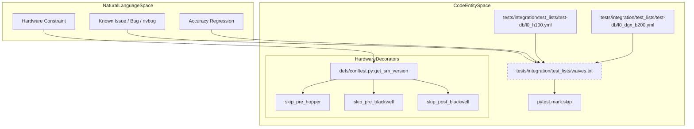
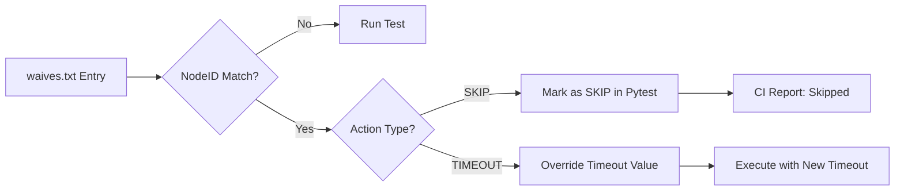
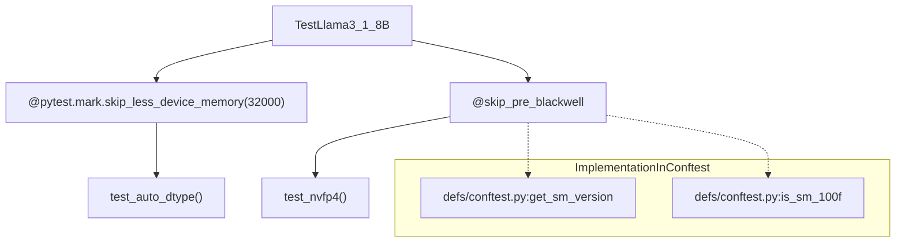

<!-- source: DeepWiki mcp.deepwiki.com · repo NVIDIA/TensorRT-LLM · page 5.5 Test Waives and Known Issues · fetched 2026-10-26 -->

# Test Waives and Known Issues

Relevant source files

The following files were used as context for generating this wiki page:

- [tests/integration/defs/.test_durations](tests/integration/defs/.test_durations)
- [tests/integration/defs/accuracy/references/cnn_dailymail.yaml](tests/integration/defs/accuracy/references/cnn_dailymail.yaml)
- [tests/integration/defs/accuracy/references/gsm8k.yaml](tests/integration/defs/accuracy/references/gsm8k.yaml)
- [tests/integration/defs/accuracy/references/mmlu.yaml](tests/integration/defs/accuracy/references/mmlu.yaml)
- [tests/integration/defs/accuracy/test_disaggregated_serving.py](tests/integration/defs/accuracy/test_disaggregated_serving.py)
- [tests/integration/defs/accuracy/test_llm_api_autodeploy.py](tests/integration/defs/accuracy/test_llm_api_autodeploy.py)
- [tests/integration/defs/accuracy/test_llm_api_pytorch.py](tests/integration/defs/accuracy/test_llm_api_pytorch.py)
- [tests/integration/defs/disaggregated/test_disaggregated.py](tests/integration/defs/disaggregated/test_disaggregated.py)
- [tests/integration/defs/test_e2e.py](tests/integration/defs/test_e2e.py)
- [tests/integration/test_lists/qa/llm_function_core.txt](tests/integration/test_lists/qa/llm_function_core.txt)
- [tests/integration/test_lists/qa/llm_function_multinode.txt](tests/integration/test_lists/qa/llm_function_multinode.txt)
- [tests/integration/test_lists/qa/llm_function_rtx6k.txt](tests/integration/test_lists/qa/llm_function_rtx6k.txt)
- [tests/integration/test_lists/test-db/l0_a10.yml](tests/integration/test_lists/test-db/l0_a10.yml)
- [tests/integration/test_lists/test-db/l0_b200.yml](tests/integration/test_lists/test-db/l0_b200.yml)
- [tests/integration/test_lists/test-db/l0_dgx_b200.yml](tests/integration/test_lists/test-db/l0_dgx_b200.yml)
- [tests/integration/test_lists/test-db/l0_dgx_b300.yml](tests/integration/test_lists/test-db/l0_dgx_b300.yml)
- [tests/integration/test_lists/test-db/l0_dgx_h100.yml](tests/integration/test_lists/test-db/l0_dgx_h100.yml)
- [tests/integration/test_lists/test-db/l0_dgx_h200.yml](tests/integration/test_lists/test-db/l0_dgx_h200.yml)
- [tests/integration/test_lists/test-db/l0_gb200_multi_gpus.yml](tests/integration/test_lists/test-db/l0_gb200_multi_gpus.yml)
- [tests/integration/test_lists/test-db/l0_h100.yml](tests/integration/test_lists/test-db/l0_h100.yml)
- [tests/integration/test_lists/test-db/l0_rtx_pro_6000.yml](tests/integration/test_lists/test-db/l0_rtx_pro_6000.yml)
- [tests/integration/test_lists/waives.txt](tests/integration/test_lists/waives.txt)

## Purpose and Scope

This document describes the test waive system and known issues management in TensorRT-LLM's testing infrastructure. A test waive is a mechanism to temporarily skip tests that have known failures, typically due to bugs, platform limitations, or hardware-specific regressions. The waive system allows continuous integration (CI) to proceed while issues are being resolved, without losing visibility of the failing tests.

The primary configuration for these waives resides in `tests/integration/test_lists/waives.txt`, which acts as a centralized database for skipping tests across different hardware architectures and software configurations [tests/integration/test_lists/waives.txt:1-55]().

## Test Waive System Architecture

The test waive system is integrated into the pytest-based integration testing suite. It bridges the gap between the test database (YAML files defining which tests to run on specific hardware) and the actual test execution.

### Code-to-System Mapping

The following diagram maps the logical waive system to specific code entities and files within the repository.

**Diagram: Test Waive System Code Map**

**Sources:** [tests/integration/test_lists/waives.txt:1-10](), [tests/integration/test_lists/test-db/l0_h100.yml:1-16](), [tests/integration/defs/accuracy/test_llm_api_pytorch.py:44-49]()

## Waive File Format and Structure

The `waives.txt` file uses a specific syntax to target tests. Each line represents a waive entry that the test runner parses during the collection phase.

### Syntax Components

The format generally follows: `[TEST_PATH]::[CLASS]::[METHOD][PARAMS] [ACTION] (REASON)`

| Component | Description | Example |
| :--- | :--- | :--- |
| **Test Path** | The pytest node ID for the test, including parameters. | `accuracy/test_disaggregated_serving.py::TestDeepSeekV3Lite::test_auto_dtype_with_helix[...]` |
| **Action** | What to do with the test. | `SKIP` or `TIMEOUT` |
| **Reason** | Documentation of why the test is waived, usually a bug link (nvbugs). | `(https://nvbugs/6567057)` |

**Diagram: Waive Entry Logic Flow**

**Sources:** [tests/integration/test_lists/waives.txt:1-55](), [tests/integration/test_lists/test-db/l0_dgx_b200.yml:42-57]()

## Categories of Known Issues

### 1. Disaggregated Serving Issues
Issues specific to the disaggregated context/generation architecture are tracked extensively. These often involve complex communication patterns like `ctx_pp` (context pipeline parallel) or `gen_tp` (generation tensor parallel).

*   **DeepSeek V3 Lite:** Multiple helix and auto_dtype variants are waived due to specific bugs (e.g., nvbugs 6633927, 6388139, 6507095) [tests/integration/test_lists/waives.txt:23-34]().
*   **Asymmetric Parallelism:** Llama 3.1 8B Instruct tests with asymmetric context pipeline parallel and generation tensor parallel are currently skipped across multiple GSM8K and MMLU configurations [tests/integration/test_lists/waives.txt:2-6]().
*   **DeepSeek R1:** KV cache v2 NIXL Python tests for R1 are tracked for potential issues [tests/integration/test_lists/qa/llm_function_core.txt:1]().

### 2. Blackwell (B200) and NVFP4 Regressions
As Blackwell support is integrated, certain high-precision or experimental quantization formats (NVFP4) may undergo temporary waives during tuning.

*   **GLM52 NVFP4:** Disaggregated serving tests with NIXL and NVFP4 are currently skipped [tests/integration/test_lists/waives.txt:1]().
*   **DeepSeek R1:** NVFP4 multi-GPU throughput/latency tests are skipped (e.g., nvbugs 6655987, 6481323) [tests/integration/test_lists/waives.txt:17-18]().
*   **DeepSeek V3 Lite:** A large matrix of NVFP4 multi-GPU tests involving combinations of `moe_backend=CUTLASS`, `attention_dp`, and `torch_compile` are waived (nvbugs 6384625) [tests/integration/test_lists/waives.txt:35-39]().

### 3. PyTorch Backend and MTP
The PyTorch-based execution engine (`test_llm_api_pytorch.py`) has specific waives for Multi-Token Prediction (MTP) and block-scale quantization.

*   **DeepSeek V3 Lite:** Multiple `bfloat16_4gpus` tests involving combinations of `pp4`, `mtp_nextn`, and `torch_compile` are waived (nvbugs 6278337, 6428057) [tests/integration/test_lists/waives.txt:27-30]().
*   **DeepSeek R1:** FP8 blockscale throughput tests for MTP are skipped [tests/integration/test_lists/waives.txt:15-16]().

**Sources:** [tests/integration/test_lists/waives.txt:1-55](), [tests/integration/test_lists/qa/llm_function_core.txt:1-17]()

## Hardware-Based Skip Decorators

In addition to the `waives.txt` file, the codebase uses Python decorators to handle dynamic hardware requirements within the test files.

### Key Decorators and Functions
These are primarily used in `tests/integration/defs/accuracy/test_llm_api_pytorch.py` and defined in the test configuration [tests/integration/defs/accuracy/test_llm_api_pytorch.py:44-49]().

*   `skip_pre_hopper`: Skips tests on GPUs older than Hopper (SM90) [tests/integration/defs/accuracy/test_llm_api_pytorch.py:49]().
*   `skip_pre_blackwell`: Skips tests on GPUs older than Blackwell (SM100) [tests/integration/defs/accuracy/test_llm_api_pytorch.py:48]().
*   `skip_post_blackwell`: Skips tests on architectures newer than Blackwell [tests/integration/defs/accuracy/test_llm_api_pytorch.py:47]().
*   `@pytest.mark.skip_less_device_memory(MB)`: Skips if the available VRAM is insufficient for the model (e.g., 32GB for Llama 3.1 8B) [tests/integration/defs/accuracy/test_llm_api_pytorch.py:172]().

**Diagram: Hardware Constraint Implementation**

**Sources:** [tests/integration/defs/accuracy/test_llm_api_pytorch.py:168-173](), [tests/integration/defs/accuracy/test_llm_api_pytorch.py:44-49]()

## Integration with Test Database

The `test-db` YAML files (e.g., `l0_h100.yml`, `l0_dgx_b200.yml`) specify which tests are active for a given hardware "condition". If a test is listed in the YAML but also appears in `waives.txt`, the waive takes precedence.

### Resource and Timeout Overrides
The test database often includes timeout overrides for long-running tests to prevent CI hang-ups.

*   **B200:** `TestNemotronV3Super::test_nvfp4_4gpu_mtp_ar` is given a 60s timeout [tests/integration/test_lists/test-db/l0_dgx_b200.yml:42]().
*   **DeepSeek V4:** `TestDeepSeekV4Flash::test_auto_dtype` is given a 60s timeout [tests/integration/test_lists/test-db/l0_dgx_b200.yml:55]().
*   **OpenAI Contamination:** `test_openai_kv_cache_contamination` is given a 120s timeout [tests/integration/test_lists/test-db/l0_dgx_b200.yml:58]().

**Sources:** [tests/integration/test_lists/test-db/l0_dgx_b200.yml:1-128](), [tests/integration/test_lists/test-db/l0_h100.yml:1-130]()

## Accuracy References and Thresholds

The system tracks expected accuracy values in reference YAML files. Tests validate that current performance meets these known good thresholds.

| Model | Benchmark | Configuration | Expected Accuracy |
| :--- | :--- | :--- | :--- |
| **Llama-3.1-8B-Instruct** | GSM8K | Base | 74.20 |
| **DeepSeek-V3-Lite** | GSM8K | NVFP4 | 63.71 |
| **DeepSeek-R1** | GSM8K | NVFP4 | 95.42 |
| **Qwen3-30B-A3B** | GSM8K | Base | 83.43 |
| **DeepSeek-V4-Flash** | GSM8K | FP8 Blockscale | 95.11 |

**Sources:** [tests/integration/defs/accuracy/references/gsm8k.yaml:1-240](), [tests/integration/defs/accuracy/references/mmlu.yaml:1-230]()

---

