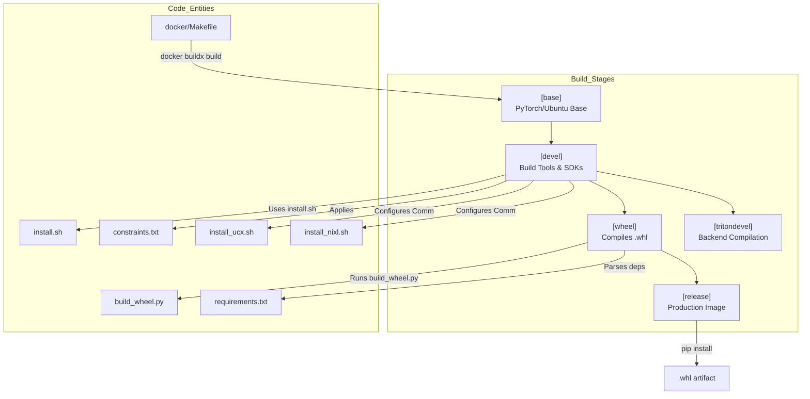
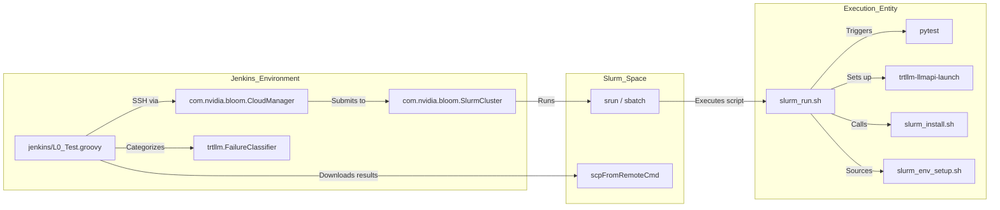

<!-- source: DeepWiki mcp.deepwiki.com · repo NVIDIA/TensorRT-LLM · page 6 CI/CD and Build Infrastructure · fetched 2026-10-26 -->

# CI/CD and Build Infrastructure

Relevant source files

The following files were used as context for generating this wiki page:

- [.coderabbit.yaml](.coderabbit.yaml)
- [.devcontainer/docker-compose.yml](.devcontainer/docker-compose.yml)
- [.github/pull_request_template.md](.github/pull_request_template.md)
- [.github/scripts/label_community_user.py](.github/scripts/label_community_user.py)
- [.github/scripts/pr_checklist_check.py](.github/scripts/pr_checklist_check.py)
- [.github/tava_architecture_diagram.md](.github/tava_architecture_diagram.md)
- [.github/workflows/auto-assign.yml](.github/workflows/auto-assign.yml)
- [.github/workflows/auto-close-inactive-issues.yml](.github/workflows/auto-close-inactive-issues.yml)
- [.github/workflows/blossom-ci.yml](.github/workflows/blossom-ci.yml)
- [.github/workflows/bot-command.yml](.github/workflows/bot-command.yml)
- [.github/workflows/full-premerge-approval.yml](.github/workflows/full-premerge-approval.yml)
- [.github/workflows/l0-test.yml](.github/workflows/l0-test.yml)
- [.github/workflows/label_community_pr.yml](.github/workflows/label_community_pr.yml)
- [.github/workflows/label_issue.yml](.github/workflows/label_issue.yml)
- [.github/workflows/module-owners.json](.github/workflows/module-owners.json)
- [.github/workflows/post-merge-approval.yml](.github/workflows/post-merge-approval.yml)
- [.github/workflows/pr-check.yml](.github/workflows/pr-check.yml)
- [ATTRIBUTIONS-Python.md](ATTRIBUTIONS-Python.md)
- [CONTAINER_SOURCE.md](CONTAINER_SOURCE.md)
- [constraints.txt](constraints.txt)
- [docker/Dockerfile.multi](docker/Dockerfile.multi)
- [docker/Makefile](docker/Makefile)
- [docker/common/install_base.sh](docker/common/install_base.sh)
- [docker/common/install_ccache.sh](docker/common/install_ccache.sh)
- [docker/common/install_ci.sh](docker/common/install_ci.sh)
- [docker/common/install_cmake.sh](docker/common/install_cmake.sh)
- [docker/common/install_etcd.sh](docker/common/install_etcd.sh)
- [docker/common/install_mpi4py.sh](docker/common/install_mpi4py.sh)
- [docker/common/install_nixl.sh](docker/common/install_nixl.sh)
- [docker/common/install_polygraphy.sh](docker/common/install_polygraphy.sh)
- [docker/common/install_triton.sh](docker/common/install_triton.sh)
- [docker/common/install_ucx.sh](docker/common/install_ucx.sh)
- [docs/source/developer-guide/ci-overview.md](docs/source/developer-guide/ci-overview.md)
- [docs/source/legacy/advanced/executor.md](docs/source/legacy/advanced/executor.md)
- [jenkins/Build.groovy](jenkins/Build.groovy)
- [jenkins/BuildDockerImage.groovy](jenkins/BuildDockerImage.groovy)
- [jenkins/L0_MergeRequest.groovy](jenkins/L0_MergeRequest.groovy)
- [jenkins/L0_Test.groovy](jenkins/L0_Test.groovy)
- [jenkins/controlCCache.groovy](jenkins/controlCCache.groovy)
- [jenkins/current_image_tags.properties](jenkins/current_image_tags.properties)
- [requirements.txt](requirements.txt)
- [scripts/dco_check.py](scripts/dco_check.py)
- [scripts/generate_container_oss_attribution.sh](scripts/generate_container_oss_attribution.sh)
- [scripts/get_wheel_from_package.py](scripts/get_wheel_from_package.py)
- [scripts/rename_docker_images.py](scripts/rename_docker_images.py)
- [scripts/test_to_stage_mapping.py](scripts/test_to_stage_mapping.py)
- [tests/integration/defs/disaggregated/test_aiperf_gate.py](tests/integration/defs/disaggregated/test_aiperf_gate.py)
- [tests/integration/defs/disaggregated/test_configs/disagg_config_ctxtp1_gentp1_qwen3_5_4b_fp8_tllm.yaml](tests/integration/defs/disaggregated/test_configs/disagg_config_ctxtp1_gentp1_qwen3_5_4b_fp8_tllm.yaml)
- [tests/integration/defs/disaggregated/test_configs/disagg_config_ctxtp2_gentp1cp2_deepseek_v3_lite_bf16_tllm_gen.yaml](tests/integration/defs/disaggregated/test_configs/disagg_config_ctxtp2_gentp1cp2_deepseek_v3_lite_bf16_tllm_gen.yaml)
- [tests/integration/defs/disaggregated/test_configs/disagg_config_ctxtp2_gentp2_gptoss_tllm.yaml](tests/integration/defs/disaggregated/test_configs/disagg_config_ctxtp2_gentp2_gptoss_tllm.yaml)
- [tests/integration/defs/disaggregated/test_configs/disagg_config_ctxtp4_gentp4_deepseek_r1_v2_fp4_tllm.yaml](tests/integration/defs/disaggregated/test_configs/disagg_config_ctxtp4_gentp4_deepseek_r1_v2_fp4_tllm.yaml)
- [tests/integration/defs/disaggregated/test_configs/disagg_config_ctxtp4_gentp4_deepseek_r1_v2_fp4_tllm_mtp.yaml](tests/integration/defs/disaggregated/test_configs/disagg_config_ctxtp4_gentp4_deepseek_r1_v2_fp4_tllm_mtp.yaml)
- [tests/integration/defs/disaggregated/test_configs/disagg_config_deepseek_v3_lite_empty_batch.yaml](tests/integration/defs/disaggregated/test_configs/disagg_config_deepseek_v3_lite_empty_batch.yaml)

This page documents the continuous integration, continuous delivery, and build infrastructure for TensorRT-LLM. The system is designed to handle complex C++/CUDA builds, multi-stage Docker image creation, and distributed GPU testing across various hardware architectures (x86_64 and aarch64/SBSA).

The infrastructure is primarily orchestrated via Jenkins pipelines that interact with Kubernetes for CPU-based build tasks and SLURM for GPU-accelerated testing, supplemented by GitHub Actions for community PR management and automated checks.

## Jenkins Pipeline Architecture
The CI/CD workflow is defined through a series of Groovy scripts that manage the lifecycle of code changes from merge requests to release-ready artifacts.

*   **L0_MergeRequest**: Handles pre-merge validation, including "Fail Fast" logic to abort early on critical failures [jenkins/L0_MergeRequest.groovy:93-95](). It manages test filtering, backend selection, and result reuse based on bot triggers [jenkins/L0_MergeRequest.groovy:176-186](). It also implements the Coverage-Based Test Selection (CBTS) pilot for specific users [jenkins/L0_MergeRequest.groovy:158-173]().
*   **L0_Test**: The primary test orchestrator that manages SLURM cluster interactions, result collection, and artifact uploads [jenkins/L0_Test.groovy:47-51](). It includes sophisticated classification for infrastructure failures via `FailureClassifier` to automate retries [jenkins/L0_Test.groovy:34-38](), [jenkins/L0_Test.groovy:150-160]().
*   **Build**: Manages the compilation of Python wheels and C++ binaries across different configurations such as `CONFIG_LINUX_X86_64_VANILLA`, `CONFIG_LINUX_X86_64_SINGLE_DEVICE`, and `CONFIG_LINUX_AARCH64` [jenkins/Build.groovy:73-103]().
*   **BuildDockerImage**: Orchestrates the creation of Docker images, pushing them to internal registries (URM) [jenkins/BuildDockerImage.groovy:23-32](). It configures Kubernetes pods for different architectures (amd64/arm64) and handles specific node affinities for stable builds [jenkins/BuildDockerImage.groovy:94-162]().

For details, see [Jenkins Pipeline Architecture](#6.1).

**Sources**: [jenkins/L0_MergeRequest.groovy:1-186](), [jenkins/L0_Test.groovy:1-160](), [jenkins/Build.groovy:1-130](), [jenkins/BuildDockerImage.groovy:1-184]()

## Docker Multi-Stage Builds
TensorRT-LLM utilizes a complex multi-stage `Dockerfile.multi` to optimize image size and build times. The `docker/Makefile` provides a standard interface for building and pushing these stages.

### Docker Build Flow
The following diagram maps the Docker stages to the scripts and configuration files used to populate them.

The `Makefile` automates the build process, detecting architectures and setting `DOCKER_BUILD_ARGS` [docker/Makefile:88-111](). It also supports local user mapping via `Dockerfile.user` to prevent permission issues in development containers [docker/Makefile:59-70](). The build process incorporates critical dependencies like `UCX`, `NIXL`, and `etcd` [docker/Dockerfile.multi:78-86](). NIXL installation specifically targets `nvda_nixl` paths and configures environment variables for communication [docker/common/install_nixl.sh:52]().

For details, see [Docker Multi-Stage Builds](#6.2).

**Sources**: [docker/Makefile:1-168](), [docker/Dockerfile.multi:1-165](), [jenkins/BuildDockerImage.groovy:173-184](), [requirements.txt:1-101](), [docker/common/install_nixl.sh:1-52]()

## Slurm Test Execution
To support multi-GPU and multi-node testing (e.g., for Tensor Parallelism or Pipeline Parallelism), the infrastructure integrates with SLURM.

### Slurm Integration Space
The diagram below illustrates the relationship between Jenkins orchestration logic and the physical execution environment in SLURM.

The CI infrastructure manages GPU types that require specific drivers, such as "open" drivers for `REQUIRED_OPEN_DRIVER_TYPES` (e.g., B100, RTX 5090) or restricted driver flashing for `REQUIRED_NO_DRIVER_TYPES` (e.g., DGX-H100, GB10x) [jenkins/L0_Test.groovy:145-148](). Jenkins uses logic to classify infrastructure failures to determine if a Slurm job should be retried, capped at `SLURM_INFRA_RETRY_MAX` (1) to avoid burning partition walltime [jenkins/L0_Test.groovy:150-160]().

For details, see [Slurm Test Execution](#6.3).

**Sources**: [jenkins/L0_Test.groovy:110-160](), [jenkins/scripts/slurm_run.sh:1-139](), [jenkins/scripts/slurm_env_setup.sh]()

## Artifact Management and Caching
Efficiency is maintained through aggressive caching of build artifacts and compiler outputs.

*   **CCache**: Shared compilation cache is stored on a Persistent Volume Claim (PVC) at `/mnt/sw-tensorrt-pvc/scratch.trt_ccache/llm_ccache` to speed up C++ builds across Jenkins jobs [jenkins/Build.groovy:130](), [jenkins/L0_Test.groovy:135]().
*   **Model Cache**: Pre-downloaded LLM weights are cached at `/scratch.trt_llm_data/llm-models` to avoid network bottlenecks during integration tests [jenkins/L0_Test.groovy:136]().
*   **URM Artifactory**: Final artifacts, including `.tar.gz` releases and Docker images, are stored in NVIDIA's internal Artifactory (URM) [jenkins/L0_Test.groovy:49](). Current tags are tracked in `current_image_tags.properties` [jenkins/current_image_tags.properties:14-20]().
*   **GitHub Blossom CI**: Community PRs are handled via a hybrid infrastructure using the `Blossom-CI` workflow, which triggers internal CI runs based on authorized user comments [.github/workflows/blossom-ci.yml:17-42]().

For details, see [Artifact Management and Caching](#6.4).

**Sources**: [jenkins/Build.groovy:130](), [jenkins/L0_Test.groovy:47-56](), [jenkins/current_image_tags.properties:1-20](), [.github/workflows/blossom-ci.yml:17-42]()

---

