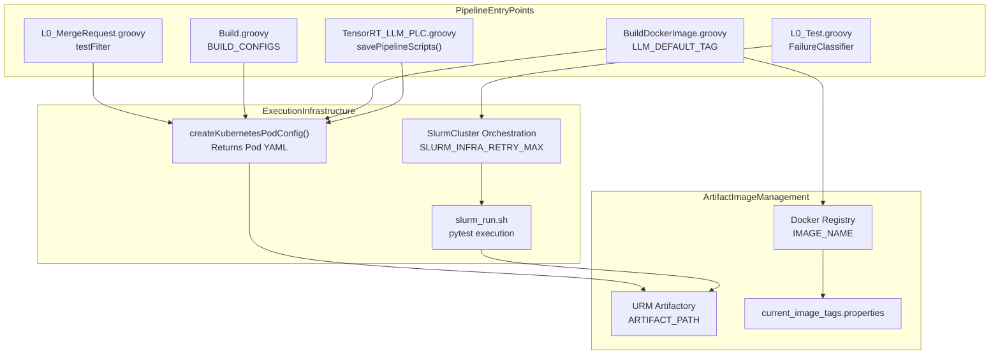
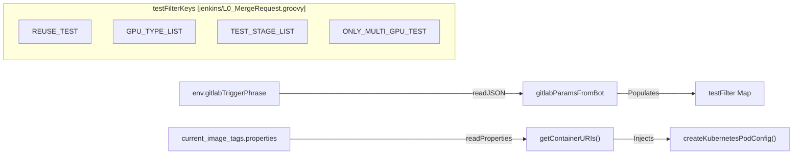

<!-- source: DeepWiki mcp.deepwiki.com · repo NVIDIA/TensorRT-LLM · page 6.1 Jenkins Pipeline Architecture · fetched 2026-10-26 -->

# Jenkins Pipeline Architecture

Relevant source files

The following files were used as context for generating this wiki page:

- [.devcontainer/docker-compose.yml](.devcontainer/docker-compose.yml)
- [ATTRIBUTIONS-Python.md](ATTRIBUTIONS-Python.md)
- [CONTAINER_SOURCE.md](CONTAINER_SOURCE.md)
- [constraints.txt](constraints.txt)
- [docker/Dockerfile.multi](docker/Dockerfile.multi)
- [docker/Makefile](docker/Makefile)
- [docker/common/install_base.sh](docker/common/install_base.sh)
- [docker/common/install_ccache.sh](docker/common/install_ccache.sh)
- [docker/common/install_ci.sh](docker/common/install_ci.sh)
- [docker/common/install_cmake.sh](docker/common/install_cmake.sh)
- [docker/common/install_etcd.sh](docker/common/install_etcd.sh)
- [docker/common/install_mpi4py.sh](docker/common/install_mpi4py.sh)
- [docker/common/install_nixl.sh](docker/common/install_nixl.sh)
- [docker/common/install_polygraphy.sh](docker/common/install_polygraphy.sh)
- [docker/common/install_triton.sh](docker/common/install_triton.sh)
- [docker/common/install_ucx.sh](docker/common/install_ucx.sh)
- [jenkins/Build.groovy](jenkins/Build.groovy)
- [jenkins/BuildDockerImage.groovy](jenkins/BuildDockerImage.groovy)
- [jenkins/L0_MergeRequest.groovy](jenkins/L0_MergeRequest.groovy)
- [jenkins/L0_Test.groovy](jenkins/L0_Test.groovy)
- [jenkins/TensorRT_LLM_PLC.groovy](jenkins/TensorRT_LLM_PLC.groovy)
- [jenkins/controlCCache.groovy](jenkins/controlCCache.groovy)
- [jenkins/current_image_tags.properties](jenkins/current_image_tags.properties)
- [jenkins/scripts/get_image_key_to_tag.py](jenkins/scripts/get_image_key_to_tag.py)
- [jenkins/scripts/pulse_in_pipeline_scanning/main.py](jenkins/scripts/pulse_in_pipeline_scanning/main.py)
- [jenkins/scripts/pulse_in_pipeline_scanning/submit_preapproved_candidates.py](jenkins/scripts/pulse_in_pipeline_scanning/submit_preapproved_candidates.py)
- [jenkins/scripts/pulse_in_pipeline_scanning/submit_report.py](jenkins/scripts/pulse_in_pipeline_scanning/submit_report.py)
- [jenkins/scripts/pulse_in_pipeline_scanning/utils/common.py](jenkins/scripts/pulse_in_pipeline_scanning/utils/common.py)
- [jenkins/scripts/pulse_in_pipeline_scanning/utils/es.py](jenkins/scripts/pulse_in_pipeline_scanning/utils/es.py)
- [jenkins/scripts/pulse_in_pipeline_scanning/utils/report.py](jenkins/scripts/pulse_in_pipeline_scanning/utils/report.py)
- [jenkins/scripts/pulse_in_pipeline_scanning/utils/slack.py](jenkins/scripts/pulse_in_pipeline_scanning/utils/slack.py)
- [jenkins/scripts/pulse_in_pipeline_scanning/utils/triage.py](jenkins/scripts/pulse_in_pipeline_scanning/utils/triage.py)
- [requirements.txt](requirements.txt)
- [scripts/generate_container_oss_attribution.sh](scripts/generate_container_oss_attribution.sh)
- [scripts/generate_lock_file.py](scripts/generate_lock_file.py)
- [scripts/get_wheel_from_package.py](scripts/get_wheel_from_package.py)
- [scripts/rename_docker_images.py](scripts/rename_docker_images.py)
- [tests/unittest/scripts/test_pulse_triage.py](tests/unittest/scripts/test_pulse_triage.py)

## Overview

The Jenkins CI/CD infrastructure for TensorRT-LLM consists of several primary orchestration layers: pre-merge validation via `L0_MergeRequest.groovy`, comprehensive testing via `L0_Test.groovy`, artifact generation via `Build.groovy`, and container image builds via `BuildDockerImage.groovy`. These pipelines execute workloads on Kubernetes CPU pods for compilation and Slurm GPU clusters for testing, coordinating via Artifactory for artifact storage.

**Architecture Components:**
- **Kubernetes Execution**: CPU-based builds using `createKubernetesPodConfig()` [jenkins/Build.groovy:133-192](), [jenkins/BuildDockerImage.groovy:94-172](), and `trtllm_utils.launchKubernetesPod()`.
- **Slurm GPU Testing**: Multi-GPU test execution managed via `L0_Test.groovy`, including infrastructure failure detection and retries for transient Slurm issues [jenkins/L0_Test.groovy:150-160]().
- **Artifact Management**: Upload/download to URM Artifactory using `ARTIFACT_PATH` and `UPLOAD_PATH` configurations [jenkins/Build.groovy:27-28]().
- **Result Aggregation**: Handling of test results and performance metrics, including logic for retryable infrastructure failures via `FailureClassifier` [jenkins/L0_Test.groovy:34-39]().

**Sources:** [jenkins/L0_MergeRequest.groovy:1-31](), [jenkins/L0_Test.groovy:1-39](), [jenkins/Build.groovy:1-17](), [jenkins/BuildDockerImage.groovy:1-21]()

## Pipeline Files Overview

### Diagram: Pipeline Orchestration Flow

**Sources:** [jenkins/L0_MergeRequest.groovy:176-190](), [jenkins/L0_Test.groovy:150-170](), [jenkins/Build.groovy:73-103](), [jenkins/BuildDockerImage.groovy:94-172](), [jenkins/TensorRT_LLM_PLC.groovy:19-91](), [jenkins/current_image_tags.properties:1-20]()

### Core Pipeline Files

| File | Purpose | Key Functions/Fields |
|------|---------|---------------|
| `L0_MergeRequest.groovy` | Pre-merge validation gate | `testFilter`, `getContainerURIs()`, `createKubernetesPodConfig()` |
| `L0_Test.groovy` | Comprehensive testing on GPU clusters | `FailureClassifier`, `BUILD_CONFIGS`, `SLURM_INFRA_RETRY_MAX` |
| `Build.groovy` | Wheel and tarball generation | `BUILD_CONFIGS`, `createKubernetesPodConfig()` |
| `BuildDockerImage.groovy` | Multi-stage Docker image builds | `createKubernetesPodConfig()`, `LLM_DEFAULT_TAG` |
| `TensorRT_LLM_PLC.groovy` | Security scanning and lockfile generation | `savePipelineScripts()`, `getPulseToken()` |
| `controlCCache.groovy` | Maintenance of the ccache volume | `NuclearClean`, `Reset`, `Stats` |

**Sources:** [jenkins/L0_MergeRequest.groovy:176-190](), [jenkins/L0_Test.groovy:109-115](), [jenkins/Build.groovy:73-103](), [jenkins/BuildDockerImage.groovy:45-46](), [jenkins/TensorRT_LLM_PLC.groovy:19-91](), [jenkins/controlCCache.groovy:1-10]()

## L0_MergeRequest Pipeline

The `L0_MergeRequest.groovy` pipeline validates merge requests. It determines the necessary test scope by parsing bot triggers and reading image tags from properties files.

### Diagram: Merge Request Logic Space

**Sources:** [jenkins/L0_MergeRequest.groovy:32-37](), [jenkins/L0_MergeRequest.groovy:64-81](), [jenkins/L0_MergeRequest.groovy:176-190]()

### Key Components

#### Pipeline Parameters and Filtering
The pipeline accepts JSON parameters via `env.gitlabTriggerPhrase` [jenkins/L0_MergeRequest.groovy:33-36](). These populate the `testFilter` map to control execution:
- `TEST_STAGE_LIST`: Filters specific stages like `accuracy_test` or `perf_test` [jenkins/L0_MergeRequest.groovy:180]().
- `GPU_TYPE_LIST`: Restricts execution to specific hardware (e.g., `h100`, `a100`) [jenkins/L0_MergeRequest.groovy:181]().
- `isReleaseCheckMode`: Triggered when `runMode` is set to `release_check` [jenkins/L0_MergeRequest.groovy:97]().

**Sources:** [jenkins/L0_MergeRequest.groovy:32-190]()

## L0_Test and Build Configurations

`L0_Test.groovy` and `Build.groovy` define the build matrix and hardware-specific requirements for the project.

### Build Matrix (BUILD_CONFIGS)
The `BUILD_CONFIGS` map defines how different flavors of TensorRT-LLM are compiled [jenkins/Build.groovy:73-103]():
- `CONFIG_LINUX_X86_64_VANILLA`: Standard build with `ENABLE_MULTI_DEVICE=1`, `NIXL`, and `Mooncake` support [jenkins/Build.groovy:76-80]().
- `CONFIG_LINUX_AARCH64`: Specialized for Grace Hopper (GH200) with `WHEEL_ARCHS` set to `90-real;100-real;103-real;120-real` [jenkins/Build.groovy:91-96]().
- `CONFIG_LINUX_X86_64_LLVM`: Build using Clang/LLVM toolchain [jenkins/Build.groovy:86-90]().

**Sources:** [jenkins/Build.groovy:73-103]()

### Infrastructure Resilience
`L0_Test.groovy` implements logic to handle transient issues during Slurm job execution. It utilizes a `FailureClassifier` to categorize exceptions into `InfraFailure`, `UserFailure`, or `PipelineInterruption` [jenkins/L0_Test.groovy:34-39](). Jobs matching infrastructure failure patterns are retried up to `SLURM_INFRA_RETRY_MAX` times [jenkins/L0_Test.groovy:160](). K8s-specific failures are independently tracked with a retry limit of `K8S_INFRA_RETRY_MAX` [jenkins/L0_Test.groovy:170]().

**Sources:** [jenkins/L0_Test.groovy:144-171]()

## BuildDockerImage and Docker Infrastructure

`BuildDockerImage.groovy` orchestrates the creation of container images using `docker/Dockerfile.multi` and `docker/Makefile`.

### Multi-Stage Build Orchestration
The pipeline builds several stages defined in the Dockerfile:
- `base`: Initial environment based on `nvcr.io/nvidia/pytorch` [docker/Dockerfile.multi:22-32]().
- `devel`: Includes build tools, TRT, CUDA, and dependencies like UCX/NIXL [docker/Dockerfile.multi:42-92]().
- `wheel`: Executes `scripts/build_wheel.py` to produce the Python package [docker/Dockerfile.multi:121-141]().
- `release`: Final lightweight image containing the installed wheel, examples, and benchmarks [docker/Dockerfile.multi:142-162]().

**Sources:** [jenkins/BuildDockerImage.groovy:94-172](), [docker/Dockerfile.multi:1-162]()

### Makefile Integration
The `docker/Makefile` provides targets like `%_build` and `%_push` that encapsulate `docker buildx` commands [docker/Makefile:81-111](). It dynamically extracts base images and tags from the Dockerfile using `grep` [docker/Makefile:2-5](). It also supports `LOCAL_USER` mapping for development environments [docker/Makefile:23-27]().

**Sources:** [docker/Makefile:2-5](), [docker/Makefile:81-126]()

## Dependency and Security Management

### Automated Security and Compliance
The `TensorRT_LLM_PLC.groovy` pipeline automates the maintenance of security-related metadata:
- **savePipelineScripts()**: Captures the pipeline's scan scripts and lock file generators before workspace checkout [jenkins/TensorRT_LLM_PLC.groovy:146-154]().
- **Pulse Integration**: Retrieves authentication tokens for internal security scanning services via `getPulseToken()` [jenkins/TensorRT_LLM_PLC.groovy:165-183]().
- **Container Scanning**: Utilizes the `pulse-container-scanner` and `pulse-oss-scanner` containers within a Kubernetes pod to perform compliance checks [jenkins/TensorRT_LLM_PLC.groovy:53-86]().

**Sources:** [jenkins/TensorRT_LLM_PLC.groovy:19-183](), [requirements.txt:1-105]()

---

